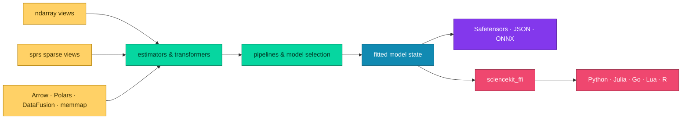

# sciencekit

[](https://github.com/neurono-ml/sciencekit/actions/workflows/ci.yml?query=branch%3Amain)
[](https://crates.io/crates/sciencekit)
[](https://docs.rs/sciencekit)
[](rust-toolchain.toml)
[](LICENSE)
[](https://neurono-ml.github.io/sciencekit/)

**All of scikit-learn, natively in Rust.** sciencekit reimplements the
scikit-learn API surface from scratch in a 22-crate workspace: every estimator
is built through an immutable builder, consumes zero-copy `ndarray`/`sprs` views
with dense and sparse representation parity, and can fit datasets larger than
RAM through streaming and memory-mapped sources. Fitted models are plain,
auditable state that travels through Safetensors, JSON and ONNX — no pickle,
no interpreter, no GIL.



## Capabilities

Names below are the public types that ship in `crates/` today.

| Category | Estimators and utilities |
| --- | --- |
| **Preprocessing** | `SKStandardScaler`, `SKMinMaxScaler`, `SKRobustScaler`, `SKOneHotEncoder`, `SKPolynomialFeatures`, `SKSimpleImputer`, `SKMissingIndicator`, `SKKNNImputer` |
| **Linear models** | `SKLinearRegression`, `SKRidge`, `SKLasso`, `SKElasticNet`, `SKLogisticRegression`, `SKSGDClassifier`, `SKSGDRegressor` |
| **Neighbors** | `SKKNeighborsClassifier`, `SKKNeighborsRegressor`, `SKKDTree`, `SKBallTree`, `SKBruteForceSearcher` |
| **SVM** | `SKSVC`, `SKSVR`, `SKLinearSVC`; linear, polynomial, RBF, sigmoid and precomputed kernels |
| **Trees & ensembles** | `SKDecisionTreeClassifier`, `SKDecisionTreeRegressor`, `SKRandomForestClassifier`, `SKRandomForestRegressor`, `SKBaggingClassifier`, `SKBaggingRegressor`, `SKGradientBoostingClassifier`, `SKGradientBoostingRegressor`, `SKHistGradientBoostingClassifier`, `SKHistGradientBoostingRegressor` |
| **Clustering** | `SKKMeans` (Lloyd and Elkan), `SKMiniBatchKMeans`, `SKDBSCAN` |
| **Decomposition** | `SKPCA`, `SKTruncatedSVD`, `SKIncrementalPCA` |
| **Outlier detection** | `SKIsolationForest` |
| **Model selection** | `SKTrainTestSplit`, `SKKFold`, `SKStratifiedKFold`, `SKGroupKFold`, `SKGridSearchCVClassifier`, `SKGridSearchCVRegressor`, `SKHalvingGridSearchClassifier`, `SKHalvingGridSearchRegressor` |
| **Pipelines** | `SKPipelineClassifier`, `SKPipelineRegressor`, `SKFeatureUnion`, `SKPipelineGraph` (runtime DAG), `SKStreamingPipeline` |
| **Metrics** | Classification (accuracy, balanced accuracy, precision, recall, F1, ROC AUC, log loss, MCC, confusion matrix), regression (MSE, RMSE, MAE, R-squared), ranking (ROC AUC, average precision) and clustering (silhouette) scorers |
| **Interop & persistence** | `SKArrowRecordBatchSource`, `SKPolarsLazySource`, `SKDataFusionStreamSource`, memory-mapped raw/NumPy/Arrow IPC sources, Safetensors model state, JSON debug format, `SKToOnnx` export |
| **Accelerators** | `SKExecutionMode` dispatch, SIMD and pure-Rust `faer` kernels plus the `blas-backend` feature, `SKComputeBackend` contracts with an OpenCL 3.0 backend, jemalloc/mimalloc allocator features, OpenTelemetry export |

## Example

```rust,no_run
use ndarray::array;
use sciencekit_common::{
    SKBuilder, SKFeatureTransformer, SKRegressorPredictor, SKSupervisedFit, SKUnsupervisedFit,
};
use sciencekit_linear_model::linear_regression::core_implementation::SKLinearRegression;
use sciencekit_preprocessing::standard_scaler::core_implementation::SKStandardScaler;

fn main() -> Result<(), Box<dyn std::error::Error>> {
    let features = array![[1.0_f64, 2.0], [2.0, 1.0], [3.0, 4.0], [4.0, 3.0]];
    let targets = array![3.0_f64, 4.0, 9.0, 10.0];

    let scaler = SKStandardScaler::build()
        .with_mean(true)
        .with_std(true)
        .build()?;
    let scaler_model = scaler.fit(features.view())?;
    let normalized = scaler_model.transform(features.view())?;

    let regressor = SKLinearRegression::build()
        .include_intercept(true)
        .build()?;
    let model = regressor.fit(normalized.view(), targets.view())?;
    let predictions = model.predict(normalized.view())?;

    println!("coefficients = {:?}", model.coefficients().to_vec());
    println!("intercept = {}", model.intercept());
    println!("predictions = {:?}", predictions.to_vec());
    Ok(())
}
```

Builders are the only construction surface, `execution_mode(...)` defaults to
`SKExecutionMode::Automatic`, and `fit` returns a distinct model type that owns
the learned state.

## Installation

The umbrella `sciencekit` crate is still being assembled (PRD §12 Phase 7), so
add the sub-crate that provides what you need:

```sh
cargo add sciencekit_preprocessing sciencekit_linear_model
cargo add sciencekit_interop --features arrow,polars,datafusion,memmap
cargo add sciencekit_gpu --features opencl
cargo add sciencekit_telemetry --features telemetry
```

Requires Rust 1.85 (edition 2024), pinned by `rust-toolchain.toml`. The default
build is pure Rust; no system BLAS or GPU runtime is needed.

## Bindings

The C ABI in `sciencekit_ffi` powers five separate binding repositories:

- [sciencekit-py](https://github.com/neurono-ml/sciencekit-py) — Python
- [sciencekit-jl](https://github.com/neurono-ml/sciencekit-jl) — Julia
- [sciencekit-go](https://github.com/neurono-ml/sciencekit-go) — Go
- [sciencekit-lua](https://github.com/neurono-ml/sciencekit-lua) — Lua
- [sciencekit-r](https://github.com/neurono-ml/sciencekit-r) — R

## Documentation

The mdBook at <https://neurono-ml.github.io/sciencekit/> covers the architecture,
the algorithm catalog, worked examples and a description of every public
function. It is built from `docs/src/` and published on every push to the
`docs/documentations` branch.

Release notes live in [CHANGELOG.md](CHANGELOG.md); the product source of truth
is [docs/PRD.md](docs/PRD.md) and the contribution workflow is in
[AGENTS.md](AGENTS.md).

## License

Apache-2.0 — see [LICENSE](LICENSE).
