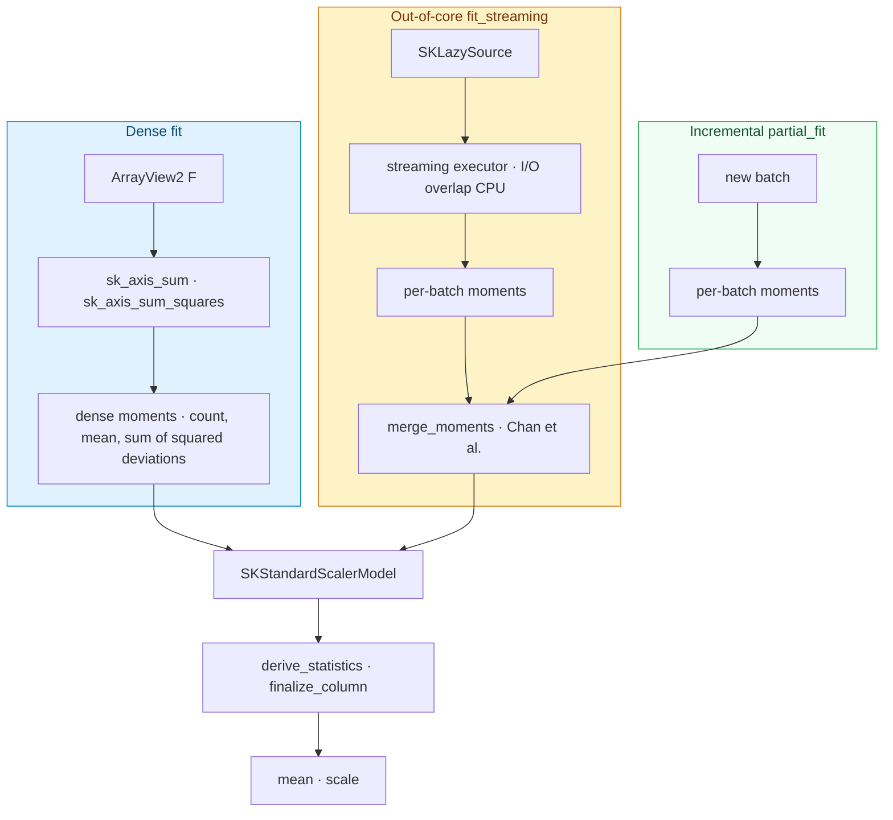

# The first algorithm: `SKStandardScaler`

Phase 0 built the *vocabulary* of sciencekit — the traits, the execution planner, the
kernels, the streaming executor — but nothing that a user would actually call to train a
model. This chapter is about the first such thing: `SKStandardScaler`, the estimator that
rescales every column of a dataset to have mean zero and standard deviation one. It is a
deliberately simple algorithm, and that is exactly why it goes first: it is the template
that every later estimator — linear models, trees, clusters — will copy, so any flaw in the
template would be copied a dozen times. Along the way we meet the first real use of the
builder pattern, of the backend selection, of the streaming executor, and of a brand-new
kernel that computes the sum of squares.

---

## 1. The problem we were solving

Picture two columns of a dataset. One is a person's age, ranging from 18 to 90. The other is
their income in dollars, ranging from 0 to 500 000. Almost every machine-learning algorithm
compares columns by *distance*: a difference of 10 in age is a 10, and a difference of 10 in
income is also a 10 — but the first is a meaningful gap and the second is noise. The columns
are on wildly different scales, so the algorithm silently decides that income matters 5 000
times more than age. **Standardization** fixes this: for each column, subtract its mean and
divide by its standard deviation, so every column ends up with mean 0 and spread 1 and no
column can shout over the others.

The arithmetic is easy; the *engineering* is the point. sciencekit promises three ways to
fit the same model, and all three must agree:

- **Dense** — the whole dataset sits in memory; one pass, done.
- **Incremental** — the data arrives in batches and the model keeps learning with
  `partial_fit`, never re-reading the past.
- **Out-of-core** — the data is a stream from disk, larger than memory; the model consumes
  it batch by batch, overlapping the disk read with the computation.

If those three paths disagree — even by a rounding error that compounds — the library is
lying to the user. And there was no algorithm crate at all yet: no `sciencekit_preprocessing`,
no estimator/model split, no place where the builder pattern, the backend parameter and the
execution plan all came together. This change had to invent that shape.

---

## 2. The decisions — and the roads not taken

| Decision | Why we chose it | Alternatives we discarded |
|---|---|---|
| **Estimator and model are different types** | `SKStandardScaler` is *configuration* (what the user asked for); `SKStandardScalerModel<F>` is *learned state* (what the data produced). `fit` turns one into the other. This matches scikit-learn's `fit → fitted estimator`, gives one obvious thing to export/serialize, and makes "not yet fitted" impossible to represent. | One mutable estimator with an internal "fitted?" flag — then "not fitted" is a runtime state you must check everywhere, and the export boundary is ambiguous. |
| **Running moments are the single source of truth** | The model stores `sample_count`, the per-column mean and the sum of squared deviations. The public `mean`/`scale` arrays are *derived* from them on every update. Dense, streaming and incremental fits all reduce to the same three quantities, so they converge by construction. | Storing `mean`/`scale` directly and accumulating them — the incremental merge would have to un-apply the `with_mean`/`with_std` masking to recover the raw moments, and zero-variance handling would drift between regimes. |
| **One exact merge formula in every regime** | Dense fit computes column sums and sums of squares, then derives the deviations with $\sum(x-\mu)^2 = \sum x^2 - 2\mu\sum x + n\mu^2$. Streaming and `partial_fit` compute the *same* per-batch moments and merge them with the Chan–Golub–LeVeque update. Because the merge is exact up to rounding and independent of batch order, all regimes agree. | A two-pass dense fit (mean first, then a second pass for variance) — it would diverge from the streaming formula and read the data twice. |
| **Out-of-core is a transport choice, not a different model** | `fit_streaming` resolves the plan against an *unbounded* context so `Automatic` picks the streaming branch; an explicit in-memory intent collects the batches and reuses the dense path. Both branches build the *same* `SKStandardScalerModel`. | A separate streaming model type — two implementations of `transform` that can drift, and no single export boundary. |
| **`Σx²` is a first-class kernel** | Variance needs the sum of squares. Rather than square inside the algorithm (a fresh allocation per fit), `sk_axis_sum_squares` mirrors `sk_axis_sum` exactly: same axes, same parallelism contract, same grain. Kernels stay the reusable substrate. | A one-off loop inside the scaler — duplicated across every variance-based algorithm (PCA, incremental PCA, robust scalers). |
| **The backend is carried, never dispatched, here** | The scaler's math is reductions only, so it never needs a concrete backend. But per the `backend-selection` spec it still exposes `backend(SKBackendKind)` and records the kind in every span, so the selection surface is uniform and a future GPU scaler is a dispatch change with no signature change. | Omitting the parameter because "scalers don't use BLAS" — the selection surface would then differ per estimator, and users would learn a different API for each. |

---

## 3. The concepts, taught from zero

### The math: mean, standard deviation, and the z-score

For one column with values $x_1, \dots, x_n$, the **mean** is the average,

$$\mu = \frac{1}{n}\sum_{i=1}^{n} x_i,$$

and the **variance** measures how far the values spread around that mean,

$$\sigma^2 = \frac{1}{n}\sum_{i=1}^{n} (x_i - \mu)^2.$$

Its square root, $\sigma$, is the **standard deviation** — same units as the data. The
**standardized** value (the *z-score*) of each entry is then

$$z_i = \frac{x_i - \mu}{\sigma}.$$

After this, the column has mean 0 and standard deviation 1. Two flags control it: `with_mean`
turns the subtraction off (mean 0), and `with_std` turns the division off (scale 1).

Computing $\sigma^2$ by first computing $\mu$ and then looping again to subtract it would read
the data twice — impossible for a stream. Instead we use the algebraic identity

$$\sum_{i=1}^{n} (x_i - \mu)^2 = \sum_{i=1}^{n} x_i^2 \;-\; 2\mu\sum_{i=1}^{n} x_i \;+\; n\mu^2,$$

so one pass collecting $\sum x$ and $\sum x^2$ is enough. That identity is exactly what
`moments_from_sums` implements.

### The math, part 2: merging two batches without losing accuracy

When a second batch arrives, we already know the mean and spread of the first; we want the
mean and spread of both together. The naive way — recombining raw sums — loses precision on
large numbers. The **Chan–Golub–LeVeque** update merges two moment summaries directly. If the
running state has count $n_a$, mean $\mu_a$ and sum of squared deviations $M_a$, and a batch
has $n_b, \mu_b, M_b$, then the combined summary is

$$n = n_a + n_b,\qquad
\mu = \mu_a + \delta\,\frac{n_b}{n},\qquad
M = M_a + M_b + \delta^2\,\frac{n_a\,n_b}{n},
\qquad \delta = \mu_b - \mu_a.$$

This is exact up to floating-point rounding and, crucially, gives the same answer no matter
how the data is split into batches — which is why `streaming_matches_dense_fit` and
`partial_fit_after_fit_matches_dense` can assert equality.

### Rust concept 1: generics and `SKFloat`

A **generic** function or type is written once and works for many types, with the type left
as a placeholder. Here the placeholder is the scalar: the scaler works for `f32` (32-bit
floats, half the memory) and `f64` (64-bit, more precision). We write `impl<F: SKFloat> ...`
and the compiler checks that `F` has the operations we use — `+`, `*`, `sqrt`, `from`. `SKFloat`
is sciencekit's *sealed* bound: a small trait the library controls, so "any float" means
"f32 or f64", not "any type a user invents". A test, `fit_accepts_either_float`, instantiates
the same code for both.

### Rust concept 2: the builder pattern

A **builder** is an object whose methods each set one option and return the builder again, so
calls chain:

```rust
let scaler = SKStandardScaler::build()
    .with_mean(false)
    .backend(SKBackendKind::MatrixMultiply)
    .build()?;
```

The estimator's own constructor is private, so the *only* way to make one is through the
builder. That gives every option an explicit default (`with_mean` and `with_std` true,
`backend` `Faer`, `execution_mode` `Automatic`) and makes it impossible to forget one. The
`build()` method returns a `Result`, because building may validate and fail.

### Rust concept 3: `ndarray`, `Array1`/`Array2` and `azip!`

`ndarray` is the array library. `Array2<F>` is a two-dimensional grid (rows × columns);
`Array1<F>` is a vector. The idiom for "visit every element and combine two arrays" is the
macro `azip!`:

```rust
ndarray::azip!((value in &mut row, mean in &self.mean, scale in &self.scale) {
    *value = (*value - *mean) / *scale;
});
```

Inside, `value`, `mean` and `scale` are references to the corresponding elements; the macro
walks all positions once. The project forbids hand-written index loops — `output[i] = ...` —
because the macro is shorter, safer and lets the compiler see the access pattern.

### Concept: `SKLazySource`, the streaming batch source

Out-of-core data is modelled as an `SKLazySource<F>`: a cursor that hands out one owned
`SKDataBatch` at a time via `next_batch() -> Result<Option<...>>`. `None` means "no more
data". The scaler never loops over the source itself; it hands it to the Phase 0 streaming
executor (chapter 7), which prefetches the next batch on a separate thread while the current
one is processed.

---

## 4. Each object, explained

### `SKStandardScaler` — the estimator

*What it is* — the immutable configuration produced by the builder: the two flags, the backend
kind, and the execution intent. Its only constructor is `SKStandardScaler::build()`.

*Why it exists* — to separate *what the user asked for* from *what the data taught the model*.
It implements `SKUnsupervisedFit<F>`: `fit` reads the dense data, learns the moments, and
returns a model.

*What we rejected* — a single mutable type holding both; see Decision 1.

### `SKStandardScalerBuilder` — the builder

*What it is* — the chainable configuration object: `with_mean`, `with_std`, `backend`,
`execution_mode`, then `build()`.

*Why it exists* — it is the mandated construction surface (every builder exposes
`execution_mode`, and every estimator builder exposes `backend`), and it is where the defaults
live. `build()` constructs the estimator directly, without touching the data or resolving any
plan — dispatch and resolution are per-operation, not per-build.

### `SKStandardScalerModel<F>` — the fitted model

*What it is* — the learned state: `sample_count`, the running `moments_mean` and
`sum_squared_deviations`, the derived public `mean` and `scale`, the two flags, the carried
`backend`, and the execution intent. It implements `SKFeatureTransformer<F>` (`transform`) and
carries the incremental `partial_fit`.

*Why it exists* — it is the export boundary (the thing you serialize) and the only object that
knows the statistics. Because it stores *moments* rather than the masked mean/scale, the
incremental update is exact.

### `sk_axis_sum_squares` — the kernel

*What it is* — a free function in `sciencekit_math`: given a 2-D array, an axis (0 = per
column, 1 = per row) and a `parallelism`, it returns the per-column (or per-row) sum of
squares. `parallelism = 1` runs a simple sequential loop; `> 1` splits the rows into chunks,
each chunk accumulating its *own* partial vector, and combines the partials once at the end.

*Why it exists* — variance is a sum of squares; making it a kernel keeps every
variance-based algorithm from reimplementing (and re-optimizing) it. The race-free
per-chunk accumulation is the same pattern chapter 7 established for `sk_axis_sum`.

*What we rejected* — squaring inside the algorithm; see Decision 5.

### `StreamingMoments<F>` and `merge_moments` — the streaming state

*What it is* — the combinable per-column Welford state (`count`, `mean`,
`sum_squared_deviations`) plus the machine facts (`available_memory_bytes`, `cpu_cores`) used
to size parallelism. `merge_moments` is the Chan update above.

*Why it exists* — it is the piece the streaming driver mutates, batch by batch, and the same
function the model's `partial_fit` uses, so streaming and incremental cannot diverge.

### `derive_statistics` and `finalize_column` — the masking rule

*What it is* — a pure function turning moments into the public masked `mean`/`scale`: a
disabled mean becomes 0, a disabled or non-positive scale becomes 1.

*Why it exists* — masking is decided in exactly one place, so dense, streaming and incremental
outputs cannot disagree on an edge column (like a constant column, whose scale must be 1, not
`NaN`).

### The `backend-selection` capability

*What it is* — a published spec (and a rule in `AGENTS.md`) stating that every estimator
builder exposes `backend(SKBackendKind)` defaulting to `Faer`, that every operation records the
configured kind in its span (never a hardcoded value), and that `fit` transfers the kind into
the model.

*Why it exists* — one uniform selection surface. Even the scaler, whose math never touches
heavy linear algebra, carries it, so that when a GPU or BLAS backend arrives it appears as a
new enum variant with no estimator signature changes.

---

## 5. A real walk-through, using the tests

The tests are the executable truth. They live in companion `*_tests.rs` files beside the
implementation, and share deterministic datasets from `test_datasets.rs` (no randomness, no
files on disk — the same numbers on every machine).

**Dense fit and transform.** `fit_learns_per_column_mean_and_scale` fits
`[[1, 2], [3, 4]]` and asserts the model reports mean `[2, 3]` and scale `[1, 1]`;
`transform_produces_z_scores` then asserts the transformed matrix is `[[-1, -1], [1, 1]]`.
These two tests are the whole contract in miniature.

**The flags.** `without_mean_keeps_values_uncentered` builds with `with_mean(false)` and checks
the mean is zero and the values pass through unchanged; `without_std_centers_without_scaling`
builds with `with_std(false)` and checks the values are centered but not divided. The
`finalize_column` helper is what makes both true.

**The zero-variance edge.** `constant_column_yields_unit_scale_and_zero_output` fits a matrix
whose first column is constant (`5, 5`). Its variance is zero, so dividing by its standard
deviation would produce `NaN`. The test asserts the scale is `1` and the transformed column is
`0` — exactly the `finalize_column` rule.

**Errors.** `fit_rejects_empty_input` expects a `ShapeMismatch` before any element is touched;
`fit_rejects_sparse_input` expects `UnsupportedRepresentation` at the dense-only boundary;
`transform_rejects_column_count_mismatch` expects a `ShapeMismatch` when transforming data with
a different number of columns.

**Backend.** `backend_defaults_to_faer` checks the estimator and its model both report `Faer`;
`backend_override_reaches_model` builds with `MatrixMultiply` and checks the kind reaches the
estimator, the fitted model, and still produces the correct z-scores.

**Streaming equals dense.** `streaming_matches_dense_fit` chunks the small matrix into uneven
batches `[2, 1, 3]`, streams them through `fit_streaming`, and asserts the streamed model's
mean and scale equal the dense fit's (and that transforming produces identical output). The
large-scale companion, `large_streaming_matches_dense_fit`, does the same on a
`100 000 × 8` matrix split `[40 000, 17 500, 42 500]`, comparing within a relative tolerance
of `1e-9` because the Chan merge reorders floating-point operations.

**Incremental equals dense.** `partial_fit_after_fit_matches_dense` fits a prefix and
`partial_fit`s the rest; `partial_fit_accumulates_single_rows` does it one row at a time;
`partial_fit_chains_updates` exercises the `&mut Self` return so calls chain. All three assert
equality with the dense fit. `partial_fit_empty_batch_is_noop` checks an empty batch changes
nothing, and `partial_fit_column_mismatch_errors` checks a wrong-width batch fails without
touching the model.

---

## 6. Look inside

Three ways in, one model out. Dense data is reduced in memory; a stream is accumulated batch
by batch through the executor; a `partial_fit` merges one more batch into a live model. Every
path ends at the same `SKStandardScalerModel`, whose moments are the single source of truth.



The insight is that **the model is a summary, not the data**. Because the summary is
combinable (the Chan merge), "fit everything at once", "fit in batches" and "fit a bit more
later" are the same operation at different granularities — and the tests prove they land on
the same numbers.

---

## 7. Recap

- **Standardization** rescales each column to mean 0 and standard deviation 1, so no column
  dominates a distance-based algorithm.
- **`SKStandardScaler` is configuration; `SKStandardScalerModel` is learned state.** `fit`
  turns one into the other; the model is the export boundary.
- **Running moments are the single source of truth.** `mean`/`scale` are derived, never
  accumulated, so the three regimes cannot drift.
- **The Chan–Golub–LeVeque merge makes batches commute.** Dense, streaming and `partial_fit`
  produce the same result within float tolerance.
- **Out-of-core is a transport choice.** `fit_streaming` resolves an unbounded plan and reuses
  the same model; an in-memory intent just collects the batches.
- **The backend is carried, not dispatched, by the scaler** — uniform selection surface, per
  the `backend-selection` spec.
- **`sk_axis_sum_squares` is a reusable kernel**, the variance-style companion of
  `sk_axis_sum`, with the same race-free parallelism contract.

*Next chapter:* with the estimator template proven on the simplest algorithm, the next Wave 1
change reuses it for the min-max and robust scalers — where the robust scaler adds an online
quantile sketch (`tdigest`) so that even its median can be learned from a stream.
