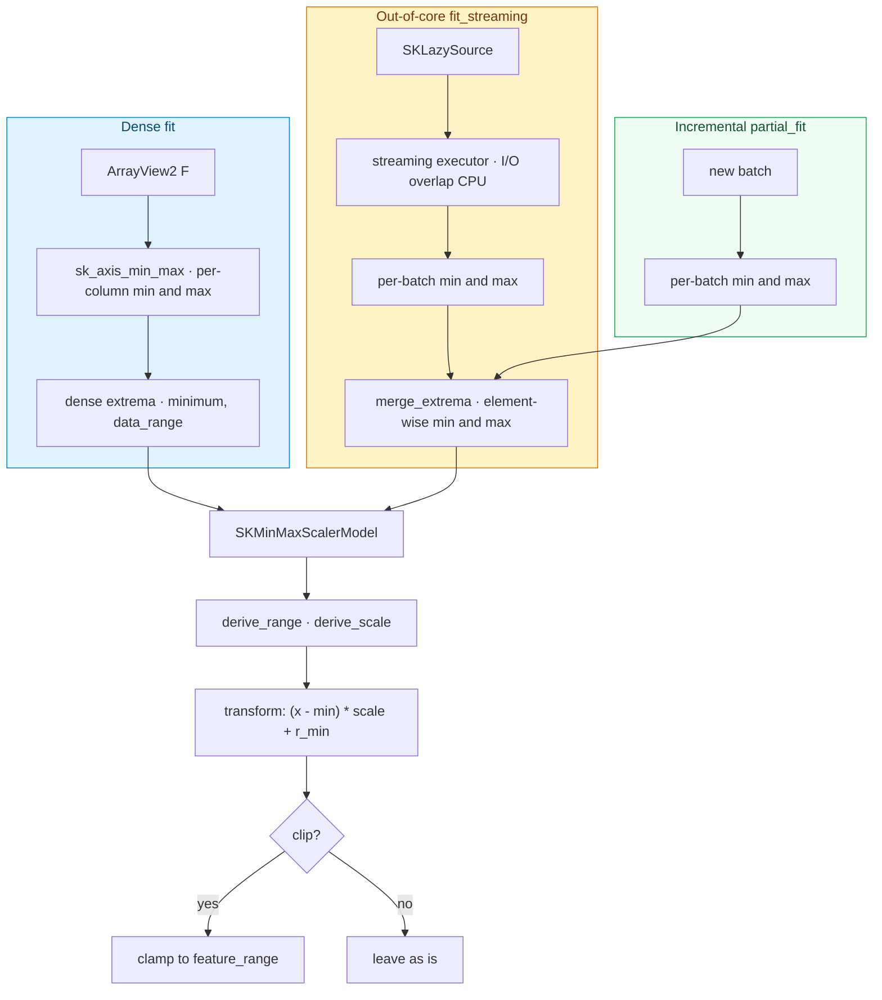

# The second scaler: `SKMinMaxScaler`

The [previous chapter](./ch08-standard-scaler.html) built the estimator template on the
simplest possible algorithm — standardization — and proved that three fit regimes (dense,
incremental, out-of-core) can agree exactly. This chapter spends that template on a second,
slightly different scaler: **`SKMinMaxScaler`**, which squeezes every column into a *bounded*
range instead of a *zero-mean, unit-variance* one. The shift is small in code and large in
consequences: the statistics are extrema rather than moments, the learned summary is a
minimum and a range rather than a mean and a deviation, and the natural kernel is a brand-new
extremum reduction, `sk_axis_min_max`. Because min and max are *associative and exact*, this
scaler gets something the standard scaler only gets "up to floating-point rounding": all three
regimes agree **bit for bit**.

---

## 1. The problem we were solving

Standardization is not always the right rescaling. Some algorithms require inputs inside a
fixed box. A distance metric that assumes features live in $[0, 1]$ is misled by an unbounded
column; an image model that expects pixel intensities in a fixed range cannot ingest raw
values; a neural-style layer with a bounded activation assumes its inputs are bounded. The
common need is: *map the smallest observed value in each column to one end of a target range,
and the largest to the other end, linearly in between.* That is the min–max scaler.

The target range is configurable — the default is `[0, 1]`, but `[-1, 1]` and others are
common — and it can optionally **clip**: values seen at transform time that fall outside what
was seen at fit time can be clamped to the target range, or left to fall outside it. Clipping
is a *presentation* choice, not a property of the data, so the design keeps it out of the
learned state entirely.

The engineering promise is the same as the standard scaler's, and stronger: the dense,
incremental and out-of-core fits must produce the **same model**. For the standard scaler that
sameness was "up to floating-point rounding", because the streaming merge reorders float
operations. For the min–max scaler it is exact, because the merge is just `min` and `max`,
which do not care about order at all. This chapter is partly about *why* that exactness falls
out for free.

---

## 2. The decisions — and the roads not taken

| Decision | Why we chose it | Alternatives we discarded |
|---|---|---|
| **Estimator and model are separate types, again** | `SKMinMaxScaler<F>` is configuration (target range, clip, backend); `SKMinMaxScalerModel<F>` is learned state (per-column minimum, range, and the affine scale). The template from chapter 8 transfers unchanged. | Reusing `SKStandardScaler`'s model with a flag — the learned state is genuinely different (extrema, not moments), so a shared type would be a lie. |
| **`SKMinMaxScaler` is generic over the scalar, unlike `SKStandardScaler`** | The target range is *stored as `F`* (`feature_range((F, F))`), so the estimator must carry the scalar type. The scalar still arrives by inference from the data at `fit` time in the common case. | Storing the range as `f64` and converting — it would force a conversion path and break the "same scalar end to end" rule the rest of the library follows. |
| **The kernel is a first-class extremum reduction** | `sk_axis_min_max` returns each column's minimum and maximum in one pass, with the *same* parallelism contract and grain as `sk_axis_sum`. Every later extremum-based algorithm (outlier detection, trees) reuses it. | Folding min/max into the scaler — duplicated and re-optimized in every extremum algorithm. |
| **Running extrema are the single source of truth** | The model stores the per-column `minimum`, `maximum` and `data_range`; the affine `scale` is *derived* from them by every constructor and every update, so an incremental update reconverges to the same parameters a batch fit would produce. | Storing the derived `scale` directly — the incremental merge would have to undo it to recover the raw extrema. |
| **Min/max makes all regimes exact, not approximate** | `min` and `max` are associative and commutative, so merging per-batch extrema in any order gives the same answer. Dense, streaming and `partial_fit` produce *identical* arrays; the tests use `assert_eq`, not a tolerance. | Sketching the extrema (as the robust scaler will do for quantiles) — unnecessary, since running min/max is $O(\text{columns})$ state and exact. |
| **`clip` is a transform-time concern** | The transform clamps to the target range only when `clip` is true, and flipping it never requires a refit. | Baking clipping into the learned scale — coupling a presentation choice to the fitted state. |
| **A zero-range column gets unit scale** | A constant column has range 0; dividing by it would produce `NaN`. We treat it as having unit scale and a target-range minimum, so its transformed values are finite and equal the target minimum. | Letting the division happen and cleaning up `NaN` later — late and easy to miss. |

---

## 3. The concepts, taught from zero

### The math: mapping a column onto a target range

For one column whose smallest value is $x_{\min}$ and largest is $x_{\max}$, and a configured
target range $(r_{\min}, r_{\max})$, the transformed value is

$$x_{\text{scaled}} = (x - x_{\min})\,\frac{r_{\max} - r_{\min}}{x_{\max} - x_{\min}} + r_{\min}.$$

Read it in three steps: shift by $-x_{\min}$ so the column starts at 0; multiply by
$\frac{r_{\max}-r_{\min}}{x_{\max}-x_{\min}}$ so its width matches the target width; shift by
$+r_{\min}$ so it starts at the target's lower end. With the default range $(0, 1)$, the
minimum maps to $0$, the maximum to $1$, and a midpoint to $0.5$.

We can write the same map as a single affine form,

$$x_{\text{scaled}} = (x - x_{\min})\,s + r_{\min}, \qquad s = \frac{r_{\max}-r_{\min}}{x_{\max}-x_{\min}},$$

where $s$ is the **scale** — the one derived parameter the model stores besides the raw
extrema. This is the same shape the standard scaler uses ($z=(x-\mu)/\sigma$), which is why the
estimator template transfers so cleanly.

### The constant column: dividing by zero, handled once

If a column never changes, $x_{\max}=x_{\min}$ and $s$ is a division by zero. The rule is
simple and lives in one place (`derive_scale`): a **non-positive range gets a unit scale**, so
$s=1$ and the transformed value is $(x-x_{\min})\cdot 1 + r_{\min} = r_{\min}$ for every value
in the column. Finite, and exactly the target minimum — never `NaN`.

### Rust concept: the `min`/`max` fold, and why it is order-independent

The kernel accumulates a running minimum and maximum over each row of a chunk. Both operations
satisfy $a \oplus b = b \oplus a$ (commutative) and $(a \oplus b) \oplus c = a \oplus (b \oplus c)$
(associative), so splitting the rows into chunks, reducing each chunk, and combining the
per-chunk results gives the same pair as reducing everything at once. There is also no
"accumulator" to share: each chunk owns its partial pair, and the combine step walks the
partials once. That race-free shape is the same one chapter 7 established for `sk_axis_sum`.

---

## 4. Each object, explained

### `SKMinMaxScaler<F>` — the estimator

*What it is* — the immutable configuration produced by the builder: the target
`feature_minimum`/`feature_maximum`, the `clip` flag, the backend kind and the execution
intent. Its only constructor is `SKMinMaxScaler::build()`.

*Why it exists* — same reason as the standard scaler: to separate *what the user asked for*
from *what the data taught the model*. It implements `SKUnsupervisedFit<F>`: `fit` reads the
dense data, reduces it to extrema, and returns a model. It also exposes `feature_range()`,
`clip()` and `backend()` so the configuration is inspectable without reaching into fields.

### `SKMinMaxScalerBuilder<F>` — the builder

*What it is* — the chainable configuration object: `feature_range((F, F))`, `clip(bool)`,
`backend(SKBackendKind)`, `execution_mode(...)`, then `build()`. Defaults are `(0, 1)`, no
clipping, `Faer` and `Automatic`.

*Why it exists* — the mandated construction surface, and the one place the defaults live.
`build()` does no data work and resolves no plan; dispatch and resolution happen per operation.

### `SKMinMaxScalerModel<F>` — the fitted model

*What it is* — the learned state: `sample_count`, the per-column `minimum`, `maximum` and
`data_range`
(= `maximum - minimum`), the derived affine `scale`, the configured target range, the `clip`
flag, the carried `backend` and the execution intent. It implements `SKFeatureTransformer<F>`
(`transform`) and carries the incremental `partial_fit`.

*Why it exists* — it is the export boundary and the only object that knows the extrema.
Because it stores the raw `minimum`/`maximum`/`data_range` rather than the derived `scale`, the
incremental update is exact and never has to "undo" a transformation.

### `sk_axis_min_max` — the kernel

*What it is* — a free function in `sciencekit_math`: given a 2-D array, an axis (0 = per
column, 1 = per row) and a `parallelism`, it returns the per-axis minima and maxima as two
1-D arrays. `parallelism = 1` runs a simple sequential fold; `> 1` splits the rows into
chunks, each chunk producing its *own* partial pair, combined once at the end.

*Why it exists* — it is the extremum companion of `sk_axis_sum`, with the same axes, the same
race-free parallelism contract and the same reduction grain (`SK_AXIS_SUM_GRAIN`), so the
scaler can reuse the plan it already resolves.

*What we rejected* — squaring the algorithm's inside; see Decision 3.

### `StreamingExtrema<F>` and `merge_extrema` — the streaming state

*What it is* — the combinable per-column extrema state (`count`, `minimum`, `maximum`,
`data_range`) plus the machine facts used to size parallelism. `merge_extrema` takes the
element-wise `min` of the minima and `max` of the maxima and rewrites the range as
`maximum − minimum`, keeping the *exact* extrema rather than reconstructing the maximum from
the range.

*Why it exists* — it is the piece the streaming driver mutates, batch by batch, and the *same*
function the model's `partial_fit` uses, so streaming and incremental cannot diverge — and,
because the extrema are stored directly rather than re-derived, they agree with the dense fit
bit for bit.

---

## 5. A real walk-through, using the tests

The tests are the executable truth, in companion `*_tests.rs` files sharing deterministic
datasets from `test_datasets.rs`. Unlike the standard scaler's cross-regime tests, the
min–max tests can assert **equality**.

**Dense fit and transform.** `fit_maps_column_to_unit_range` fits the single column
`[0, 5, 10]` with the default range and asserts the minimum is `0`, the range is `10`, and the
output is `[[0], [0.5], [1]]`. That one test is the whole contract in miniature.

**The learned details.** `fit_learns_per_column_minimum_and_range` fits two columns and checks
the minimum, the range, *and* the derived scale (`[0.25, 0.1]`) — showing that `scale` is a
function of the extrema, not stored independently.

**The target range and clipping.** `feature_range_override_maps_into_target_range` builds with
`(-1, 1)` and checks the output is `[[-1], [0], [1]]`. `clip_true_constrains_output_to_feature_range`
transforms a value *above* the fitted maximum and asserts it lands exactly on the target maximum;
`clip_false_allows_out_of_range_output` shows the same value overshooting to `1.5` when clipping
is off.

**The zero-range edge.** `constant_column_maps_to_target_minimum` fits a matrix whose first
column is constant (`5, 5, 5`) and asserts its range is `0`, its scale is `1`, and its
transformed column is all `0` — exactly the `derive_scale` rule.

**Errors.** `fit_rejects_empty_input` expects a `ShapeMismatch` before any element is touched;
`fit_rejects_sparse_input` expects `UnsupportedRepresentation` at the dense-only boundary;
`transform_rejects_column_count_mismatch` expects a `ShapeMismatch` on a width mismatch.

**Backend.** `backend_defaults_to_faer` checks both estimator and model report `Faer`;
`backend_override_reaches_model` builds with `MatrixMultiply` and checks the kind reaches the
estimator, the fitted model, and still produces correct output.

**Incremental equals dense — exactly.** `partial_fit_after_fit_matches_dense` fits a prefix and
`partial_fit`s the rest; `partial_fit_accumulates_single_rows` does it one row at a time;
`partial_fit_chains_updates` exercises the `&mut Self` return so calls chain. All three use
`assert_close`, and `large_partial_fit_matches_dense_fit` uses `assert_eq` on the
`100 000 × 8` matrix — no tolerance, because the merge is exact. `partial_fit_empty_batch_is_noop`
checks an empty batch changes nothing (not even the sample count), and
`partial_fit_column_mismatch_errors` checks a wrong-width batch fails without touching the model.

**Streaming equals dense — exactly.** `streaming_matches_dense_fit` chunks the small matrix into
`[2, 1, 3]`, streams it, and asserts the streamed model's extrema equal the dense fit's *and*
that transforming produces identical output; `large_streaming_matches_dense_fit` does the same at
scale. `streaming_explicit_in_process_collects_batches` pins the in-memory branch, while an
`Automatic` intent takes the true streaming driver.
`streaming_empty_source_errors` and `streaming_column_mismatch_errors` cover the failure paths.

---

## 6. Look inside

Three ways in, one model out — and this time every path lands on the *same numbers*, because
the merge is `min`/`max`.

The insight is the same as chapter 8 — **the model is a summary, not the data** — but the
summary here is *extrema*, and extrema commute. That is why the three regimes do not merely
"agree within tolerance"; they agree exactly.

---

## 7. Recap

- **Min–max scaling** maps each column linearly onto a configurable target range, so bounded
  inputs are guaranteed for algorithms that need them.
- **`SKMinMaxScaler` is configuration; `SKMinMaxScalerModel` is learned state.** `fit` turns one
  into the other; the model is the export boundary.
- **Running extrema are the single source of truth.** `scale` is derived from `minimum`,
  `maximum` and `data_range`, never accumulated, so the regimes cannot drift.
- **Min/max make the regimes exact.** Dense, streaming and `partial_fit` produce identical
  arrays; the tests use `assert_eq`, not a tolerance.
- **A zero-range column gets unit scale**, so constant columns stay finite instead of `NaN`.
- **`clip` is a transform-time concern**, so flipping it never requires a refit.
- **`sk_axis_min_max` is a reusable kernel**, the extremum companion of the sum reductions, with
  the same race-free parallelism contract.

*Next chapter:* the [robust scaler](./ch10-robust-scaler.html) takes the same template in a
harder direction — centering and scaling on *quantiles* (median and interquartile range) so
outliers stop dominating the scale, and learning those quantiles from a stream through an
online sketch, something scikit-learn's `RobustScaler` cannot do at all.
