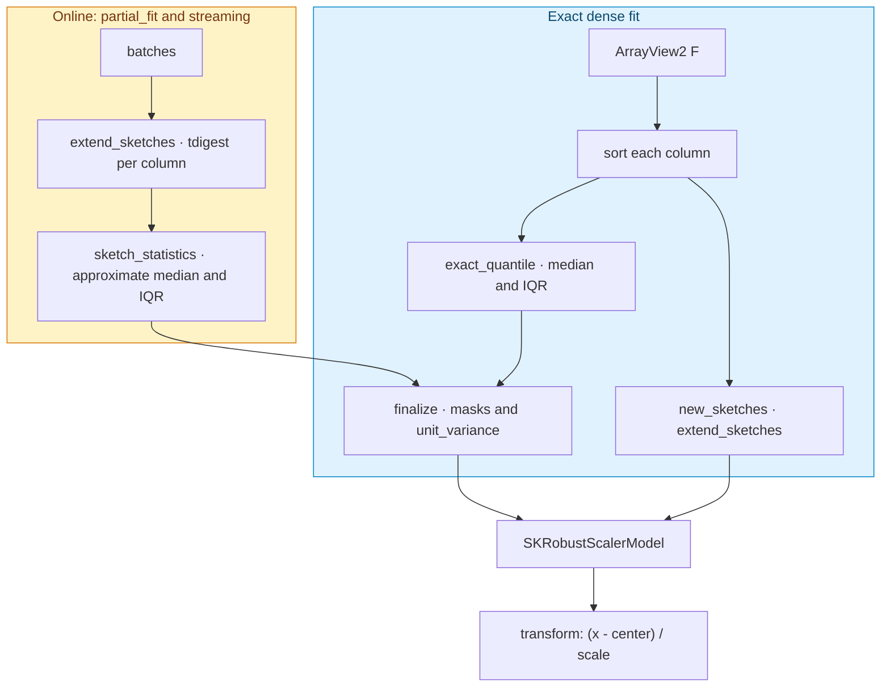

# The third scaler: `SKRobustScaler`

The [min/max scaler](./ch09-minmax-scaler.html) proved that the estimator template scales to a
second algorithm whose statistics are extrema. This chapter pushes the same template into its
hardest case yet: **`SKRobustScaler`**, which centers and scales every column on *quantile*
statistics — the median and the interquartile range — so a handful of extreme values can no
longer drag the scale. Quantiles are the first statistic in this book that cannot be computed
in a single associative pass, and *that* is the point: scikit-learn's `RobustScaler` must see a
whole column in memory, while sciencekit learns the quantiles from a stream through an **online
sketch**. It is the out-of-core differentiator applied to a transformer scikit-learn cannot
stream at all.

---

## 1. The problem we were solving

Standardization and min–max scaling both compute statistics that *every* value influences. A
single entry of a million — a mistyped income, a sensor spike — moves the mean and widens the
range, so the whole column is rescaled around a number the outlier chose. The result is a
scaler that is *accurate but not robust*: correct statistics over a contaminated sample.

The robust answer is to summarize a column by **order statistics** instead of sums. The
**median** (the 50th percentile) is the value in the middle of the sorted column, and the
**interquartile range** (IQR) is the distance from the 25th to the 75th percentile — the width
of the middle half of the data. Both are famously insensitive to outliers: dragging the largest
value to infinity does not move the median or the IQR at all. Centering on the median and
scaling by the IQR gives an outlier-resistant rescaling that matches scikit-learn.

The engineering problem is subtler than the arithmetic. Median and IQR are *selection*
statistics: to know the middle value you must order the column, and ordering needs the whole
column at once. That is exactly what a stream does not give you. The chapter's central idea is
how to keep the dense result **exact** (for scikit-learn parity) while learning an
**approximate** version from an unbounded stream — and to be honest in the tests about which is
which.

---

## 2. The decisions — and the roads not taken

| Decision | Why we chose it | Alternatives we discarded |
|---|---|---|
| **Dense fit is exact; the stream sketches** | Dense `fit` computes the median and IQR exactly from the sorted column, matching scikit-learn. `partial_fit` and `fit_streaming` maintain a per-column `tdigest` sketch and read the quantiles from it. Exact where exactness is cheap and expected; approximate only where the stream forces it. | Always using the sketch — dense results would be approximate and surprising, breaking parity. Always using exact quantiles — impossible in one streaming pass without buffering the whole column, the very capability we are adding. |
| **One sketch per column, compression fixed internally** | The model holds a `Vec<tdigest::TDigest>`, one per column, each fed per batch. Memory is `columns × compression`, independent of the row count — the out-of-core property. The compression parameter stays an internal constant, not a builder option, so the public surface stays focused. | Exposing compression as a knob — more surface for a setting almost nobody needs; it can be promoted later. |
| **`unit_variance` uses a probit approximation** | `unit_variance = true` divides the scale by the standard-normal interquartile span of the same `quantile_range`. That span is `Φ⁻¹(high) − Φ⁻¹(low)`, computed by Acklam's rational approximation of the inverse normal CDF — accurate to ~1e-9 for one constant per range. | Pulling in `statrs`/`libm` for a single closed-form constant — dependency weight for a ten-line approximation. |
| **The model stores only center and scale** | By the time the model exists, the masking flags and the unit-variance divisor have already been applied. The transform is a plain `(x − center) / scale`, and a non-positive scale becomes `1` so a zero-spread column stays finite. | Branching on the flags inside `transform` — more runtime state and a second place the masking rule could drift. |
| **`sk_axis_min_max` is not reused here** | The min/max scaler's kernel is an associative reduction; quantiles are not, so `SKRobustScaler` needs its own exact-quantile helper and its own sketch. Sharing a kernel would have hidden the fact that the two scalers' statistics are fundamentally different. | Fitting quantiles into the reduction family — they would have to buffer, defeating the streaming shape. |
| **The backend is still carried, not dispatched** | As in the other two scalers, the math is selection and reduction only, so no concrete `SKMathBackend` is needed — but the estimator still exposes `backend(SKBackendKind)` and records the kind in every span, per the `backend-selection` spec. | Omitting it — a non-uniform selection surface. |

---

## 3. The concepts, taught from zero

### The math: median and interquartile range

Sort a column into $x_{(1)} \le x_{(2)} \le \dots \le x_{(n)}$. The **quantile** at
probability $p \in [0,1]$ is the value at position $p\,(n-1)$ in that sorted order; when the
position falls between two integers we interpolate linearly:

$$\text{quantile}(p) = x_{(\lfloor i \rfloor)} + \bigl(x_{(\lceil i \rceil)} - x_{(\lfloor i \rfloor)}\bigr)\,(i - \lfloor i \rfloor), \qquad i = p\,(n-1).$$

This is the NumPy / scikit-learn convention, and `exact_quantile` implements exactly it. With
it, the **median** is $\text{quantile}(0.5)$ and the **interquartile range** is
$\text{quantile}(0.75) - \text{quantile}(0.25)$. For the column `[1, 2, 3, 4, 5]` the median is
$3$ and the IQR is $4 - 2 = 2$ — the number the test `fit_learns_median_and_interquartile_range`
pins.

The transform is then the familiar affine shape:

$$z_i = \frac{x_i - \text{center}}{\text{scale}},$$

with $\text{center} = \text{median}$ and $\text{scale} = \text{IQR}$. Two flags mask each
half — `with_centering` and `with_scaling` — and a non-positive scale is replaced by $1$, so a
column with zero spread transforms to finite zeros instead of dividing by zero.

### The concept: an online quantile sketch

Exact quantiles need the whole sorted column. A **sketch** is a fixed-size summary that
answers quantile queries approximately while seeing each value only once. The one we use is the
**t-digest**: it keeps a small set of "centroids" that stand in for clusters of nearby values,
merging them as data arrives so that the count of centroids never exceeds the configured
compression. Feeding a batch is just pushing its values; querying a quantile walks the
centroids. Memory is bounded by the compression, not the data, which is precisely the
out-of-core property.

The trade-off is explicit and testable. Because the sketch is approximate, the online path is
*not* bit-identical to the dense path; the cross-regime tests assert agreement within a
**documented relative tolerance** (5% here), the same contract the standard scaler's
`assert_close_with_tolerance` uses — just a looser number, because the sketch is a genuinely
different kind of summary.

### The concept: the probit and unit variance

If the data are normal, the IQR is a fixed multiple of the standard deviation — specifically
the distance between the 75th and 25th percentiles of a standard normal, about `1.34898`. When
`unit_variance` is true we divide the IQR by that constant so a *normally distributed* column
ends up with unit variance, matching scikit-learn's `RobustScaler(unit_variance=True)`. The
constant comes from the **probit** — the inverse of the normal CDF — computed by Acklam's
rational approximation in `probit`, and summed into the span by
`standard_normal_interquantile_span`. A dedicated test pins the 25–75 span at its well-known
value.

---

## 4. Each object, explained

### `SKRobustScaler<F>` — the estimator

*What it is* — the immutable configuration: `with_centering`, `with_scaling`,
`quantile_range`, `unit_variance`, the backend kind and the execution intent. Its only
constructor is `SKRobustScaler::build()`.

*Why it exists* — the template, unchanged: configuration separate from learned state. It
implements `SKUnsupervisedFit<F>`, and its `fit` learns the exact center and scale *and* seeds
the sketches a later `partial_fit` will extend.

### `SKRobustScalerBuilder<F>` — the builder

*What it is* — the chainable surface: `with_centering`, `with_scaling`,
`quantile_range((F, F))`, `unit_variance`, `backend`, `execution_mode`, then `build()`. Defaults
are center and scale on `(25, 75)`, no unit variance, `Faer` and `Automatic`.

### `SKRobustScalerModel<F>` — the fitted model

*What it is* — the learned state: `sample_count`, the per-column `center` and `scale` (already
masked), the `Vec<tdigest::TDigest>` sketches, the configuration, the backend and the execution
intent. It implements `SKFeatureTransformer<F>` and carries the incremental `partial_fit`.

*Why it exists* — the export boundary, and the only object that both transforms and keeps
learning. Storing the sketches is what makes `partial_fit` able to keep approximating the
statistics over all the data a model has seen.

### `column_quantile_statistics`, `exact_quantile` and `standard_normal_interquantile_span` — the dense quantile helpers

*What it is* — `exact_quantile` is the interpolated order-statistic quantile above;
`column_quantile_statistics` sorts each column and reads the median and IQR;
`standard_normal_interquantile_span` wraps `probit`.

*Why they exist* — they isolate the exact quantile convention (parity with scikit-learn) and
the probit approximation in one testable place, away from the estimator.

### `new_sketches`, `extend_sketches` and `sketch_statistics` — the online sketch helpers

*What it is* — `new_sketches` builds one `tdigest` per column at a fixed compression;
`extend_sketches` feeds a batch into every column sketch and compresses them;
`sketch_statistics` reads the median and IQR back out.

*Why they exist* — they are the single implementation of "learn quantiles from a stream", used
by both `partial_fit` and the streaming driver, so the two online paths cannot diverge.

### `StreamingSketches` — the streaming state

*What it is* — the row count, the column count, the per-column sketches and a parked error,
mutated batch by batch by the streaming driver.

*Why it exists* — the streaming counterpart of the model's sketches; the driver feeds it, and
the finalize step reads the quantiles and applies the same masking the dense path applies.

---

## 5. A real walk-through, using the tests

**Dense fit and transform.** `fit_learns_median_and_interquartile_range` fits `[1, 2, 3, 4, 5]`
and asserts center `3` and scale `2`; `transform_centers_and_scales` checks the output is
`[[-1], [-0.5], [0], [0.5], [1]]` — the median at 0 and the IQR at 1.

**The options.** `quantile_range_override_changes_scale` widens the range to `(0, 100)` and
checks the scale becomes the full spread `4`; `without_centering_keeps_values_uncentered` and
`without_scaling_centers_without_scaling` check the two masks;
`unit_variance_divides_scale_by_standard_normal_span` checks the IQR `2` becomes
`2 / 1.34898…`.

**The zero-spread edge.** `zero_spread_column_gets_unit_scale_and_finite_output` fits a constant
column and asserts its scale is `1` and its output is finite — the non-positive-scale rule.

**The probit.** `standard_normal_span_matches_known_value` pins
`standard_normal_interquantile_span(25.0, 75.0)` to `1.3489795003921634` within `1e-9`, and
`exact_quantile_matches_hand_computed_values` pins the interpolation against hand-computed
quantiles.

**Errors and backend.** `fit_rejects_empty_input`, `fit_rejects_sparse_input` and
`transform_rejects_column_count_mismatch` cover the error taxonomy;
`backend_defaults_to_faer` and `backend_override_reaches_model` cover the carried backend.

**Incremental approximates dense.** `partial_fit_after_fit_approximates_dense` fits a prefix of
the `100 000 × 8` matrix, `partial_fit`s the rest, and asserts the center and scale track the
exact dense fit within `SKETCH_RELATIVE_TOLERANCE`; `partial_fit_accumulates_sample_count`
checks the count, `partial_fit_empty_batch_is_noop` the no-op, and
`partial_fit_column_mismatch_errors` the mismatch.

**Streaming approximates dense.** `streaming_approximates_dense_fit` streams uneven batches and
asserts the same tolerance; `streaming_explicit_in_process_collects_batches` pins the in-memory
branch (which is *exactly* the dense fit, because it collects and reuses it);
`streaming_respects_builder_flags` checks the flags survive an online fit;
`streaming_empty_source_errors` and `streaming_column_mismatch_errors` cover the failures.

---

## 6. Look inside

Dense fitting is exact and seeds the sketches; both online paths feed the same per-column
sketches and finalize through one masking step. The tests pin how close the approximate path is
allowed to be.

The insight is that **robustness and streaming are different axes**. Robustness comes from
*which* statistic we summarize (order statistics, not sums). Streaming comes from *how* we
summarize it (a bounded sketch instead of the whole column). The design keeps the two honest:
exact when the data is in memory, approximate — within a number the tests enforce — when it is
not.

---

## 7. Recap

- **Robust scaling** centers on the median and scales by the interquartile range, so outliers
  cannot dominate the scale the way they dominate a mean and standard deviation.
- **`SKRobustScaler` is configuration; `SKRobustScalerModel` is learned state**, and the model
  is the export boundary.
- **Dense fit is exact** — interpolated order statistics, matching scikit-learn.
- **The online path sketches** — one `tdigest` per column, memory bounded by
  `columns × compression`, so the scaler streams where scikit-learn cannot.
- **The two paths differ by a documented tolerance** (5%), asserted explicitly rather than
  hidden; the in-memory branch is exactly dense because it reuses the dense path.
- **`unit_variance` divides the IQR by the standard-normal interquantile span**, computed by a
  self-contained Acklam probit pinned at `1.34898` for `(25, 75)`.
- **A zero-spread column gets unit scale**, and the backend kind is carried into the model and
  every span.
