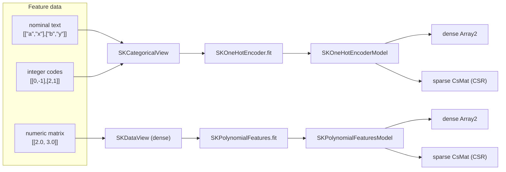

# Encoders: the categorical boundary, `SKOneHotEncoder` and `SKPolynomialFeatures`

The [three scalers](./ch10-robust-scaler.html) taught the estimator template to standardize,
bound and de-outlier numeric columns — but every one of them assumed the data already *was*
numbers. This chapter crosses a line the book has not crossed yet: it adds a **second kind of
feature data** to the library. Categorical features — names, colours, small integer codes —
are not numbers, and no amount of scaling makes them numbers. Turning them into numbers is the
job of the **one-hot encoder**; the companion task of growing numbers into their products is
the job of the **polynomial expander**. Together they are the two feature-engineering
transformers Wave 1 promised last.

---

## 1. The problem we were solving

Every estimator so far accepted one thing: an `SKDataView`, the **numeric** feature boundary —
a dense matrix or a sparse CSR matrix of numbers. That boundary is generic over a scalar
`F: SKFloat`, and it is deliberately numeric: a distance, a mean, a dot product only make sense
on numbers. But real tabular data is full of columns that are *labels*. A `city` column holding
`"Lisbon"`, `"Porto"`, `"Braga"` is not a number, and if you force it into a float you have
either invented a fake ordering (`Lisbon` < `Porto`?) or thrown the information away.

The standard solution is the **one-hot encoding**: give each distinct category its own output
column and put a `1` in the column the row belongs to, `0` elsewhere. Three cities become three
indicator columns; a row in `"Porto"` becomes `[0, 1, 0]`. Now every numeric estimator works.

The second transformer answers a different need. A **linear** model can only see straight
combinations of its inputs: it can learn $w_0 + w_1 x_0 + w_2 x_1$, but never the curve
$x_0 \times x_1$ or the bend $x_0^2$. **Polynomial features** manufacture those terms — the
squares, cubes and pairwise products — and hand them to the linear model as if they were
independent inputs. A linear model on the expanded matrix fits a curved surface, without
leaving the linear family.

The engineering problem was not the arithmetic — an indicator and a product are trivial — but
the **boundary**. Categorical data had no representation in the library at all. Either the
encoder quietly forks its own private input type, or the boundary grows a proper categorical
counterpart that every future encoder, imputer and codec can share. We chose the second, and
that choice is half of this chapter.

---

## 2. The decisions — and the roads not taken

| Decision | Why we chose it | Alternatives we discarded |
|---|---|---|
| **A categorical boundary, sibling to `SKDataView`** | `sciencekit_common` gains `SKNominalMatrixView` (row-major borrowed labels) and the non-exhaustive `SKCategoricalView` enum (`Nominal` text columns / `Integer` `ArrayView2<i64>` codes), entered through the same fallible `TryInto` seam. Categorical data is a first-class citizen of the same boundary every estimator uses. | Widening `SKDataView` with a categorical variant — it is generic over `F: SKFloat`; a text or `i64` column is not an `F`, and forcing it through would make the type parameter a lie and break every `as_dense` consumer. Accepting `&[&[&str]]` directly on the encoder — a private seam instead of the shared one. |
| **A documented missing sentinel `-1`** | Integer-coded columns have no `NaN`; `-1` (scikit-learn's convention) marks a missing entry. It is never registered as a category and always encodes to an all-zero block, so encoders and imputers agree. | Using `i64::MIN` — a valid, if unlikely, code that would collide. Inventing a second missing mechanism — two ways to say "absent". |
| **Per-column tables: `SKLabelTable` for text, a code table for integers** | Nominal columns reuse the existing `SKLabelTable` interning (first-occurrence order, reversible, exportable). Integer columns get a tiny `SKIntegerCategoryTable` (`index → code`, `code → index`) so the code stays exact. | Stringifying integer codes into one `SKLabelTable` — `label_of` would return `"3"` and force a parse to recover the code. |
| **Dense *and* sparse output, chosen by the builder** | Both expansions are overwhelmingly sparse, so both emit a dense `Array2` **or** a `sprs` CSR matrix; `sparse_output` picks the default and `transform_dense` / `transform_sparse` are always available. The CSR build is two-pass and parallel across rows with `CsMat::new_from_unsorted`. | Dense only — losing the zero-copy sparse path the library bets on. A generic output type — the transformer trait is bound to numeric `SKDataView` input, which categorical data cannot satisfy, so a concrete non-exhaustive enum is both simpler and future-proof. |
| **No runtime `phf` perfect hash** | The wave plan phrased the table as "interned string table, perfect-hash". A *runtime* perfect-hash builder does not exist in `phf` (it is compile-time codegen); an ordered `HashMap`-backed interning table already gives average `O(1)` with no extra dependency and no unsafe. The plan's intent — a deterministic, compact, ordered table — is met. | Adding `phf` for a property it does not provide at runtime. |
| **`fit` learns scalar-independent state; transforms are generic over `F`** | The learned tables and the exponent list do not depend on the output scalar, so the fitted models are **not** generic over `F` — only `transform_dense`/`transform_sparse` are. | A `PhantomData<F>` on the model — a type parameter that tracks nothing. |
| **Polynomial order: bias, then degree, then lexicographic** | Terms are combinations of feature indices, laid out bias-first, then by increasing total degree, then lexicographically: for two features at degree two that is `1, x0, x1, x0², x0x1, x1²`. This is exactly scikit-learn's column order. | Reverse-lexicographic exponent tuples — a different, surprising order that would break parity. |
| **The backend is still carried, not dispatched** | As in the scalers, the math is interning and products, not heavy dense algebra — but both estimators still expose `backend(SKBackendKind)` and record the kind in every span, per `backend-selection`. | Omitting it — a non-uniform selection surface. |

---

## 3. The concepts, taught from zero

### The categorical view

`SKNominalMatrixView` is a **borrowed** row-major matrix of labels: the outer slice indexes
rows, each inner slice holds that row's column labels, and every label is a `&str` borrowed
from the caller — no text is copied. The non-exhaustive `SKCategoricalView` is the enum that
either wraps it (`Nominal`) or wraps an integer-coded matrix (`Integer(ArrayView2<i64>)`).
Like the numeric boundary, it is entered through `TryInto<SKCategoricalView, Error = SKError>`,
so a native slice or view converts infallibly and a third party can plug in a fallible
conversion whose error flows into the operation's `Result`.

### Interning: the label table

To encode a column you need a fixed mapping from label to index. During `fit` the encoder walks
the column in order and assigns index `0` to the first label it sees, `1` to the next new one,
and so on — **first-occurrence order** — building an `SKLabelTable`. The order is
deterministic: the same data always yields the same table, which is what makes the export
boundary and the tests stable. The test `first_occurrence_order_and_determinism` pins that
`["b","a","b","c"]` maps `b→0, a→1, c→2` and that two fits agree.

### The one-hot transform

Learn the tables of each column, then remember how many categories each has. The output width
is their sum, and each column owns a **contiguous block** of output columns starting at an
offset. Encoding a row is, per input column, a table lookup to a local index, then a `1` at
`offset + local`:

$$\text{output}[r,\ \text{offset}_c + \text{index}_c(x_{r,c})] = 1.$$

For `[["a"],["b"],["a"]]` the table is `a→0, b→1` and the output is
`[[1,0],[0,1],[1,0]]` — the test `text_column_encodes_to_indicators`.

### Unknown categories and the missing sentinel

A category seen at `transform` time but not at `fit` time is **unknown**. The `handle_unknown`
policy decides: `Reject` (the default) fails with a structured error before writing anything;
`Ignore` leaves that column's block all zeros. An integer entry equal to the sentinel `-1` is
**missing**, not unknown: it is skipped during `fit` (never becomes a category) and encodes to
an all-zero block regardless of policy. `integer_codes_skip_missing_sentinel` walks a column
`[0, -1, 2]` and shows the sentinel both staying out of the table and encoding to zeros.

### Sparse output without copying zeros

One-hot matrices are mostly zeros — with a hundred cities, every row stores exactly one `1` per
column. Storing the zeros would waste most of the memory. `sprs`' **CSR** format stores only
the nonzeros, row by row: an `indptr` array of row boundaries, an `indices` array of column
positions, and a `data` array of values. We build it in **two passes**: first, in parallel
across rows, compute each row's output indices (which is also where an unknown category
surfaces as an error); then lay them into `indptr`/`indices`/`data` and hand the arrays to
`CsMat::new_from_unsorted`, which validates and — if needed — sorts them. The test
`sparse_matches_dense` densifies the sparse result and asserts it equals the dense one exactly.

### Polynomial expansion

A **term** is a sorted list of feature indices; its value is the product of the input values at
those indices, and the empty list is the constant `1`. For two features at degree two the
non-interaction terms are `[]`, `[0]`, `[1]`, `[0,0]`, `[0,1]`, `[1,1]`, whose values on the
row `[2, 3]` are `1, 2, 3, 4, 6, 9` — the test `hand_checkable_expansion`. `interaction_only`
forbids repeated indices, dropping the pure powers `[0,0]` and `[1,1]`; `include_bias` drops
the empty term. The terms are cheap metadata (index lists); the *values* are computed row by
row during `transform`, never materialized as a blow-up of owned arrays.

---

## 4. The public objects

- **`SKCategoricalView<'a>`** (`sciencekit_common`) — the non-exhaustive categorical feature
  view: `Nominal(SKNominalMatrixView<'a>)` or `Integer(ArrayView2<'a, i64>)`.
- **`SKNominalMatrixView<'a>`** — the borrowed label matrix: `shape`, `value(row, column)`,
  `row`, `is_empty`.
- **`SK_CATEGORICAL_MISSING_CODE: i64 = -1`** — the documented missing sentinel.
- **`SKOneHotEncoder`** — builder-only configured encoder. Builder: `sparse_output(bool)`
  (default `true`), `handle_unknown(SKUnknownPolicy)` (default `Reject`), `backend`,
  `execution_mode`.
- **`SKOneHotEncoderModel`** — the fitted tables plus output offsets; `transform_dense`,
  `transform_sparse`, `transform` (returns `SKEncodedOutput`), and accessors
  (`column_categories`, `number_of_output_features`, `backend`, ...).
- **`SKExpandedOutput<F>` / `SKEncodedOutput<F>`** — the non-exhaustive `Dense`/`Sparse` output
  enums.
- **`SKPolynomialFeatures`** — builder-only configured expander. Builder: `degree(usize)`
  (default `2`), `interaction_only(bool)`, `include_bias(bool)`, `sparse_output(bool)`
  (default `false`), `backend`, `execution_mode`.
- **`SKPolynomialFeaturesModel`** — the term list plus input/output counts; `transform_dense`,
  `transform_sparse`, `transform`, `terms`, `backend`.

---

## 5. A walk through the real tests

Both estimators' companion test modules are the executable specification. A few worth reading
in full:

- `text_column_encodes_to_indicators` — the tracer bullet: one text column, the exact
  indicator matrix, the output width. It proves the whole path (view → intern → encode)
  end to end.
- `output_width_is_sum_of_category_counts` — two columns of two categories each give four
  output columns, pinning the offset arithmetic.
- `unknown_category_rejected_by_default` / `unknown_category_ignored_encodes_zeros` — the two
  faces of the `handle_unknown` policy.
- `builder_selects_default_output` — the encoder defaults to sparse, the expander to dense, and
  each builder flips its default.
- `streaming_uneven_batches_equal_dense` (both) — three rows fed in batches of two-then-one
  produce exactly the dense result, the out-of-core promise.
- `hand_checkable_expansion` — the row `[2, 3]` expands to `[1, 2, 3, 4, 6, 9]`, the scikit-learn
  column order.
- `documented_column_order_is_stable` — the term list itself is asserted, so the order can never
  drift silently.
- `sparse_matches_dense` (both) — the densified CSR equals the dense matrix, the guarantee that
  the two output paths agree.

---

## 6. What it cost, and what it unlocked

The whole change is **additive**: `SKDataView` and every existing estimator are untouched; the
categorical view is a new sibling, non-exhaustive so it can grow. The one non-obvious recurring
cost is the borrow choreography — lifetimes through `TryInto`, `&[&[&str]]` into a view into a
table — which is exactly why the boundary, and not each encoder, owns the conversion impls.

What it unlocked is larger than two transformers. Every future categorical consumer — the
`SKKNNImputer` that imputes per column, the codecs that move labelled data, the pipelines that
chain a transformer's sparse output into the next stage — now has a boundary to speak through.
And the sparse output path is shared: the same two-pass CSR build will serve PCA, truncated SVD
and the kernel machines still to come.

---

## 7. Recap

- Categorical features get a **boundary**, not a private input: `SKCategoricalView` with a
  documented missing sentinel.
- `SKOneHotEncoder` interns labels into deterministic per-column tables and emits dense or
  sparse indicators; `handle_unknown` and the missing sentinel define the edges.
- `SKPolynomialFeatures` enumerates exponent terms lazily in a stable scikit-learn order and
  emits dense or sparse expansions.
- Both are builder-only, carry their backend, stream out-of-core, and expose their learned
  state as the export boundary.

Next chapter: with features now encodable, the book turns to the first *supervised* models —
starting with `SKLinearRegression` — where these encoders and expanders finally become inputs
to a model that learns.

> Chapters are added in the order the pull requests landed. The linear-model chapter will be
> registered in `SUMMARY.md` when it lands.
