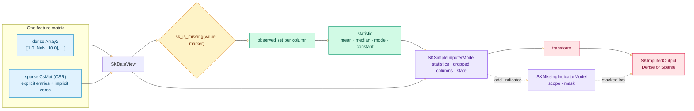
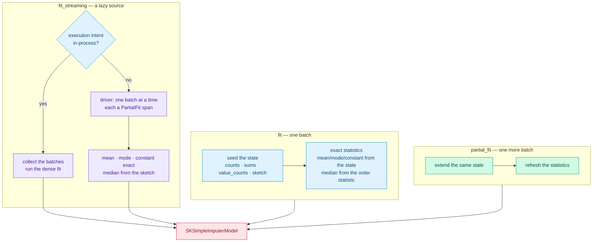
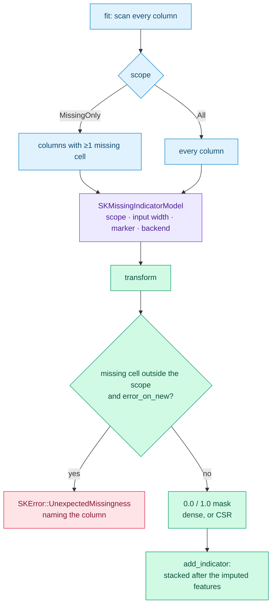

# Imputation: `SKSimpleImputer` and `SKMissingIndicator`

The [encoders](./ch11-one-hot-and-polynomial-encoders.html) crossed the categorical boundary.
This chapter crosses a boundary of a different kind: every estimator so far assumed the matrix
was **complete**. Real tabular data is not. Sensors drop readings, joins leave holes, surveys
skip questions — and a mean, a distance or a dot product that meets a hole either produces a
`NaN` that poisons everything downstream or silently pretends the row does not exist. Wave 1's
last preprocessing family is the answer: one estimator **fills** the holes, another **reports**
them, and a builder flag lets the first stack the second after its own output.

---

## 1. The problem we were solving

A missing cell is not a small inconvenience. Suppose you want the mean of a column that holds
`[1, NaN, 3]`. Three answers are tempting and only one is correct: treat `NaN` as zero
(`4/3 = 1.33`, wrong), drop the row (`[1, 3] → 2`, right here but wrong when other columns are
fine), or skip the missing cell (`(1+3)/2 = 2`, right). The third is what scikit-learn's
`SimpleImputer` does, and it is what we wanted: **learn a statistic over the observed cells and
fill only the missing ones**.

That introduces three genuinely new problems.

1. **What counts as missing?** `NaN` is the obvious marker, but real files encode missingness
   as `-1`, `-999`, or sometimes `0`. The marker has to be configurable, and it has to mean the
   same thing in a dense matrix and in a sparse one — where a value can be *absent from
   storage* entirely.
2. **What happens at the edges?** A column that is missing in every row has no mean and no
   median. Do we drop it? Keep it as zero? And what if a cell that was complete at fit time is
   missing at transform time — is that an error, or just another fill?
3. **Can the information be kept?** Filling a hole with the mean destroys the fact that the
   value was ever absent. For a downstream model that fact is often a signal. scikit-learn
   answers with `MissingIndicator`: a `0`/`1` mask of the cells that were missing. We wanted
   both the imputer and the mask, composable.

The engineering problem, as with the encoders, was the **seam**: the marker and the
"observed set" logic must be identical in dense and sparse paths, in the batch fit and in the
streaming fit, and in the imputer and the indicator. Solving it once, in one crate, is half of
this chapter.

---

## 2. The decisions — and the roads not taken

| Decision | Why we chose it | Alternatives we discarded |
|---|---|---|
| **A new crate, `sciencekit_impute`** | The PRD's crate tree reserves imputation for Phase 1, item 6. It owns the missing-data estimators and depends on `sciencekit_common` and `sciencekit_math`, exactly like `sciencekit_preprocessing`. | Adding the imputer to `sciencekit_preprocessing` — a different concern and a different wave, and it would blur the crate boundary the PRD draws. |
| **One marker rule for both representations** | Dense: `NaN` marker means `is_nan`, any other marker means `==`. Sparse: explicit entries follow the same rule, and the `0.0` marker additionally claims the **implicit zeros** (the cells CSR does not store). One predicate, `sk_is_missing`, and one companion, `sk_sparse_marks_implicit_zeros`. | A separate "sparse marker" — two subtly different behaviors for the same option. Treating implicit zeros as always observed — wrong for data where `0` is the missing code. |
| **A generic estimator, `SKSimpleImputer<F>`** | The configuration carries values of the scalar: `missing_values` and `fill_value` are `F`. Carrying them in the type keeps the builder honest and mirrors `SKRobustScaler<F>`. | A non-generic estimator over `f64` — the library is generic over `SKFloat` and `f32` must work. |
| **Mean via a compensated sum** | A plain running sum loses low-order bits on long columns. Neumaier compensation keeps an error term per column, so the statistic is stable even with thousands of small values and one huge one. | Plain `sum()` — fast, but the tests compare against hand-checked values and the streaming path must match the batch path. |
| **Median as an order statistic; ties in the mode to the smallest value** | The median sorts the observed values (midpoint of the middle pair on an even count); the mode sorts and scans runs, replacing only on a **strictly** larger count, so a tie always resolves to the smallest value. Both are deterministic. | Hash-based mode — `SKFloat` has no `Hash`, and hash iteration order would make ties unpredictable. |
| **All-missing column → `NaN` statistic, recorded as dropped** | A column with no observed cell has no statistic. The model stores `NaN` in `statistics` (one entry per **input** column) and lists the column in `dropped_columns` unless `keep_empty_features(true)`, which retains it filled with `0.0`. | Dropping silently — the export boundary must tell the caller which columns vanished. Inventing a statistic — every invented value is a lie. |
| **`partial_fit` and `fit_streaming` from day one** | The project's iterative mandate forbids skipping the incremental/out-of-core stage. The model carries a `SKImputationState` with per-column counts, compensated sums, value counts and a `tdigest` sketch, so one more batch extends the same state. | Batch-only — a Wave 1 estimator that cannot stream would be re-opened in Wave 2. |
| **The median sketch stores only explicit values; structural zeros are a separate multiplicity** | In CSR, the implicit zeros are not stored, so a sketch cannot see them. The state keeps their count per column and inverts the combined CDF: `(explicit · F_explicit + zeros · [v ≥ 0]) / total`. This is exact for a single batch and within tolerance across batches. | Weighting the zero centroid in the sketch — `tdigest` interpolates between centroid means, and the test `[0,0,0,0,10,12]` returned `4.0` instead of `0.0`. |
| **The mask is typed on `F`, not `bool`** | `SKIndicatorOutput<F>` emits `0.0`/`1.0` in the scalar type so a stacked output is one matrix of one scalar, ready for the next pipeline stage. | A `bool` mask — scikit-learn's choice; it would introduce a second scalar type through every downstream pipeline. The deviation is recorded in the ADR and pinned by tests. |
| **`add_indicator` composes, it does not special-case** | The imputer fits a real `SKMissingIndicator` on the same batch (same marker, same backend, `error_on_new(false)`) and stores the fitted model. The transform runs the imputation, then stacks the mask in a second pass. | A private mask routine — duplicated logic that would drift from the standalone indicator. |
| **`error_on_new` defaults to `true`** | Missingness in a feature that was complete at fit is suspicious: the training distribution changed. The default fails with a precise `SKError::UnexpectedMissingness { column }`; `error_on_new(false)` tolerates it and leaves the cell unmarked. | Silently masking the new column — it has no mask column, so the information would be lost invisibly. |
| **The backend kind is still carried** | The math is reductions and order statistics, not heavy algebra, but both estimators expose `backend(SKBackendKind)` and record it in every span — the selection surface stays uniform (spec `backend-selection`). | Omitting it — an inconsistency every other estimator would expose. |

---

## 3. The concepts, taught from zero

### The marker and the observed set

`sk_is_missing(value, marker)` is the single predicate the whole crate shares:

$$\text{missing}(v, m) = \begin{cases} v \ne v & m \text{ is } \texttt{NaN} \\ v = m & \text{otherwise} \end{cases}$$

The `v ≠ v` trick is the standard way to ask "is this a `NaN`" without naming the type. The
second branch is plain equality — which is why the `0.0` marker has a special consequence in
sparse data. `sk_sparse_marks_implicit_zeros(marker)` answers "does the marker claim the cells
CSR does not store?", and it is true only for `0.0`: a `NaN` marker leaves structural zeros
**observed**, while a `0.0` marker makes every structural zero **missing**.

The **observed set** of a column is everything the marker does not claim. The dense path visits
every cell; the sparse path visits the explicit entries and adds the structural zeros as a
multiplicity. The `SKObservedColumn<F>` type in `simple_imputer/statistics/` materializes that
set exactly once, and both representations build it, so "sparse agrees with dense" is true by
construction rather than by a second implementation.

### The four strategies

With the observed values in hand, each strategy is a one-line definition:

- **Mean** — the compensated sum divided by the count. The Neumaier compensation is a second
  accumulator holding the rounding error; adding it back at the end recovers the bits a naive
  sum loses. Test: `mean_over_the_observed_values`.
- **Median** — sort the observed values; take the middle one, or the average of the middle pair
  when the count is even. Tests: `median_of_an_odd_observed_count`,
  `median_of_an_even_observed_count_averages_the_middle_pair`.
- **Most frequent** — sort, scan runs of equal values, and replace the winner only when a run is
  **strictly** longer. Ties therefore resolve to the smallest value. Test:
  `most_frequent_tie_breaks_toward_the_smallest`.
- **Constant** — ignore the observed set and fill with `fill_value`, default `0.0`. A
  `fill_value(Some(NaN))` is rejected at build time with `InvalidHyperparameter`, because filling
  missing cells with a missing value would be a no-op pretending to be an imputation. Test:
  `fill_value_of_nan_under_constant_is_rejected`.

The model stores **one statistic per input column**. A column that has no observed value gets
`NaN` there, and — unless `keep_empty_features` is on — its index is recorded in
`dropped_columns`. `number_of_output_features()` is therefore
`number_of_input_columns - dropped_columns.len()`, and the transform knows both the width and
which source columns to skip. Tests: `all_missing_column_gets_a_nan_statistic_and_is_reported`,
`all_missing_column_is_dropped_by_default`, `keep_empty_features_retains_the_column_as_zero`.

### The incremental state and the three regimes

`SKImputationState<F>` is what makes the estimator iterative. Per column it keeps:

- a `count` of observed values;
- a compensated `sum` and its `compensation`;
- a `value_counts` map keyed by the **bit pattern** of the value (normalizing `-0.0` to `0.0`,
  since `SKFloat` has no `Hash`), so the mode can be extended without re-reading old batches;
- a `tdigest` sketch of the explicit values, for the online median;
- the count of implicit zeros, kept apart from the sketch.

`fit` seeds this state with the batch, then derives the exact statistics: the mean, mode and
constant come straight from the state, and the median takes the exact order statistic of the
batch (the sketch is still seeded so `partial_fit` can continue from it). `partial_fit` extends
the state and refreshes the statistics — nothing else changes. The tests
`split_batches_equal_the_whole_for_mean` and `split_batches_equal_the_whole_for_most_frequent`
assert that two halves and the concatenation produce the same model;
`median_stays_within_the_sketch_tolerance_of_the_dense_fit` states the one documented
approximation.

The streaming driver is the same `sk_run_streaming_driver` the scalers use. Its state validates
the column count, parks the error and stops the pipeline on a mismatch, skips empty batches, and
instruments each batch as `PartialFit` with the configured backend. The in-process branch
collects the batches and reuses the dense path, so its result is **exactly** the concatenated
fit — the test `in_process_streaming_matches_the_dense_fit_exactly` pins that.

### Why the median needs a CDF inversion

`tdigest` summarizes a distribution as centroids and estimates quantiles by interpolation. For
explicit values that is exactly what we want. The problem is the structural zeros: they are not
in the sketch, and pushing a synthetic zero centroid corrupts the interpolation between
neighbouring centroids. The state therefore keeps the zeros as a **multiplicity** and inverts
the combined CDF instead:

$$q(p) = \begin{cases} -\infty \text{ direction: } 0 & \text{if } p \cdot \text{total} \le z \\ \text{explicit quantile} & \text{otherwise} \end{cases}$$

where `z` is the number of structural zeros and `total = explicit + z`. In words: if the target
rank falls inside the zero block, the answer is zero; otherwise it falls in the explicit mass and
the sketch answers. The test `median_places_the_implicit_zeros_in_their_rank_block` walks
`[0,0,0,0,10,12]` and shows the median landing at `0` — the case the weighted-centroid approach
got wrong.

### The missingness mask

`SKMissingIndicator` is a second, independent transformer. `fit` scans the matrix and records
the **scope**: under `MissingOnly` (the default) the columns with at least one missing cell,
under `All` every column. `transform` emits a `0.0`/`1.0` matrix with one column per scoped
feature, in ascending column order. A dense input yields a dense mask unless
`sparse_output(true)` asks for CSR; a sparse input always yields CSR, with stored entries
exactly at the missing cells. Tests: `mask_marks_the_missing_cells`,
`dense_input_yields_a_dense_mask_in_scope_order`, `sparse_input_yields_a_sparse_mask`.

The interesting edge is missingness that `fit` never saw. With `error_on_new(true)` (the
default) the transform fails before writing anything, naming the offending column:
`SKError::UnexpectedMissingness { column: 0 }`. With `error_on_new(false)` the cell is tolerated
and simply **not masked** — the mask only covers the scope learned at fit. Tests:
`new_missingness_is_rejected_by_default`, `new_missingness_is_tolerated_on_request`.

### Stacking the mask after the features

`add_indicator(true)` makes the imputer **compose** the indicator instead of duplicating it. At
fit, an indicator is built with the imputer's marker, `error_on_new(false)` (so a transform the
imputer can handle is never failed by the mask) and the same backend kind; its fitted model is
stored in `SKSimpleImputerModel::indicator()`. At transform, the imputation runs first — dropping
the empty columns — and the mask is concatenated along the column axis. For a dense result that
is an `ndarray` concatenation; for CSR it is a triplet rebuild that shifts the mask columns past
the feature columns. The output width is therefore

$$\text{width} = \text{retained features} + \text{mask columns}.$$

The test `stacking_appends_one_column_per_missing_feature` fits a 3-column matrix missing only
in its second column, which is dropped as empty: the output is `[[2.5, 4.5, 1.0]]` — two
features, then one mask — and `sparse_stacking_appends_the_mask_columns` asserts the same shape
for CSR. `a_retained_empty_column_keeps_its_indicator_column` shows the other policy: with
`keep_empty_features(true)` the column stays as `0.0` **and** keeps its mask column.

---

## 4. The public objects

- **`SKSimpleImputer<F>`** — builder-only configured imputer. Builder: `strategy`,
  `missing_values(F)` (default `NaN`), `fill_value(Option<F>)` (default `None`, meaning `0.0`
  under `Constant`), `keep_empty_features(bool)` (default `false`), `add_indicator(bool)`
  (default `false`), `backend`, `execution_mode`.
- **`SKImputationStrategy`** — `Mean`, `Median`, `MostFrequent`, `Constant`.
- **`SKImputedOutput<F>`** — the non-exhaustive result: `Dense(Array2<F>)` or `Sparse(CsMat<F>)`.
- **`SKSimpleImputerModel<F>`** — the fitted state: `statistics()`, `dropped_columns()`,
  `number_of_input_columns()`, `number_of_output_features()`, `strategy()`, `missing_values()`,
  `indicator()`, `backend()`, `execution_intent()`, plus `partial_fit`.
- **`SKMissingIndicator<F>`** — builder-only mask. Builder: `features(SKMissingFeatureScope)`
  (default `MissingOnly`), `error_on_new(bool)` (default `true`), `sparse_output(bool)` (default
  `false`), `missing_values(F)`, `backend`, `execution_mode`.
- **`SKMissingFeatureScope`** — `MissingOnly` or `All`.
- **`SKMissingIndicatorModel<F>`** — the learned scope: `scope()`,
  `number_of_input_columns()`, `number_of_output_columns()`, `features()`, `error_on_new()`,
  `sparse_output()`, `backend()`.
- **`SKIndicatorOutput<F>`** — the non-exhaustive mask result: `Dense(Array2<F>)` or
  `Sparse(CsMat<F>)`.
- **`sk_is_missing` / `sk_sparse_marks_implicit_zeros`** — the shared marker predicates in
  `sciencekit_impute::missingness`.

---

## 5. A walk through the real tests

The companion modules are the executable specification; these are the ones worth reading in
full:

- `the_tiny_matrix_is_hand_checkable_end_to_end` (acceptance) — the tracer bullet:
  `[[1, NaN, 10], [3, 4, NaN], [5, 6, 30]]` imputed with the mean and with the median, both
  hand-computed to the same `[[1,5,10],[3,4,20],[5,6,30]]`.
- `sparse_mean_counts_the_implicit_zeros_as_observed` and
  `sparse_zero_marker_makes_the_implicit_zeros_missing` — the two faces of sparse marker
  semantics, pinned in the fit tests.
- `observed_cells_stay_bit_identical` — the transform changes **only** the missing cells; every
  observed value is copied bit for bit.
- `zero_marker_fills_the_implicit_zeros` — with a `0.0` marker the CSR rebuild also materializes
  the cells that storage never held.
- `split_batches_equal_the_whole_for_mean` — two `partial_fit` halves equal one fit, the
  incremental promise.
- `streaming_driver_mean_is_exact` / `streaming_driver_median_stays_within_the_sketch_tolerance`
  — what the out-of-core driver guarantees exactly and what it approximates.
- `median_places_the_implicit_zeros_in_their_rank_block` — the CDF inversion that fixed the
  structural-zero median.
- `a_large_generated_matrix_streams_like_the_concatenated_fit` (acceptance) — 4,000 rows in
  eight chunks match the in-memory fit column by column.
- `missing_only_scope_is_exactly_the_missing_columns` and
  `the_scope_is_deterministic_across_fits` — the indicator's scope is learned, exact and stable.
- `new_missingness_is_rejected_by_default` — the error names the column, and the remedy is in
  the message.
- `one_fitted_model_transforms_concurrently` (acceptance) — one model, eight threads, identical
  results: the model is `Send + Sync` by construction.

---

## 6. What it cost, and what it unlocked

The cost is **state discipline**. The estimator is cheap; the model is not: it carries the exact
statistics, the dropped-column list, the incremental state (including a `tdigest` per column) and
the optional indicator model. That is what makes `partial_fit` possible and what makes the model
the single export boundary — every learned fact is behind an accessor, never recomputed.

The other cost is **two representations**. Dense and sparse paths must agree, and the tests hold
them to it: the same statistics (`dense_and_sparse_inputs_produce_equal_outputs`), the same
imputation, the same mask. The observed-set abstraction paid for itself here — the marker rules
live once, and the strategies consume the same type in both paths.

What it unlocked is the rest of the roadmap. Every model that follows — the linear models, the
neighbors, the trees — can now assume complete numeric input, or ask for the mask and learn from
the missingness itself. `SKKNNImputer`, the multivariate imputer of the next wave, has both the
crate and the marker semantics to build on.

---

## 7. Recap

- Missing values are defined by a **marker**, configurable per estimator, with one shared
  predicate for dense and sparse — and structural zeros are missing only under the `0.0` marker.
- `SKSimpleImputer` fills each column with a **mean, median, most frequent or constant**
  statistic, drops all-missing columns by default (or keeps them at `0.0`), and stacks a
  missingness mask when `add_indicator` is on.
- `SKMissingIndicator` learns the **scope** at fit and emits a `0.0`/`1.0` mask, rejecting
  missingness it never saw unless `error_on_new(false)`.
- Both run as a batch fit, an incremental `partial_fit`, and an out-of-core `fit_streaming`;
  the mean, mode and constant stay exact, the median stays within a documented sketch tolerance.
- Both are builder-only, carry their backend, and expose their learned state through accessors —
  the export boundary.

Next chapter: with imputation in place, the book turns to the first *supervised* models, where
complete, encoded feature matrices finally become inputs to a model that learns.

> Chapters are added in the order the pull requests landed. The linear-model chapter will be
> registered in `SUMMARY.md` when it lands.
