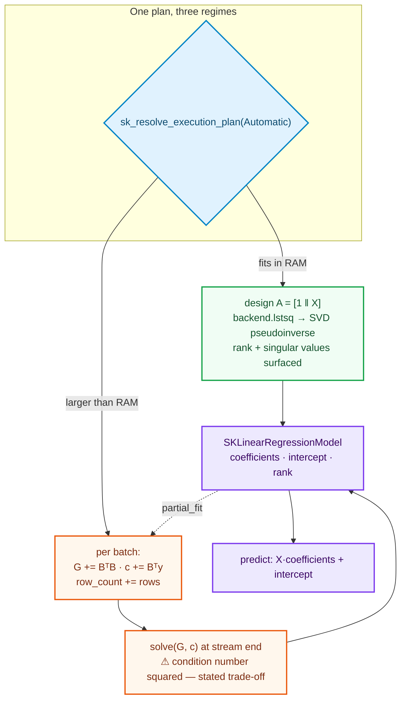

# Linear models: `SKLinearRegression`

The [imputation chapter](./ch12-simple-imputer.html) closed Wave 1 by making feature
matrices *complete*. This chapter opens Wave 2 and crosses a different boundary: for the
first time an estimator learns from **targets**. Every object before it — the scalers, the
encoders, the imputers — transformed features and never looked at an answer. `SKLinearRegression`
is the library's first **supervised** estimator, and it is the template every regressor and
classifier after it copies.

Ordinary least squares also looks deceptively simple: "draw the best line through the
points". The whole chapter is about the two places that simplicity lies. The first is *which
decomposition* carries the solve — the obvious one is a numerical trap. The second is what a
**streaming** version of a dense linear system even means, and the honest price of it.



---

## 1. The problem we were solving

We have rows of features `xᵢ ∈ ℝᵖ` and a numeric answer `yᵢ ∈ ℝ` for each. We want a vector of
coefficients `β` and an intercept `b₀` so that `xᵢ·β + b₀ ≈ yᵢ`. "Best" means least squares:
choose `β, b₀` to minimize `Σᵢ (yᵢ − xᵢ·β − b₀)²`. Written as one matrix equation, with the
**design matrix** `A = [1 ‖ X]` (a column of ones prepended to the features), it is:

```text
minimize ‖A β − y‖₂
```

Three problems sit under that innocent line.

1. **Which solver?** There are three standard roads to `β`, and the difference between them
   is not style — it is how many correct digits survive. The textbook one-liner (the *normal
   equations*) is a trap, and the trap is exactly the situation practitioners meet most.
2. **What if the columns are redundant?** Two features that co-move make the design
   rank-deficient. A naive solve returns *an* answer that claims to be *the* answer. We wanted
   the answer to admit it is degenerate.
3. **What does streaming mean?** Every estimator in the library must also run out-of-core
   (PRD §4.4). But a dense linear system has no obvious "one batch at a time" form. The choice
   of streaming formulation is a real decision with a real price.

Solving all three once, honestly, is what this chapter records.

---

## 2. The decisions — and the roads not taken

| Decision | Chosen | Roads not taken — and why they are traps |
|---|---|---|
| **Dense solver** | SVD least squares through the backend's `lstsq` (the pseudoinverse path) | **Normal equations** (`solve(AᵀA, Aᵀy)`) square the condition number: `κ(AᵀA) = κ(A)²`. For even moderately ill-conditioned real data that is the difference between ~13 and ~7 trustworthy digits, silently wrong exactly where correlated features live. **QR** is stable and cheaper but does not report rank for free — deferred as a profile-driven escape hatch. |
| **Intercept** | Design-matrix augmentation: prepend a column of ones, solve `b₀` jointly with `β` | **Center-then-solve** (subtract the means, solve, recover the intercept) collapses rank prematurely on rank-deficient designs and complicates the streaming accumulator. The augmented matrix is the *same* object the streaming path accumulates. |
| **Streaming** | **Gram accumulation**: carry `AᵀA` and `Aᵀy` per batch, solve once at the end | **Solve per batch and average the coefficients** — a weighted average hides how the rows were distributed and per-batch ranks do not compose. The Gram form composes exactly. It re-introduces the squared condition number — accepted and documented, not hidden. |
| **Rank deficiency** | Surface `rank` and `singular_values` on the model; return the minimum-norm solution | Silently computing with a rank-deficient matrix and returning "the" answer is a subtraction bug in plain sight. SVD hands rank and singular values for free. |
| **Scalar genericity** | Estimator **not** generic (its config carries no scalar); model generic over `F` | Making the estimator generic when nothing in its configuration is scalar would add a phantom type parameter — against `backend-selection`. |

---

## 3. The concepts, taught from zero

### 3.1 Three roads to the least-squares solution

Set the gradient of `‖Aβ − y‖₂²` to zero and you get the **normal equations**:
`AᵀA β = Aᵀy`. When rows ≫ columns, `AᵀA` is a small `p×p` object (instead of the tall
`n×p` design), which made this the pedagogical favourite for decades. The catch is measurable:

> `κ(AᵀA) = κ(A)²` — the condition number **squares**.

The condition number is the factor by which a linear solve can amplify rounding. Doubling its
exponent means doubling the digits you lose. If `A` has condition `10⁷`, `AᵀA` has `10¹⁴`, and
a 64-bit float has about 16 digits — with the normal equations the solve is allowed roughly
**two** digits of trust, on exactly the gritty, correlated-feature data we are asked to
process.

**QR** orthogonalizes `A = QR` and solves `β = R⁻¹Qᵀy`. Because `Q` is perfectly conditioned,
`κ(QR) = κ(A)` — the condition is *not* squared. Stable and `O(np²)`.

**SVD** factors `A = UΣVᵀ`, so `β = Σ_{σᵢ≠0} (uᵢ·y / σᵢ) vᵢ` — the pseudoinverse solution.
It costs more than QR *and* does something QR does not: **it shows you the rank**. Singular
values near zero declare exactly which features make the problem degenerate, and the
pseudoinverse path degrades gracefully when `A` is not full-rank, returning both the
minimum-norm solution and the information that it did so.

We chose SVD, exposed as the backend's `lstsq`. The *algorithm* never sees `faer` or
`ndarray-linalg` — the backend is injectable and the solver is a dispatch-level truth.

### 3.2 The design matrix and the intercept

Instead of treating the intercept as a special case, we prepend a column of ones:

```text
A = [ 1 | X ]      β = [ b₀ | β_features ]ᵀ
```

The intercept becomes one more coefficient, solved by the same call. The payoff appears in
§3.3: the streaming path accumulates `AᵀA` for *this* matrix, so the intercept rides along
with no separate pass.

### 3.3 The streaming road — and its honest price

The tempting streaming idea — solve least squares per batch and average the `β` — is almost
never right: a weighted average hides how the covered rows were distributed, and per-batch
ranks do not compose. What *composes* is the raw material of the normal equations:

```text
G := AᵀA        (p × p, symmetric)
c := Aᵀy        (p, the right-hand side)
```

Each batch `B` adds a rank-`|B|` contribution: `G := G + BᵀB`, `c := c + Bᵀy_batch`. At the
end, one solve of `Gβ = c` yields the coefficients. Exactly one extra fact must be said out
loud: **we computed `AᵀA`, so we are square-conditioning again.** The streaming trade-off is:

| | in-memory SVD | streaming Gram |
|---|---|---|
| Trustworthy digits at `κ(A)=10⁷` | ~9 | ~3–5 (the squared condition eats the rest) |
| Memory per stream step | `O(n·p)` | `O(p²)` — the entire point |
| Rank at stream end | native | only via `G`'s own singular values (≈ `σᵢ²` of `A`) |

We keep the dense path on SVD and the streaming path on the Gram. They are not "the same
computation"; they are two honest points on a trade-off, and the tests below pin where they
agree.

### 3.4 The state that combines

```rust
// crates/sciencekit_linear_model/src/linear_regression/gram.rs
pub(crate) struct SKGramState<F> {
    pub(super) design_width: usize,
    pub(super) gram: Array2<F>,   // AᵀA
    pub(super) rhs: Array1<F>,    // Aᵀy
    pub(super) row_count: u64,
}
```

The single source of truth for the incremental and streaming regimes: the coefficients are a
pure function of these three quantities, so batch order and sizes do not change the result. The
dense `fit` records the same state too, so a densely-fitted model can keep learning through
`partial_fit`.

### 3.5 A supervised streaming block

Wave 1's streaming executor carries **features only** (`SKDataBatch`). A supervised
out-of-core fit needs the targets *alongside* them. Rather than stuff a target column into the
feature matrix or duplicate the prefetch machinery, this change adds the supervised pair to
`sciencekit_common`:

```rust
// crates/sciencekit_common/src/batching/
pub struct SKSupervisedBatch<F> { features: Array2<F>, targets: Array1<F>, /* position, is_final */ }
pub trait SKSupervisedLazySource<F> { fn next_supervised_batch(&mut self) -> Result<Option<SKSupervisedBatch<F>>, Self::Error>; }
```

and generalizes the prefetch driver so both source kinds share one engine
(`sk_run_supervised_streaming_driver` alongside the unchanged `sk_run_streaming_driver`).

---

## 4. Each object, explained

### `SKLinearRegression` — the estimator

Builder-only configuration with **no scalar field**, so it is not generic:

```rust
// crates/sciencekit_linear_model/src/linear_regression/core_implementation.rs
#[derive(Debug, Clone, Copy)]
pub struct SKLinearRegression {
    pub(super) plan: SKBuilderState,
    pub(super) include_intercept: bool,
    pub(super) backend: SKBackendKind,
}
```

`SKLinearRegression::build()` exposes `include_intercept(bool)` (default `true`),
`backend(SKBackendKind)` (default `Faer`) and `execution_mode(SKExecutionMode)` (default
`Automatic`). The direct constructor is private. `fit` builds the design matrix, records the
Gram state, and solves through the backend's `lstsq` under a `Fit` span:

```rust
let design = build_design(&dense, self.include_intercept);
let gram = gram_of(&design, &target, plan.parallelism);
let solution = solve_least_squares(self.backend, design.view(), target.view())?;
SKLinearRegressionModel::from_solution(solution, gram, self.include_intercept, self.backend, self.execution_intent())
```

### `SKLinearRegressionModel` — the fitted model

The learned state and the export boundary, generic over `F: SKFloat`:

```rust
pub struct SKLinearRegressionModel<F> {
    pub(super) coefficients: Array1<F>,
    pub(super) intercept: F,
    pub(super) rank: usize,
    pub(super) singular_values: Vec<F>,
    pub(super) gram: SKGramState<F>,
    /* include_intercept, backend, execution_intent */
}
```

Accessors: `coefficients()`, `intercept()`, `rank()`, `singular_values()`, `row_count()`,
`backend()`. Prediction is `SKRegressorPredictor<F>`:

```rust
fn predict<'a, X>(&self, features: X) -> Result<Array1<F>, Self::Error> {
    let dense = features.try_into()?.as_dense()?;
    if dense.ncols() != self.coefficients.len() { /* ShapeMismatch */ }
    // ... span ...
    Ok(dense.dot(&self.coefficients).mapv(|value| value + self.intercept))
}
```

Prediction exists **only** on the model — the estimator has no `predict`, so
predict-without-fit does not compile.

### `solve_least_squares` — the per-operation dispatch

```rust
// crates/sciencekit_linear_model/src/linear_regression/solving.rs
pub(super) fn solve_least_squares<F: SKFloat>(kind: SKBackendKind, design: ArrayView2<F>, target: ArrayView1<F>)
    -> Result<SKLeastSquaresSolution<F>, SKError>
{
    let rhs = target.insert_axis(Axis(1));
    match kind {
        SKBackendKind::Faer => SKFaerBackend::new().lstsq(design, rhs),
        SKBackendKind::MatrixMultiply => SKMatrixMultiplyBackend::new().lstsq(design, rhs),
        SKBackendKind::NdArrayLinalg => sk_default_math_backend::<F>().lstsq(design, rhs),
    }
}
```

The configured kind is resolved to a concrete backend **at operation time**, never in
`build()` — the `backend-selection` rule.

### `partial_fit` and `fit_streaming` — the extra regimes

`partial_fit` merges one batch into the model's Gram state and re-solves:

```rust
self.gram.accumulate(&design.view(), &target.view(), parallelism);
let solution = solve_least_squares(backend, self.gram.gram.view(), self.gram.rhs.view())?;
let (intercept, coefficients) = split_solution(&solution.solution, include_intercept);
```

`fit_streaming` resolves the plan against an unbounded context (so `Automatic` takes the
streaming branch), drives the supervised prefetch pipeline with `update_gram`, and builds the
*same* model type at the end. An in-memory intent instead collects the batches and reuses the
dense path — out-of-core is a transport choice, not a different model.

---

## 5. Walk-through of the real tests

The executable source of truth is
`crates/sciencekit_linear_model/src/linear_regression/*_tests.rs`, with shared fixtures in
`test_datasets.rs`. The small fixture is a hand-checkable line: `X = [[1,0],[0,1],[1,1],[2,1]]`
with `y = 3·x₀ − 2·x₁ + 0.5`.

- **Exact recovery** (`recovers_exact_coefficients_and_intercept`): the SVD fit returns
  coefficients `[3, −2]` and intercept `0.5` to `1e-9`.
- **Rank surfaced** (`surfaces_rank_and_singular_values`): the augmented design is full rank
  `3`, with three non-increasing singular values.
- **Rank deficiency is a feature** (`rank_deficiency_yields_a_minimum_norm_solution`): a design
  whose second column is exactly twice the first still fits; the reported rank drops below the
  design width and the predictions still reproduce the targets.
- **Intercept off** (`intercept_can_be_disabled`): `include_intercept(false)` reports a zero
  intercept and fits the best line through the origin.
- **Errors before work** (`rejects_empty_input`, `rejects_sparse_input`,
  `rejects_target_length_mismatch`, `rejects_prediction_shape_mismatch`): each raises the right
  central `SKError` before touching the backend.
- **Backend carried** (`default_backend_is_faer`, `backend_override_reaches_the_model`): the
  configured kind reaches the model.
- **Concurrency** (`model_serves_concurrent_predictions`): one `Arc<model>` serves eight threads
  with identical predictions.
- **Streaming ≡ dense** (`streaming_matches_the_dense_fit_on_large_data`): a 50 000 × 6 design
  streamed in uneven batches agrees with the dense fit to `1e-6` — the cross-regime tolerance
  that admits the Gram's squared condition.
- **Incremental ≡ dense** (`incremental_matches_the_concatenated_fit`,
  `row_by_row_accumulation_matches_the_dense_fit`): splitting the data and accumulating with
  `partial_fit` — even one row at a time — converges to the concatenated fit.
- **Supervised streaming contract** (in `sciencekit_common`):
  `supervised_driver_pairs_features_and_targets` pins that each update step receives that
  block's features *and* targets, in order.

---

## 6. Acceptance and what it unlocked

| Acceptance criterion (PRD §8.7 / §10.3) | Where it lands |
|---|---|
| Lots and little data | the four-row fixture and the 50 000 × 6 one |
| Under concurrency | `model_serves_concurrent_predictions` + `Send + Sync` assertion |
| Model export | the model is the distinct, backend-carrying export boundary (Safetensors/JSON deferred to Phase 7) |
| Metrics | the `SKSupervisedScorer` contract is ready; the metrics suite (W6.3) exercises R² against these models |

The change also paid two debts forward. The **Gram kernels** (`sk_gram_matrix`, `sk_gram_vector`)
are reusable substrate — ridge and PCA's covariance accumulator will consume the same
cross-products. And the **supervised streaming contract** means every supervised algorithm of
Wave 2+ (ridge, lasso, logistic, SGD) fits out-of-core without reinventing a target-carrying
batch.

---

## 7. Recap

- `SKLinearRegression` is the library's first **supervised** estimator: a builder-only,
  scalar-free estimator and a distinct, generic fitted model.
- The dense fit goes through the backend's **SVD least-squares** kernel, never the normal
  equations, and surfaces `rank` and `singular_values`.
- The **intercept** is a design-matrix column, solved jointly.
- `partial_fit` and `fit_streaming` accumulate the **Gram** state (`AᵀA`, `Aᵀy`) and solve once
  — with the squared-condition trade-off stated, not hidden.
- A new **supervised streaming contract** in `sciencekit_common` carries features *and* targets
  through the shared prefetch driver.

Next chapter: the family where streaming is not an adaptation but the *home* — gradient
descent, state-as-accumulator, and why in-memory training is just "the batch of everything".
