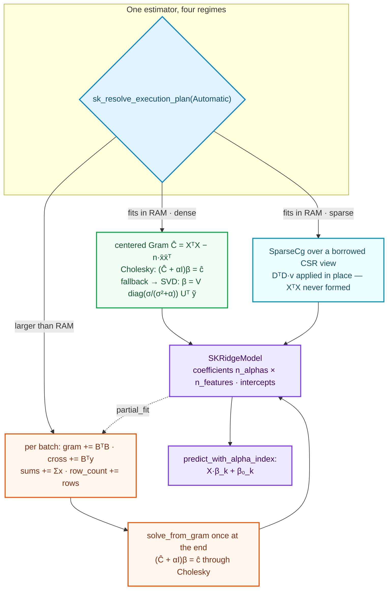
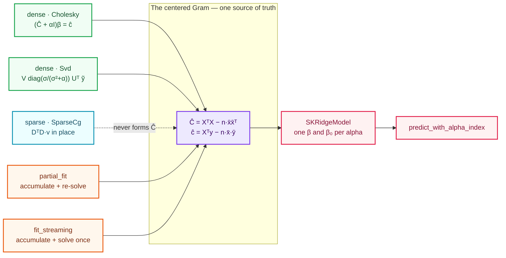

# Regularized linear models: `SKRidge`

The [linear-regression chapter](./ch13-linear-regression.html) left Wave 2 with one supervised
estimator and a deliberately narrow toolkit: it fit the *unregularized* least-squares line,
learned from dense input, and streamed via the Gram accumulator. `SKRidge` is the second
Wave 2 algorithm, and it is the first whose linear system is **regularized**. Inheriting the
estimator/model split, the per-operation backend dispatch and the Gram streaming path from
`SKLinearRegression`, it adds the four things that fit deliberately left out: a penalty
parameter that is a **configuration scalar** (so the estimator becomes generic over `F`), a
**portfolio of solvers** with different numerical personalities, **sparse input that never
densifies**, and a model that carries **one solution per `alpha`**.

Ridge also needs a piece of numerical machinery that did not exist yet — iterative solvers.
That substrate lives in `sciencekit_math`, because PCA's covariance solves and the regularized
models after ridge will want it too. This chapter tells the story of both.



---

## 1. The problem we were solving

Lesson one of ordinary least squares is "draw the best line through the points". Lesson two is
that the best line can be *wildly unstable*. When two features carry almost the same
information — height in centimetres and height in inches, two thermometers on the same wall —
the least-squares solve has to decide how to split the credit between them, and an arbitrarily
tiny change in one target value can fling the coefficients to enormous, opposite-signed values.
The line still fits the training data; it has simply stopped being a sensible description of
anything.

Ridge regression answers this by adding a **penalty** on the size of the coefficients. Instead
of minimizing only the squared error, it minimizes

```text
‖Xβ + β₀ − y‖₂² + α · ‖β‖₂²
```

The second term charges for every unit of coefficient magnitude. The penalty strength `α`
(`alpha`) is the dial: `α = 0` is ordinary least squares; larger `α` invites smaller, more
stable coefficients at the price of a little training error. This is the classic
**bias–variance trade-off** arriving as one number.

Ridge inherits four hard constraints from the library's design rules, and every one of them is
a decision this chapter has to walk through:

1. **The intercept must not be penalized.** Shrinking `β₀` would make the fit depend on where
   the target's origin happens to sit — a statistically meaningless, and damaging, penalty.
2. **Sparse input must stay sparse.** A matrix with a million columns and three non-zeros per
   row must never be converted into a dense million-wide block.
3. **One `alpha` is not enough.** Practitioners fit a whole *grid* of penalties and inspect the
   coefficient paths. Doing that naively means refactorizing once per `alpha`; ridge is worth
   supporting because it can share the expensive work across the whole grid.
4. **Every estimator also runs incrementally and out-of-core.** `partial_fit` and
   `fit_streaming` must converge to exactly the same model as the dense `fit`, regardless of
   how the rows are chopped into batches.

The rest of the chapter is the story of how those four constraints turned into the code.

---

## 2. The decisions — and the roads not taken

| Decision | Chosen | Roads not taken — and why they are traps |
|---|---|---|
| **Unpenalized intercept** | Two algebraically identical spellings: the Gram and SVD solvers **center** the data and recover `β₀ = ȳ − x̄ᵀβ`; the CG solver solves the **augmented** system `(DᵀD + αP)β = Dᵀy` with `D = [1 ‖ X]` and `P = diag(0, 1, …, 1)`. | **W2.1's plain `[1 ‖ X]` augmentation** — it would divide the penalty into the intercept column, shrinking `β₀`. **One spelling for all solvers** — centering densifies a sparse matrix, so it is only usable by the solvers that form the dense `p × p` Gram anyway; the augmented form is the sparse-friendly one, so both exist and are cross-tested. |
| **Dense exact path** | **Cholesky** on the centered normal equations `(Ĉ + αI)β = ĉ`, one solve per `alpha`. | **Normal equations on the raw design** is the W2.1 trap (`κ(AᵀA) = κ(A)²`). Ridge accepts the squared condition deliberately — the design is centered first, and the users who care about conditioning have the SVD solver (below). What ridge refuses is densifying sparse input to get there. |
| **Robust dense path** | **SVD**: one decomposition of the centered design, then `β = V diag(σ/(σ²+α)) Uᵀ ỹ` per `alpha`. The decomposition is amortized across the whole grid. | **SVD per `alpha`** — recomputing the factorization for every penalty wastes the one thing that makes a grid cheap. **QR** — stable but does not report rank for free, and rank deficiency with `α = 0` is exactly the case SVD exists for. |
| **Sparse path** | **Conjugate gradient** over a zero-copy operator on the **borrowed** CSR view: `DᵀD · v` is applied in place, so `XᵀX` is **never formed** and the design is **never densified**. | **Densify then solve** — defeats the entire point of accepting sparse input. **Preconditioned (Jacobi) CG** — plain CG first, per the "iterative evolution, no skipped steps" rule; Jacobi is a recorded follow-up. **Per-batch CG for streaming** — the operator would have to be rebuilt cumulatively and the result would depend on batch boundaries. |
| **Solver resolution** | `Automatic` resolves by representation: dense → `Cholesky`, sparse → `SparseCg`. `Cholesky` falls back to `Svd` when every `alpha` is zero or the factor fails. | **Hiding the solver choice** — silently swapping a factorization for an iterative solve changes cost and accuracy characteristics a consumer should be able to see, so the fitted model *exposes* the solver actually used. |
| **Multi-alpha model** | One coefficient row and one intercept **per `alpha`**, in configuration order; `coefficients()` is `n_alphas × n_features`. | **One estimator per `alpha`** — it would refactorize for every penalty and make the natural "inspect the path" workflow clunky; a grid is the unit ridge reasons in. |
| **Prediction** | `predict` is defined **only** for a single `alpha`; a multi-alpha model returns a structured error and directs the consumer to `predict_with_alpha_index`. | **Guessing an `alpha`** — the coefficient vector is ambiguous once several were configured, and silently picking one is a correctness bug; this mirrors scikit-learn, which raises on a multi-alpha `Ridge`. |
| **Extra regimes** | One `SKCenteredGramState` (running `XᵀX`, `Xᵀy`, `Σx`, `Σy`, row count) drives both `partial_fit` and `fit_streaming`, then one `solve_from_gram` at the end. | **Reusing W2.1's `SKGramState`** — OLS augments with the intercept column while ridge centers; the two are *different formulations* of Decision 1, so sharing one type would force one estimator into the other's spelling. |

---

## 3. The concepts, taught from zero

### 3.1 What regularization does, in one picture

Think of the two thermometers again. Least squares asks: "split the credit between the two
columns however fits best". Since the columns are nearly identical, *many* splits fit almost
equally well, and the algorithm returns whichever one rounding noise happens to favour —
typically two large coefficients of opposite sign that cancel on the training data. On new
data they stop cancelling and the prediction explodes.

Ridge changes the question to: "split the credit however fits best, **but prefer small
coefficients**". The `α · ‖β‖₂²` term makes large coefficients cost something, so among the
many near-perfect splits the solver picks the one with the smallest magnitude. The
condition number that was a cliff becomes a gentle slope, and the coefficients stop swinging.

Setting the gradient of `‖Xβ + β₀ − y‖₂² + α‖β‖₂²` to zero gives ridge's normal equations:

```text
(XᵀX + αI) β = Xᵀy
```

Everything else in this chapter is about computing that `β`, and its friends across a whole
grid of `α`, safely and cheaply.

### 3.2 Why the intercept must be left out of the penalty

The penalty charges for coefficient magnitude. If we penalized `β₀` too, then a target that
happens to average 1000 instead of 0 would need a huge `β₀`, and ridge would dutifully shrink
it toward zero — dragging the whole line down. The answer would depend on the *units and
origin of the target*, which is statistically absurd: predicting a temperature in Celsius
versus Kelvin would give different slopes.

The fix is mechanical. **Centering**: subtract each feature's mean `x̄` and the target's mean
`ȳ`; solve the penalized problem on the zero-mean data (where no intercept is needed, and
where `XᵀX` and `Xᵀy` become their centered versions `Ĉ = XᵀX − n·x̄x̄ᵀ` and
`ĉ = Xᵀy − n·x̄·ȳ`); finally recover `β₀ = ȳ − x̄ᵀβ`. The intercept is computed *after* the
penalized step, so the penalty never touches it.

The CG path writes the same estimator a second way, as one **augmented** system: stack a
column of ones onto the design (`D = [1 ‖ X]`) but give the penalty a diagonal `P` whose first
entry is `0` and the rest `1`. Then `(DᵀD + αP)β = Dᵀy` penalizes every coefficient *except*
the intercept. Centering and the unpenalized augmentation are the same estimator in different
clothes; the tests in §5 pin that they agree, so they cannot quietly drift apart.

### 3.3 A solver portfolio, and what "resolution" means

Ridge offers four settings: `Automatic`, `Cholesky`, `Svd`, `SparseCg`. `Automatic` is a small
rule, not a separate algorithm: **dense input → `Cholesky`, sparse input → `SparseCg`**. An
explicit choice is honored verbatim, with two guard rails: `Cholesky` silently falls back to
`Svd` when every `alpha` is zero (no penalty means the centered Gram can be singular) or when
the factorization fails; and `Svd` rejects sparse input with a structured error pointing at
`Cholesky`/`SparseCg`.

The rule that matters is that **the model always reports which solver actually ran**. "Which
solver ran" is observable behaviour — cost and accuracy depend on it — so the model exposes it
rather than hiding it.

### 3.4 The centered Gram — the state that combines

The only incident of `XᵀX` in ridge's dense and streaming paths is the **centered Gram state**:

```rust
// crates/sciencekit_linear_model/src/ridge/gram.rs
pub(crate) struct SKCenteredGramState<F> {
    pub(super) features_count: usize,
    pub(super) gram: Array2<F>,        // XᵀX
    pub(super) cross: Array1<F>,       // Xᵀy
    pub(super) column_sums: Array1<F>, // Σx
    pub(super) target_sum: F,          // Σy
    pub(super) row_count: u64,
}
```

Every quantity ridge needs is a pure function of these sums. `centered()` derives `Ĉ` and `ĉ`
without an index loop:

```rust
centered_gram[(i, j)] = gram[(i, j)] - row_count * feature_means[i] * feature_means[j];
centered_cross[i]     = cross[i]      - column_sums[i] * target_mean;
```

Because the coefficients depend only on the sums, **batch order and size cannot change the
result**. That single fact is why `partial_fit` (incremental, dense or sparse) and
`fit_streaming` (out-of-core) agree with the dense fit by construction, not by luck.

### 3.5 The zero-copy operator and conjugate gradient

For sparse input, forming `XᵀX` means turning a sparse matrix into a dense `p × p` block. When
`p` is a million, that is precisely the memory blow-up we are trying to avoid. So ridge never
forms it. Instead, the CG solver only ever needs to *apply* `DᵀD` to a vector, and that can be
done by walking the sparse structure twice: a forward `D v` and a backward `Dᵀ w`.

That is exactly what the `SKLinearOperator` trait abstracts:

```rust
// crates/sciencekit_math/src/solvers/linear_operator.rs
pub trait SKLinearOperator<F: SKFloat>: Send + Sync {
    fn dimension(&self) -> usize;
    fn apply_into(&self, input: ArrayView1<F>, output: ArrayViewMut1<F>);
    fn apply(&self, input: ArrayView1<F>) -> Array1<F> { /* allocating convenience */ }
}
```

The operator holds its matrix by **reference** and writes the product into a
caller-provided buffer — no ownership transfer, no copy. `SKCsrNormalEquationOperator` is the
sparse instance: `apply_into` computes `A v` from the CSR rows, then scatters each stored entry
into `Aᵀ w`, yielding `AᵀA·v` while `AᵀA` itself is never materialized.

**Conjugate gradient** is the iterative method that drives this. Starting from a zero guess, it
walks a sequence of search directions chosen so that each step is optimal along its direction
and the directions stay mutually independent; for a symmetric positive-definite system of
dimension `p` it reaches the exact solution in at most `p` steps in exact arithmetic, and
usually far fewer. Its loop is a sequential recurrence — the parallel work is inside the
operator's application. Crucially, the solve is **honest about failure**: if the iteration
budget is exhausted before the residual norm falls to `tolerance`, it returns
`SKError::NotConverged { iterations }` — it never hands back a stale vector pretending to have
converged.

Ridge wraps both into one augmented operator, `SKRidgeSparseNormalEquationOperator`, which adds
the `αP` diagonal and the intercept's constant column to the borrowed `SKCsrNormalEquationOperator`
without ever densifying anything.

### 3.6 Multi-`alpha` amortization

Why does ridge bother storing a whole grid? Because the expensive part — factorizing the
system — can be shared. The SVD solver decomposes the centered design **once** and then each
`alpha` is a cheap elementwise rescale:

```text
β(α) = V · diag( σᵢ / (σᵢ² + α) ) · Uᵀ ỹ
```

Only the `σᵢ / (σᵢ² + α)` factor changes between penalties. Fit a 100-value grid and you pay
for one decomposition, not a hundred. The Cholesky path cannot amortize across `alpha` (each
penalty changes the matrix, so each needs its own triangular solve), but its solves are cheap,
and the model shape is identical either way.

---

## 4. Each object, explained

### `SKRidge<F>` — the estimator

Builder-only configuration, and — unlike the scalar-free `SKLinearRegression` — **generic over
`F`** because its configuration carries scalars (`alpha`, `tolerance`):

```rust
// crates/sciencekit_linear_model/src/ridge/core_implementation.rs
pub struct SKRidge<F> {
    pub(super) plan: SKBuilderState,
    pub(super) alphas: Vec<F>,
    pub(super) include_intercept: bool,
    pub(super) solver: SKRidgeSolver,
    pub(super) tolerance: F,
    pub(super) maximum_number_of_iterations: usize,
    pub(super) backend: SKBackendKind,
}
```

The learned state lives **only** on the distinct `SKRidgeModel`, so "not yet fitted" is
unrepresentable and `predict` cannot be called before `fit` (the estimator has no `predict`).
`fit` is the `SKSupervisedFit` implementation; it resolves the plan against the data, opens the
`Fit` span with the configured backend, and routes to the dense or sparse path.

### `SKRidgeBuilder<F>` — the only construction surface

`SKRidge::build()` returns this. Defaults: `alpha = 1.0`, intercept included,
`Automatic` solver, `tolerance = 1e-6`, `maximum_number_of_iterations = 1000`,
`SKBackendKind::Faer`, `Automatic` execution intent. Its `alpha` setter is generic over
`SKIntoRidgeAlphas`, so `alpha(1.0)`, `alpha(vec![..])`, `alpha(array![..])`, `alpha(&[..])` and
`alpha([..])` all work. `build()` validates the hyperparameters — the alpha sequence must be
non-empty and non-negative, tolerance positive, iteration budget at least 1 — each rejection a
structured `SKError::InvalidHyperparameter` naming the offending field.

### `SKRidgeSolver` — the portfolio

```rust
pub enum SKRidgeSolver { Automatic, Cholesky, Svd, SparseCg }
```

A plain `enum` (not a type parameter), because the selection is a runtime value the estimator
carries, not a compile-time choice. This is also why the solver can be *resolved* — `Automatic`
picks per representation, and `Cholesky` can fall back — with the resolved value recorded on
the model.

### `SKRidgeModel<F>` — the fitted model and export boundary

```rust
pub struct SKRidgeModel<F> {
    pub(super) alphas: Vec<F>,
    pub(super) coefficients: Array2<F>, // n_alphas × n_features
    pub(super) intercepts: Array1<F>,   // one per alpha
    pub(super) include_intercept: bool,
    pub(super) solver: SKRidgeSolver,   // the solver actually used
    pub(super) rank: usize,
    pub(super) singular_values: Vec<F>,
    pub(super) backend: SKBackendKind,
    pub(super) execution_intent: SKExecutionMode,
    pub(super) gram: SKCenteredGramState<F>,
}
```

Accessors: `alphas()`, `coefficients()`, `intercepts()`, `solver()`, `include_intercept()`,
`backend()`, `rank()`, `singular_values()`, `feature_count()`, `row_count()`,
`coefficient_for(index)`, `intercept_for(index)`. It is `Send + Sync` by construction, so one
model serves concurrent predictions. Prediction goes through `SKRegressorPredictor<F>`
(single-alpha) or `predict_with_alpha_index` (explicit), and both accept dense and sparse
features — a sparse prediction multiplies the CSR view by the chosen coefficient column without
densifying the design.

### `SKLinearOperator`, `sk_conjugate_gradient`, `SKCsrNormalEquationOperator` — the substrate

These three live in `sciencekit_math` under their own `iterative-linear-solvers` capability,
not inside ridge, because they are general symmetric-positive-definite machinery:
`SKTruncatedSVD`, PCA and the next regularized models all consume them.

- `SKLinearOperator<F>` — the zero-copy operator abstraction (§3.5).
- `sk_conjugate_gradient` — the SPD solve; returns the solution once the residual norm is at or
  below tolerance, else `SKError::NotConverged { iterations }`.
- `SKCsrNormalEquationOperator<'a, F>` — the zero-copy `AᵀA` operator over a borrowed CSR view.

Ridge's `SKRidgeSparseNormalEquationOperator` composes the last of these, adding `α` and the
unpenalized intercept, and is the thing `SparseCg` actually drives.

---

## 5. Walk-through of the real tests

The executable source of truth is `crates/sciencekit_linear_model/src/ridge/*_tests.rs` (and
`crates/sciencekit_math/src/solvers/*_tests.rs` for the substrate). The hand-checkable fixture
is a single feature with `y = 2x`: `X = [[1],[2],[3]]`, so `Σxy = 28`, `Σx² = 14`, and with
`α = 2` and no intercept the closed-form slope is `28 / 16 = 1.75`.

### Dense fit and multi-alpha shape — `ridge_tests.rs`

- **Hand-checkable closed form** (`hand_checkable_ridge_solution_without_intercept`): fits the
  `y = 2x` fixture with `α = 2`, no intercept, and asserts the coefficient is exactly `1.75`
  and the intercept is `0`. This is ridge's definition pinned against arithmetic a human can
  verify.
- **Scalar vs sequence** (`scalar_alpha_yields_one_solution`,
  `alpha_sequence_yields_one_solution_per_value`): a scalar yields one coefficient row and one
  intercept; `[0.0, 1.0, 4.0]` yields three, **in the configured order**, and — a fact worth
  seeing — the slope *shrinks monotonically* as the penalty grows.
- **The intercept is not penalized** (`intercept_is_not_penalized`): on a design whose feature
  has zero mean and whose best line has intercept `5`, growing `α` from `1e-9` to `10` shrinks
  the slope's magnitude while the intercept stays at `5`. This is §3.2 as an assertion.
- **Intercept can be turned off** (`intercept_can_be_disabled`) and **prediction** on new rows
  (`predicts_fitted_line`) evaluates the learned line.
- **Ambiguity is refused** (`plain_predict_refuses_multiple_alphas`): a two-alpha model's
  `predict` returns `InvalidHyperparameter { name: "alpha", .. }`;
  `predict_with_alpha_index_selects_a_row` shows the explicit path yielding different responses
  for the exact (`α = 0`) and shrunk (`α = 10`) rows.
- **Resolution and carry-through** (`default_solver_resolves_to_cholesky`,
  `non_default_backend_reaches_model`, `fits_both_supported_floats`, `default_configuration`,
  `model_is_send_and_sync`): `Automatic` lands on `Cholesky` for dense input, a non-default
  backend reaches the model, both `f32` and `f64` fit, and the defaults are the documented ones.

### Solver agreement and resolution — `solver_tests.rs`

- **Cholesky matches the closed form** (`cholesky_matches_the_closed_form`): on a two-feature
  design with no intercept, the Cholesky path reproduces the explicit
  `(XᵀX + αI)⁻¹Xᵀy` computation.
- **SVD agrees with Cholesky** (`svd_agrees_with_cholesky`): the two exact dense solvers return
  the same coefficients and intercept on a well-conditioned design — the cross-solver pin of
  §3.3.
- **Rank deficiency is a feature** (`rank_deficient_svd_reports_reduced_rank`): a design whose
  second column is twice the first, with `α = 0`, still fits; the reported rank drops below the
  feature count and the singular values are surfaced.
- **The fallback is real** (`automatic_falls_back_to_svd_for_zero_penalty`): under `Automatic`,
  a rank-deficient design with `α = 0` records `Svd` — because zero penalty leaves the centered
  Gram singular. `cholesky_surfaces_no_singular_values` shows the Cholesky path reporting full
  rank and no singular values.

### The sparse path — `sparse_tests.rs`, `sparse_prediction_tests.rs`

- **CG matches dense Cholesky** (`sparse_cg_matches_dense_cholesky`): the same design as a CSR
  matrix fitted with `SparseCg` agrees with the dense `Cholesky` reference within a documented
  relative tolerance. This is the bridge between the two spellings of the intercept.
- **Representation dispatch** (`sparse_automatic_resolves_to_sparse_cg`,
  `sparse_cholesky_accepts_sparse_input`): `Automatic` picks `SparseCg` for sparse input, while
  an explicit `Cholesky` builds the sparse Gram and solves it — both routes stay sparse.
- **SVD refuses sparse** (`sparse_svd_is_rejected`, `svd_rejects_sparse_input`): a structured
  `UnsupportedRepresentation { representation: "csr", .. }` pointing at `Cholesky`/`SparseCg`.
- **Non-convergence is structured** (`sparse_zero_iteration_budget_fails_to_converge`): a zero
  iteration budget returns `SKError::NotConverged { iterations: 0 }` — never a silent answer.
- **Sparse prediction stays sparse** (`sparse_prediction_matches_dense`): predicting from the
  CSR view equals predicting from the dense matrix.

### Incremental and streaming — `partial_fit_tests.rs`, `streaming_tests.rs`

- **Split equals whole** (`incremental_after_a_dense_fit_matches_the_dense_fit`,
  `single_row_accumulation_matches_the_dense_fit`): fitting `[0..2]` then `partial_fit`-ing
  `[2..]` — even one row at a time — converges to the concatenated fit, and `row_count()`
  counts every row.
- **Batch hygiene** (`empty_batch_is_a_noop`, `partial_fit_rejects_a_column_mismatch`,
  `partial_fit_chains_several_batches`): an empty batch changes nothing, a wrong column count is
  a `ShapeMismatch`, and `partial_fit` returns the model so calls chain.
- **Sparse batches mix with dense** (`sparse_batches_accumulate_like_dense_batches`): sparse
  batches accumulate into the same centered Gram.
- **Streaming equals dense** (`uneven_batches_match_the_dense_fit`,
  `single_batch_matches_the_dense_fit`, `multi_alpha_streaming_matches_the_dense_fit`,
  `streaming_matches_the_dense_fit_on_large_data`): uneven chunks, a single batch, a
  three-value alpha grid and a large dataset all agree with the dense fit within tolerance —
  because they share one Gram state.
- **Branch behaviour** (`in_memory_intent_collects_and_matches_the_dense_fit`,
  `sparse_cg_intent_falls_back_to_the_gram_solve`): an in-memory intent collects batches and
  reuses the dense path; a `SparseCg` intent met while streaming falls back to the Gram solve
  and records `Cholesky`, since a single-pass source cannot drive a per-batch operator.

### Structured errors — `error_tests.rs`

`rejects_empty_design`, `rejects_target_length_mismatch`, `rejects_negative_alpha`,
`rejects_empty_alpha_sequence`, `rejects_zero_tolerance`, `rejects_zero_iteration_budget` and
`rejects_prediction_shape_mismatch` each raise the right central `SKError` **before** any
element is processed.

### The substrate — `sciencekit_math/src/solvers/*_tests.rs`

- `dense_operator_reports_dimension_and_writes_product` pins that `apply_into` writes the
  product and leaves both the input and the operator's borrowed data untouched.
- `conjugate_gradient_solves_hand_checkable_system` solves `[[4,1],[1,3]]x = [1,2]` (exact
  solution `[1/11, 7/11]`); `conjugate_gradient_drives_the_residual_below_tolerance` checks the
  stopping rule directly; `zero_iteration_budget_fails_immediately` and
  `unreachable_tolerance_reports_the_budget` pin the honest-failure contract.
- `normal_equation_operator_matches_explicit_gram_product` applies the operator and compares it
  to an explicitly formed `AᵀA·v`, while `normal_equation_operator_borrows_the_view_in_place`
  asserts repeated applications are identical and the source matrix is untouched.

---

## 6. Look inside

The whole change collapses to one picture: a single estimator definition, four ways to reach
it, and one invariant — every route must produce the same coefficients.



The strong insight: **regularization does not add a second estimator — it adds one diagonal to
a system you already know how to solve**, and the library's job is to expose that one system
through every input shape and every execution regime, without ever lying about which solver ran
or about how far an iterative solve actually got.

---

## 7. Recap

- `SKRidge<F>` is a builder-only, **generic** estimator (its configuration carries scalars)
  with a distinct, `Send + Sync` fitted model that is the export boundary.
- The **intercept is never penalized**: the Gram and SVD solvers center and recover
  `β₀ = ȳ − x̄ᵀβ`; the CG solver uses the algebraically identical unpenalized augmentation —
  and a cross-solver test keeps the two spellings from drifting.
- The **solver portfolio** is `Automatic`, `Cholesky`, `Svd`, `SparseCg`; `Automatic` resolves
  by representation, `Cholesky` falls back to `Svd` on a zero penalty or a failed factor, and
  the model always reports the solver actually used.
- **Sparse stays sparse**: conjugate gradient drives a zero-copy operator over the borrowed CSR
  view, so `XᵀX` is never formed and the design is never densified.
- **One solution per `alpha`**, with the SVD decomposition amortized across the whole grid; the
  ambiguous multi-alpha `predict` is refused in favour of `predict_with_alpha_index`.
- **One centered Gram accumulator** drives `partial_fit` and `fit_streaming`, so incremental,
  streaming and dense fits agree by construction.
- The iterative substrate — `SKLinearOperator`, `sk_conjugate_gradient`,
  `SKCsrNormalEquationOperator` — lives in `sciencekit_math` and is reused by later sparse and
  decomposition algorithms.

Next: the family where the penalty becomes a *selection* — `SKLasso`'s L1 norm drives
coefficients to exactly zero, turning a regressor into a feature selector, and the follow-up
changes ridge's Jacobi preconditioning and its `RidgeCV` grid search.
