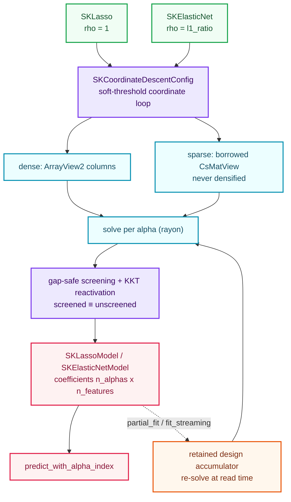
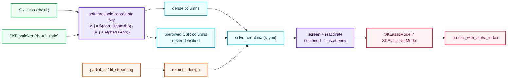

# L1-regularized linear models: `SKLasso` and `SKElasticNet`

The [ridge chapter](./ch14-ridge-regression.html) ended with the family "where the penalty
becomes a *selection*". This is that family. `SKLasso` and `SKElasticNet` are the third pair of
Wave 2 algorithms, and they are the first whose penalty is **not a smooth function**. Ridge's
penalty is an L2 ball, differentiable everywhere, so its normal equations are one linear solve.
The L1 penalty $\lVert\beta\rVert_1$ has a kink at the origin, and that kink is exactly what
makes a coefficient become **exactly zero** — the regressor turns into a feature selector.

No closed form survives the kink. Ridge could be solved by a factorization; Lasso cannot. It
needs a solver that respects the non-differentiability, and the field settled on **coordinate
descent** — Friedman, Hastie and Tibshirani's *glmnet* (2010), the reference algorithm this
change follows, building on Tibshirani's original Lasso (1996) and Zou and Hastie's ElasticNet
(2005). Two more constraints come along with it: a sparse design must stay sparse **through the
solve**, and the incremental and streaming regimes cannot reuse ridge's Gram accumulator,
because the L1 objective is not a function of $X^\top X$ alone.

---

## 1. The problem we were solving

Suppose we hand a regression problem a hundred features, of which three actually matter. Ridge
will not say so: it will keep every coefficient a little bit alive, because shrinking a
coefficient to zero and keeping it tiny cost almost the same under a smooth penalty. We want a
model that **refuses** the irrelevant features. That is what the L1 norm buys.

The objective for ElasticNet is

$$\min_{\beta,\ \beta_0}\ \frac{1}{2n}\lVert y - X\beta - \beta_0\mathbf{1}\rVert_2^2
\;+\; \alpha\rho\lVert\beta\rVert_1 \;+\; \frac{\alpha(1-\rho)}{2}\lVert\beta\rVert_2^2,$$

and Lasso is the special case $\rho = 1$. The three constants are the dials the estimators
expose: $\alpha$ (`alpha`) sets the overall penalty strength, and $\rho$ (`l1_ratio`) mixes the
two penalties. At $\rho = 1$ the model is a pure feature selector; at $\rho = 0$ it is ridge; in
between it is ElasticNet, which keeps the selection behaviour while adding the L2 term's
stability when features are correlated.

Three constraints shape the whole implementation:

1. **The kink forbids a closed form.** The subgradient at $\beta_j = 0$ is a set, not a number,
   so we cannot invert a matrix. We need an iteration that reduces to a **soft-threshold** at
   each coordinate.
2. **Sparse stays sparse.** A text-classification design with a million columns and a handful of
   non-zeros per row must never be densified — not to center it, not to form $X^\top X$.
3. **The Gram is not enough.** Ridge's `partial_fit` and `fit_streaming` accumulated $X^\top X$
   and $X^\top y$ and solved once. The L1 objective cannot be reconstructed from those sums, so
   those two regimes must **keep the design** and re-solve. That is a real memory cost, and the
   chapter is honest about it.

The rest of the chapter is how those constraints became code.

---

## 2. The decisions — and the roads not taken

| Decision | Chosen | Roads not taken — and why they are traps |
|---|---|---|
| **One body, two names** | A shared `coordinate_descent` substrate; `SKLasso` and `SKElasticNet` are thin builder-configured estimators over it, with **distinct** fitted models. | **One public estimator with an `l1_ratio`** — scikit-learn ships two names for two statistically distinct models, and the wave plan names both. **Duplicating the solver** — Lasso is the `l1_ratio = 1` case of the same objective, so two solvers would drift. |
| **The solver** | **Coordinate descent**: sweep the coordinates and update each by a soft-threshold of the partial residual, `wⱼ ← S(xⱼᵀr/n + aⱼwⱼ, αρ) / (aⱼ + α(1−ρ))`. | **Proximal gradient / FISTA** — plain coordinate descent first, per the "iterative evolution, no skipped steps" rule. **A second-order QP solver** — heavier and not the field's reference for Lasso. |
| **Convergence** | The **maximum coordinate change** across a sweep, against `tolerance`, bounded by `maximum_number_of_iterations`; exhaustion raises `SKError::NotConverged { iterations }`. | **A fixed iteration count** — silent truncation dressed up as a solution. **A residual norm alone** — it does not measure the coordinate-wise step that actually drives L1. |
| **The intercept** | An **unpenalized coordinate**: every sweep, `β₀ ← β₀ + mean(r)` and the residual is recentered — algebraically identical to centering the design, but it never densifies a sparse column. | **Center-then-solve** — centering $x_j - \bar{x}_j$ is dense even for a sparse column, exactly the ridge trap applied to L1. **Penalizing the intercept** — makes the fit depend on the target's origin. |
| **Screening** | A strong initial active set, a **gap-safe** safe-screening test derived from the primal–dual gap, and a **KKT reactivation** pass that adds back any violating coordinate. The final answer equals the unscreened solve **by construction**. | **Screening without reactivation** — a heuristic that can silently return a suboptimal answer. **No screening** — leaves the sparse-solution win on the table. |
| **Sparse path** | Dense and sparse share **one** coordinate loop through a column-access abstraction; a sparse design's column entries are gathered as `(row, value)` lists and the design is never densified. | **A separate sparse solver** — doubles the iteration, the screening and the convergence logic, and lets them drift. **Densify then solve** — defeats accepting sparse input. |
| **Incremental / streaming** | A shared **retained-design** accumulator: dense batches appended, sparse batches stacked, re-solved at read time; independent of batch order and size. | **Reusing ridge's Gram accumulator** — the L1 objective is not a function of $X^\top X$. **Per-batch online coordinate descent** — the result would depend on batch boundaries, breaking "incremental ≡ dense". |
| **Parallelism** | Rayon across the **independent per-`alpha` solves**; the result is independent of the thread count. | **Parallel coordinate updates inside one solve** — the residual is shared mutable state; not this change. **Multi-output target matrices** — scikit-learn ships `MultiTaskLasso`/`MultiTaskElasticNet` as separate estimators; deferred. |
| **Prediction** | `predict` is defined **only** for a single `alpha`; a multi-alpha model returns a structured error and directs the consumer to `predict_with_alpha_index`. | **Guessing an `alpha`** — the coefficient vector is ambiguous; silently picking one is a correctness bug. |

---

## 3. The concepts, taught from zero

### 3.1 The soft-threshold — a penalty turned into a decision

Minimize, over a single coordinate $w_j$ with everything else fixed,

$$\frac{1}{2n}\lVert r_+ - x_j w_j\rVert_2^2 \;+\; \lambda\lvert w_j\rvert,$$

where $r_+$ is the residual *including* coordinate $j$'s current contribution. Setting the
(sub)gradient to zero gives the closed-form minimizer

$$w_j = \frac{S(x_j^\top r_+ / n,\ \lambda)}{\lVert x_j\rVert_2^2 / n},\qquad
S(z, \lambda) = \operatorname{sign}(z)\,\max(\lvert z\rvert - \lambda, 0).$$

$S$ is the **soft-threshold**: it shifts the correlation toward zero by $\lambda$ and clamps
anything inside the band to exactly zero. This is the entire source of Lasso's sparsity — a
feature whose partial correlation is weaker than the penalty is not shrunk, it is *removed*.
The ElasticNet variant simply adds the L2 denominator: the update becomes
$S(\cdot,\alpha\rho) / (a_j + \alpha(1-\rho))$ with $a_j = \lVert x_j\rVert_2^2/n$.

### 3.2 Coordinate descent, and why it converges

If we cannot solve all coordinates at once, we solve them **one at a time**: fix every
$w_k$ for $k \ne j$, solve exactly for $w_j$ with the soft-threshold, update the residual by
$r \mathrel{-}= x_j\,\Delta w_j$, and move on. A **sweep** visits every coordinate once. Because
the objective is convex and each coordinate step strictly decreases it, the iteration converges
to the global optimum; the only question is how fast, and that is what `tolerance`,
`maximum_number_of_iterations` and `selection` (cyclic or a deterministic random order) control.

Convergence is declared when the largest coordinate change over a whole sweep falls to
`tolerance` or below. This is the criterion glmnet uses, and it measures precisely the quantity
that matters: how much the coefficients are still moving.

### 3.3 The intercept is just another coordinate

Shrinking the intercept would make the fit depend on where the target's origin happens to sit —
statistically wrong. Turning the intercept into a coordinate makes the rule beautiful: its exact
update is `β₀ ← β₀ + mean(r)`, i.e. *recenter the residual and push the removed mean into the
intercept*. After every sweep the residual has mean zero, so the feature gradients
$x_j^\top r / n$ equal the **centered** gradients $x̃_j^\top r / n$ for free — no dense
centering of the design required. This is why the sparse path can stay sparse.

This is algebraically the *same* estimator as "center the design, solve, recover
$\beta_0 = \bar{y} - \bar{x}^\top\beta$" — the two are pinned together by the closed-form tests.

### 3.4 Gap-safe screening, correct by construction

Lasso's solution is sparse: most coordinates are exactly zero at the optimum. Screening skips
those coordinates so the solver never even visits them. The danger is skipping a coordinate that
*should* be active, which would silently return a wrong answer. The change makes that impossible.

The pure-L1 problem has a firm primal–dual bound. For any dual-feasible point $z$ (satisfying
$\lVert X^\top z\rVert_\infty \le \alpha$) and the dual optimum $z^\*$, the primal–dual gap $G$
bounds the distance

$$\lVert z^\* - z\rVert_2 \;\le\; R = \sqrt{2G/n}.$$

A coordinate is then **provably zero** when

$$\lvert x_j^\top z\rvert + \lVert x_j\rVert_2\,R \;<\; \alpha,$$

because $\lvert x_j^\top z^\*\rvert < \alpha$ contradicts complementary slackness for
$\beta_j \ne 0$. The solver builds $z$ from the current residual, computes the gap, and screens.
Then — and this is the safety net — after the screened active set converges it checks the
**full** gradient on every coordinate and **reactivates** any violator, re-solving until none
remain. Screening can only change how much work is done, never the answer; a dedicated test
forces a coordinate out of the active set and asserts the reactivation recovers the exact
unscreened solution.

### 3.5 The retained design — the price of L1

Ridge's extra regimes carried a fixed $O(p^2)$ Gram state and solved at the end. L1 cannot: the
soft-threshold needs the actual columns, not their cross-products. So `partial_fit` and
`fit_streaming` accumulate the **design** — dense rows appended, or CSR batches stacked — plus
the targets, and re-solve the whole thing at read time. Memory grows with the data; that is the
documented price of an out-of-core L1 fit, and it buys an order-independent result: any chopping
of the rows into batches yields the same model as one dense fit.

### 3.6 One solve per `alpha`, in parallel

Each `alpha` is an independent L1-regularized problem. When several are configured, the
`coordinate_descent::solver` runs them over the rayon pool (`alphas.par_iter()`), so a grid of
penalties costs little more than one solve on a multi-core machine. The result is deterministic:
a test asserts the parallel rows equal the sequential single-`alpha` solves.

---

## 4. Each object, explained

### `SKLasso<F>` and `SKElasticNet<F>` — the estimators

Builder-configured, immutable, and **generic over `F`** because their configuration carries
scalars (`alpha`, `tolerance`, and `l1_ratio`). Like ridge, the learned state does not live here:
the estimator is configuration, the model is the fit. `SKElasticNet` stores its
coordinate-descent configuration as a `SKCoordinateDescentConfig<F>`; `SKLasso` fixes the
mixing ratio at one.

### `SKLassoBuilder<F>` and `SKElasticNetBuilder<F>` — the only construction surface

Both expose `alpha` (a scalar or a sequence through `SKIntoAlphas`), `include_intercept`,
`positive`, `selection`, `screening`, `tolerance`, `maximum_number_of_iterations`, `backend`
(default `Faer`) and `execution_mode` (default `Automatic`); ElasticNet adds `l1_ratio` (default
`0.5`, validated to $[0, 1]$). `build` validates the whole surface with
`sk_validate_coordinate_descent_hyperparameters` and returns the central `SKError`, never a
panic.

### `SKSelection` — the sweep order

`Cyclic` visits coordinates in index order; `Random` visits a deterministic Fisher–Yates
permutation over an xorshift stream, so the "random" order is reproducible. Both converge to the
same solution, which a test pins.

### `SKCoordinateDescentConfig<F>` — the internal objective configuration

A crate-internal struct carrying `tolerance`, `maximum_number_of_iterations`, `positive`,
`selection` and `screening`. It is deliberately internal — the public surface is the builders —
but it is the seam through which both estimators hand the solver one identical configuration.

### `SKCoordinateDescentModelCore<F>` — the shared learned state

The single implementation behind both fitted models: the `n_alphas × n_features` coefficients,
the per-`alpha` intercepts, the `l1_ratio`, the backend kind, the screening count, the
configuration and the retained design. `predict_with_alpha_index` and `partial_fit` live here so
the two public model types cannot diverge.

### `SKLassoModel<F>` and `SKElasticNetModel<F>` — the fitted models

Distinct, `Send + Sync` public types wrapping the core, with `alphas()`, `coefficients()`,
`intercepts()`, `l1_ratio()` (ElasticNet), `backend()`, `include_intercept()`, `positive()`,
`row_count()`, `screened_count()`, per-`alpha` accessors, `predict_with_alpha_index` and the
`SKRegressorPredictor<F>` impl. They are the export boundary a later interop change will extend.

---

## 5. Walk-through of the real tests

The executable source of truth lives beside the implementation, in the `*_tests.rs` modules.
This section walks the ones that matter.

### Closed forms — `coordinate_descent/solver_tests.rs`

The substrate's tests use an **orthogonal mean-zero design** (a Hadamard-like matrix) whose
columns have squared norm four and whose targets are $X\cdot[2,-1,0]$. Because the columns are
orthogonal, the Lasso solution is exactly $w_j = S(\beta_j, \alpha)$ and the intercept is zero —
hand-checkable for any penalty. `orthogonal_design_matches_the_closed_form` checks
$[1.5, -0.5, 0]$; `zero_penalty_recovers_least_squares` checks that $\alpha = 0$ recovers the
ordinary least-squares solution; `large_penalty_zeroes_every_coefficient` checks that a penalty
above every gradient magnitude zeroes the whole vector. `sparse_matches_dense` runs the same
one-feature problem through the CSR path and asserts the two agree.

### Sparsity and optimality — `lasso/lasso_tests.rs`

`irrelevant_feature_is_exactly_zero` asserts that the third coefficient is `0.0` — not "small",
exactly zero, the whole point of the L1 norm. `kkt_conditions_hold` recomputes the gradient
$x^\top r / n$ at the solution and asserts the Lasso KKT conditions: active coordinates have
$\lvert g_j\rvert = \alpha$, inactive ones have $\lvert g_j\rvert \le \alpha$.

### The mixing ratio — `elastic_net/elastic_net_tests.rs`

`l1_ratio_one_reproduces_lasso` fits the same data with `SKLasso` and with `SKElasticNet` at
`l1_ratio = 1.0` and asserts the coefficients agree; `l1_ratio_zero_reproduces_the_pure_l2_closed_form`
checks the other end of the dial against $\beta_j/(1+\alpha)$; `kkt_conditions_hold` checks the
ElasticNet subgradient $g_j = \alpha(1-\rho)\beta_j + \alpha\rho\,\operatorname{sign}(\beta_j)$
on the active set.

### Screening — `coordinate_descent/screening_tests.rs`

`screening_matches_unscreened` fits with screening on and off and asserts the solutions are
identical while the screened run reports at least one excluded coordinate.
`kkt_reactivation_recovers_a_screened_coordinate` calls the inner solver with a deliberately
truncated active set (only the first of three coordinates) and asserts the reactivation pass
recovers the exact unscreened answer `[1.5, -0.5, 0.0]`. The remaining tests check the gap-safe
radius, the dual-feasible scaling, the safe-zero test and the KKT violation detector directly.

### Incremental and streaming — `lasso/streaming_tests.rs`, `elastic_net/streaming_tests.rs`

`uneven_batches_match_the_dense_fit` streams `[1, 2, 1]` and `[1, 2, 1]`-shaped chunks and
compares to one dense fit; `partial_fit_split_batches_equal_the_whole` accumulates two batches
into a fitted model and compares; `partial_fit_sparse_batch_matches_dense` accumulates a **CSR**
batch into a dense fit; `empty_source_is_rejected` and `column_mismatch_is_rejected` pin the
error paths. `streaming_matches_the_dense_fit_on_large_data` runs the check at 12 000 rows.

### Concurrency — `lasso/thread_tests.rs`, `elastic_net/thread_tests.rs`

`model_serves_concurrent_predictions` shares one fitted model across eight threads through an
`Arc` and asserts every prediction equals the single-threaded result — the model is `Send + Sync`
by construction.

---

## 6. Look inside

The whole change is one idea: **a kink needs an iteration, and that iteration must give the same
answer through every input shape and every regime.**

The strong insight: **the L1 penalty does not change the estimator's shape — it changes the
solver from a factorization to a coordinate-wise iteration**, and the library's job is to expose
the same estimator through dense and sparse input, through incremental and out-of-core fits, and
to never lie about how far the iteration got or about which coordinates it skipped.

---

## 7. Recap

- `SKLasso<F>` and `SKElasticNet<F>` are builder-only, **generic** estimators with distinct,
  `Send + Sync` fitted models that are the export boundary.
- One shared **coordinate-descent** substrate serves both: soft-threshold updates, an
  unpenalized residual-mean intercept, cyclic/deterministic-random sweeps and convergence on the
  maximum coordinate change, with a structured `NotConverged` on budget exhaustion.
- The **L1 penalty produces exact zeros**; a test asserts a coefficient is `0.0`, and the KKT
  conditions hold at the solution.
- **Sparse stays sparse**: dense and sparse share one coordinate loop through a column-access
  abstraction, and the design is never densified.
- **Gap-safe screening** drops provably-zero coordinates, and a **KKT reactivation** pass makes
  the screened solution equal to the unscreened one by construction.
- **The design is retained** for `partial_fit` and `fit_streaming`, because the L1 objective is
  not a function of the Gram; the result is independent of batch order and size.
- **One solve per `alpha`**, run in parallel over the compute pool, exposed through a model that
  refuses an ambiguous multi-`alpha` `predict` in favour of `predict_with_alpha_index`.

Next: the penalty family turns to classification. `SKLogisticRegression` reuses this
coordinate-descent substrate for its L1 penalty, adds SAGA for the large-scale path, and extends
the select-then-predict story from regression to classification.
