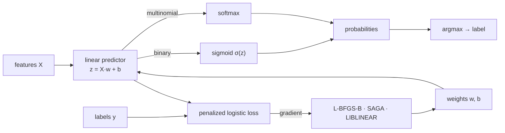

# The first classifier: `SKLogisticRegression`

> **Chapter 16 of the Development Explained book.** Prerequisites: the supervised
> estimator shape from [chapter 13](./ch13-linear-regression.html), the solver portfolio from
> [chapter 14](./ch14-ridge-regression.html) and the coordinate-descent substrate from
> [chapter 15](./ch15-lasso-elastic-net.html). This chapter explains the *why* behind the
> Wave 2.4 change, from zero.

## 1. The problem we were solving

Every linear model so far — `SKLinearRegression`, `SKRidge`, `SKLasso`, `SKElasticNet` — is a
**regressor**: it predicts a number, and its loss is a quadratic whose minimum is a *linear*
system. `SKLogisticRegression` is the library's first **classifier**, and that changes three
things at once.

1. **The loss is nonlinear.** We predict the *probability* that a row belongs to a class with
   the logistic function; the loss is the negative log-likelihood, and its gradient is a
   nonlinear function of the coefficients. There is no normal-equation, SVD or Cholesky solve.
2. **The output is different.** A classifier returns a **label** and a **probability per
   class**, not a number. In this library those live behind `SKClassifierPredictor<F>`:
   `predict_labels` returns canonical `i64` indices, `predict_probabilities` returns one column
   per class.
3. **The model is multi-headed.** With more than two classes the model carries **one
   coefficient vector per class**, not one vector overall.

scikit-learn's `LogisticRegression` is the richest estimator in its linear family, so the wave
plan scoped this change for **full parity**: every penalty, a portfolio of solvers, and both
one-vs-rest and multinomial classification.



## 2. The decisions — and the roads not taken

- **Three solvers, not one.** A single gradient solver cannot handle the non-smooth L1 penalty
  and is slow on sparse designs. We chose **L-BFGS-B** (with an orthant-wise step for the L1
  component) for the smooth L2/none path, **SAGA** — a variance-reduced incremental-gradient
  method — for L1/ElasticNet/none and the sparse path, and a **LIBLINEAR-style
  coordinate-descent** solver for the L1/L2 one-vs-rest path. *Road not taken:* adding
  `newton-cg`/`newton-cholesky` (dense Hessians that fight the sparse goal) and `sag` (a
  near-duplicate of SAGA without L1).
- **Both `C` and `alpha`.** scikit-learn parameterizes by `C = 1/alpha`; our other linear
  models use `alpha`. The builder accepts **both** — the last setter wins, and using both
  emits a warning — so a reader porting scikit-learn code and a reader used to `SKRidge` are
  both at home. *Road not taken:* a single `RegularizationStrength` enum (heavier for no
  observable gain).
- **`warm_start` as an explicit source.** scikit-learn stores the last solution *on the
  estimator*. Our estimators are immutable and shared across threads, so instead
  `warm_start_from(&model)` seeds the optimizer from a supplied solution; the estimator stays
  stateless. This is a deliberate, documented deviation.
- **`auto` multi-class resolution.** `auto` picks **multinomial** for the smooth solvers on
  more than two classes and **one-vs-rest** for LIBLINEAR (which is one-vs-rest by
  construction) and for binary problems; `ovr`/`multinomial` force the strategy, and
  LIBLINEAR with multinomial is a structured error.

## 3. The concepts, taught from zero

### 3.1 The sigmoid and the softmax

For two classes the model computes a score `z = x·w + b` and turns it into a probability with
the **sigmoid** `σ(z) = 1 / (1 + e^{−z})`, which is always between 0 and 1 and equals `0.5` at
`z = 0`. For several classes it computes one score per class and uses the **softmax**, which
normalizes the exponentiated scores into a probability distribution that sums to one. Both are
implemented to be stable in the tails (`logistic/objective.rs`): the sigmoid never overflows,
and the softmax subtracts the row maximum before exponentiating.

### 3.2 The objective

The fit minimizes the **penalized negative log-likelihood**. With a per-sample weight `cᵢ`
and the regularization strength `α = 1/C`:

```text
F(w, b) = (1/n)·Σᵢ cᵢ · loss(xᵢ, yᵢ; w, b)  +  P(w)
```

where `loss` is `log(1 + e^{−y·z})` for two classes and `−log softmax` for several, and `P(w)`
is `(α/2)‖w‖²` (L2), `α‖w‖₁` (L1), `α·(l1_ratio·‖w‖₁ + (1−l1_ratio)/2·‖w‖²)` (ElasticNet) or
`0` (none). The **intercept is never penalized** — shrinking it would make the fit depend on
the origin of the data.

### 3.3 L-BFGS-B: a smarter gradient descent

Plain gradient descent crawls along the gradient. **L-BFGS-B** keeps a short history of
recent steps and how the gradient changed, and uses that history to *estimate the curvature*
of the loss, taking a much better step each iteration (the "two-loop recursion" in
`solver/lbfgs.rs`). It is exact for smooth objectives, which is why it is the default for L2
and `none`.

### 3.4 SAGA: variance-reduced gradients

The L1 penalty is non-smooth at zero, so a plain gradient method stalls. **SAGA** looks at one
sample at a time but remembers each sample's last gradient in a table; it then uses the
difference between the fresh and remembered gradient plus the running average to form a
*low-variance* estimate of the true gradient. A **soft-threshold** step then turns the L1
penalty into an exact zero when a coefficient is small enough — the same "decision" as in
[chapter 15](./ch15-lasso-elastic-net.html), which is why SAGA yields sparse solutions.

### 3.5 LIBLINEAR: coordinate descent

The third solver walks one coordinate at a time. For L2 it works on the **dual** problem
(a reformulation with one variable per sample), solving each coordinate with a few Newton
steps bounded inside a box; for L1 it works on the **primal** with a soft-threshold step. Both
keep a sparse design sparse, because they only ever read one row or one column at a time.

### 3.6 One interface, dense and sparse

The solvers never see a matrix. They see a `SKLogisticDesign` trait (`logistic/design.rs`) with
just three moves: the dot of one row with the weights, adding a scaled row into a vector, and
the dot of one column with a vector. A dense design and a **borrowed CSR** design implement it,
so a sparse design is never turned into a dense one — the only dense object kept is the
`O(rows × classes)` score matrix.

### 3.7 Labels become indices

A classifier must map arbitrary labels (`"cat"`, `"dog"`, or the integers `7`, `3`) to compact
indices `0, 1, …`. We reuse `SKLabelTable` and `sk_canonicalize_labels`: labels are recorded in
first-occurrence order and the fitted model keeps the table, so predictions map back to the
original labels. Continuous targets are rejected.

### 3.8 The retained design, again

The logistic objective, like the L1 objective, is **not** a function of the Gram matrix
`XᵀX`. So the incremental (`partial_fit`) and out-of-core (`fit_streaming`) regimes cannot keep
cross-products: they **retain the design** in a `SKLogisticState` and re-solve at read time.
This is the same trade-off the L1 pair made, and it is documented.

## 4. Each object, explained

### `SKLogisticRegression<F>` — the estimator

Immutable configuration. `SKLogisticRegression::<f64>::build()` returns a builder; `.build()`
returns the estimator; `fit`/`fit_streaming` produce a model. It carries `backend`,
`execution_mode`, the penalty, the solver and the multi-class choice.

### `SKLogisticRegressionBuilder<F>` — the only construction surface

Chainable setters: `penalty`, `l1_ratio`, `C`, `alpha`, `solver`, `multi_class`,
`class_weight`, `warm_start`, `warm_start_from`, `include_intercept`, `tolerance`,
`maximum_number_of_iterations`, `backend`, `execution_mode`. Defaults: L2, `alpha = 1.0`,
`Lbfgs`, `Auto`, no class weight, intercept on, `tolerance = 1e-4`, 100 iterations, `Faer`,
`Automatic`. The direct constructor is private.

### `SKLogisticRegressionModel<F>` — the fitted model

Holds the coefficients (`heads × features`), the intercepts, the class table, the backend kind
and the retained design. Implements `SKClassifierPredictor<F>` (`predict_labels`,
`predict_probabilities`), exposes `decision_function`, and is `Send + Sync` by construction.
`partial_fit` continues learning.

### `SKLogisticPenalty`, `SKLogisticSolver`, `SKMultiClass`, `SKClassWeight<F>`

The four public enums that name the configuration surface: the penalty, the solver, the
multi-class strategy and the class-weighting policy (`None`, `Balanced`, `Explicit`).

## 5. Walk-through of the real tests

The tests are the executable source of truth.

### The solvers — `logistic/solver/solver_tests.rs`

`lbfgs_binary_separates_the_classes` fits a separable design and checks every row lands on the
right side of the decision boundary. `saga_l1_drives_the_zero_column_to_exact_zero` asserts an
irrelevant feature is driven to **exactly** zero — the soft-threshold in action.
`saga_and_lbfgs_agree_under_l2` and `liblinear_l2_matches_lbfgs_without_intercept` cross-check
two different algorithms on the same optimum. `sparse_and_dense_agree` fits the same design
densely and as CSR and compares. `a_tiny_budget_reports_non_convergence` checks the structured
`NotConverged` error.

### The estimator — `logistic_regression/logistic_regression_tests.rs`

`builder_defaults_are_documented` pins the surface; `c_and_alpha_are_reciprocal` checks the
`C`/`alpha` duality; `binary_fit_predicts_labels_and_probabilities` and
`multinomial_fits_three_classes` check labels and that probabilities sum to one;
`nominal_labels_round_trip` checks the class table; `balanced_class_weight_fits_an_imbalanced_design`,
`warm_start_reaches_the_same_optimum`, `partial_fit_equals_the_dense_fit` and
`a_shared_model_serves_concurrent_predictions` round out the acceptance criteria.

### Streaming — `logistic_regression/streaming_tests.rs`

`streaming_equals_the_dense_fit` feeds the data in two batches and checks the result matches the
dense fit; `an_empty_source_is_rejected` checks the structured error.

## 6. Look inside

| Path | What it holds |
|---|---|
| `logistic/config.rs` | the enums, the objective configuration, the validation |
| `logistic/resolution.rs` | the penalty/solver matrix and multi-class resolution |
| `logistic/class_weight.rs` | the per-sample weight expansion |
| `logistic/objective.rs` | sigmoid, softmax, loss and gradient primitives |
| `logistic/design.rs` | the dense/CSR design abstraction |
| `logistic/solver/` | L-BFGS-B, SAGA, LIBLINEAR and the orchestration |
| `logistic/accumulator.rs` | the retained design for incremental/streaming fits |
| `logistic_regression/` | the estimator, the fitted model and the streaming fit |

## 7. Recap

- The first classifier: a **nonlinear**, **multi-headed** loss with a **label/probability**
  surface.
- Three solvers behind one design abstraction; dense and CSR share every path.
- `C` and `alpha` both accepted, last setter wins; `warm_start` is an explicit source.
- Targets canonicalize through `SKLabelTable`; the model is a distinct, backend-carrying
  export boundary.

Next, Wave 2 continues with `SKSGDClassifier`/`SKSGDRegressor`, which reuse the SAGA idea for a
fully streaming, out-of-core pair.
