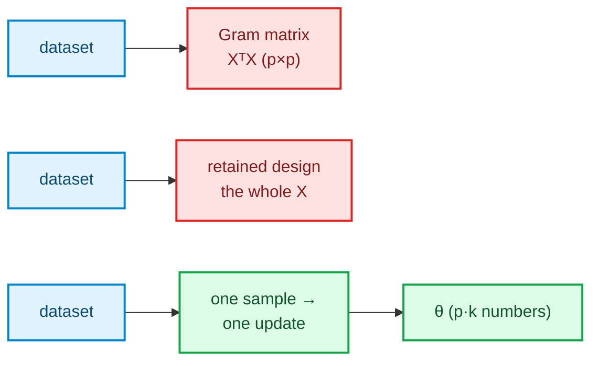
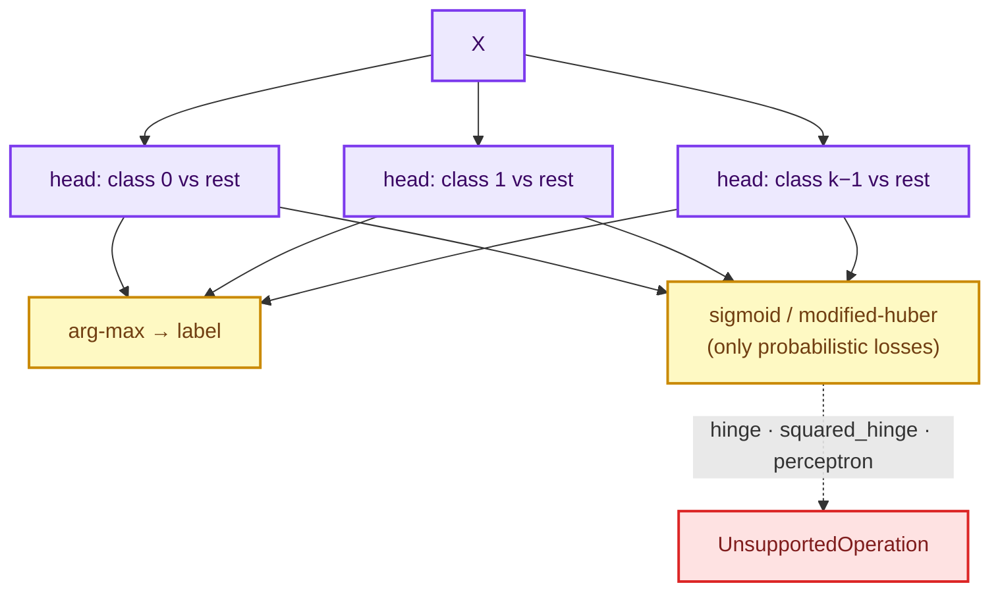
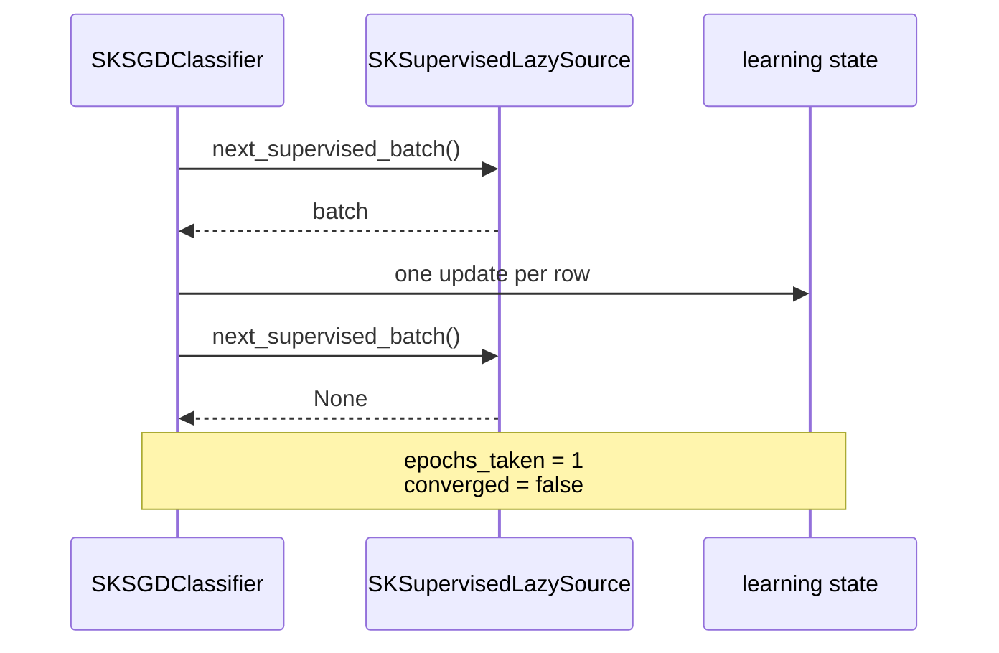

# Stochastic gradient: `SKSGDClassifier` & `SKSGDRegressor`

> **Chapter 17 of the Development Explained book.** Prerequisites: the supervised estimator
> shape from [chapter 13](./ch13-linear-regression.html), the regularized solvers from
> [chapters 14](./ch14-ridge-regression.html) and [15](./ch15-lasso-elastic-net.html), and
> the classifier surface from [chapter 16](./ch16-logistic-regression.html). This chapter
> explains the *why* behind Wave 2.5, from zero.

## 1. The problem we were solving

Every linear model before this one touches the **whole design**. `SKLinearRegression` and
`SKRidge` build a Gram matrix or a decomposition; `SKLasso`, `SKElasticNet` and
`SKLogisticRegression` keep a **retained design** that grows with the stream. Their fits are
exact, and their memory is a function of the dataset.

`SKSGDClassifier` and `SKSGDRegressor` are the library's **first truly streaming supervised
estimators**: each update consumes **one sample**, so nothing about the cost depends on the
dataset living in memory. That is the architectural point of the change — and the reason the
PRD puts it in the out-of-core differentiator, not in the "another linear model" list.



The second reason is mathematical. The logistic loss has no closed form; the coordinate
descent family solves that with a full pass per sweep. SGD instead takes a **noisy estimate of
the gradient from one sample** and moves. Nobody promises the last step is at the optimum —
the promise is that the *sequence* converges, and that the cost per step is `O(p)`.

## 2. The decisions — and the roads not taken

| Decision | Chosen | Road not taken — and why |
|---|---|---|
| Update granularity | **one sample per update**, with an epoch loop around it | Mini-batch updates would vectorize better, but they change the convergence theory and the schedule semantics; scikit-learn's SGD is per-sample, and parity is the goal. |
| Where the algebra lives | a separate `sgd` **substrate** (`loss/`, `learning_rate/`, `penalty.rs`, `shuffle.rs`, `averaging.rs`, `update.rs`, `epoch/`) | Putting it inside each estimator would duplicate the loss catalogue and the schedules — and Wave 3's linear SVM and Wave 5's mini-batch k-means reuse this loop. |
| Loss catalogue | two public enums, one per task family, behind a sealed trait | One enum forces a runtime family check in the hot loop and lets a regressor loss reach the classifier. |
| L1 penalty | **proximal soft-threshold** after the gradient step | Adding an L1 subgradient to the step does not produce exact zeros; the soft-threshold does, which is the whole point of L1. |
| Averaging | optional **running mean** of visited iterates (ASGD) | Keeping the last iterate is cheaper but noisier; storing the trajectory would defeat the memory guarantee, so the mean is updated incrementally. |
| Shuffling | a **self-contained SplitMix64** generator seeded on the builder | Adding `rand`/`rand_xoshiro` would be a dependency for ~40 lines; seeding by default at `0` makes experiments reproducible (a deliberate deviation from scikit-learn's `None`). |
| Convergence | `Strict` (**error**) or `Permissive` (model + `converged() == false`) | scikit-learn always warns and returns the model; the library's other iterative solvers error, so `Strict` is the default and `Permissive` is the documented escape hatch. |
| One-shot streaming | **one pass**, reported as `epochs_taken() == 1`, never a `NotConverged` | A source cannot rewind; a later change (`streaming-source-provider`) adds reopenable providers so the epoch budget applies to streams too. |
| Multi-class | **one-vs-rest** heads | scikit-learn's SGD is OvR; a multinomial softmax step would need a full softmax per sample and diverge from parity. |
| Random generator home | inside `sgd/shuffle.rs` | Promoting it to `sciencekit_common` now would freeze a shape Wave 4's forests may not want; the module boundary makes the move mechanical later. |

## 3. The concepts, taught from zero

### 3.1 The update rule

For a sample with features `x`, target `y` and weight `c`, the model predicts the linear score
`f = xᵀw + b`. The loss `ℓ(f, y)` measures how wrong that is, and its slope with respect to
`f` tells us which way to move:

```
gradient = c · ℓ'(f, y) · x
w ← w − η · (gradient + α · (1 − l1_ratio) · w)
b ← b − η · gradient_intercept          ← the intercept is never penalized
w ← soft_threshold(w, η · α · l1_ratio) ← only when the L1 component is active
```

The **learning rate** `η` decides how far each step goes. The data term is the **mean** loss
(like scikit-learn), so `alpha` keeps exactly the meaning a scikit-learn user expects.

### 3.2 Schedules

| Schedule | Step size | Intuition |
|---|---|---|
| `Constant` | `η₀` | the simplest baseline |
| `InverseScaling` | `η₀ / (1 + t)^p` | big early steps, careful late ones |
| `Optimal` | `1 / (α · (t + t₀))` | the classical `1/t` form, with `t₀` estimated from the first batch's slope scale |
| `Adaptive` | `η` halved on a non-improving epoch | reacts to a plateau without a schedule formula |

The counter `t` is **monotone across** `fit`, `fit_streaming` and `partial_fit`: an
incremental continuation does not restart the clock, which is what makes the fits agree.

### 3.3 Exact zeros and the soft-threshold

The L1 penalty is not differentiable at zero. Instead of pretending it is, the update takes a
gradient step and then *projects* each coordinate:

```
soft_threshold(v, λ) = sign(v) · max(|v| − λ, 0)
```

Any coordinate whose step does not clear `λ` lands exactly on zero — and stays there. This is
why an L1 fit can be used as a feature selector, and why the tests assert `== 0.0`, not
`≈ 0.0`.

### 3.4 Averaging

With `average(true)` the model reports the **running mean of the iterates it visited**:

```
w̄ ← w̄ + (w − w̄) / t
```

One vector of extra state, no trajectory stored. Averaging trades a little bias for a large
variance reduction at the end of training — the ASGD trick.

### 3.5 Convergence, honestly

After each epoch the driver knows the average loss it observed. A fit **converges** when that
number improves by no more than `tolerance` for `number_of_epochs_without_improvement`
consecutive epochs. Otherwise, if the whole budget ran:

- `Strict` → `SKError::NotConverged { iterations }` (the library's convention);
- `Permissive` → the iterate, with `converged() == false` and a warning.

And a **provider-limited** fit — a one-shot stream that yielded fewer passes than the budget —
never raises: the model reports `epochs_taken()` and `converged() == false`. An SGD budget is
a compute knob, not a feasibility test.

### 3.6 One-vs-rest and probabilities

With `k` classes the classifier fits `k` independent heads, each against the rest with
`±1` targets, and predicts the arg-max of the heads' scores (ties go to the lowest canonical
index). Probabilities are available **only** for the two probabilistic losses:

- `log_loss` → the logistic sigmoid;
- `modified_huber` → the clipped affine `(f + 1) / 2` in `[0, 1]`.

Asking for probabilities under `hinge` returns
`SKError::UnsupportedOperation { operation: "predict_probabilities", … }` rather than inventing
a number.



## 4. The public objects

Each estimator follows the same builder-only shape as its siblings:

| Item | Role |
|---|---|
| `SKSGDClassifier` / `SKSGDRegressor` | the immutable estimator; `fit`, `fit_streaming` |
| `SKSGDClassifierBuilder` / `SKSGDRegressorBuilder` | every knob, with the documented defaults |
| `SKSGDClassifierModel` / `SKSGDRegressorModel` | the fitted model: `predict`, `predict_labels`, `predict_probabilities`, `decision_function`, `partial_fit`, `converged()`, `epochs_taken()` |
| `SKSGDClassifierLoss` / `SKSGDRegressorLoss` | the loss catalogue, split by task family |
| `SKSGDLearningRate` | `Constant`, `Optimal`, `InverseScaling`, `Adaptive` |
| `SKSGDPenalty` | `L2`, `L1`, `ElasticNet`, `None` |
| `SKConvergencePolicy` | `Strict` (default) or `Permissive` |
| `SKSGDClassifierCoefficients` / `SKSGDRegressorCoefficients` | the explicit warm-start source |

The estimator never predicts; the model does. `fit` transfers the configured
`SKBackendKind` into the model, and every operation records it in its span, even though the
loop performs no heavy linear algebra — the selection surface is uniform across the library.

## 5. Walking the real tests

The executable source of truth is the companion `*_tests.rs` modules under
`crates/sciencekit_linear_model/src/sgd_classifier/` and `…/sgd_regressor/`.

- **The update rule, checked exactly.** `one_update_equals_the_closed_form_squared_error_step`
  compares one step against the hand-computed formula; `a_sparse_fit_supports_both_floats`
  repeats the sparse path on `f32` and `f64`.
- **The schedules.** `constant_rate`, `partial_fit_continues_the_schedule_counter` and
  `partial_fit_continues_the_average` pin the counter and the running mean across calls.
- **Losses.** `hinge_and_perceptron_are_exact_on_a_separable_design` proves the pair reaches
  zero training error; `squared_hinge_and_modified_huber_converge` covers the smooth ones;
  `log_loss_is_calibrated_and_normalized` checks the rows sum to one;
  `a_large_epsilon_huber_matches_squared_error` and `the_insensitive_band_keeps_the_start`
  pin the epsilon semantics.
- **Penalties.** `the_intercept_is_not_penalized`,
  `elastic_net_limits_match_the_pure_penalties` and
  `squared_error_converges_to_the_ols_solution` connect the new family back to `SKRidge` and
  `SKLinearRegression`.
- **Representations.** `dense_and_csr_fits_agree_across_losses_and_penalties` and
  `sparse_prediction_matches_dense` are the never-densify guarantee.
- **Streaming.** `one_streaming_pass_equals_one_in_memory_epoch` states the honest contract;
  `early_stopping_over_a_stream_is_refused` pins the explicit refusal.
- **Convergence.** `a_converged_fit_reports_its_epochs`, `permissive_single_epoch` and
  `a_seeded_refit_never_regresses_within_the_same_budget`.
- **Classifier surface.** `three_classes_produce_three_heads`,
  `ties_resolve_to_the_lowest_canonical_index`,
  `probabilities_are_refused_for_non_probabilistic_losses`,
  `balanced_improves_the_minority_class`, `nominal_labels_round_trip`,
  `an_unseen_class_is_rejected`.

If you change the loop, these are the tests that should fail first.

## 6. Streaming today, epochs tomorrow

A one-shot `SKSupervisedLazySource` is a fallible iterator: it yields batches and ends. It
cannot rewind, so `fit_streaming` runs exactly one epoch and says so:



The follow-up change `streaming-source-provider` introduces a provider seam that can reopen a
source, so the same epoch budget will apply to streams. Nothing in the estimator's public
surface has to change for that: the model already reports `epochs_taken()` and `converged()`.

## 7. Recap

- SGD is the first supervised estimator whose **cost per update is independent of the
  dataset**; that is why it is a separate family, not a solver option.
- The **substrate** owns the losses, schedules, penalty, averaging, shuffling and the epoch
  loop; the estimators own only their target semantics and prediction surface.
- **Exact zeros** come from the proximal step, **variance reduction** from averaging, and
  **honesty** from `converged()`/`epochs_taken()` plus the convergence policy.
- One-vs-rest, two probabilistic losses and a strict refusal everywhere else keep the
  classifier's surface predictable.

Next, the book moves to Wave 3: neighbors and the kernel machines that reuse this loop.
