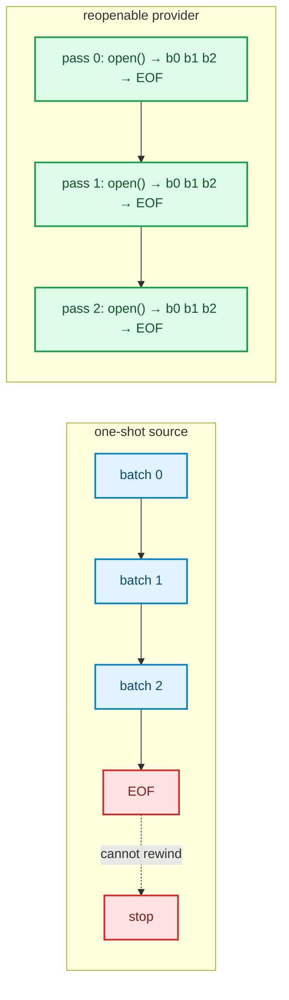
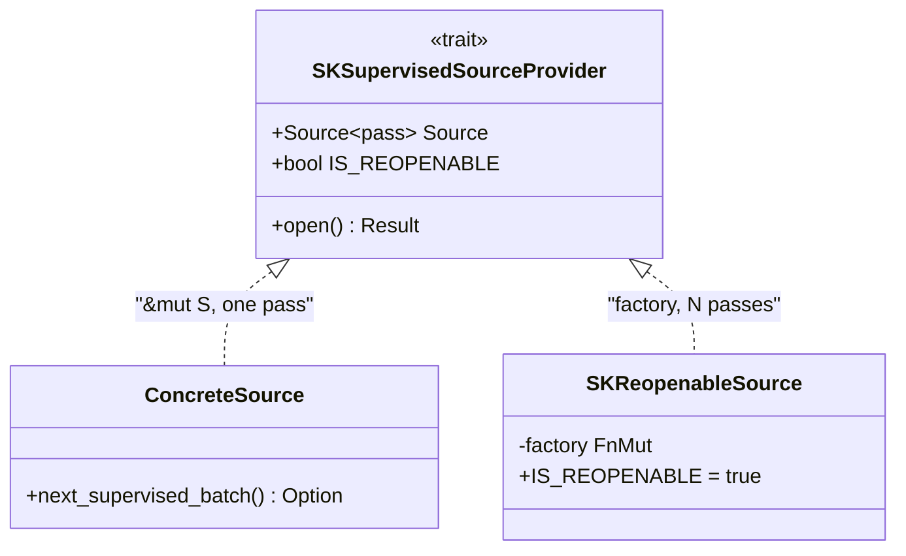
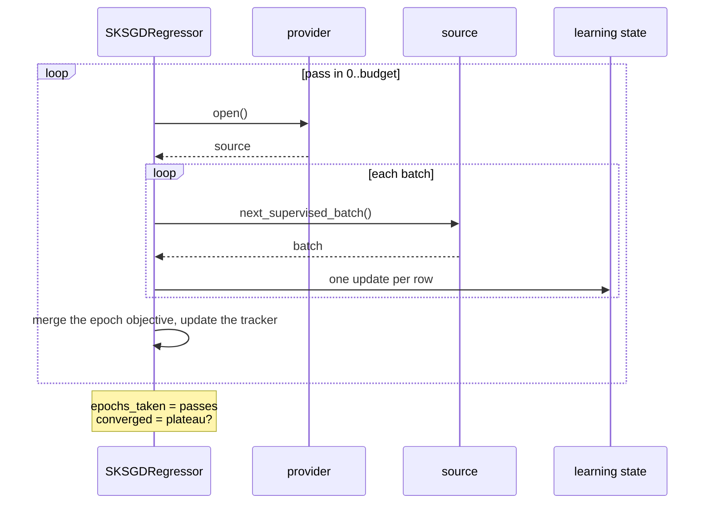

# Source providers: multi-epoch out-of-core fits

> **Chapter 18 of the Development Explained book.** Prerequisites: the streaming executor
> from [chapter 7](./ch07-parallel-kernels-and-streaming.html) and the stochastic-gradient
> family from [chapter 17](./ch17-sgd-classifier-regressor.html). This chapter explains the
> *why* behind the `streaming-source-provider` change, from zero.

## 1. The problem: a stream cannot rewind

Every out-of-core fit consumed a **one-shot** source: a fallible iterator that yields
batches and then ends. That is exactly right for an *exact accumulator* — a Gram matrix, a
running mean, a category table — because reading the data twice would double-count it.

It is wrong for a *stochastic* estimator. `SKSGDClassifier` and `SKSGDRegressor` learn one
sample at a time; one pass over the stream is **one epoch**, and one epoch of SGD usually
underfits. The in-memory `fit` runs up to a thousand epochs; the streamed fit ran one. The
PRD promised out-of-core SGD, not out-of-core *one-epoch* SGD.



## 2. Why not `Into<Source>`?

The obvious reach — accept "anything convertible into a source" — does not work in Rust:

```rust
fn fit_streaming<S>(&self, source: impl Into<S>)
where S: SKSupervisedLazySource<F>   // E0283: cannot infer S from the argument
```

1. `S` appears only in the bound, so the compiler has no target for the conversion.
2. `impl<T> From<T> for T` already makes every concrete source `Into<itself>`; a factory
   conversion would need a per-type impl, and the orphan rule forbids it for foreign types.
3. A closure has an **unnameable type**, so nobody can implement `From`/`Into` for it.

The working seam is a **dedicated trait**, implemented for a reference to a concrete source
*and* for a wrapper around a factory. No `dyn`, no allocation, no new dependency.

## 3. The provider contract

```rust
pub trait SKSupervisedSourceProvider<F> {
    type Source<'pass>: SKSupervisedLazySource<F> + Send where Self: 'pass;
    const IS_REOPENABLE: bool;
    fn open(&mut self) -> Result<Self::Source<'_>, SKError>;
}
```

The **generic associated type** is the key: it lets one trait return a *borrow* for a
concrete source and an *owned* source for a factory, under the same signature.

| Argument | Implementation | Passes |
|---|---|---|
| `&mut source` | residual impl for `&mut S` | 1 |
| `SKReopenableSource::new(|| open_file(path))` | factory wrapper | up to the budget |

The residual implementation is what keeps every existing call compiling:

```rust
impl<F, S: SKSupervisedLazySource<F> + Send> SKSupervisedSourceProvider<F> for &mut S {
    type Source<'pass> = &'pass mut S where Self: 'pass;
    const IS_REOPENABLE: bool = false;
    fn open(&mut self) -> Result<Self::Source<'_>, SKError> { Ok(&mut **self) }
}
```

The reopenable wrapper stores a `FnMut() -> Result<S, SKError>` and calls it once per pass,
so each epoch sees the same data in the same order — the property that makes a streamed fit
reproducible.



## 4. One rule, classified by estimator

The executor does not guess. `SKStreamingPassPolicy` says how many passes are allowed:

| Class | Estimators | Pass policy |
|---|---|---|
| Exact accumulator | scalers, polynomial features, simple imputer, OLS, ridge, lasso, elastic net, logistic regression | `SinglePass` — reading twice would double-count `n`, `Σx`, `XᵀX` |
| Iterative | `SKSGDClassifier`, `SKSGDRegressor` (and later mini-batch k-means, incremental PCA) | `Iterative { maximum_number_of_passes }` — one epoch per pass |

A one-shot provider with a budget above one takes **one** pass and emits a
`tracing::warn!`; the model reports `epochs_taken() == 1` so the clamp is observable without
logs. Silently pretending the budget was honoured would be worse than the warning.

`SKOneHotEncoder` is the declared exception: its streaming seam consumes **categorical
views** (`IntoIterator<Item = SKCategoricalView>`), not numeric blocks, so it stays outside
the provider trait until an owned categorical block exists. Every numeric estimator in the
library uses the seam.

## 5. Multi-epoch SGD, pass by pass

Each pass opens a source, runs one epoch over its batches with the **same** learning state,
and merges the epoch objective into the convergence tracker:



The schedule counter and the averaged iterate live in the state, so they continue across
passes exactly as they do across `partial_fit`. The convergence policy is unchanged:

- `Strict` raises `NotConverged` only when the **full requested budget** executed without a
  plateau;
- `Permissive` returns the model with `converged() == false`;
- a **provider-limited** fit (one-shot, fewer passes than the budget) returns the model with
  `converged() == false` and never raises.

Early stopping over a stream is still refused with `UnsupportedOperation`: it needs a
held-out validation slice the provider does not promise to retain. The refusal is explicit,
not a silent no-op.

## 6. Walking the real tests

- `sciencekit_common/src/batching/provider/*_tests.rs`: a concrete source reports itself as
  not reopenable and yields once; the factory is invoked once per pass; a factory error
  aborts; the feature-only and supervised families agree on passes and order.
- `sciencekit_common/src/execution/streaming_driver/provider_entry_points_tests.rs`: a
  one-shot
  provider runs one pass despite a budget of five; a reopenable provider runs the budget.
- Scalers, polynomial features and the imputer: a reopenable provider with a larger budget
  still takes **one** pass and the model equals the dense fit.
- OLS, ridge, lasso, elastic net and logistic: the same one-pass rule, with the accumulator
  compared against the dense fit.
- SGD: a reopenable multi-epoch stream equals the in-memory fit under a fixed seed, with the
  schedule counter and the average carried across passes; a one-shot provider takes one pass
  and does not raise; `Strict` raises only after the full budget.

## 7. Recap

- A source provider is the seam that lets **one** method accept a concrete source and a
  factory, because `Into` cannot express it in Rust.
- The GAT returns a borrow or an owned source; `IS_REOPENABLE` is a compile-time fact.
- The number of passes follows the estimator class: exact accumulators take one, iterative
  estimators take the epoch budget from a reopenable provider.
- The one-shot call shape survives, the clamp is reported by `epochs_taken()`, and the
  convergence policy decides what an unconverged streamed fit does.

Next: the batch contract itself becomes representation-generic, so sparse data can stream
without ever being densified.
