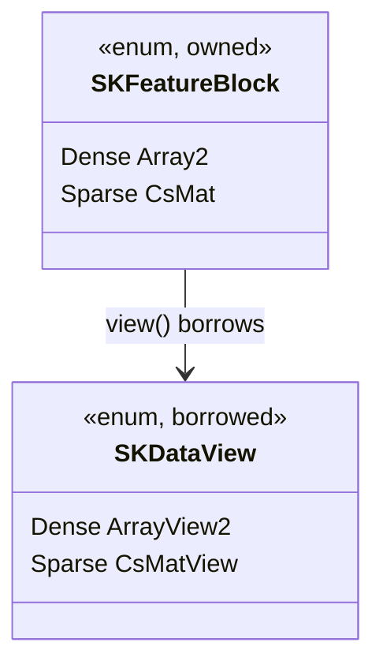
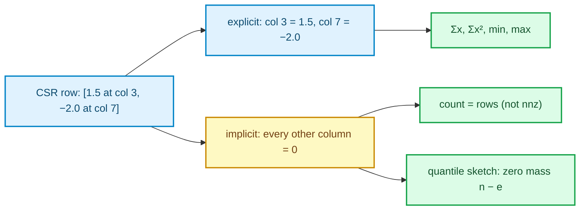

# Sparse out-of-core: the owned feature block

> **Chapter 19 of the Development Explained book.** Prerequisites: the streaming executor
> from [chapter 7](./ch07-parallel-kernels-and-streaming.html) and the source providers from
> [chapter 18](./ch18-source-providers-and-epochs.html). This chapter explains the *why*
> behind the `sparse-streaming-batches` change, from zero.

## 1. The problem: sparse data had to become dense to travel

The in-memory boundary has always known two representations — `SKDataView::Dense` and
`SKDataView::Sparse` — and every estimator dispatches on them once. The **streaming** block
did not: `SKDataBatch` and `SKSupervisedBatch` owned an `Array2<F>` and nothing else.

So a sparse design could not enter a stream. The only way to fit it out-of-core was to
densify it first — allocating `rows × columns` numbers to feed a pipeline whose whole point is
that it never holds the dataset in memory. Text features, recommendation matrices and
one-hot-encoded columns are exactly the data that is sparse *and* large.

## 2. The owned block mirrors the borrowed view

`SKDataView` is a borrowed enum over `ArrayView2` and `CsMatView`. The streaming twin is an
**owned** enum with the same two variants:

```rust
#[non_exhaustive]
pub enum SKFeatureBlock<F> {
    Dense(Array2<F>),
    Sparse(CsMat<F>),
}
```



`view()` returns the existing borrowed enum with no copy and no conversion, so the estimator
dispatch code reads identically in both regimes:

```rust
match batch.view() {
    SKDataView::Dense(dense) => fit_dense(dense),
    SKDataView::Sparse(sparse) => fit_sparse(sparse),
}
```

The enum is `#[non_exhaustive]`: a third representation (say, a bit-packed categorical block)
can arrive later without breaking a match.

## 3. The batches carry the block

Both batches now own a block instead of a matrix:

| Before | After |
|---|---|
| `SKDataBatch::data() -> ArrayView2` | `view() -> SKDataView`, `number_of_rows()`, `number_of_columns()`, `is_sparse()` |
| `SKSupervisedBatch::features()` | the same block accessors, plus `targets()` |
| `SKSupervisedBatch::new(features, targets, …)` | `new_dense` / `new_sparse`, both fallible |

The supervised constructors return `Result<Self, SKError>` because they now enforce an
invariant the old shape could not: the target count must equal the block's rows. The breaking
change is deliberate — the compiler catches every old call site, which is far better than a
runtime densification or a silent mispairing.

Position and the final-block flag are unchanged, and the block is still fully owned, so the
prefetch driver can move it to another thread exactly as before.

## 4. The memory guard tells the truth

The execution plan refuses a streaming batch whose **double-buffered** size exceeds available
memory. With a dense-only pipeline the hint was `rows × columns × size_of::<F>()`. A sparse
batch must be measured by what it actually stores:

```
dense:  rows · columns · size_of<F>()
sparse: data.len() · size_of<F>()
       + indices.len() · size_of::<usize>()
       + indptr.len() · size_of::<usize>()
```

`SKFeatureBlock::byte_size` implements exactly that. The plan carries
`available_memory_bytes`, and the executor checks each batch **when it is read, before it is
processed**: two resident batches must fit, or the read fails with `BatchBufferOversize`. A
10⁶ × 10⁶ matrix with one nonzero per row passes a guard that the dense figure would reject —
correctly, because the block really is that small. The optional
`SKExecutionContext::batch_byte_size_hint` remains available when a source knows the size
before opening.

## 5. The subtle part: implicit zeros

A CSR matrix stores only the non-zeros. Every other entry is zero, and the statistics must
count it:

- **Mean and moments**: a column with `e` explicit values in `n` rows has `n − e` implicit
  zeros. `Σx` and `Σx²` include nothing for them (they contribute zero), but the **count** is
  `n`, so the mean is `Σx / n`, not `Σx / e`.
- **Min and max**: zero participates unless a column is explicitly present in *every* row.
  The accumulator therefore tracks a per-column explicit count.
- **Quantiles**: the robust scaler's sketch receives the explicit values plus one weighted
  zero centroid per column, with multiplicity `n − e`; the in-process sparse branch computes
  exact order statistics by treating the zeros as a virtual sorted block, then seeds the
  sketch.



This is the part most likely to be wrong in a naive port: a mean divided by the number of
non-zeros looks plausible and is silently biased.

## 6. Estimators reuse what they already had

The in-memory `fit` already had sparse paths — Gram products over `CsMatView`, a retained
design that stacks CSR, per-row SGD updates. The streaming change does not invent new
algebra; it routes the block to the same code:

- **Scalers**: per-column `count`, `Σx`, `Σx²` / `extrema` / sketch over CSR rows in
  `O(nnz)`.
- **Polynomial features**: expand each CSR row directly; the output is sparse and follows the
  documented column order.
- **Simple imputer**: the marker predicate already special-cased the `0.0` marker for CSR
  implicit zeros; the streaming path reuses it.
- **OLS / ridge**: accumulate the Gram matrix from CSR.
- **Lasso / elastic net / logistic regression**: accumulate the retained design as CSR (a
  later dense batch is converted to CSR, never the reverse).
- **SGD**: one epoch over CSR rows through the sparse row driver.

## 7. Walking the real tests

- `sciencekit_common/src/batching/feature_block/feature_block_tests.rs`: construction, shape,
  zero-copy view (pointer identity), byte size from the stored buffers, ownership and
  cross-thread movement, `f32`.
- The batch tests: dense and sparse construction, metadata, the target-count mismatch, a
  sparse block moved across threads.
- The driver test: a sparse block reaches the update closure with its representation intact
  and the order preserved.
- Per-estimator conformance: sparse stream ≡ dense stream ≡ dense `fit` on the concatenated
  data, with implicit-zero edge cases, `sample_count()` equality where available, and a
  read-time batch guard test (a sparse block fits a memory budget its dense twin would
  exceed). The older large-shape tests are shape sanity: they prove a stream completes at a
  shape whose dense twin is impractical for the test budget, not that no copy was ever made.
- The scaler tests assert the **sample count**, not just the mean: a mean is invariant under
  duplication, so it cannot prove that the data was read once.

## 8. Recap

- One owned block type mirrors the borrowed view, so dispatch reads the same in both
  regimes.
- The batches carry the block; the driver never converts; the memory guard measures the real
  buffers.
- Implicit zeros are data: they shape every count, extremum and quantile.
- No new algebra — the sparse paths of the in-memory fits are reused, now fed one batch at a
  time.

This closes the streaming story: providers let a fit take epochs, and the feature block lets
those epochs be sparse.
