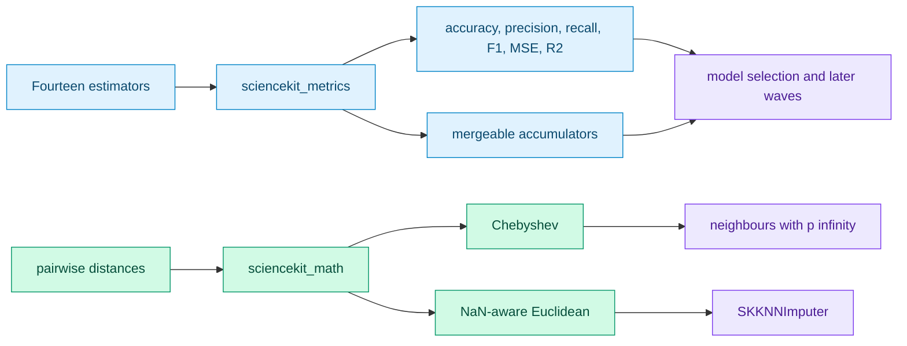
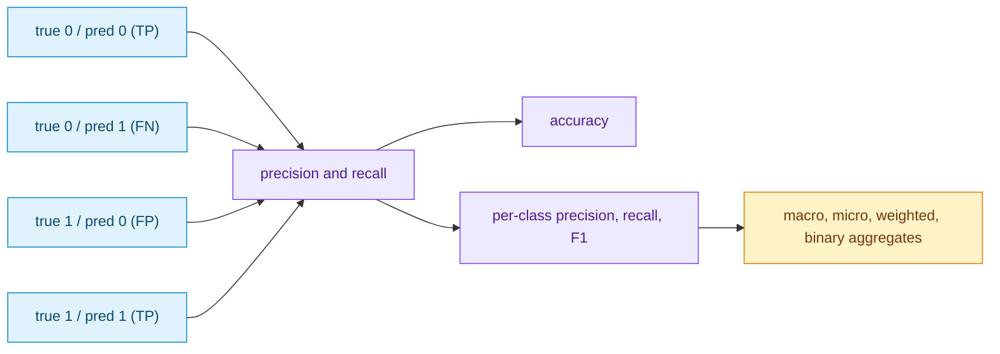
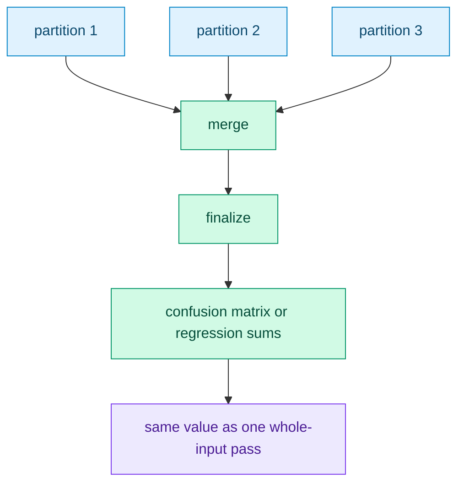
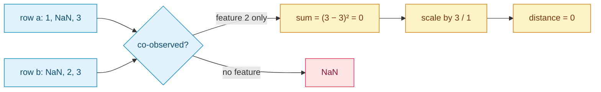
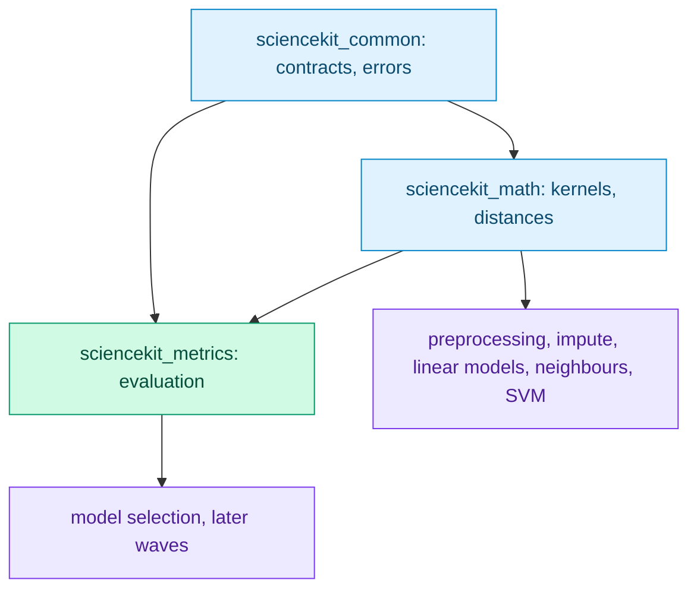

# Measuring a model: the metrics foundation

By the end of the previous chapter sciencekit could *fit* fourteen estimators: five
preprocessors, two imputers and seven linear models. It could not answer the next question a
user always asks — **is the model any good?** The shared scoring traits existed in
`sciencekit_common`, but no crate implemented them. This chapter tells the story of the
change that closed that gap, and of the two distances the next algorithms needed.

---

## 1. The problem we were solving

The product requirement is blunt (PRD §8.7): every implementation must run with lots of data
and with little data, under concurrency, **and produce metrics**. Fourteen estimators had
tests and benchmarks but no way to compute accuracy, error or a confusion matrix inside the
library. Every downstream feature — model selection, grid search, even the neighbours and SVM
waves — needs those numbers.

At the same time, the distance catalogue in `sciencekit_math` stopped at Euclidean, Manhattan
and Cosine. The next wave needs two more:

- **Chebyshev** ($L_\infty$), the "largest coordinate difference" distance used by $p = \infty$
  neighbours;
- **NaN-aware Euclidean**, the only distance a missing-value imputer can use, because it
  compares only the features observed in *both* rows.

The change therefore had two halves, both measurement: evaluation metrics in a new crate,
and two distance kernels in the existing maths crate.



---

## 2. The concepts, taught from zero

### 2.1 Classification: labels and the label space

A classifier returns an integer label per row. To count how often it is right we need a
**label space**: the set of labels that defines the rows and columns of the result. sciencekit
offers two ways to build it:

- an **explicit** list, validated (non-empty, no duplicates) and sorted internally;
- otherwise the **sorted union** of the labels observed in the truth and in the predictions.

The order matters: every metric, every confusion-matrix row and every per-class score follows
the same ascending order, so two evaluations of the same data always produce the same layout.

### 2.2 The confusion matrix

The confusion matrix is the atom of classification evaluation. Rows are true labels, columns
are predicted labels, and each cell counts observations.



Precision asks *of the rows we predicted as class c, how many really were c?* Recall asks *of
the rows that really were c, how many did we find?* F1 is their harmonic mean. When a
denominator is zero the library returns **zero**, never NaN and never a panic: absence of
evidence is not an undefined number.

### 2.3 Averaging across classes

Per-class scores are not enough for a single number. `SKAveraging` defines four policies:

| Policy | Question it answers |
|---|---|
| `Macro` | Every class counts equally, regardless of size. |
| `Micro` | Pool every true positive and every observation; for single-label problems this equals accuracy. |
| `Weighted` | Weight each class by its true support. |
| `Binary { positive_label }` | Report one chosen class explicitly — no hidden `pos_label = 1`. |

### 2.4 Regression: error and $R^2$

Regression predicts a continuous number. The library measures the **mean squared error**,
its square root, the **mean absolute error**, and the **coefficient of determination**
$R^2 = 1 - \mathrm{SSE} / \mathrm{SST}$. When every target is identical, $\mathrm{SST}$ is zero; the documented finite
policy returns `1` for an exact prediction and `0` otherwise, instead of dividing by zero.

### 2.5 Streaming: sums, not predictions

A metric over a million rows must not store a million predictions. The regression accumulator
stores constant-size state — count, a running mean, $M_2$ (the Welford/Chan sum of squared deviations from the mean), and compensated $\sum (y - \hat{y})^2$ and $\sum \lvert y - \hat{y} \rvert$ — and the classification
accumulator stores one counter per observed label pair. Both can be merged, so batches and
parallel partitions finalize to exactly the whole-input result.



Long sums in `f32` lose small addends next to large ones, and $\sum y^2 - n \cdot \overline{y}^2$ cancels
catastrophically for large targets. The regression accumulator therefore uses
**Neumaier compensated summation** for the error sums and the **Welford/Chan `M2`** state for
the target variance: $M_2$ accumulates squared deviations from the running mean, so no large
terms cancel and merges use the standard parallel formula. A test sums `[1e8, 1, -1e8, 1]` in `f32` and proves the compensated value is `2` while
the naive sum is `1`.

### 2.6 Missing values: the NaN-aware distance

`nan_euclidean` answers a different question from Euclidean distance. If a feature is missing
in either row, it is **not compared**. The sum runs only over co-observed features, then is
scaled by the ratio of total features to co-observed features:

$$d(a, b) = \sqrt{\sum_{\text{present}} (a_i - b_i)^2 \cdot \frac{\text{total\_features}}{\text{present\_features}}}$$

If the two rows share no observed feature, the distance is NaN. This is exactly the distance
`SKKNNImputer` needs, because the set of comparable features changes from pair to pair — which
is also why a spatial tree cannot index it.



---

## 3. The decisions — and the roads not taken

| Decision | Why we chose it | Alternatives we discarded |
|---|---|---|
| **Distances stay in `sciencekit_math`** | The `pairwise-distances` capability already owns them, and neighbours, SVM, clustering and imputation depend on `math`, not on evaluation. | Mirroring scikit-learn's `metrics.pairwise` namespace — it would invert the crate dependency for a cosmetic resemblance. |
| **Extend the central `SKError`** | `SKError` is already `#[non_exhaustive]`; `EmptyInput`, `NonFiniteValue` and `UnknownLabel` are reusable across algorithms, and scorer adapters keep `type Error = SKError`. | A crate-local `SKMetricsError` — it would force conversions at every boundary and contradict the central-taxonomy contract. |
| **Explicit zero-division policy** | Zero is finite, comparable and never contaminates an average; the policy is testable. | Returning NaN — one undefined class poisons every macro average downstream. |
| **Binary averaging is explicit** | `Binary { positive_label }` names the class instead of assuming label `1`. | scikit-learn's hidden `pos_label = 1` default — surprising for label sets without `1`. |
| **Compensated sums, scalar stays `F`** | An `f32` pipeline never detours through `f64`; compensation recovers the lost bits. | Accumulating everything in `f64` — a scalar detour inconsistent with the generic-float change. |
| **Accumulators, not stored predictions** | Constant-size regression state and $O(k^2)$ classification state finalize to the same values as a whole pass. | Keeping every prediction — unbounded memory, defeats streaming. |

---

## 4. Each public object, explained

`sciencekit_metrics` exposes three layers.

**Whole-input functions** — take borrowed views or slices and own nothing:

| Function | Result |
|---|---|
| `sk_confusion_matrix` | `SKConfusionMatrix` over the resolved label space |
| `sk_accuracy_score` | fraction of exactly matching labels |
| `sk_precision_score`, `sk_recall_score`, `sk_f1_score` | aggregated classification scores |
| `sk_mean_squared_error`, `sk_root_mean_squared_error`, `sk_mean_absolute_error` | regression errors |
| `sk_r2_score` | coefficient of determination |

**Scorer adapters** — implement the existing `SKLabelScorer` and `SKSupervisedScorer`
contracts, so any compatible fitted model is scored through the pure form (stored outputs) or
the convenient form (run inference, then delegate): `SKAccuracyScorer`, `SKPrecisionScorer`,
`SKRecallScorer`, `SKF1Scorer`, `SKMeanSquaredErrorScorer`, `SKRootMeanSquaredErrorScorer`,
`SKMeanAbsoluteErrorScorer`, `SKR2Scorer`.

**Accumulators** — `SKClassificationAccumulator` (observe, merge, finalize a confusion
matrix) and `SKRegressionAccumulator` (observe, merge, finalize errors and $R^2$). Both are
`Send + Sync`; both reject finalization over zero observations with `EmptyInput`.

The two distance kernels live in `sciencekit_math::pairwise`:
`sk_chebyshev_distance_matrix` and `sk_nan_euclidean_distance_matrix`.

---

## 5. Walk-through: the tests are the specification

### The label space

`label_space_tests.rs` pins the order and the validation:

```rust
let space = SKLabelSpace::from_explicit(&[2, 0, 1]).expect("valid label list");
assert_eq!(space.labels(), &[0, 1, 2]);
```

Sorting is not cosmetic: the same test suite checks that duplicates and an empty list are
rejected as `InvalidHyperparameter`, and that a label outside the explicit space returns
`UnknownLabel { label }`.

### The confusion matrix and averaging

`confusion_tests.rs` builds the matrix from a known example and verifies the row-major counts.
`averaging_tests.rs` then uses one unbalanced matrix — truth `[0,0,0,0,1]`, predictions
`[0,0,0,1,1]` — and checks every policy against hand-computed values: macro precision `0.75`,
micro precision `0.8`, weighted precision `0.9`, binary class-1 precision `0.5`. The
`micro_averaging_equals_accuracy` test is the important invariant: on single-label multiclass
data, micro F1 and accuracy must agree.

### The accumulators

`classification_tests.rs` observes the same pairs one by one and compares the finalized
matrix with `sk_confusion_matrix`; `merging_two_accumulators_equals_concatenation` splits the
same pairs, merges, and checks equality again. The concurrency test partitions 10 000 pairs
across eight rayon tasks and reduces the accumulators. The regression twin does the same for
MSE, MAE and $R^2$, and the acceptance suite repeats the exercise at $100\,000$ observations.

### The distances

`chebyshev_tests.rs` pins the largest-coordinate rule, symmetry, non-negativity and the
parallel path against a direct reference. `nan_euclidean_tests.rs` encodes the formula as
scenarios: co-observed-only comparison, the scale factor, the no-co-observation NaN, equality
with Euclidean when nothing is missing, and symmetry.

---

## 6. Where it sits



The dependency direction is deliberate: evaluation may use the numeric substrate, but the
numeric substrate never depends on evaluation. The next algorithms — an imputer that consumes
`nan_euclidean`, neighbours that consume Chebyshev and the accumulators, SVM that consumes
distances — plug into the same foundation.

---

## 7. What comes next

With evaluation in place, every estimator shipped so far can produce metrics, and the next
wave can be judged as it is built. The immediate follow-ups are the `SKKNNImputer`, which the
NaN-aware distance unblocks, and the neighbours wave, whose classifiers and regressors will
use both the distance catalogue and the streaming accumulators.
