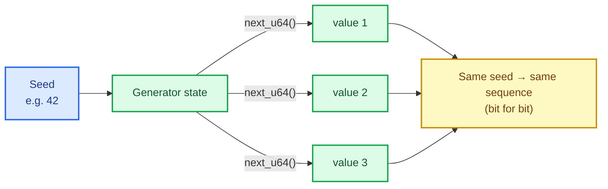
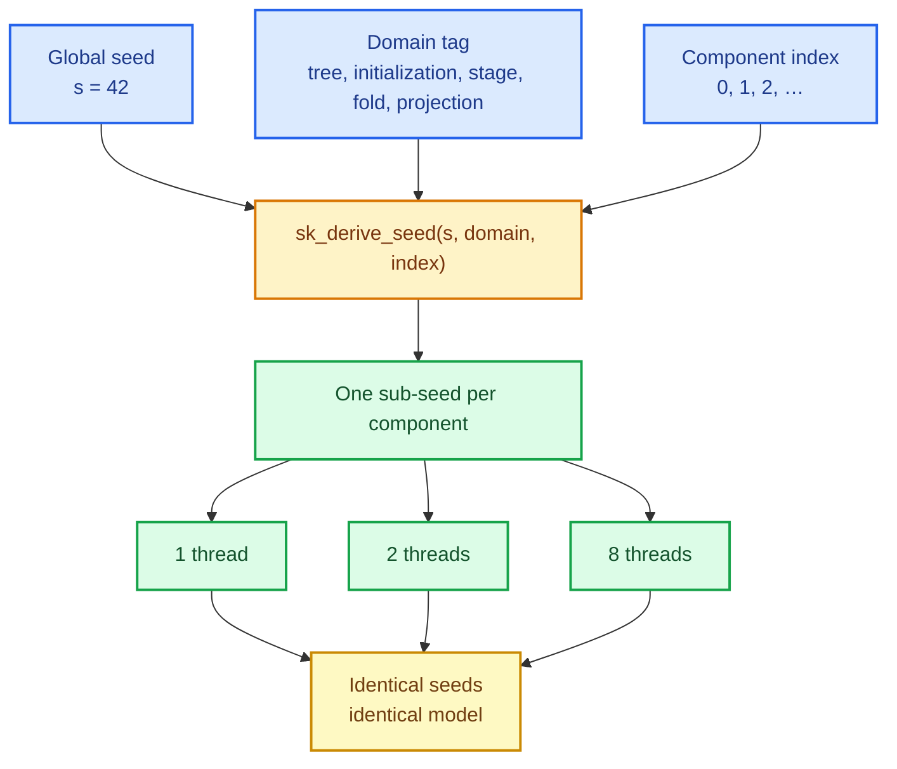

# Deterministic randomness: one generator for every stochastic estimator

Every algorithm in this chapter's family — SGD, k-means++, MiniBatchKMeans, random
forests, bagging, boosting, randomized SVD, isolation forests — needs randomness. Before
this change, the repository had one `pub(crate)` SplitMix64 inside
`sciencekit_linear_model` that only SGD used, plus two private xorshift64* permutations
with hard-coded seeds inside the logistic SAGA solver and the coordinate-descent random
selection. The two xorshift streams were not reachable through any builder, and the next crate that
needed a random number would either copy one of them or, worse, call the operating
system's entropy source and make its tests flaky. This change promotes one generator to
`sciencekit_common`, retires every private stream, gives the surface a public contract, and
writes down the reproducibility rule the whole library follows from now on.

The capability is `deterministic-randomness`; the code lives in
`crates/sciencekit_common/src/random/`.

## 1. The problem, in plain words

Imagine two runs of the same training job on the same data with the same configuration.
If the model comes out different, you cannot tell whether you changed something that
matters or whether the dice simply landed differently. Randomness is useful (it is what
lets a forest grow *different* trees), but **uncontrolled** randomness makes results
irreproducible and bugs unfindable.

There is a second problem, subtler. Suppose you seed one generator and share it across the
eight threads that build a random forest. Which thread draws which number now depends on
scheduling. Run the job again with four threads and the *same seed* and the forest changes.
The seed did not buy you what you thought it bought.

So the requirement is not "use a seed". It is:

> The same seed, the same data and the same configuration produce the same model,
> **independent of how many threads ran and in which order**.

## 2. The decisions, and the roads not taken

1. **A shared generator, not one per crate.** One implementation means one golden-vector
   test, one reproducibility promise and no drift. The SAGA permutations and the
   coordinate-descent random sweep order are migrated onto it, so no estimator keeps a
   private stream.
2. **SplitMix64.** A 64-bit counter advanced by the golden-ratio increment and finished
   with an invertible bit mixer. It needs no entropy, no allocation and no platform state,
   so the raw stream is identical everywhere.
3. **A pure sub-seed function.** Each independent component (tree #7, initialization,
   stage 3, fold 2) derives its own seed from the global seed with
   `sk_derive_seed(global_seed, domain, index)`. Because the function keeps no state, the
   result depends only on its three inputs — not on who called it first or on which
   thread.
4. **`random_seed(u64)` on every stochastic builder, defaulting to `0`.** No ambient RNG,
   ever.

*Roads not taken.* A per-crate generator (duplication and inconsistent guarantees); a
global thread-local RNG (order-dependent, exactly the bug above); `rand` from crates.io
(a dependency and a moving target for reproducibility); and drawing sub-seeds from a
shared stream (then thread count changes which component gets which seed).

## 3. The concepts, taught from zero

### What a pseudo-random generator is

A **pseudo-random generator** (PRNG) is a function with memory: it holds a state, and each
call returns a value derived from that state and advances it. Given the same starting
*seed*, it replays the same sequence. "Pseudo" means the values look random but are fully
determined.

### SplitMix64, concretely

SplitMix64 keeps one `u64`. Each call does two things: add a fixed golden-ratio constant
(the counter step), then *mix* the bits so neighbouring states look unrelated:

$$
\text{state} \leftarrow \text{state} + \varphi,\qquad
z \leftarrow \text{mix}(\text{state})
$$

with $\varphi = \texttt{0x9E3779B97F4A7C15}$ and the mixer being two rounds of
"xor-shift then multiply". The mixer is invertible, so no output is ever lost; the shifts
give *avalanche* — flipping one input bit changes about half the output bits. That is why
`0, 1, 2, …` seeds produce wildly different streams instead of near-identical ones.

### Uniform, floats, and normal draws

`next_u64` gives 64 random bits. Everything else is built on it:

- `next_f64` takes the top 53 bits and divides by $2^{53}$ — the exact number of bits an
  `f64` can hold without rounding — producing a value in $[0, 1)$.
- `uniform(low, high)` scales that value to the requested interval.
- `normal()` uses **Box–Muller**: two independent uniforms become two independent standard
  normals. One is returned and the other is *cached* for the next call, so a pair of
  uniforms yields a pair of normals. That cache is why the generator has a second field,
  `cached_normal`.

### Sub-seeds: independent components without shared state

If every component shares one generator, the number a component sees depends on how many
draws happened before it — which depends on thread scheduling. The fix is to give each
component its own generator, seeded from `(global_seed, domain, index)`. The function folds
the domain in with one golden-ratio multiplier and the index with another, mixing between
them:

$$
\text{seed} = \text{mix}\!\left(\text{mix}\left(s \oplus d\varphi_1\right) \oplus i\varphi_2\right)
$$

Because it is a pure function of its inputs, deriving the 64 tree seeds sequentially or
across eight threads produces the **same** 64 seeds. That is the whole trick behind
thread-count invariance.

### Reproducibility scope — the honest fine print

The integer stream is bit-identical on every platform and every Rust version, because it
uses only wrapping integer arithmetic. The *floating-point* draws use IEEE-754 basics plus
`sqrt`, `ln` and `cos`; the same build on the same platform reproduces them exactly, while
across platforms they are guaranteed only within the estimator's documented tolerance.
Estimators add one more condition: same input and same backend. Saying this out loud is
part of the contract — a promise that silently breaks on another machine is worse than a
narrower promise that holds.

## 4. Each public object, explained

- **`SKRandomGenerator`** — the generator. `new(seed)` builds it; `next_u64`, `next_f64`,
  `uniform`, `normal`, `next_index`, `shuffle`, `shuffled_indices` and
  `sample_indices_without_replacement` draw from one stream. It is `Send`: a task can own
  one and move it across threads, but sharing one between threads needs external
  synchronization, so each component gets its own.
- **`sk_derive_seed(global_seed, domain, index) -> u64`** — the pure sub-seed function.
- **Domain constants** — `SK_RANDOM_DOMAIN_TREE`,
  `SK_RANDOM_DOMAIN_INITIALIZATION`, `SK_RANDOM_DOMAIN_STAGE`, `SK_RANDOM_DOMAIN_FOLD`,
  `SK_RANDOM_DOMAIN_PROJECTION`. Distinct tags guarantee that, for example, tree #0 and
  fold #0 never share a stream.
- All of them are re-exported from the `sciencekit_common` crate root, so an estimator
  imports `sciencekit_common::SKRandomGenerator` and nothing else.

## 5. A real walk-through, using the tests

The executable truth lives in `random/generator_tests.rs` and `random/sub_seed_tests.rs`.
Three of them tell the whole story.

### Test: `golden_vectors_pin_the_splitmix64_stream`

This test hard-codes the first five outputs for seeds `0`, `1` and two others. If anyone
changes a constant or a shift, the test fails immediately — which is exactly the point:
the golden vectors *are* the compatibility promise. Compare with the concurrency test:
seeds change the stream; constants change the stream; nothing else may.

### Test: `the_same_seed_produces_the_same_shuffle_order`

Two generators with the same seed must produce the same permutation. This is the property
SGD's epoch shuffle depends on, and the companion test
`different_seeds_produce_different_shuffle_orders` proves the seed actually does something.

### Test: `derivation_is_thread_count_invariant`

The test computes 64 sub-seeds sequentially, then again with 1, 2, 4 and 8 threads, each
worker handling a stride of indices. It collects every `(index, seed)` pair and asserts the
set is identical. This is the test that would have caught the shared-generator design: with
one shared stream, eight threads consume draws in a different order and the seeds differ.
Because `sk_derive_seed` is pure, they cannot.

The companion test in `sciencekit_linear_model` goes one level up: it replays an SGD epoch
with an order produced by `SKRandomGenerator` and asserts **bit-identical coefficients**.
That proves the estimator really consumes the shared generator's stream, rather than a
look-alike.

## 6. Look inside

| File | Responsibility |
|---|---|
| `random/mod.rs` | Pure dispatcher: declares and re-exports, no logic |
| `random/generator.rs` | SplitMix64 and the draw operations |
| `random/generator_tests.rs` | Golden vectors, range, permutation, moments |
| `random/sub_seed.rs` | `sk_derive_seed` and the domain constants |
| `random/sub_seed_tests.rs` | Distinctness, purity, order and thread invariance |

The folder module follows the repository rule: `mod.rs` carries no implementation, and each
companion `*_tests.rs` sits beside the file it tests.

## 7. What this unlocks

Every stochastic estimator now has one convention: a `random_seed(u64)` builder parameter
defaulting to `0` — proven by `SKLogisticRegression` (SAGA), `SKLasso` and `SKElasticNet`
(random selection) alongside `SKSGDClassifier`/`SKSGDRegressor` — sub-seeds derived with
`sk_derive_seed`, results collected in a stable order (the tests fit the same model under
one and four rayon threads and compare coefficient rows by index), and no ambient RNG. The
randomized SVD kernel, k-means initialization, forests, bagging, boosting and
cross-validation folds will plug into the same contract, and their reproducibility tests get
to be *exact* instead of statistical.
