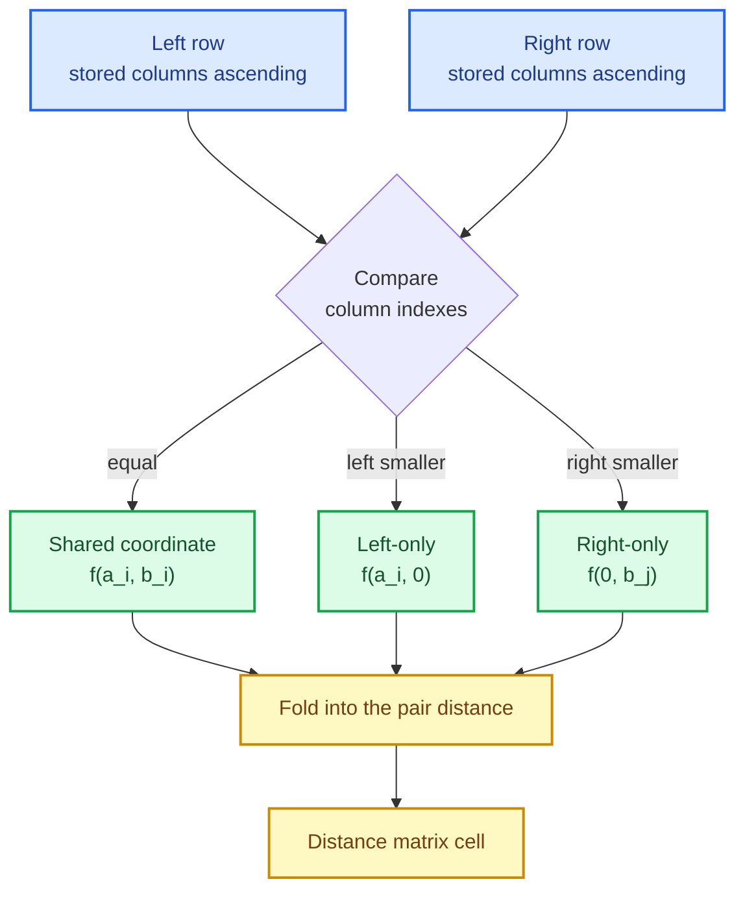

# Sparse distance matrices: one dispatcher, four representation pairs

Measuring distances is the smallest-looking operation in a machine-learning library and one
of the most consequential. k-nearest neighbours, k-means, DBSCAN, the RBF kernel, silhouette
scores, nearest-centroid classifiers and the imputer all begin with a matrix of pairwise
distances. Waves 0–2 computed that matrix for dense data only. Text features, one-hot
encodings, user–item matrices and graph adjacency are **sparse**, and a sparse matrix with
one million columns must never be turned into a dense one just because a distance routine
was easier to write that way.

This chapter tells how the sparse pairwise path was built: what a distance matrix is, why
the naive formula is dangerous, how the sparse kernels recover the dense answers from stored
values only, and why a single dispatcher — rather than a flag inside every kernel — is what
keeps the representation decision honest.

The capability is `pairwise-distances`; the code lives in
`crates/sciencekit_math/src/pairwise/`.

## 1. The problem, in plain words

A **distance matrix** answers, for every pair of rows, "how far apart are they?". With $n$
query rows and $m$ reference rows the answer is an $n \times m$ grid of numbers. Every
algorithm above it reads that grid.

The dense formula for squared Euclidean distance is algebraically beautiful:

$$
\lVert a - b \rVert^2 = \lVert a \rVert^2 - 2\,a\cdot b + \lVert b \rVert^2
$$

It lets you compute every pair with one matrix product instead of a subtraction per pair. But
it is also **numerically dangerous**: when two rows are almost identical, $\lVert a\rVert^2$
and $\lVert b\rVert^2$ are large and nearly equal, and their difference loses precision. A
second, structural problem appears for sparse data: the formula assumes every coordinate
exists. In CSR storage, a coordinate that is not stored **is zero**, and a zero is a real
observation — not "missing". Any sparse kernel must therefore distinguish three kinds of
coordinate for every pair:

| Coordinate | Left value | Right value | Contribution |
|---|---|---|---|
| shared | stored $a_i$ | stored $b_i$ | $f(a_i, b_i)$ |
| left-only | stored $a_i$ | implicit $0$ | $f(a_i, 0)$ |
| right-only | implicit $0$ | stored $b_j$ | $f(0, b_j)$ |

A sorted **row merge** walks both rows once and classifies every coordinate into one of the
three cases. Everything else is arithmetic on those three cases.

## 2. The decisions, and the roads not taken

1. **One public dispatcher.** `sk_pairwise_distance_matrix(metric, left, right)` is the
   single entry point. It validates shapes, matches metric × representation once, and calls a
   prepared kernel. Representation-specific kernels stay internal so the public surface cannot
   forget a combination.
2. **Dense formulas, sparse contributions.** Each sparse metric is derived from the same
   definition the dense kernel uses — norms plus shared dot product for Euclidean, a merged
   sum for Manhattan and Chebyshev, stored dot and norms for cosine — never by densifying.
3. **Row-parallel fill.** The output is filled row by row with rayon at grain `1024` — the
   same grain the dense Chebyshev and NaN-aware kernels use — so parallel and sequential runs
   are bit-identical.
4. **NaN-aware Euclidean is dense-only.** In CSR an implicit zero is an observed value, so
   "what is the distance ignoring missing coordinates?" has no sparse meaning. The dispatcher
   rejects it up front with `UnsupportedRepresentation`.

*Roads not taken.* A `is_sparse` boolean threaded through every kernel (branching in the hot
loop and easy to get wrong); densifying a sparse input when it is "small enough" (a silent
memory cliff); and a separate public function per representation (four times the surface, and
callers must choose). The norm-expansion form *is* used, because for sparse rows it needs only
the stored values; the dense kernels keep the same form, so the two paths stay comparable —
with the caveat that near-identical rows can lose precision in the dense expansion, which is
why equivalence tests compare values that are not catastrophically close.

## 3. The concepts, taught from zero

### CSR storage, in one paragraph

**Compressed sparse row** keeps three arrays: the stored values, the column each value lives
in, and a pointer marking where each row starts. Row $i$ occupies the slice between
`indptr[i]` and `indptr[i+1]`. Because columns inside a row are kept ascending, two rows can
be merged with two indexes — the same trick merge sort uses.

### Why the merge sees only three cases

Walk the left row and the right row together, advancing whichever column is smaller. When the
columns match, the coordinate is **shared**; when only the left has an entry, it is
**left-only**; when only the right does, **right-only**. At the end one row may be exhausted;
the remainder is one-sided. That is the entire helper `sk_merge_sorted_rows`, and every sparse
kernel is a fold over its output.

### Each metric from its definition

- **Squared Euclidean.** Shared coordinates contribute $(a_i-b_i)^2$; one-sided ones
  contribute the square of the stored value. Equivalently: $\lVert a\rVert^2 + \lVert b\rVert^2
  - 2\sum_{\text{shared}} a_i b_i$, with the norms computed from stored values only.
- **Euclidean.** The square root of the squared form.
- **Manhattan.** Sum of absolute differences; a one-sided coordinate contributes $|a_i|$ or
  $|b_j|$.
- **Chebyshev.** The maximum absolute difference; one-sided coordinates still participate, so
  the maximum must also consider the largest stored magnitude of the side that has no
  counterpart.
- **Cosine.** $1 - \dfrac{a\cdot b}{\lVert a\rVert\,\lVert b\rVert}$, with the dot product over
  shared coordinates only. The zero-norm policy matches the dense kernel.

## 4. Each public object, explained

- **`SKPairwiseMetric`** — `SquaredEuclidean`, `Euclidean`, `Manhattan`, `Chebyshev`, `Cosine`
  and the dense-only `NanEuclidean`.
- **`sk_pairwise_distance_matrix(metric, left, right)`** — the dispatcher. Accepts two
  `SKDataView`s (any of the four dense/sparse combinations), validates the feature count
  before computing, and returns `Array2<F>`.
- **`sk_sparse_squared_euclidean_distance_matrix`**, **`sk_sparse_euclidean_distance_matrix`**,
  **`sk_sparse_manhattan_distance_matrix`**, **`sk_sparse_chebyshev_distance_matrix`**,
  **`sk_sparse_cosine_distance_matrix`** — the public sparse kernels, taking two borrowed CSR
  views. The mixed sparse×dense and dense×sparse kernels stay internal: the dispatcher is the
  only public door, so every representation pair is reachable and none is forgotten.

## 5. A real walk-through, using the tests

The executable truth is in `pairwise/sparse/*_tests.rs` and the dispatcher tests.

### `sparse_squared_euclidean_matches_dense_on_the_same_logical_matrix`

The single most important test in the change: build one logical matrix, hand it to the dense
kernel as an `Array2` and to the sparse kernel as a `CsMat`, and assert the two matrices agree
within tolerance. It is the definition of correctness for every sparse kernel, and it is
repeated per metric.

### `sparse_squared_euclidean_is_symmetric_with_zero_diagonal`

A metric has structure: $d(a,b) = d(b,a)$ and $d(a,a) = 0$. The test checks both, which catches
a whole class of merge bugs (double counting, dropped one-sided coordinates).

### `sparse_pairwise_wide_matrix_is_not_densified`

A matrix with **one hundred million columns** and three stored entries is passed through the
dispatcher for all five sparse metrics. A densified copy would need about 2.4 GB and fail, so
the test only passes because every kernel reads stored values. The test also keeps the
stored-entry count unchanged — the memory promise is a test, not a comment.

### `sparse_pairwise_rejects_sparse_nan_euclidean` and `sparse_pairwise_dense_nan_euclidean_keeps_the_dense_kernel`

The dense-only exception is exercised in two halves: a sparse request for the NaN-aware metric
returns `UnsupportedRepresentation`, and a separate test proves the dense request still
produces the dense NaN-aware matrix. This is the `data-view-boundary` rule applied to a
*semantically undefined* representation: rejection is the whole answer because no sparse
alternative path can exist.

### `sparse_pairwise_parallel_equals_sequential` and `sparse_pairwise_concurrent_calls_are_deterministic`

The row-parallel fill must be invisible: the same input produces the same matrix whether one
thread or many computed it, and several threads calling concurrently get their sequential
results.

## 6. Look inside

| File | Responsibility |
|---|---|
| `pairwise/dispatcher.rs` | `SKPairwiseMetric`, `sk_pairwise_distance_matrix`, validation and dispatch |
| `pairwise/sparse/row_merge.rs` | sorted-row merge classifying shared/one-sided coordinates |
| `pairwise/sparse/squared_euclidean.rs` | sparse squared Euclidean and Euclidean |
| `pairwise/sparse/manhattan.rs` | sparse Manhattan |
| `pairwise/sparse/chebyshev.rs` | sparse Chebyshev |
| `pairwise/sparse/cosine.rs` | sparse cosine |
| `pairwise/sparse/acceptance_tests/` | tiny, large and concurrent acceptance suite |

## 7. Why this shape matters

The dispatcher is the load-bearing decision. It makes "every metric works on every
representation pair" a property of *one* function that can be tested cell by cell, instead of
a convention every kernel must remember. It also gives the dense-only exception exactly one
place to live: the NaN-aware metric is rejected before a single element is read, and the
reason is written next to the rejection. The neighbours, clustering, imputation and model
selection changes now call one function and inherit all of it.
