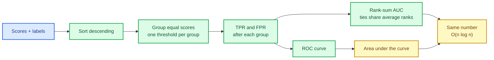

# Ranking metrics: ROC, average precision, log loss and MCC

Accuracy answers one question: *how often is the label right?* It cannot answer the question
that matters when a model outputs a **score** — "how well does the model rank the positives
above the negatives?" A fraud detector that flags the right transactions but ranks them below
a thousand harmless ones is useless in a review queue, even at high accuracy. Ranking metrics
measure that ordering directly, and they are the last big piece of the evaluation foundation.

This chapter builds them: the ROC curve and its area (AUC), precision-recall curves and
average precision, log loss, balanced accuracy and the Matthews correlation coefficient, plus
their scorer adapters and a mergeable AUC accumulator.

The capability is `ranking-metrics`; the code lives in `crates/sciencekit_metrics/src/ranking/`
and the probability-scorer contract in `sciencekit_common`.

## 1. The problem, in plain words

Imagine sorting every example by the model's score, highest first. Slide a threshold down that
sorted list. At each point you can count four things:

| | predicted positive | predicted negative |
|---|---|---|
| **actually positive** | true positive (TP) | false negative (FN) |
| **actually negative** | false positive (FP) | true negative (TN) |

Two rates summarise the point:

$$
\text{TPR} = \frac{TP}{TP + FN}, \qquad \text{FPR} = \frac{FP}{FP + TN}
$$

The **ROC curve** plots TPR against FPR as the threshold moves; the **area under it (AUC)** is
the probability that a randomly chosen positive is scored above a randomly chosen negative.
An AUC of $1$ is a perfect ranking, $0.5$ is a coin flip, and $0$ is a perfectly inverted one.
Precision-recall trades the same walk for $\text{precision} = TP/(TP+FP)$ against recall, which
is far more informative when positives are rare.

The subtlety is **ties**. If two examples share a score, no threshold can separate them. Cutting
the curve between them would invent an ordering the model never produced. The honest answer is
to treat tied scores as one threshold and credit the pair with *average* ranks — the **rank-sum**
form of AUC:

$$
\text{AUC} = \frac{\sum_{\text{positives}} \text{rank}_i - \frac{n_+(n_+ + 1)}{2}}{n_+ \, n_-}
$$

where tied scores receive the mean of the ranks they span.

## 2. The decisions, and the roads not taken

1. **Rank-sum AUC with average ranks.** It computes the same number as integrating the ROC
   curve, in $O(n \log n)$ and with ties handled exactly once.
2. **One-vs-rest for multiclass.** Each class gets its own binary problem; macro, micro and
   weighted averaging combine them. One-vs-one is explicitly out of scope.
3. **Log loss clips, never zeroes.** A confident wrong prediction costs a lot but not infinity:
   probabilities are clipped at the scalar's epsilon before the logarithm.
4. **A mergeable accumulator.** Batches and whole-input evaluation must produce the same AUC,
   so streaming evaluation stays exact rather than approximate.
5. **A probability scorer contract.** `SKProbabilityScorer` separates "give me scores and
   truth" from "give me a fitted model", mirroring the other scoring contracts.

*Roads not taken.* Threshold-sweeping AUC (ties become arbitrary, and it is slower); a
separate multiclass curve type per averaging mode; silently dropping non-finite scores instead
of rejecting them; and an approximate streaming AUC.

## 3. The concepts, taught from zero

### Why the curve needs distinct thresholds

If five examples share a score, they enter the positive set together. The ROC point after them
is the only point the model can actually produce. Grouping equal scores before computing the
step gives both the curve and the AUC a single, deterministic answer.

### Average precision is not the area under PR

The precision-recall curve is not monotone, so its area depends on how you interpolate.
**Average precision** uses the step interpolation: each time recall increases, it adds the
current precision weighted by the recall gain. That is what scikit-learn reports and what the
tests pin.

### Log loss: the cost of being confidently wrong

$$
\text{log loss} = -\frac{1}{n}\sum_i \left[ y_i \log p_i + (1-y_i)\log(1-p_i) \right]
$$

With $y_i \in \{0,1\}$ and $p_i$ the predicted probability of the positive class. If $p_i$ is
exactly $0$ for a positive example the logarithm diverges, so the probability is clipped at
$\varepsilon$ first — finite by construction, still enormous for a confident mistake.

### Balanced accuracy and MCC

**Balanced accuracy** is the mean of per-class recall: it refuses to reward a model that only
learns the majority class. The **Matthews correlation coefficient** generalises beyond two classes (its binary form is
the correlation on a $2\times2$ table) and ranges from $-1$ to $1$; it stays honest under
strong class imbalance where accuracy flatters. In the general form, with $C$ the confusion
matrix, $t_k = \sum_i C_{ik}$ the true count of class $k$, $p_k = \sum_i C_{ki}$ the predicted
count, $c = \sum_k C_{kk}$ the correct count and $s = \sum_{ij} C_{ij}$ the total:

$$
\text{MCC} = \frac{c\,s - \sum_k t_k p_k}
{\sqrt{\left(s^2 - \sum_k p_k^2\right)\left(s^2 - \sum_k t_k^2\right)}}
$$

## 4. Each public object, explained

- **`sk_roc_curve(scores, labels, positive_label) -> SKRocCurve<F>`** — the grouped-threshold
  curve (false-positive and true-positive rates).
- **`sk_roc_auc_score(scores, labels, positive_label) -> F`** — the rank-sum AUC with average
  ranks for ties.
- **`sk_one_versus_rest_roc_auc_scores(...)`** and **`sk_multiclass_roc_auc_score(...,
  SKRankingAveraging)`** — per-class AUCs and the macro / micro / weighted combination.
- **`sk_precision_recall_curve(...)` -> `SKPrecisionRecallCurve<F>`** and
  **`sk_average_precision_score(...)`** — the curve and its step-interpolated area.
- **`sk_log_loss(...)`** and **`sk_binary_log_loss(...)`** — multiclass and binary log loss with
  epsilon clipping.
- **`sk_balanced_accuracy_score(...)`** and **`sk_matthews_correlation_coefficient(...)`**.
- **`SKProbabilityScorer<F, M>`** in `sciencekit_common` — the pure form takes scores and
  truth, the convenient form obtains probabilities from a fitted `SKClassifierPredictor`. The
  shared validator checks the row count and the non-empty class axis; each metric then checks
  its own label/column rules.
- **Scorers** — `SKAucScorer`, `SKAveragePrecisionScorer`, `SKLogLossScorer`,
  `SKBalancedAccuracyScorer`, `SKMatthewsCorrelationScorer`, each equal to its free function.
- **`SKAucAccumulator`** — `observe` / `merge` / `finalize`, producing the same AUC as
  whole-input evaluation for both batched and merged streams.

## 5. A real walk-through, using the tests

### `roc_ties_use_average_ranks` and `roc_fully_tied_scores_have_half_auc`

The first pins the rank-sum arithmetic on a hand-computed fixture with ties. The second is the
degenerate case: every score equal means the model ranks nothing, and the AUC is exactly $0.5$.
Together they prove the tie policy end to end.

### `precision_recall_hand_computed_average_precision`

Average precision is easy to get subtly wrong (trapezoid instead of step). The fixture is small
enough to compute by hand and asserts the exact value.

### `log_loss_zero_probability_is_finite_through_clipping`

A predicted probability of exactly $0$ for the true class would be infinite; the test asserts
the result is finite and large, proving the clip is applied rather than the logarithm guarded
by a branch.

### `auc_accumulator_batches_equal_whole_input` and `auc_accumulator_merge_equals_concatenation`

Streaming evaluation must not change the number. The tests feed the same data as one batch and
as many batches, then as merged accumulators, and assert equality — the property that makes a
streaming score trustworthy.

## 6. Look inside

| File | Responsibility |
|---|---|
| `ranking/roc.rs` | grouped-threshold ROC curve and rank-sum AUC |
| `ranking/multiclass_roc.rs` | one-vs-rest AUCs and averaging |
| `ranking/precision_recall.rs` | precision-recall curve and average precision |
| `ranking/log_loss.rs` | binary and multiclass log loss with clipping |
| `ranking/balanced_accuracy.rs` | mean per-class recall |
| `ranking/matthews.rs` | Matthews correlation coefficient |
| `ranking/averaging.rs` | `SKRankingAveraging` |
| `ranking/accumulator.rs` | `SKAucAccumulator` |
| `scorers/ranking/` | the five scorer adapters (per-scorer files plus the label/column helpers) |
| `sciencekit_common/src/scorer_traits/probability.rs` | `SKProbabilityScorer` |

## 7. What this completes

With the label space, confusion matrix, regression errors and these ranking metrics, every
estimator shipped so far can be evaluated on the axis its task cares about. Model selection
(`GridSearchCV`, halving search) can now rank candidates by AUC or average precision, and the
metrics suite no longer stops at accuracy.
