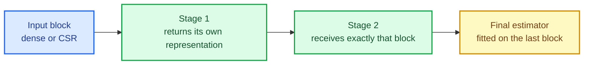

# Type-safe pipelines: making the data flow a compile-time property

A scaler followed by an imputer followed by a classifier looks trivial in a notebook. In a
typed library it is a small design problem: each stage changes the shape of the data, some
change the *representation* (dense to sparse), and the final estimator must receive the output
of the **last transformer**, not the original input. Get it wrong at runtime and you find out
with a shape error deep inside a fit; get it right at the type level and the wrong chain simply
does not compile.

This chapter builds `sciencekit_pipeline`: a builder whose *type* records the stages composed so
far, a classifier and a regressor finalizer, a forward fit walk, prediction delegation, and a
dense/sparse block medium that carries the representation through the chain.

The capability is `typed-pipeline`; the code lives in `crates/sciencekit_pipeline/`.

## 1. The problem, in plain words

Consider the chain:

```text
StandardScaler → SimpleImputer → LogisticRegression
```

Three things must line up:

1. **Scalar.** The scaler works on `f32` or `f64`; the classifier must use the same `F`.
2. **Medium.** The scaler emits a dense matrix; the imputer accepts dense or sparse; the
   classifier is fitted on whatever the imputer produced.
3. **Order and arity.** The final estimator is fitted on the *transformed* training data, and at
   prediction time the same transformers run in the same order before the classifier sees a row.

A runtime pipeline (a `Vec<Box<dyn Transformer>>`) can only check these at run time. The cost is
not just errors: the compiler can no longer tell you that a classifier finalizer only accepts a
supervised estimator, or that mixing `f32` and `f64` stages is impossible.

## 2. The decisions, and the roads not taken

1. **The builder type carries the stage tuple.** `SKPipeline::start::<F>()` opens
   `SKPipelineBuilder<F, ()>`; each `.then(stage)` returns a builder with the tuple extended.
   The finalizer requires the tuple to end in a stage whose output the estimator accepts.
2. **Two finalizers, one per supervision kind.** `finalize_classifier` returns
   `SKPipelineClassifierBuilder`; `finalize_regressor` returns the regressor one. Fitting a
   classifier as a regressor is not a runtime error — it does not type-check.
3. **A forward fit walk.** `fit` runs the transformers in order on the training block, then fits
   the final estimator on the last output. The fitted model stores every stage model plus the
   final model, so prediction can replay exactly the same walk.
4. **One owned block medium.** Stages exchange `SKFeatureBlock` (dense or CSR). A stage that
   changes representation says so in its own output type; the pipeline never densifies.
5. **Compile-fail doctests as contract tests.** The claim "you cannot mix scalars" is tested by a
   `compile_fail` doctest, not by prose.

*Roads not taken.* A `Vec<Box<dyn Transformer>>` (runtime-only checks, dynamic dispatch in the
hot path); an untyped `fit(input) -> output` graph (no finalizer guarantee); and converting
everything to dense to dodge the representation question (silent memory blow-up on text data).

## 3. The concepts, taught from zero

### Typed state: the builder remembers what you composed

Rust generics can carry *values-shaped* information in a type. `SKPipelineBuilder<F, S>` has a
second parameter `S` — the tuple of configured stages. Appending a stage is a type-changing
operation:

```text
SKPipelineBuilder<F, ()>
    .then(scaler)  →  SKPipelineBuilder<F, ((), Scaler)>
    .then(imputer) →  SKPipelineBuilder<F, (((), Scaler), Imputer)>
```

The tuple is left-nested: every `then` wraps the previous tuple and the new stage, so the type
grows without a variadic list. Nothing is stored dynamically — the stage **values** are moved
into the builder by `then`, and `fit` turns them into fitted stage models. This is the
"type-state" pattern: the compiler is the validator.

```mermaid
flowchart LR
    accTitle: The builder type grows with every composed stage
    accDescr: A pipeline builder's second type parameter is a tuple of the stages composed so far. Starting with an empty tuple, each then call returns a builder whose tuple has one more stage. The classifier finalizer only accepts a builder whose final stage feeds a supervised estimator, so an invalid chain fails to compile instead of failing at fit time.
    A["SKPipeline::start::<f64>()<br/>builder<( )>"] -->|".then(scaler)"| B["builder<(Scaler, )>"]
    B -->|".then(imputer)"| C["builder<(Scaler, Imputer)>"]
    C -->|"finalize_classifier"| D["SKPipelineClassifierBuilder"]
    C -->|"finalize_classifier(regressor)<br/>rejected: not a classifier"| E["compile error"]
    D --> F[".fit(features, labels)"]
    classDef start fill:#dbeafe,stroke:#2563eb,stroke-width:2px,color:#1e3a8a
    classDef built fill:#dcfce7,stroke:#16a34a,stroke-width:2px,color:#14532d
    classDef bad fill:#fee2e2,stroke:#dc2626,stroke-width:2px,color:#7f1d1d
    classDef result fill:#fef9c3,stroke:#ca8a04,stroke-width:2px,color:#713f12
    class A start
    class B,C,D built
    class E bad
    class F result
```



### The block medium and representation flow

Every stage receives and returns an `SKFeatureBlock`: either `Dense(Array2<F>)` or
`Sparse(CsMat<F>)`. The rule is simple and strict — *the representation a stage produces is the
representation the next stage receives*. A dense scaler keeps the block dense; the one-hot
encoder can emit CSR; the imputer accepts either. The pipeline itself never calls `to_dense`,
so a sparse design stays sparse from the first stage to the classifier.



### Why a forward walk is enough

A pipeline is a *chain*, not a graph: the output of stage $i$ is the input of stage $i+1$. One
forward pass over the training data fits every transformer, and one forward pass over a query
batch transforms it. There is no back-propagated state, so the fitted model is simply the
ordered list of fitted stage models plus the fitted final estimator.

## 4. Each public object, explained

- **`SKPipeline::start::<F>()`** — opens the typed builder.
- **`SKPipelineBuilder<F, Stages>`** — `.then(stage)` appends a transformer stage; the type
  records the tuple.
- **`finalize_classifier(estimator)` / `finalize_regressor(estimator)`** — produce
  `SKPipelineClassifierBuilder` / `SKPipelineRegressorBuilder`; each requires the composed tuple
  to match its supervision kind.
- **`.fit(&features, targets)`** — runs the forward walk and returns `SKPipelineClassifier` /
  `SKPipelineRegressor`, which implement the shared `SKClassifierPredictor` /
  `SKRegressorPredictor` contracts.
- **Accessors** — `number_of_stages`, the fitted stage models in order, and the final model, so
  a pipeline can be inspected after fitting.
- **`SKPipelineTransformer`** and **`SKConfiguredStages`** — the traits that let an existing
  transformer become a stage and let the builder introspect its configured tuple.
- **`SKFeatureBlock` / `SKIntoFeatureBlock`** — the owned dense/CSR medium and the conversion
  seam. The seam exists in `sciencekit_common` because the orphan rule forbids implementing a
  foreign `From` for a foreign type from the pipeline crate.

## 5. A real walk-through, using the tests

### `a_scaler_imputer_classifier_chain_fits_each_stage_on_the_previous_output`

This is the definition of correctness for the forward walk. It fits the scaler on the raw
features, then the imputer on the **scaled** features, then the classifier on the **imputed**
features, and asserts the fitted stage statistics prove it: the scaler learned the mean of the
raw columns (`[3, 4]`), and the imputer learned statistics near zero, which is only possible if
it saw *scaled* data. If a stage were fitted on the raw input, those numbers would differ.

### `classifier_probabilities_equal_transform_then_final_model`

Prediction must replay the same walk. The test transforms a query batch by hand through each
fitted stage and then calls the final model, and asserts the pipeline's probabilities match.
Labels and regressor responses have their own versions, so delegation is covered for both
supervision kinds.

### `a_sparse_classifier_pipeline_matches_the_dense_one`

A dense chain (scaler → imputer → classifier) and a sparse chain (imputer → classifier, since the
scaler is dense-only in its fitted statistics) are fitted on the same logical design and produce
the same labels. The chains differ in composition, but both keep their representation end to
end; the parity claim is about the *data*, not about an identical stage list.

### The two `compile_fail` doctests

They are tests of the *type system*. The first passes a stage implemented only for `f64` into an
`f32` pipeline, and the compiler rejects the `SKPipelineTransformer<f32>` bound. The second
calls `finalize_classifier` with a regressor, and the compiler rejects it because
`SKLinearRegressionModel<f64>` does not implement `SKClassifierPredictor`. Both doctests assert
that the snippet does **not** compile — which is the contract.

### `the_same_pipeline_fitted_twice_produces_identical_predictions` and `concurrent_prediction_agrees_with_the_sequential_result`

Determinism and thread-safety are part of the acceptance checklist: refitting an identically
configured pipeline gives identical predictions, the fitted model is `Send + Sync`, and several
threads predicting concurrently get their sequential answers.

## 6. Look inside

| File | Responsibility |
|---|---|
| `lib.rs` | crate documentation and the composition example |
| `block.rs` | re-export of `SKFeatureBlock` / `SKIntoFeatureBlock` |
| `stage.rs` | `SKPipelineTransformer`, the stage adapters and shape errors |
| `stages/` | the left-nested stage chain (`chain.rs`) that fits and transforms in order |
| `pipeline/builder.rs` | typed builder, `then`, the two finalizers |
| `pipeline/model.rs` | fitted classifier/regressor models and accessors |
| `pipeline/fit.rs` | the forward fit walk |
| `pipeline/predict.rs` | prediction delegation |
| `pipeline/concurrency_tests.rs` | determinism and concurrent prediction |
| `acceptance_tests/` | tiny/large, dense/sparse and composed-model acceptance |

## 7. What this enables

Pipeline composition is the last piece model selection needed: a grid search can now vary the
stages *and* the final estimator, and DAGs (the next change) generalise this chain to a graph
with shared preprocessing. Because the type carries the composition, an invalid pipeline is a
compiler error with a precise message rather than a shape panic after a long fit.
