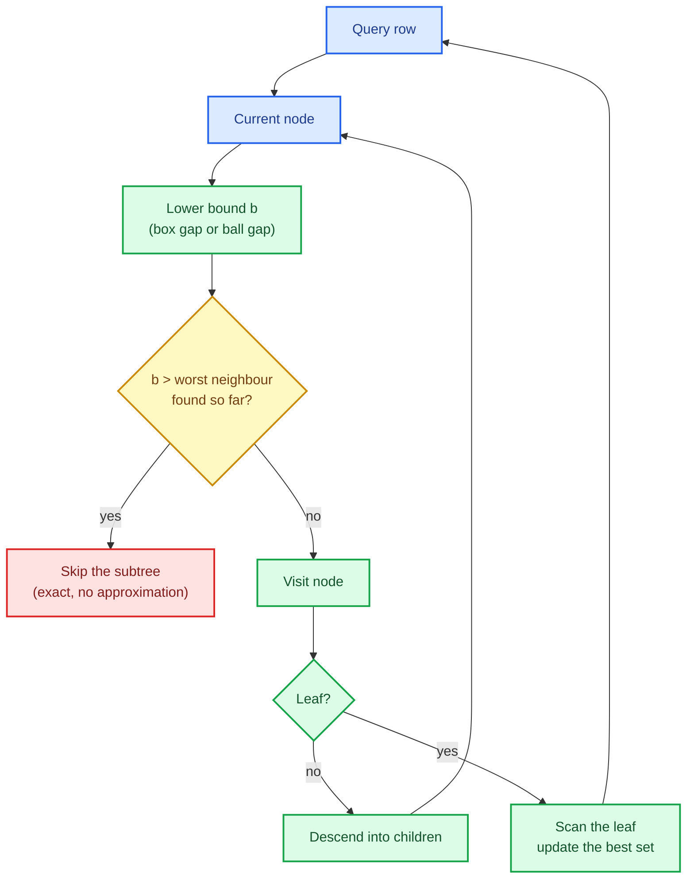

# Spatial indexes: k-d trees and ball trees

Nearest-neighbour search is the first algorithm in the library whose cost is dominated by
**geometry** rather than by arithmetic. Answering "which training rows are closest to this
query?" by comparing every pair is $O(n \cdot m)$: a million training rows and ten thousand
queries means ten billion distance computations. A spatial index prunes almost all of them.

This chapter builds two exact indexes — a **k-d tree** (axis-aligned boxes) and a **ball tree**
(nested balls) — behind one searcher contract. Both return the *exact* answer a brute-force
scan would return, in deterministic order, and both are the documented **dense-only exception**
to representation parity.

The capability is `kd-tree-and-ball-tree`; the code lives in `crates/sciencekit_neighbors/`.

## 1. The problem, in plain words

Imagine a map. To find the five nearest cafés you do not measure the distance to every café in
the country; you look at the neighbourhood first. A spatial index is the data structure that
makes "look at the neighbourhood first" exact rather than heuristic.

It works by **partitioning space and keeping a summary of each part**:

- a **k-d tree** splits on one coordinate at a time. Each node owns an axis-aligned box, and
  the box is summarised by its minimum and maximum on every axis.
- a **ball tree** splits by picking two far-apart pivots and grouping points around them. Each
  node owns a centre and a radius, and the ball contains all of its members.

With a summary you can compute a **lower bound** on the distance from a query to anything
inside the node. If that lower bound is already farther than the worst neighbour found so far,
the entire subtree can be skipped — with no approximation.

## 2. The decisions, and the roads not taken

1. **Two indexes, one contract.** `SKNearestNeighborsSearcher<F>` has `k_nearest` and
   `radius_neighbors`; both trees implement it, so callers can swap them.
2. **Exact, never approximate.** Pruning uses a proven lower bound; nothing is dropped that
   could be a true neighbour.
3. **Deterministic ordering.** Distances ascending, ties broken by the **smallest training row
   index** — never by tree layout or hash order. Two different partitions of the same data must
   produce the same result.
4. **Dense-only, explicitly.** Tree geometry is boxes and balls; there is no honest sparse form.
   A sparse training or query view is rejected *before any element is processed* with
   `UnsupportedRepresentation` and a suggestion (the brute-force searcher arrives with the
   neighbours estimators).
5. **Bounded leaves and parallel batches.** Build until every leaf holds at most `leaf_size`
   rows; scan the leaf with an auto-vectorizable loop; parallelise across query rows with
   rayon.

*Roads not taken.* Approximate indexes (random projections, HNSW) — they change the definition
of the answer; cosine distance — it violates the triangle inequality, so tree pruning is
unsound; NaN-aware distance — there is no sparse missing marker; and a single generic tree with
a runtime metric branch inside the hot loop.

## 3. The concepts, taught from zero

### Why a lower bound is enough

The search keeps a set of the best neighbours found so far. Let $d_{\max}$ be the current worst
distance in that set. For a candidate node, compute $b$: a value that is **guaranteed** to be
no larger than the distance from the query to any point in the node.

$$
b \le d(q, x) \quad \text{for every } x \text{ in the node}
$$

If $b > d_{\max}$, then every point in the node is farther than the worst neighbour already
found, so the node cannot improve the answer. Skipping it is safe — that is what makes the
index *exact*. If $b \le d_{\max}$, descend and eventually scan the leaves.

### The k-d tree: boxes on axes

Each node splits its rows on one coordinate — the axis with the largest spread — by the
**median**. The median guarantees balance, so the depth is $O(\log n)$. Every node
stores the box that encloses its members: the minimum and maximum on each axis.

The lower bound is the **box gap**: for each axis, the distance from the query to the interval
$[\min_i, \max_i]$, combined with the metric's own combination rule (sum of squares for
Euclidean, sum of absolute values for Manhattan, maximum for Chebyshev). Inside the box the gap
is zero, which is why a query that lands inside a node always descends.

### The ball tree: nested balls

The ball tree picks two far-apart pivots and splits the rows by which pivot is closer. Each node
stores its centre and the radius that covers all members. The **ball gap** is
$g = \max(0, \lVert q - c \rVert - r)$: zero when the query is inside the ball, otherwise
how far outside it lies. The bound is then converted to the metric's own unit — $g$ for
Euclidean and Manhattan, $g^2$ for squared Euclidean, and $g/\sqrt{f}$ for Chebyshev, where
$f$ is the feature count. Because a floating-point bound can round a few ulps above the true
minimum, pruning only happens when the bound exceeds the limit by a small relative tolerance;
exploring one extra node is cheap, while pruning a node exactly at the radius would be wrong.

### Ties, and why they need a rule

Two training rows at the *same* distance are equally good neighbours, but a list needs an
order. Tree layout depends on the split, so "whatever the traversal found first" would make the
result depend on the data structure. The contract fixes it: **distance ascending, then the
smallest training row index**. A test partitions the same data differently and asserts the
same order.

## 4. Each public object, explained

- **`SKKDTree<F>` / `SKBallTree<F>`** — the built, immutable indexes.
- **`SKKDTreeBuilder<F>` / `SKBallTreeBuilder<F>`** — builder-only construction with
  `leaf_size` (default documented and asserted), `metric`, `backend` (default `Faer`) and
  `execution_mode` (default `Automatic`); `build(features)` takes the borrowed training view.
- **`SKNearestNeighborsSearcher<F>`** — the shared contract: `k_nearest(queries,
  neighbors_count)` returns a row-major `SKNeighborQuery` (distances + indices), and
  `radius_neighbors(queries, radius)` returns `SKRadiusNeighbors` (per-row slices, inclusive
  boundary, empty neighbourhoods allowed).
- **`SKNeighborMetric`** — the implemented metrics: Euclidean, squared Euclidean, Manhattan and
  Chebyshev. `SKRequestedNeighborMetric` is the user-facing request type, which rejects Cosine
  and NaN-aware Euclidean at build time with a clear reason.
- **Internal node types** (`SKKDTreeNode`, `SKBallTreeNode`) and the permutation are
  crate-private; the public accessors expose only the configuration, `node_count` and `depth`.

## 5. A real walk-through, using the tests

### `acceptance_every_metric_matches_brute_force_on_both_trees`

The definition of correctness: for every metric, both trees return exactly the neighbours a
brute-force scan returns. An index that prunes too aggressively fails here immediately.

### `kd_query_breaks_distance_ties_by_the_smallest_training_index` and `kd_query_tie_order_is_independent_of_the_tree_partition`

Ties are the classic source of nondeterminism. The second test builds the same rows with
different `leaf_size` values — different partitions — and asserts the neighbour order is
identical.

### `kd_radius_query_includes_the_boundary` and `kd_radius_query_represents_an_empty_neighborhood`

Radius queries are inclusive, and "nobody is within the radius" is a valid answer that must be
representable rather than an error.

### `representation_rejects_sparse_training_for_both_trees`

The dense-only exception, tested at the boundary: a CSR training view is rejected before the
tree is built, with `UnsupportedRepresentation`. The reason is written next to the rejection —
tree geometry has no sparse form.

### `acceptance_large_batches_agree_between_both_trees` and `acceptance_one_shared_index_serves_concurrent_batches`

Large batches prove the parallel query path equals the sequential one, and a `Send + Sync`
index answers several threads concurrently with their sequential results.

## 6. Look inside

| File | Responsibility |
|---|---|
| `kd_tree/` | builder, build (median splits and node array), `k_nearest`, radius and parallel query |
| `ball_tree/` | builder, build (farthest pivots), `k_nearest`, radius and parallel query |
| `metric/` | point distances and the box/ball lower bounds per metric |
| `searcher/` | the shared contract, result types and query validation |
| `acceptance_tests/` | tiny/large, every metric, ties, radius and concurrency |

## 7. What this unlocks

The next change (`knn-classifier-regressor`) reuses both indexes and adds the brute-force
searcher behind the same contract, which is how the *estimators* keep full representation
parity: dense queries use a tree, sparse or mixed queries use brute force over the stored
training rows, and the estimator never densifies. This change supplies the dense half of that
story, tested against the answer that matters — the one brute force would give.
