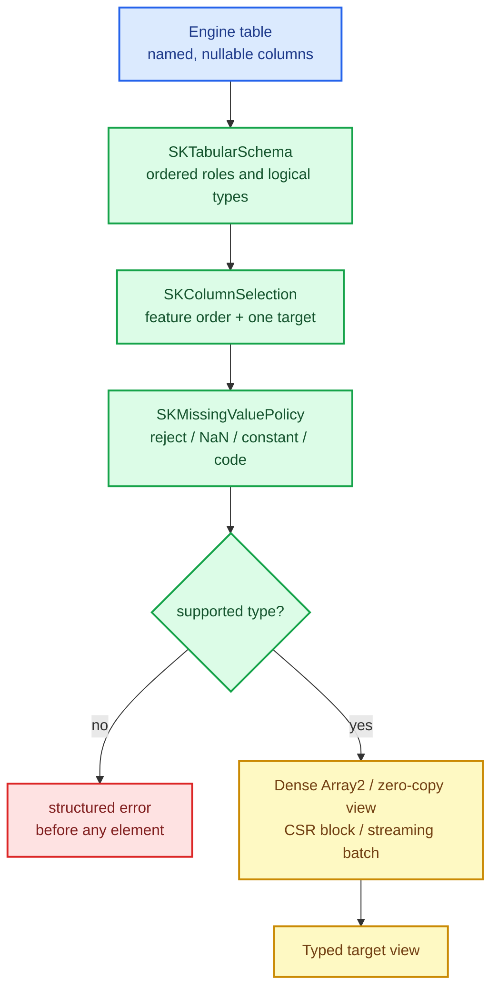

# Dataset interop: one seam from engines into sciencekit

Every real dataset arrives from somewhere else: a Parquet file through Polars, a SQL result
through DataFusion, an Arrow table, a pandas DataFrame, a Spark job. Those sources are
**columnar, heterogeneous and nullable** — each column has its own type and may name missing
values in its own way. sciencekit's algorithms want **homogeneous, dense or sparse numeric
feature matrices** plus targets.

The gap between the two is where most integration bugs live: a categorical column silently
becomes a float, a null becomes `0.0` in one engine and `NaN` in another, a column order
changes between batches, an async engine blocks the compute thread. This chapter builds the
single seam that closes the gap — one schema, one selection, one missing-value policy, one
conversion path, one streaming source contract and one async bridge.

The capability is `dataset-interop-core`; the code lives in `crates/sciencekit_interop/`.

## 1. The problem, in plain words

A columnar table is a list of **named columns**, each with its own **logical type**
(integer, float, boolean, string, categorical) and its own **nullability**. To feed a model we
must answer four questions deterministically:

1. **Which columns are features, and in what order?** Model coefficients are positional, so
   the order must be explicit and stable — never "whatever the engine returned".
2. **Which column is the target?** Exactly one, and it may not also be a feature.
3. **What does a missing value mean?** Reject the row, map it to `NaN`, fill a constant, or use
   the documented categorical code. Every engine must produce the same answer.
4. **Which representation?** Dense for small numeric designs, CSR for sparse ones, and a stream
   for out-of-core fits.

A seam that answers all four in one place means the next engine adapter (Polars, Arrow,
DataFusion) is a thin translation rather than another interpretation of the rules.

## 2. The decisions, and the roads not taken

1. **Engine-neutral core.** `sciencekit_interop` does not depend on Polars, Arrow or DataFusion.
   Those arrive later behind optional features; the core defines the vocabulary they translate
   into.
2. **An ordered schema with explicit roles.** `SKTabularSchema` keeps the column order, rejects
   duplicate names and empty schemas, and gives every column a role (feature, target, ignored)
   and a logical type.
3. **Explicit selection.** `SKColumnSelection` names features and the optional target by name or
   position; the resolved selection is what conversion consumes, so the order is the selection
   order and never the engine's.
4. **One missing-value policy.** `SKMissingValuePolicy` (reject / map to `NaN` / fill a
   constant / documented categorical code) is applied identically to every engine.
5. **Typed column batches.** `SKTabularBatch` holds `SKColumnData` per column with null
   counts; unsupported types are rejected once per batch, before any element is read.
6. **Conversion produces existing representations.** Dense `Array2`, zero-copy views where the
   layout allows it, CSR blocks, `SKDataBatch`/`SKSupervisedBatch` for streaming, and the
   categorical view for coded columns.
7. **A reopenable source and an async bridge.** `SKTabularSource` can be reopened for
   multi-epoch fits; `SKAsyncTabularSource` drains an async stream on a dedicated thread so the
   CPU never blocks an async runtime, and cancellation drops the reader.

*Roads not taken.* A single "convert everything to `f64`" path (loses categoricals and
precision); engine crates as core dependencies (couples the library to four moving targets);
per-engine missing-value conventions (irreproducible models); and letting a `tokio` runtime
drive the conversion (blocks the compute pool).

## 3. The concepts, taught from zero

### Columnar tables and logical types

A **columnar** table stores each column contiguously, which is why engines can compress and scan
it efficiently. Each column has a **logical type** — what the values *mean*, not how they are
laid out in memory. `SKLogicalType` is the neutral vocabulary: signed/unsigned integers,
floats, booleans, strings, categoricals. A model never sees "an Arrow Int64 array"; it sees "an
integer column", and the interop layer decides how to coerce it.

### Nulls are not zeros

A null means "this value is unknown". Mapping it to `0.0` invents a measurement; mapping it to
`NaN` marks it as missing for the imputers. That is why the policy is explicit and applied
once, not left to each engine.

### Why the async bridge exists

An async engine yields batches asynchronously. sciencekit's streaming executor is synchronous
and CPU-bound. Bridging them naively — `block_on` inside the executor — blocks the runtime
thread. `SKAsyncTabularSource` therefore runs a dedicated reader thread that awaits the stream
and delivers batches through a bounded channel; the consumer never polls, back-pressure bounds
memory, and dropping the consumer cancels the reader.

## 4. Each public object, explained

- **`SKColumnRole` / `SKLogicalType` / `SKColumnSchema`** — the neutral vocabulary of one column;
  role and logical-type names round-trip and an unknown name is rejected.
- **`SKTabularSchema`** — the ordered column list with deterministic lookup, duplicate-name and
  empty-schema rejection, and role partitioning.
- **`SKColumnSelection` / `SKColumnSelectionBuilder` / `SKResolvedSelection`** — feature and
  target selection by name or position, validated once (no duplicate features, no target
  counted twice, no out-of-range position).
- **`SKMissingValuePolicy`** — reject, map to `NaN`, fill a constant (validated finite) or use
  `SK_CATEGORICAL_MISSING_CODE`.
- **`SKColumnData` / `SKTabularBatch`** — typed, nullable column storage and the validated batch
  (row-count agreement, logical-type agreement) with projection.
- **Conversion** — dense `Array2`, `SKRowMajorFeatureView`/`SKNumericColumnView` (zero-copy when
  the layout allows), CSR materialization, `SKDataBatch`/`SKSupervisedBatch`.
- **`SKTargetExtraction` / `SKCategoricalExtraction`** — typed targets (continuous, integer,
  nominal canonicalized deterministically) and coded/nominal categorical columns.
- **`SKTabularSource` / `SKSupervisedTabularLazySource` / `SKTabularSourceProvider`** — the
  reopenable source contract and its bridge into the Phase 0 streaming providers.
- **`SKAsyncTabularSource` / `SKAsyncTabularStream`** — the async-to-sync bridge.
- **`SKInteropConversionAttributes` / `SKInteropSourceKind`** — the observability span and the
  stable source-kind names.

## 5. A real walk-through, using the tests

### `tiny_table_converts_for_both_scalars` and `large_table_converts_and_streams_in_order`

The first proves the smallest end-to-end path (schema → selection → policy → matrix) for `f32`
and `f64`. The second proves order and streaming: a large table converts batch by batch in the
input order, so a streaming fit sees exactly what a dense fit would.

### `nullable_and_categorical_columns_follow_the_policy`

Nulls and categoricals are where engines disagree. The test exercises the policy variants and
the coded categorical path together, so the documented answer is pinned rather than incidental.

### `type_rejection_precedes_element_processing` and `unsupported_type_is_named_with_a_suggestion`

An unsupported column type is rejected **once per batch, before any element is read**, with the
column named and a suggestion. This is the same "reject up front" discipline as the
representation rules.

### `caller_thread_never_polls` and `dropping_the_source_cancels_and_drops_the_stream`

The async bridge is tested for the two properties that matter: the caller never polls (the
reader thread does the waiting), and dropping the consumer cancels the reader instead of leaking
a task.

### `one_shot_source_rejects_reopening` and `reopenable_source_replays_each_pass`

A multi-epoch fit needs a reopenable source; a one-shot source must say so instead of silently
returning an empty second pass.

## 6. Look inside

| File | Responsibility |
|---|---|
| `schema/` | roles, logical types, column schema and the ordered tabular schema |
| `selection/` | feature/target selection and its resolved form |
| `missing/` | the missing-value policy |
| `columns/` | typed nullable column storage and scalar coercion |
| `batch/` | the validated tabular batch, views, materialization, targets and categoricals |
| `source/` | the reopenable source contract and the provider bridge |
| `bridge/` | the async-to-sync reader thread, back-pressure and cancellation |
| `observability/` | the conversion span and source-kind names |
| `acceptance/` | tiny/large, nullable, concurrent and error-path suites |

## 7. What this unlocks

Every engine change — Arrow, Polars, DataFusion, memory-mapped files, and the Python/Julia/JVM
dataset bridges — becomes a translation into this vocabulary. The rules live in one crate, so a
null means the same thing in a pandas DataFrame and a Parquet scan, and a feature order never
depends on which engine produced the table.
