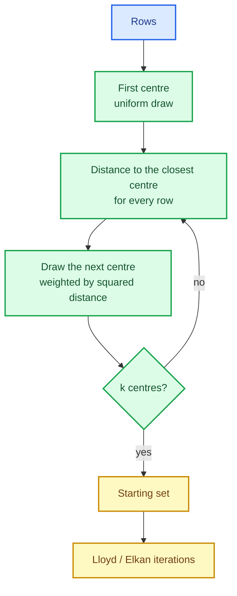

# k-means: Lloyd, Elkan and a seed you can trust

Clustering is the first unsupervised learning task in the library. Given $n$ rows and a
requested number of clusters $k$, the goal is to partition the rows so that each one sits
close to its group's centre. It sounds simple, and the classic algorithm *is* short — but the
interesting engineering is elsewhere: how to initialise without luck, how to accelerate
without changing the answer, and how to keep the result identical across runs and thread
counts.

This chapter builds `SKKMeans`: the Lloyd iteration, the Elkan accelerated variant, seeded
k-means++ initialisation, best-of-`n` restarts, empty-cluster repair and the typed cluster
assignment surface.

The capability is `kmeans-lloyd-elkan`; the code lives in `crates/sciencekit_cluster/`.

## 1. The problem, in plain words

k-means minimises the **inertia**: the sum of squared distances from every row to the centre
of the cluster it was assigned to.

$$
\text{inertia} = \sum_{i=1}^{n} \lVert x_i - c_{a(i)} \rVert^2
$$

The algorithm alternates two steps until nothing changes:

1. **Assign** every row to its nearest centre.
2. **Update** every centre to the mean of the rows assigned to it.

That is Lloyd's algorithm. Its two famous problems are **initialisation** (a bad starting
guess gives a bad local optimum) and **cost** (each assign step compares every row to every
centre). Everything else in this change exists to solve one of those two.

## 2. The decisions, and the roads not taken

1. **k-means++ initialisation, seeded.** Pick the first centre uniformly, then pick each next
   centre with probability proportional to its squared distance to the closest chosen centre.
   Every draw comes from `SKRandomGenerator` seeded through `sk_derive_seed`, so the same
   `random_seed` reproduces the same centres.
2. **Best of `number_of_initializations` runs.** k-means++ is still stochastic; running it
   several times and keeping the lowest inertia removes most of the variance. Ties go to the
   **earliest** initialisation, so the choice is deterministic.
3. **Elkan's acceleration, same answer.** Elkan keeps a lower bound on the distance from each
   row to every centre and skips comparisons that provably cannot win. It returns exactly what
   Lloyd returns, just faster.
4. **`Auto` picks by representation.** Dense data uses Elkan; sparse data uses Lloyd with the
   norm-expansion kernel (Elkan's bounds are cheap only when distances are cheap to compare
   and update). An explicit `Elkan` on sparse input falls back to Lloyd and the model reports
   what it actually ran.
5. **Empty clusters are repaired, deterministically.** If a centre loses all its rows, it is
   moved to the row farthest from its own centre, with ties broken by row index.
6. **Typed assignments.** `predict` returns `Array1<SKClusterLabel>`, never a bare index and
   never noise.

*Roads not taken.* Random initialisation as the default (unstable results); a fixed number of
iterations instead of convergence (wasted work); sampling-based approximations (they change
the answer); and sharing one RNG across parallel initialisations (thread count would leak into
the result).

## 3. The concepts, taught from zero

### Why k-means++ matters

Imagine the data has three natural groups and the first centre happens to land on one of them.
Picking the second centre uniformly might land right next to it, wasting a centre while two
groups share one. k-means++ makes that unlikely: it chooses the next centre **where the
current centres are far away**, weighted by squared distance.

### Lloyd's loop, and why it stops

Each assign step can only decrease the inertia (every row moves to a centre at least as close
as before), and each update step can only decrease it again (the mean is the point minimising
the sum of squared distances). The inertia is bounded below by zero, so the loop must reach a
fixed point. In practice it stops when the centres move less than `tolerance` or the iteration
budget runs out; an exhausted budget returns a model with `converged() == false` rather than
pretending.

### Elkan: prune with bounds

Elkan maintains, for every row $x$ and centre $j$:

- $d(x, c_j)$ — the exact distance to its assigned centre,
- $\text{lower}(x, j)$ — a lower bound on the distance to centre $j$,
- $\text{upper}(x)$ — an upper bound on the distance to its assigned centre.

A centre $j$ can be skipped when

$$
\text{lower}(x, j) \ge \text{upper}(x) \quad\text{or}\quad
\text{lower}(x, j) \ge \tfrac{1}{2}\,d(c_{a(x)}, c_j)
$$

Both conditions are *sufficient* to prove another centre is at least as close, so pruning
never changes the assignment. That is why `kmeans_elkan_equals_lloyd_on_dense_data` can assert
exact equality: the acceleration is invisible in the output.

### Sparse data: norms instead of differences

For a CSR design, forming $x - c$ is wasteful — most entries are zero. The kernel expands the
squared distance:

$$
\lVert x - c \rVert^2 = \lVert x \rVert^2 - 2\,x\cdot c + \lVert c \rVert^2
$$

with the dot product over **stored entries only**. The design is never densified, which is why
a wide sparse matrix clusters in memory proportional to its stored values.

## 4. Each public object, explained

- **`SKKMeans` / `SKKMeansBuilder`** — builder-only configuration: `number_of_clusters`,
  `initialization` (`KMeansPlusPlus` default, `Random`), `number_of_initializations` (default
  10), `maximum_number_of_iterations`, `tolerance`, `algorithm` (`Auto` default, `Lloyd`,
  `Elkan`), `random_seed` (default 0), `backend` (default `Faer`) and `execution_mode`
  (default `Automatic`).
- **`SKKMeansModel`** — the fitted state: centres, per-row assignments, inertia, the number of
  iterations and whether it converged, plus the configuration carried into the model.
- **`SKKMeansAlgorithm` / `SKKMeansInitialization`** — the closed catalogues of algorithm and
  initialisation choices.
- **Fit and predict** — `SKUnsupervisedFit` for `fit`; `SKClustererPredictor` for
  `predict_clusters`; `transform` returns the distance from every row to every centre;
  `fit_predict` returns the training assignments.
- **`inertia()`** — the objective value a model selection search can compare.

## 5. A real walk-through, using the tests

### `kmeans_distance_sparse_wide_design_is_not_densified`

A design with a very large number of columns and few stored entries is clustered through the
sparse kernel. If any step called `to_dense`, this test would not complete — the no-densification
promise is executable, not a comment.

### `kmeans_elkan_equals_lloyd_on_dense_data` and `kmeans_elkan_prunes_impossible_distances`

The first proves the acceleration is **answer-preserving**; the second proves it actually
prunes (a test that only compared answers would pass even if Elkan silently ran Lloyd). Together
they pin both the correctness and the point of the variant.

### `kmeans_init_plus_plus_is_reproducible` and `kmeans_init_tie_selects_the_earliest_initialization`

The seeded initialisation must replay exactly for a fixed `random_seed`; and when two
initialisations reach the same inertia, the earlier one wins, so the outcome does not depend on
rayon's completion order.

### `acceptance_determinism_is_independent_of_the_thread_count`

The same fit is repeated under different rayon thread counts and must produce identical
assignments and centres. This is the test that would catch a shared generator: sub-seeds are
derived per initialisation with `sk_derive_seed`, so thread count cannot leak into the answer.

### `kmeans_lloyd_empty_cluster_repair_moves_the_farthest_point`

Empty clusters are a classic source of silent nonsense (a centre left at the origin). The test
forces one and asserts the documented repair: move the centre to the row farthest from its own
centre, with ties by row index.

## 6. Look inside

| File | Responsibility |
|---|---|
| `kmeans/builder.rs` | builder surface, defaults, validation |
| `kmeans/kernel/` | dense and sparse squared-Euclidean assignment kernels |
| `kmeans/init/` | seeded k-means++ and uniform initialisation, selection of the best run |
| `kmeans/lloyd/` | Lloyd iterations, convergence, empty-cluster repair |
| `kmeans/elkan/` | bounds, pruning and the accelerated update |
| `kmeans/fit.rs` | fit entry point and algorithm resolution |
| `kmeans/model/` | fitted model, predictions, transform, accessors |
| `acceptance_tests/` | tiny/large, representations, determinism, concurrency, metrics |

## 7. What this unlocks

`SKKMeans` is the first estimator that produces the typed `SKClusterLabel` surface built in
`clustering-contracts`, so silhouette-style scorers and the clustering metrics can evaluate it
directly. It also provides the `inertia` objective that model selection can minimise, and the
Elkan/Lloyd split previews the pattern the remaining clusterers follow: an exact algorithm, an
accelerated variant, and a representation-driven choice between them.
