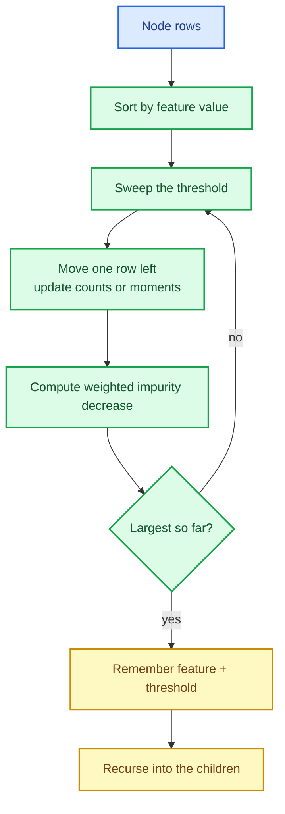

# Decision trees: CART, impurity and split search

A decision tree is the first model in the library that is **not** a linear combination of
features. It asks a sequence of yes/no questions — "is `x₃ ≤ 1.7`?" — and predicts from the
leaf a row ends in. That makes trees expressive (they capture interactions and thresholds a
linear model cannot) and interpretable (the path is the explanation), and it makes them the
foundation of every ensemble that follows: random forests, bagging, gradient boosting.

This chapter builds the CART tree: impurity, split search over dense and sparse designs, the
two splitters (best and random), growth constraints, class weights, feature importances,
classification and regression, and the deterministic order that makes all of it testable.

The capability is `decision-trees`; the code lives in `crates/sciencekit_tree/`.

## 1. The problem, in plain words

A tree grows by **splitting** a node: choose a feature and a threshold, divide the rows into
"left" and "right", and recurse. The question is which split to choose. CART answers with a
**loss**: pick the split that most reduces the impurity of the children.

A node's impurity measures how mixed it is:

- **Classification** uses Gini
  $1 - \sum_c p_c^2$ or entropy $-\sum_c p_c \log p_c$, where $p_c$ is the fraction of the
  node's rows in class $c$.
- **Regression** uses squared error (variance around the mean) or absolute error (deviation
  around the median).

A pure node has impurity zero. The best split maximises the **weighted impurity decrease**:

$$
\Delta = \text{impurity}(\text{parent})
- \frac{n_L}{n}\,\text{impurity}(L)
- \frac{n_R}{n}\,\text{impurity}(R)
$$

## 2. The decisions, and the roads not taken

1. **Sorted-threshold scan per feature.** Sort the node's rows by one feature, sweep the
   threshold left to right, and update the class counts or the running moments incrementally.
   That is $O(n \log n)$ per feature instead of $O(n^2)$.
2. **Sparse CSC scan.** For a CSR design the natural scan is per column, so the design is
   converted once to CSC at fit time; each feature is read as its stored entries plus the
   **implicit zeros**, with no dense copy.
3. **Two splitters.** `Best` evaluates every candidate (deterministic, the default) and
   `Random` draws a seeded threshold per feature, which the ensembles need.
4. **Deterministic ties.** Equal impurity decreases go to the **smaller feature index**, then
   to the lower threshold. Growth is deterministic for the same data, seed and thread count.
5. **Feature subsampling is seeded.** `maximum_features` (`All`, `Sqrt`, `Log2`, `Fraction`, `Count`)
   draws its subset through `sk_derive_seed` per node, so thread count never changes it.
6. **Class weights change the impurity, not the vote.** Balanced or explicit weights enter the
   class counts, so the split and the leaf probability both respect them.
7. **Importances from impurity decrease.** A feature's importance is its normalised total
   decrease; a tree without splits has all-zero importances.

*Roads not taken.* Exhaustive pairwise thresholds (quadratic); converting sparse to dense for
split search (memory cliff); random tie-breaking (irreproducible trees); and a separate
tree implementation per task (one growth engine, two criteria families).

## 3. The concepts, taught from zero

### Why sorting enables a single sweep

For one feature, sort the rows by value. Every meaningful threshold sits between two
consecutive distinct values. Sweep left to right, moving one row at a time from the right
child's counts to the left child's, and after each move evaluate the impurity decrease. The
best split is the maximum over the sweep — one pass per feature.

### Implicit zeros in a sparse scan

A CSR/CSC row may not store a coordinate — which means zero. A sparse split must therefore
consider the zero side too. The scan sorts the stored values; for non-negative designs it
starts with every *implicit* zero on the left and the stored entries on the right, then moves
stored values across one by one (negative stored values sort before zero, and the sweep follows
the same ordering rule). The test
`sparse_scan_recovers_the_implicit_zero_split` builds a case where the only useful threshold
separates zeros from non-zeros, so a scan that ignored implicit zeros would miss it.

### Deterministic ties, and why they matter

Suppose two features produce exactly the same impurity decrease. If the tree picked whichever
came first in a hash map, two runs could produce different trees — and every downstream
ensemble would inherit the nondeterminism. The rule is simple: **smaller feature index wins**,
then the lower threshold. `best_split_is_independent_of_feature_order` shuffles the feature
order and asserts the same split.

### Class weights

With weights $w_i$, the class mass in a node is the sum of its rows' weights, and the impurity
uses the normalised masses. A balanced weighting gives every class the same total mass, so a
model cannot ignore a rare class simply because it is rare. The leaf probability is the
weighted fraction, not the raw count.

## 4. Each public object, explained

- **`SKDecisionTreeClassifier` / `SKDecisionTreeClassifierBuilder`** and
  **`SKDecisionTreeRegressor` / `SKDecisionTreeRegressorBuilder`** — builder-only surface:
  `criterion`, `splitter` (`Best`/`Random`), `maximum_depth`, `minimum_samples_split`,
  `minimum_samples_leaf`, `maximum_features`, `class_weight` (classifier),
  `random_seed`, `backend` and `execution_mode`.
- **`SKDecisionTreeClassifierModel` / `SKDecisionTreeRegressorModel`** — the fitted tree plus
  `predict_labels`/`predict_probabilities` or `predict`, `feature_importances`, the node count
  and the configuration carried from the estimator.
- **`SKTree` / `SKTreeNode`** — the node array and its accessors (split feature and threshold,
  leaf value, children), so the structure is inspectable.
- **`SKTreeCriterion`** — Gini/entropy for classification, squared/absolute error for
  regression; using the wrong family is rejected at build time.
- **`SKMaximumFeatures`** — `All`, `Sqrt`, `Log2`, `Fraction`, `Count(n)`, resolved per node.
- **`SKSplitter`** — `Best` (exhaustive, deterministic) or `Random` (seeded).
- **`SKClassWeight`** — `None`, `Balanced`, `Explicit`.

## 5. A real walk-through, using the tests

### `dense_scan_recovers_the_separating_split`

The simplest correctness statement: on a feature that perfectly separates two classes, the
scan finds the threshold between them. Everything else builds on this.

### `sparse_scan_matches_the_dense_scan` and `sparse_scan_recovers_the_implicit_zero_split`

The first proves the CSC path is equivalent to the dense path on the same logical design. The
second proves it actually understands implicit zeros — the case a naive sparse scan would get
wrong.

### `best_split_is_independent_of_feature_order` and `best_split_breaks_ties_by_smaller_feature`

Determinism at the split level: shuffling features must not change the chosen split, and exact
ties resolve by feature index.

### `classifier_sparse_fit_equals_dense_fit` / `regressor_sparse_fit_equals_dense_fit`

The whole estimator, not just the scan: a tree fitted on CSR predicts exactly what the same
tree fitted densely predicts.

### `balanced_weights_equalize_the_class_mass` and `explicit_weights_can_flip_the_majority_class`

Weights are not cosmetic: the test constructs a case where weighting flips the leaf's
prediction, proving the weights reach the impurity and the probability.

### `one_model_serves_several_threads` and `parallel_classifier_prediction_equals_sequential`

Fitted trees are immutable and `Send + Sync`; prediction is parallel across rows and equals
the sequential answer.

## 6. Look inside

| File | Responsibility |
|---|---|
| `node.rs` | `SKTree`, `SKTreeNode`, traversal and value counting |
| `impurity/` | Gini/entropy and squared/absolute error |
| `splitter/` | `Best`/`Random` splitters, candidate ordering and the scan |
| `splitter/scan/` | per-criterion sweeps (`classification`, `squared`, `absolute`, `ranked`) and boundary selection |
| `growth/` | growth engine: depth, split and leaf constraints, feature subsampling |
| `classifier/` | builder, validation, fit, prediction, probabilities, class-weight expansion |
| `regressor/` | builder, fit, prediction |
| `class_weight/` | `None`/`Balanced`/`Explicit` expansion |
| `design/` | dense/CSR/CSC design view and conversion |
| `acceptance_tests/`, `determinism_tests.rs` | tiny/large, representations, determinism, concurrency |

## 7. What this unlocks

The tree is the base learner for the ensemble wave: random forests subsample features and
rows, bagging resamples, and gradient boosting fits trees on residuals. Because the split
search is deterministic, seeded and representation-aware, every ensemble inherits those
properties for free — and because the sparse scan never densifies, text-scale designs can be
boosted without a memory cliff.
