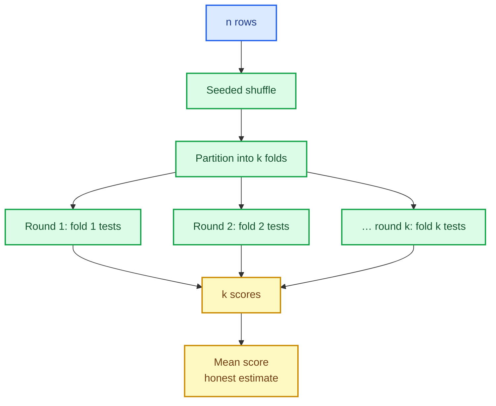

# Model selection: splits, folds and honest scores

Every number a model reports about itself is only as trustworthy as the data it was measured
on. Training accuracy is a lie — the model has already seen those rows. The whole discipline of
**model selection** exists to answer a narrower, honest question: *how well would this model
perform on data it has never seen?*

This chapter builds the machinery for that question: a train/test split, K-fold,
stratified K-fold, group K-fold, and cross-validation scoring. All of it is deterministic,
seeded, representation-aware and built on one row-gathering primitive.

The capability is `model-selection-core`; the code lives in
`crates/sciencekit_model_selection/`.

## 1. The problem, in plain words

You have $n$ labelled rows and a model. To estimate generalisation you must **hide** some rows
from the model while it trains, then score it on them. Three decisions follow:

1. **Which rows are hidden?** A random subset is the usual answer, but it must be the *same*
   subset every time you rerun, or your comparison between two models is noise.
2. **How many times?** Hiding a quarter once gives one estimate. K-fold hides every row once,
   in $k$ rounds, and averages — a more stable estimate that uses all the data.
3. **What must stay together?** With imbalanced classes, a random split can leave a fold with
   no rare-class example; with grouped data (several rows per patient), splitting a group across
   train and test leaks information.

## 2. The decisions, and the roads not taken

1. **One partition type.** Every splitter yields an `SKIndexSplit`: the training indices and
   the test indices. Nothing else — no copied features, no boxed closures. Gathering rows is a
   separate, explicit step.
2. **Seeded Fisher–Yates shuffle.** Shuffling uses `SKRandomGenerator`, so the same
   `random_seed` reproduces the same partition. No ambient entropy.
3. **Three K-fold flavours.** Plain `SKKFold`; `SKStratifiedKFold`, which keeps class
   proportions per fold and rejects a class with fewer examples than folds; and `SKGroupKFold`,
   which never splits a group.
4. **One gather primitive for dense, sparse and targets.** `sk_gather_rows` copies only the
   selected rows, keeps CSR sparse (no densification) and gathers continuous, integer and
   nominal targets consistently.
5. **Validation up front.** Fractions that consume every row, counts that leave a side empty,
   `k < 2`, `k > n`, a rare class, a group-length mismatch, a target-length mismatch and
   non-finite values are all rejected with the central error taxonomy before any split is
   produced.
6. **Cross-validation as a function, not a framework.** `sk_cross_val_score_classifier` and
   `sk_cross_val_score_regressor` take a splitter, features, targets and a scorer, then fit and
   score one model per fold, returning the per-fold scores.

*Roads not taken.* A "shuffle everything at fit time" helper (irreproducible comparisons); a
splitter that copies data eagerly (memory waste and a hidden densification risk); stratified
sampling by rejection (it can loop forever on rare classes); and a cross-validation trait
hierarchy before there is a second use for it.

## 3. The concepts, taught from zero

### Why the same split must come back

Suppose model A scores 0.81 and model B 0.83 on a random split. Is B better? Only if both were
scored on the **same** rows — otherwise the difference may be which rows happened to be hard.
Seeding the shuffle makes the partition a pure function of `(n, k, seed)`, so comparisons are
fair and a failing test reproduces exactly.

### Stratification, in one paragraph

Stratified K-fold assigns rows to folds **per class**: each class is shuffled and dealt round
robin into the folds. Every fold then holds roughly the same class proportions as the whole
dataset. If a class has fewer examples than folds, exact stratification is impossible; the
splitter rejects the request instead of silently producing empty folds.

### Groups, and leakage

If five rows belong to one patient and the patient's rows appear in both train and test, the
model can memorise the patient rather than learn the pattern. `SKGroupKFold` partitions the
**groups**, then derives the row split from the group assignment. The number of folds defaults
to the number of distinct groups, and asking for more is rejected.

### Cross-validation, honestly

For each fold: fit a fresh estimator on the training rows, predict the test rows, score them.
The result is $k$ numbers. Reporting their mean is the usual summary; reporting all $k$ is more
honest, and the API returns all of them.

## 4. Each public object, explained

- **`SKIndexSplit`** — `train_indices()` and `test_indices()`, the universal output.
- **`SKSplitter`** — the contract every splitter implements: `split(features, targets,
  groups)` yields index splits.
- **`SKKFold` / `SKKFoldBuilder`** — `number_of_splits`, `shuffle`, `random_seed`.
- **`SKStratifiedKFold` / `SKStratifiedKFoldBuilder`** — the same surface, stratifying on the
  targets.
- **`SKGroupKFold` / `SKGroupKFoldBuilder`** — groups in, group-preserving folds out.
- **`sk_train_test_split` / `SKTrainTestSplit` / `SKTrainTestSplitBuilder`** — fractions
  (`test_fraction`), explicit counts (`SKPartitionSize`), `shuffle`, `random_seed` and optional
  `stratify`.
- **`sk_gather_rows`** — dense/sparse feature gathering plus target gathering, preserving order
  and never densifying CSR.
- **`sk_shuffle_indices`** — the seeded Fisher–Yates permutation other changes reuse.
- **`sk_cross_val_score_classifier` / `sk_cross_val_score_regressor`** — fit-and-score per
  fold, returning every fold's score.

## 5. A real walk-through, using the tests

### `kfold_test_partitions_are_disjoint_and_exhaustive`

The defining property of K-fold: every row is in exactly one test fold, and the union is all
rows. If a row were duplicated or dropped, the average would be wrong in a subtle way.

### `kfold_shuffle_is_seeded_and_reproducible`

Two splitters with the same seed produce identical index vectors; a different seed produces a
different order. This is what makes a cross-model comparison meaningful.

### `stratified_every_fold_sees_every_class_in_proportion`

A 90/10 dataset must not produce a fold with zero minority examples. The test asserts every
fold holds both classes and that the proportions track the whole dataset.

### `group_never_splits_a_group_across_train_and_test`

The leakage guarantee: for every group, all of its rows land on the same side of the split.

### `gather_sparse_features_keeps_csr_without_densifying`

Gathering selected rows from a CSR design returns CSR. A naive implementation would call
`to_dense` and pass the small test anyway; this one asserts the representation survives.

### `cross_validation_parallel_scores_equal_sequential_scores`

Folds are independent, so they run in parallel — but the scores must not depend on it.

### `validation_rejects_non_finite_sparse_features`

Missing values are not silently tolerated: a `NaN` in a stored entry is reported with its
position before the split is produced.

## 6. Look inside

| File | Responsibility |
|---|---|
| `splitter/` | `SKIndexSplit`, the `SKSplitter` contract and the builders |
| `gather/` | dense/CSR feature gathering and target gathering |
| `shuffle.rs` | seeded Fisher–Yates |
| `kfold/`, `stratified/`, `group/` | the three K-fold flavours |
| `train_test/` | fractions, counts, stratification |
| `cross_validation/` | fit-and-score per fold |
| `validation/` | shared input checks |
| `acceptance_tests/` | tiny/large, representations, determinism, concurrency, metrics |

## 7. What this unlocks

`SKGridSearchCV` and the halving search are the next changes in this lane, and they consume
exactly this surface: a splitter to produce folds, a scorer to evaluate each candidate, and a
seed to keep the comparison fair. Because the splits are index-only and gathering is explicit,
a grid search can hold one copy of the data and slice it per candidate instead of cloning it
per configuration — which is what makes searching many hyperparameters affordable.
