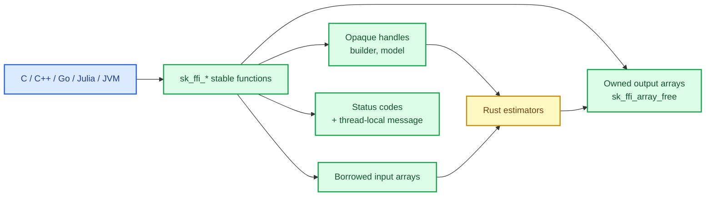

# A stable C ABI: handles, ownership and no panics across the boundary

Rust is the implementation language; most of the world is not Rust. A data team calls from
Python, a simulation from C or C++, a services team from Go, a research group from Julia or from
the JVM. Each of those needs to call the library **without** reimplementing its own unsafe
glue — and without a careless pointer turning a modelling run into a segmentation fault.

This chapter builds the stable C ABI: a small integer-based surface, opaque handles, borrowed
inputs, owned outputs, thread-local error messages, panic containment and a C smoke test that
compiles and runs against the real shared library.

The capability is `ffi-abi`; the code lives in `crates/sciencekit_ffi/`.

## 1. The problem, in plain words

A C boundary has three hard rules that Rust does not enforce for you:

1. **Nothing may unwind.** A Rust panic crossing into C is undefined behaviour. Every entry
   point must catch it and return a status code.
2. **Ownership must be explicit.** Who frees an output buffer? When is a handle valid? Without a
   written rule, every binding leaks or double-frees.
3. **Pointers may be wrong.** Null, misaligned, too short, freed — the library must validate
   before dereferencing, because the caller's language cannot express Rust's guarantees.

The ABI also has to **erase generics**: Rust's estimators are generic over `f32`/`f64`, C has no
generics. The answer is a runtime data-type code plus opaque handles.

## 2. The decisions, and the roads not taken

1. **Opaque handles, never struct layouts.** `SKFfiBuilder` and `SKFfiModel` are incomplete C
   types; the binding never knows their size or fields, so the Rust internals can change
   without breaking the ABI.
2. **Status codes, not exceptions.** Every fallible function returns `SKFfiStatus`; the message
   travels separately through a **thread-local** last-error string.
3. **Borrowed inputs, owned outputs.** An array passed *to* the library is borrowed for the
   call; an array *returned* by it is owned and released with `sk_ffi_array_free` (idempotent).
4. **A handle registry.** Freed handles are never dereferenced: a freetable lookup runs first,
   so use-after-free returns `SK_FFI_STATUS_INVALID_HANDLE`.
5. **`catch_unwind` at every entry point.** A panic becomes `SK_FFI_STATUS_INTERNAL` plus a
   message, and the process keeps running.
6. **One encoding for persistence.** Save/load use the `SKModelState` contract from
   `sciencekit_common::interop`, so the C path and the Rust path agree on what a model is.
7. **A compiled C smoke test.** The header is verified by compiling and running real C against
   the cdylib, not by reading it.

*Roads not taken.* Exposing Rust structs directly (ABI breakage on every field change); returning
Rust `String`s (unfreeable from C); panicking on invalid input (undefined behaviour); and a
per-language binding in this change (Lua, Go, Julia and the JVM come later, on top of this ABI).

## 3. The concepts, taught from zero

### Opaque handles and a registry

A **handle** is an opaque pointer to a Rust value. The binding must never dereference it, so the
ABI keeps a **registry**: each handle has a numeric identifier, and every entry point looks the
identifier up. Freeing removes it. A second use finds nothing and returns
`SK_FFI_STATUS_INVALID_HANDLE` — no garbage read, no crash.

### Borrowed versus owned

For an **input**, the C caller passes a pointer, a length and a stride description. The library
reads it during the call and never stores it. For an **output**, the library allocates, fills and
returns a descriptor; the caller must free it exactly once. `sk_ffi_array_free` tolerates a
second call so a defensive `free` in a binding is safe.

### Panics must not cross

Rust's unwinding is not compatible with C frames. Each entry point wraps its body in
`std::panic::catch_unwind`, converts the payload into a message, and returns `Internal`. The
test `panic_is_converted_to_internal_status` installs a panicking path and asserts the process
survives with the right status.

### Why the ABI erases generics with a code

`f32` and `f64` estimators are different Rust types. The C surface takes an `SKFfiDataType`
(`F32`, `F64`, `I64`, `U8`) at builder creation and validates every array against it. That is
the whole generics story from C's point of view: one builder, one data-type code, one model
handle.

## 4. Each public object, explained

- **`SKFfiStatus`** — stable integer codes (`OK`, `INVALID_HANDLE`, `SHAPE`,
  `INVALID_ARGUMENT`, `UNSUPPORTED`, `NOT_FITTED`, `IO`, `INTERNAL`). Never renumbered.
- **`SKFfiDataType`** — `F32`, `F64`, `I64`, `U8`, checked against every descriptor.
- **`SKFfiArray` / `SKFfiArrayShape` / `SKFfiOwnedArray`** — the descriptor, its shape metadata
  and the owned output wrapper.
- **`SKFfiBuilder` / `SKFfiModel`** — opaque handles; create, configure, fit, predict,
  transform, score, free.
- **`sk_ffi_last_error` / `sk_ffi_clear_last_error`** — thread-local message access.
- **`sk_ffi_version` / `sk_ffi_version_features`** — ABI version and capability query, so a
  binding can refuse an incompatible library instead of crashing.
- **Persistence** — `sk_ffi_save_model_file` / `sk_ffi_load_model_file` (plus the encode/decode
  pair) over the shared `SKModelState` contract.

## 5. A real walk-through, using the tests

### `panic_is_converted_to_internal_status`

A deliberately panicking entry point returns `SK_FFI_STATUS_INTERNAL`, sets a message and does
not abort the process. This is the single most important property of the boundary.

### `handle_use_after_free_is_rejected`

Free a model, then predict: the registry answers `INVALID_HANDLE` without touching the freed
memory. The test is safe by construction, which is the point.

### `array_rejects_length_mismatch` and `boundary_rejects_length_mismatch_before_reading`

Before any element is read, the number of elements is checked against the declared shape. A
short buffer cannot cause an out-of-bounds read.

### `persistence_save_and_load_keep_predictions`

A fitted model is saved to a file, loaded into a new process-local handle, and predicts the same
values. This proves the C path and the Rust `SKModelState` encoding agree.

### The C smoke test (`tests/c_smoke.c`)

Compiled with `cc` and linked against the real cdylib, it creates a builder, fits, predicts,
scores, saves and loads, exercises the scaler and checks an invalid handle. A header that lies
about a signature fails to compile; an ABI that lies about behaviour fails at run time.

### `version_header_declares_every_entry_point`

The header is checked against the exported symbol list, so adding an entry point without
declaring it fails a test rather than a user.

## 6. Look inside

| File | Responsibility |
|---|---|
| `abi/` | entry points grouped by area (builder, fit, predict, persistence, version) |
| `handle/` | the registry and identifier allocation |
| `array/` | descriptors, shape checks and owned buffers |
| `boundary/` | the only module that dereferences raw pointers |
| `error/`, `error_kind/` | status codes and the thread-local message |
| `model/` | the model handle and its operations |
| `persistence/` | the `SKModelState` file encoding |
| `include/sciencekit.h` | the stable C header |
| `tests/c_smoke.c` | the compiled end-to-end C test |

## 7. What this unlocks

Every non-Rust binding — Lua, Go, Julia, the JVM — is now a thin wrapper over this ABI rather
than a second implementation. The rules that make bindings safe (opaque handles, borrowed
inputs, owned outputs, status codes, panic containment) are written once, tested once, and
inherited by all of them.
