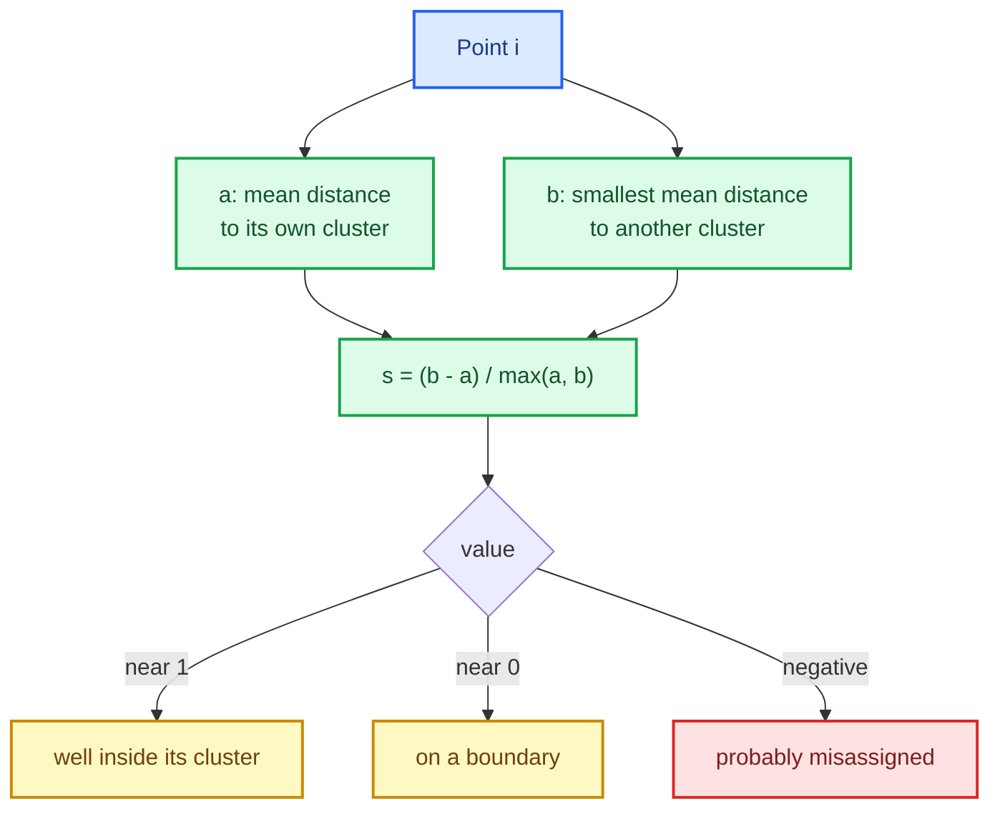

# Clustering metrics: silhouette, ARI, NMI and the centroid indices

A clusterer always returns *some* partition. The question is whether the partition is any good —
and unlike supervised learning there are no labels to compare against. Clustering evaluation is
therefore a family of proxies, each answering a different question:

- **Silhouette** — are points closer to their own cluster than to the next one?
- **Davies-Bouldin** and **Calinski-Harabasz** — how compact and separated are the clusters,
  judged from centroids and dispersions?
- **Adjusted Rand index**, **normalized mutual information**, **homogeneity/completeness/V-measure**
  — when a reference labelling exists, how much do the two partitions agree, *above chance*?

This chapter builds all of them, with the dense/sparse parity, noise policy and degenerate-case
handling the rest of the library follows.

The capability is `clustering-metrics`; the code lives in `crates/sciencekit_metrics/src/clustering/`.

## 1. The problem, in plain words

Two partitions of the same $n$ rows can be compared in two very different ways.

**Internally**, without any reference: a good clustering has points near their own centroid and
far from the others. The silhouette captures that per point:

$$
s(i) = \frac{b(i) - a(i)}{\max\{a(i),\, b(i)\}}
$$

where $a(i)$ is the mean distance from point $i$ to the other members of its cluster and $b(i)$
the mean distance to the members of the nearest *other* cluster. The value lies in $[-1, 1]$:
near $1$ means well inside its cluster, near $0$ on the boundary, negative means it is probably
in the wrong cluster.

**Externally**, with a reference labelling: count how the two partitions agree. The raw agreement
is misleading — two random partitions agree by chance, and the chance level grows with the number
of clusters. The **adjusted Rand index** subtracts that expectation, so $0$ means chance and $1$
means identical (up to relabelling).

## 2. The decisions, and the roads not taken

1. **Chunked pairwise distances.** Silhouette needs, per point, the mean distance to every
   cluster. The pairwise matrix is computed in row chunks and reduced immediately, so peak memory
   is one chunk instead of $n^2$.
2. **Noise is excluded, explicitly.** A `Noise` assignment has no cluster to be close to, so the
   silhouette/centroid metrics drop those rows and document it; the pairwise metrics take plain
   `i64` labels and treat noise as an ordinary label.
3. **Chance correction is explicit.** The adjusted Rand index subtracts the expected agreement
   of independent partitions. NMI is not chance-corrected; it is mutual information normalised by
   the two label entropies (arithmetic, geometric or max), with identical partitions scoring 1.
4. **Homogeneity, completeness and V-measure** come from the same contingency table, so the three
   are consistent with each other by construction.
5. **Degenerate cases are documented, not papered over.** Fewer than two clusters, all-noise
   assignments, singleton clusters, coincident centroids and zero within-cluster dispersion each
   have a stated answer (rejection, `0`, or positive infinity).
6. **Dense and sparse designs score identically**, and a wide sparse design is never densified.

*Roads not taken.* Materialising the full pairwise matrix (memory blow-up); comparing raw
agreement without chance correction (favours many clusters); and silently dropping noise in the
pairwise metrics (it would hide a modelling decision).

## 3. The concepts, taught from zero

### The silhouette, one point at a time

For point $i$ in cluster $C_i$:

- $a(i)$ = mean distance to the other points of $C_i$ (a cluster of one has $a(i) = 0$ by
  convention, and its silhouette is defined as $0$);
- $b(i)$ = the smallest mean distance to any *other* cluster.

Then $s(i)$ compares them. Averaging over the non-noise rows gives the **mean silhouette**.

### Chance correction, in one paragraph

Suppose both partitions have many small clusters. Even a random labelling will put some pairs
together, so raw agreement is high. ARI subtracts the expected agreement and divides by the
maximum possible, which is why it can be negative (worse than chance) and why it stays near zero
for independent labellings regardless of cluster count. NMI does the same for mutual information,
normalised so identical partitions score $1$.

### The centroid indices

**Davies-Bouldin** averages, over clusters, the worst ratio of within-cluster spread to
between-centroid distance: lower is better, zero for perfectly separated clusters. **Calinski-Harabasz**
is a variance ratio (between-cluster dispersion over within-cluster dispersion, scaled by degrees
of freedom): higher is better. Both need centroids; both exclude noise rows for the same reason
as the silhouette.

## 4. Each public object, explained

- **`sk_silhouette_samples`** — the per-point silhouette, in the order of the non-noise rows.
- **`sk_silhouette_score`** — its mean; rejects fewer than two clusters and all-noise input.
- **`SKSilhouetteScorer`** — the scorer adapter over `SKUnsupervisedScorer`, taking typed
  assignments and applying the same noise policy as the free function.
- **`sk_adjusted_rand_score`** — chance-corrected pair agreement.
- **`sk_normalized_mutual_information_score`** with **`SKMutualInformationNormalization`** —
  arithmetic, geometric or max normalisation.
- **`sk_homogeneity_score`**, **`sk_completeness_score`**, **`sk_v_measure_score`** — the three
  contingency-table views.
- **`sk_davies_bouldin_score`**, **`sk_calinski_harabasz_score`** — centroid-based indices.

## 5. A real walk-through, using the tests

### `silhouette_samples_exclude_noise_rows`

A partition containing `Noise` rows returns one sample per **non-noise** row. Noise has no cluster
to be close to, so counting it would corrupt the mean.

### `silhouette_samples_agree_between_dense_and_sparse`

The same logical design, once dense and once as CSR, yields the same silhouettes. This is where a
hidden densification or a wrong sparse mean would show up.

### `adjusted_rand_is_invariant_under_label_permutation`

Renaming the clusters must not change the score: ARI depends on the partition, not on the labels.

### `adjusted_rand_matches_the_hand_computed_cross_fixture`

A small contingency table is computed by hand; the function must match it exactly. This is what
pins the chance-correction formula rather than an approximation of it.

### `nmi_matches_the_hand_computed_normalization_variants`

All three normalisations are checked on the same fixture, so the difference between them is
explicit and tested.

### `davies_bouldin_matches_the_hand_computed_fixture` and `calinski_harabasz_matches_the_hand_computed_fixture`

Both centroid indices are pinned against a hand-computed value; `davies_bouldin_is_near_zero_for_separated_clusters`
and `calinski_harabasz_is_large_for_separated_clusters` confirm the direction of "better".

### `clustering_validation_rejects_a_single_cluster` and `clustering_validation_rejects_noise_only_input`

Degenerate inputs are rejected with a structured error rather than producing a meaningless
number.

### `clustering_large_data_produces_the_expected_verdict` and `clustering_scorer_is_send_and_sync`

Large-data behaviour and thread-safety round out the acceptance checklist.

## 6. Look inside

| File | Responsibility |
|---|---|
| `clustering/silhouette.rs` | per-sample silhouette, chunked distances, mean score |
| `clustering/adjusted_rand.rs` | chance-corrected pair agreement |
| `clustering/mutual_information.rs` | NMI with three normalisations |
| `clustering/homogeneity.rs` | homogeneity, completeness, V-measure |
| `clustering/davies_bouldin.rs` | Davies-Bouldin index |
| `clustering/calinski_harabasz.rs` | Calinski-Harabasz index |
| `scorers/clustering.rs` | `SKSilhouetteScorer` |
| `acceptance_tests/clustering_acceptance_tests.rs` | large data, concurrency, `Send + Sync` |

## 7. What this unlocks

The clustering lane now has the same evaluation depth as the supervised one: `SKKMeans` can be
compared on internal quality (silhouette, centroid indices) and, when a reference exists, on
external agreement (ARI, NMI, homogeneity family); later clusterers inherit the same surface. Because the metrics
share the pairwise kernels and the typed-assignment contract, a new clusterer gets all of them
without new plumbing.
