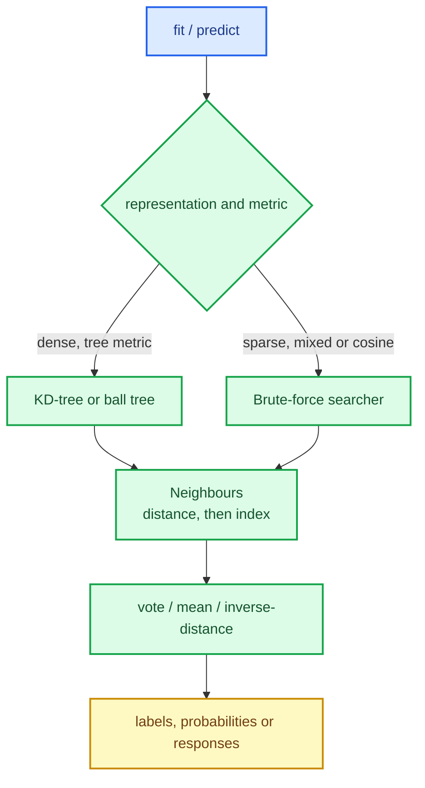

# k-nearest neighbours: a search strategy behind one estimator

k-nearest neighbours is the simplest supervised model in the library and, in production, one of
the most useful: no training beyond storing the data, no assumption about the shape of the
decision boundary, and a decision you can explain by showing the neighbours. It is also the
first estimator whose **prediction cost** depends on how the data is searched, which is why it
sits at the intersection of the geometry chapter and the estimator contracts.

This chapter builds `SKKNeighborsClassifier` and `SKKNeighborsRegressor`: the brute-force
searcher, the runtime strategy dispatch, weighting, voting and probabilities, and the
representation parity that lets a sparse design be classified without densification.

The capability is `nearest-neighbor-estimators`; the code lives in `crates/sciencekit_neighbors/`.

## 1. The problem, in plain words

To classify a query row:

1. find its $k$ nearest training rows;
2. let them vote.

With $k = 5$ and three of the neighbours in class `A`, the prediction is `A`, and the estimated
probability is $3/5$. For regression, take the mean of the neighbours' responses. Optionally,
weight each neighbour by inverse distance so a very close neighbour counts more.

Two engineering questions decide the quality of the implementation:

- **How do you find the neighbours?** A k-d or ball tree is fast on dense, low-dimensional data;
  brute force is the honest fallback for sparse, high-dimensional or cosine data.
- **What happens when the neighbours are tied?** Both the neighbour list and the vote need a
  deterministic rule, or the model is irreproducible.

## 2. The decisions, and the roads not taken

1. **One contract, three searchers.** The brute-force searcher joins the k-d tree and ball tree
   behind `SKNearestNeighborsSearcher`, so the estimator can swap them at run time.
2. **`Auto` picks by representation and metric.** Dense Euclidean/Manhattan/Chebyshev data uses a
   tree; sparse, mixed or cosine data uses brute force. An explicit tree request on a
   representation the tree cannot serve returns `UnsupportedRepresentation`.
3. **Sparse is never densified.** The brute-force searcher computes distances over the stored
   entries plus the implicit zeros using the shared pairwise kernels.
4. **Deterministic neighbours and votes.** Neighbours are ordered by distance then the smallest
   training index (inherited from the searcher contract); a vote tie goes to the smallest
   canonical class index.
5. **Two weighting modes.** `Uniform` (plain vote/mean) and `Distance` (inverse distance); a
   zero-distance neighbour is handled by the documented convention so weights stay finite.
6. **Typed targets, scalar-independent labels.** Integer and nominal targets go through
   `SKLabelTable`; `predict_labels` returns canonical `i64` indices and `predict_probabilities`
   returns the model scalar.

*Roads not taken.* A single searcher with a runtime branch inside the distance loop (slow and
error-prone); densifying sparse queries (memory cliff on text data); random tie-breaking
(irreproducible models); and a separate classifier per weighting mode (combinatorial surface).

## 3. The concepts, taught from zero

### Why the representation changes the algorithm

A k-d tree prunes by comparing coordinates; its bounding boxes have no meaning when most
coordinates are implicit zeros. Brute force does not care: it computes the distance to every
training row using only the stored entries, in $O(\text{nnz})$ per pair. So the *same* estimator
is fast on dense low-dimensional data and correct on sparse high-dimensional data — the
representation chooses the strategy, not the user.

### Uniform and distance weighting

Uniform voting counts neighbours. Inverse-distance weighting uses $1/d$ (with the zero-distance
case handled explicitly), so the nearest row dominates. Both are legitimate; the choice belongs
in the builder, and the probabilities must still sum to one.

### Ties are a specification, not an accident

Two equidistant neighbours, or two classes with the same vote, need an order. The searcher
guarantees distance-then-index ordering; the vote breaks ties by the smallest canonical class
index. Both are tested, because a nondeterministic tie would make cross-validation scores depend
on hash-map iteration order.

## 4. Each public object, explained

- **`SKKNeighborsClassifier` / `SKKNeighborsClassifierBuilder`** — `nearest_neighbors_count`
  (default 5), `weights` (`Uniform`/`Distance`), `algorithm` (`Auto`/`KdTree`/`BallTree`/
  `BruteForce`), `metric` (Euclidean/Manhattan/Chebyshev/Cosine), `leaf_size`, `backend`,
  `execution_mode`.
- **`SKKNeighborsRegressor` / `SKKNeighborsRegressorBuilder`** — the same surface for responses.
- **Fitted models** — implement `SKClassifierPredictor` (labels + probabilities) or
  `SKRegressorPredictor`, and expose the stored design, `nearest_neighbors_count` and the
  resolved search strategy.
- **`SKNeighborsAlgorithm`**, **`SKNeighborsWeights`**, **`SKNeighborsMetric`** — the closed
  catalogues of choices.
- **`SKBruteForceSearcher`** — the sparse-aware searcher implementing the shared contract.

## 5. A real walk-through, using the tests

### `brute_force_*` agreement with the k-d tree

The brute-force searcher is checked against the tree on the same dense data: same distances, same
indices, same order. The new searcher never gets to invent a different answer.

### `representation_*` dense/sparse parity

The estimator fitted on CSR predicts the same labels as the one fitted densely, and the mixed
combinations (dense fit / sparse predict and the reverse) agree too. This is the representation
parity rule applied to an estimator whose search depends on it.

### `classifier_probabilities_*`

Probabilities are neighbour fractions (or weighted fractions) and must sum to one; the columns
follow the canonical class table, not the order the labels happened to appear in.

### `acceptance_knn_equidistant_neighbors_*`

Equidistant neighbours produce a deterministic list and a deterministic vote, so the prediction
cannot drift between runs.

### `acceptance_knn_large_*` and `concurrency_*`

A 20 000-row acceptance case, all representation combinations, and a fitted model shared across
threads with the same predictions as a single thread.

### `validation_rejects_*`

Zero or excessive neighbour counts, feature-count mismatch, non-finite values and unsupported
metric/algorithm pairs are rejected with the central error taxonomy.

## 6. Look inside

| File | Responsibility |
|---|---|
| `searcher/brute_force/` | sparse-aware brute-force neighbour search |
| `classifier/` | builder, fit, labels, probabilities, target canonicalization |
| `regressor/` | builder, fit and response prediction |
| `algorithm.rs`, `weights.rs`, `metric.rs` | the closed catalogues and `Auto` resolution |
| `acceptance_tests/` | tiny/large, representations, ties, parallelism, metrics |

## 7. What this unlocks

The neighbours estimators complete the representation-parity story that the trees began: dense
queries use geometry, sparse queries use brute force, and the user sees one estimator either way.
They are also the natural consumer of the clustering metrics and the model-selection splits,
which is why this lane can now evaluate itself end to end. The next neighbour change
(`knn-imputer`) reuses the same searcher to fill missing values from the nearest complete rows.
