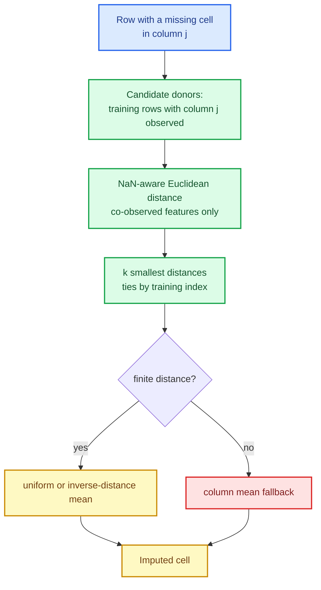

# The k-NN imputer: filling a hole from the nearest complete rows

`SKSimpleImputer` fills a missing value from the column's own statistic — mean, median, mode,
constant. That is cheap and often enough. It is also blind: a 90-year-old's missing income is
replaced by the average income of *everyone*, including teenagers. The k-nearest-neighbour
imputer makes the fill **local**: it finds the training rows most similar to the incomplete row
and averages the values those rows hold in the missing column.

This chapter builds `SKKNNImputer`: the missingness mask, the NaN-aware donor search, the
weighting and fallback rules, the optional missingness indicator, and the memory bound that
keeps a large transform affordable.

The capability is `knn-imputer`; the code lives in `crates/sciencekit_impute/src/knn/`.

## 1. The problem, in plain words

For a row with a missing cell in column $j$:

1. compare it to every **training** row that has a value in column $j$;
2. keep the $k$ closest such rows (the **donors**);
3. fill the cell with their mean, or an inverse-distance weighted mean.

"Closest" needs a distance that **ignores the missing coordinates** on both sides: a row is not
far away just because the column you are about to fill is empty. The documented metric is the
NaN-aware Euclidean distance, which compares only co-observed features and scales by the
fraction of features observed in both rows.

## 2. The decisions, and the roads not taken

1. **One marker predicate, shared with `SKSimpleImputer`.** `NaN`, a scalar sentinel (e.g.
   `-999`) or any configured value identifies a missing cell; the same predicate drives fit and
   transform, so the two imputers cannot disagree about what "missing" means.
2. **Column-wise donor pools.** A row can only donate to a column it observes, so the pool for
   column $j$ is the training rows with $j$ present. This is both correct and cheaper than a
   full $n \times m$ neighbour search.
3. **Chunked distance blocks.** The donor distances are computed in blocks sized by a byte
   budget, so a transform never materialises the full receiver × training matrix.
4. **Deterministic donor selection.** The $k$ smallest distances are selected with a partial
   selection; ties break by the smallest training row index — the same rule as the neighbours
   searchers.
5. **Two weighting modes and an explicit fallback.** `Uniform` and `Distance`; a zero-distance
   donor takes the whole weight; when no distance is finite (no co-observed feature), the
   column mean fills the cell.
6. **Dense-only, stated up front.** The donor search needs a dense missingness mask; a sparse
   design is rejected with `UnsupportedRepresentation` rather than silently densified.
7. **The indicator composes.** `add_indicator` appends the missingness mask after the imputed
   features, tolerating missingness patterns unseen at fit.

*Roads not taken.* Reusing the spatial-tree index (missing coordinates break its bounding
boxes); a full pairwise matrix (memory); random donor selection (irreproducible fills); and
densifying sparse input to reuse the dense path.

## 3. The concepts, taught from zero

### Why the distance must ignore missing coordinates

Classic Euclidean distance treats a missing value as impossible to compare, so it either fails
or substitutes a number (often zero), which invents a distance. The NaN-aware form instead
computes the distance over the features **both** rows observe and rescales by
$\text{total}/\text{observed}$, so a row missing half its features is not automatically far from
everything. If two rows share no observed feature, the distance is `NaN` — and a `NaN` donor is
never averaged in.

### Why the donor pool is per column

The value you need comes from a column the donor must actually have. Restricting the pool to
rows that observe column $j$ removes every donor that would contribute another hole, and makes
the search smaller.

### The memory bound

A naive transform computes one distance per (receiver row, donor) pair. With a 100 000-row
training set and a 100 000-row batch that is $10^{10}$ numbers. The implementation processes
receiver rows in blocks sized against a byte budget, so peak memory is bounded regardless of the
input size; the block plan is tested directly
(`knn_distance_block_rows_stays_within_the_byte_budget`).

## 4. Each public object, explained

- **`SKKNNImputer<F>` / `SKKNNImputerBuilder<F>`** — builder-only configuration:
  `missing_values`, `nearest_neighbors_count` (default 5), `weights` (`Uniform`/`Distance`),
  `add_indicator`, `keep_empty_features`, `backend` (default `Faer`) and `execution_mode`.
- **`SKKNNImputerModel<F>`** — the learned state: the retained training design with missing
  cells normalised to `NaN`, the mask, the valid columns, the per-column means and the donor
  pools; plus `transform`.
- **Marker and mask** — the shared predicate and the dense missingness mask.
- **Distance blocks and donor selection** — the NaN-aware kernel and the partial selection.
- **Weights and averaging** — uniform, inverse-distance, zero-distance and mean fallback.

## 5. A real walk-through, using the tests

### `knn_transform_imputes_a_known_matrix`

A tiny matrix whose answer can be computed by hand: the missing cell is the mean of its two
nearest donors. This pins the whole pipeline — mask, pool, distance, selection, average.

### `knn_transform_preserves_observed_cells_bit_identically`

Imputation must never perturb a value that was present. A bit-identical assertion catches any
accidental re-scaling or recomputation.

### `knn_transform_falls_back_to_the_column_mean_without_a_comparable_donor`

When no donor shares an observed feature (all distances `NaN`), the documented fallback applies
instead of writing `NaN` or panicking.

### `knn_marker_predicate_is_the_shared_one`

The k-NN imputer and `SKSimpleImputer` must agree on what missing means. The test asserts they
use the same predicate, so a sentinel configured in one is not silently ignored by the other.

### `knn_validation_rejects_sparse_fit_input` and `…_sparse_transform_input`

The dense-only contract is enforced on both entry points, before any mask is built, with a
suggestion rather than a silent densification.

### `acceptance_knn_imputer_fits_ten_thousand_rows_and_transforms` and `…_large_transform_is_deterministic`

Large data stays correct and repeatable; the block plan does not introduce order dependence.

### `acceptance_knn_imputer_produces_a_low_imputation_error`

A planted missing pattern is imputed and compared against the known truth, so the test measures
*quality*, not just shape.

## 6. Look inside

| File | Responsibility |
|---|---|
| `knn/builder.rs`, `knn/mod.rs` | builder surface and the pure dispatcher |
| `knn/marker.rs`, `knn/fit.rs` | shared missingness mask and the retained training state |
| `knn/distance_block.rs`, `knn/donors.rs` | chunked NaN-aware distances and k-smallest selection |
| `knn/weights.rs`, `knn/transform.rs` | weighting, averaging, fallback and the row-parallel transform |
| `knn/validation.rs` | dense-only contract and input validation |
| `knn/acceptance_tests/` | tiny, large, patterns, metrics and concurrency |

## 7. What this unlocks

With `SKKNNImputer`, the imputation lane covers both ends of the spectrum: cheap column
statistics and local, similarity-driven fills. The shared marker, mask and indicator semantics
mean the two imputers compose in a pipeline without surprises, and the chunked design shows how
a neighbour search can stay inside a memory budget — a pattern the remaining out-of-core work
reuses.
