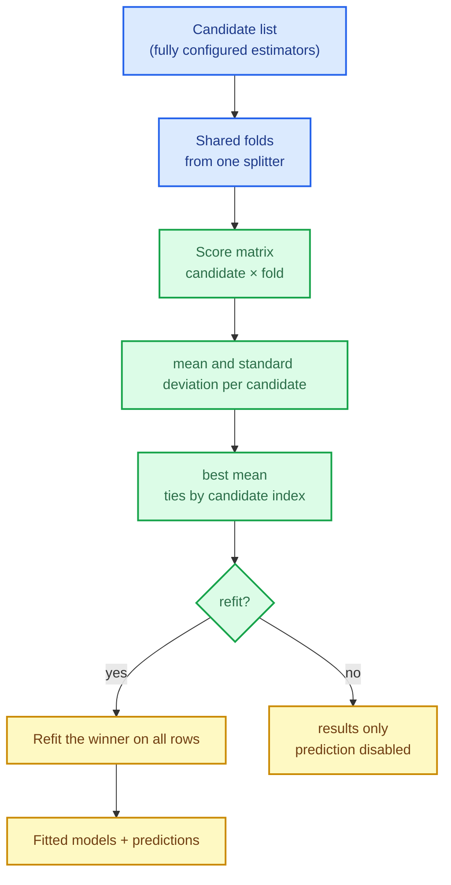

# Grid search: trying every candidate honestly

Hyperparameters are not learned from the data; they are *chosen*. Choosing them well means
answering the same question model selection already taught us — "how well would this
configuration generalise?" — once per candidate, on the same folds, and then committing to the
one that wins.

This chapter builds `SKGridSearchCV`: the candidate enumeration, cross-validated scoring,
deterministic winner selection, the refit, and the result surface a caller inspects afterwards.

The capability is `grid-search-cv`; the code lives in
`crates/sciencekit_model_selection/src/grid_search/`.

## 1. The problem, in plain words

You have a model class, three values of `alpha` and two values of `tolerance`. That is six
candidates. Grid search:

1. enumerates the six configurations;
2. for each one, runs the **same** K-fold split and scores every fold;
3. aggregates each candidate's fold scores into a mean (and a spread);
4. picks the highest mean, breaking ties deterministically;
5. optionally **refits** the winner on all the data so it can predict.

Every step has a trap. Different folds per candidate make the comparison unfair. A
nondeterministic tie makes runs disagree. Averaging scores from different scales (accuracy and
log loss) is meaningless. And a candidate that fails on one fold must not silently disappear.

## 2. The decisions, and the roads not taken

1. **Candidates are configured estimators, not string maps.** A candidate is a fully built
   `SKDecisionTreeClassifier` (or any `SKSupervisedFit` estimator) with its hyperparameters
   already set. Type safety replaces a `HashMap<String, String>` and a runtime parser.
2. **One splitter, one fold partition.** The splitter runs once; every candidate is scored on
   the same indices, so differences come from the configuration, not from the data.
3. **Classification and regression scoring are separate enums.** `SKClassifierScoring`
   (`Accuracy`, `BalancedAccuracy`, `F1`, `Precision`, `Recall`, `Auc`, `LogLoss`) and
   `SKRegressorScoring` (`R2`, `NegMeanSquaredError`, `NegMeanAbsoluteError`) make a
   regressor scorer on a classifier **unwritable at compile time**.
4. **Errors are a policy.** `SKErrorScore::Raise` propagates the first failing fold;
   `SKErrorScore::Value(v)` records `v` for that fold and continues. A `NaN` error score is
   ordered below every finite mean, so a broken candidate can never win.
5. **Deterministic winner.** Highest mean wins; an exact tie goes to the **earliest candidate**
   in the list.
6. **Refit is explicit.** With `refit(true)` the winner is fitted on all rows and the result
   exposes prediction; without it, results are available but prediction is rejected.
7. **Parallel and order-preserving.** Candidates (and folds) run in parallel, but the score
   matrix, ranking and best index are collected in declaration order.

*Roads not taken.* Random search (a different change), string-keyed parameter grids (untyped
and unvalidated), a separate scorer passed as a trait object (loses the classifier/regressor
split), and refitting every candidate (wasted work — only the winner is deployed).

## 3. The concepts, taught from zero

### Why the folds must be shared

If candidate A is scored on folds $\{1,2,3\}$ and candidate B on $\{2,3,4\}$, the difference in
mean score may be the difference between those folds. Grid search therefore asks the splitter
once and replays the same index splits for every candidate.

### The score matrix

The evaluation produces a $C \times K$ matrix: $C$ candidates, $K$ folds. Row means are the
selection criterion; the population standard deviation is reported alongside because a candidate
that is excellent on average but wildly variable is often not what you want to deploy.

### Error policies, from zero

A candidate can fail: a fold may not contain a class the scorer needs, or a solver may not
converge. Silently dropping such a candidate biases the search. `Raise` stops and tells you;
`Value(v)` lets the search continue with a penalty (commonly `0` or `-∞`), and the ordering
guarantees a penalised candidate loses to any healthy one.

## 4. Each public object, explained

- **`SKGridSearchCVClassifier<F, E>` / `SKGridSearchCVRegressor<F, E>`** — the search
  estimators, built through `SKGridSearchCVClassifierBuilder` / `…RegressorBuilder` with
  `candidates`, `splitter`, `scoring`, `error_score`, `refit`, `backend`, `execution_mode`.
- **Result accessors** — `results()`, `mean_scores()`, `best_index()`, `best_candidate_index()`,
  `best_parameters()` (the winning configured candidate), `best_score()`,
  `ranked_candidate_indices()` and `best_model()`.
- **Fitted models** — `SKGridSearchCV…Model`, which predict by delegating to the refitted best
  model.
- **`SKClassifierScoring` / `SKRegressorScoring` / `SKErrorScore`** — the closed policy
  catalogues.

## 5. A real walk-through, using the tests

### `grid_evaluation_*` — the hand-computed matrix

A tiny three-candidate, five-fold fixture whose score matrix can be computed by hand. This pins
fold sharing, ordering and aggregation in one test.

### `grid_selection_*`

`mean` and **population** standard deviation, the highest mean winning, and an exact tie going
to the earlier candidate. A mean is easy; the tie rule is what makes a search reproducible.

### `grid_errors_*`

`Raise` propagates, `Value` records per failing fold, and a healthy candidate beats a penalised
one. The numeric-policy test uses `NaN` to prove the ordering is strict.

### `grid_refit_*` and `grid_predict_*`

With refit, the winner is fitted on **all** rows and prediction delegates to it; without refit,
prediction is rejected. Labels, probabilities and responses match the best model exactly.

### `grid_representation_*`

A sparse design is scored and predicted without densification; dense and sparse folds agree.

### `grid_concurrency_*`

Prediction without refit is blocked; a refitted model is shared across eight threads with the
same results.

### `grid_acceptance_*`

Tiny and large data, every scoring policy, K-fold/stratified/group splitters, thread-count
determinism, and the composition of an error policy with refit.

## 6. Look inside

| File | Responsibility |
|---|---|
| `grid_search/builder/` | classifier and regressor builders, configuration, validation |
| `grid_search/scoring/` | the classifier/regressor scoring enums and fold-scorer seam |
| `grid_search/evaluation/` | parallel candidate × fold evaluation |
| `grid_search/results.rs` | aggregation, ranking and best selection |
| `grid_search/error_score.rs` | the `Raise`/`Value` policy |
| `grid_search/classifier/`, `grid_search/regressor/` | refit, prediction delegation, models |
| `grid_search/acceptance_tests/` | tiny/large, policies, splitters, determinism, metrics |

## 7. What this unlocks

A grid search turns a model class into a *searchable* space, and it does so on the same honest
folds the rest of the lane uses. The halving search next builds on this shape — same candidates,
same scoring, same error policy — and adds successive halving to spend fewer folds on hopeless
configurations.
