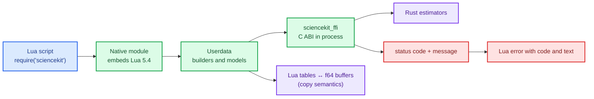

# Lua bindings: embedding Lua, not requiring it

Lua is a small, fast scripting language designed to be **embedded** in a host program. That
word is the whole design brief for this change: a Lua user should `require("sciencekit")` and
call the library, and an operator should not have to install a Lua interpreter, a development
package, or a matching `liblua` before the module builds.

This chapter builds the Lua binding: the embedded interpreter, the module entry point, userdata
for builders and models, table↔matrix conversion, error mapping, lifecycle and packaging.

The capability is `lua-bindings`; the code lives in `crates/sciencekit_lua/`.

## 1. The problem, in plain words

A native binding has to answer five questions:

1. **Where does Lua come from?** If the answer is "the system", every deployment becomes a
   compatibility puzzle (`liblua5.4` present? correct ABI? headers installed?).
2. **How does a Lua table become a matrix?** Lua has no arrays of numbers; it has tables that
   can hold anything, including ragged rows.
3. **What owns the model?** A Lua value is garbage-collected; a C handle is not. Something must
   free the handle exactly once.
4. **How do errors surface?** A status code is invisible to a script; the failure must become a
   Lua error with a readable message.
5. **How is it packaged?** A module that cannot be installed is a demo, not a binding.

## 2. The decisions, and the roads not taken

1. **`mlua` with `lua54` + `vendored`.** Lua 5.4 is compiled from source into the module. The
   build needs a C compiler (already required by the workspace) and nothing else.
2. **Reuse the C ABI in process.** The module calls `sciencekit_ffi`, so a Lua call exercises
   exactly the code path a C consumer sees — no second implementation to drift.
3. **One entry point written by hand.** `mlua`'s `module` feature cannot be combined with
   `vendored`, so `luaopen_sciencekit` is written explicitly over the entry-point constructor.
4. **Copy semantics, stated plainly.** A Lua table is copied into a contiguous `f64` buffer and
   outputs are fresh tables of rows. No zero-copy is promised across a garbage-collected,
   dynamically typed value.
5. **`f64` only.** Lua 5.4 numbers are IEEE-754 doubles; accepting `f32` descriptors would add
   rounding without saving memory.
6. **Double lifecycle control.** Userdata frees its handle on garbage collection (`Drop`),
   and an explicit `close()` releases it early; both are idempotent, and a live-handle counter
   makes double-free testable.
7. **Errors are Lua errors.** An ABI status plus the thread-local message becomes a Lua error
   carrying the status name and code, so `pcall` sees something actionable.
8. **A rockspec and a Lua test suite.** Packaging is part of the change, not an afterthought.

*Roads not taken.* Linking the system `liblua` (deployment friction); LuaJIT FFI (a different
ABI); implementing estimators directly in the binding (duplication); and promising zero-copy
through Lua tables (impossible without pinning the value).

## 3. The concepts, taught from zero

### What "vendored" means

A C library is normally found on the system at build time (`pkg-config`, headers, a shared
object). **Vendoring** ships the C sources inside the Rust crate and compiles them with the
`cc` crate. The result is a static copy linked into the module: the same build works on a
machine with no Lua installed, and the module does not care which `liblua` the loader might
find.

### Userdata and garbage collection

A Lua **userdata** is an opaque value whose memory is managed by Lua's collector. The binding
stores a handle inside it and implements the destructor; when the value becomes unreachable the
collector calls it and the handle is freed. Because the collector's timing is not defined by
the script, an explicit `close()` gives deterministic release for long-running processes.
Both paths funnel into the same idempotent free.

### Tables as matrices

A matrix is a table of rows, each row a table of numbers. The conversion validates
rectangularity (every row the same length), rejects non-numeric cells with the offending
position, and copies into a row-major buffer. On the way out, every row becomes a fresh table.
That is a copy in both directions, and the README says so.

## 4. Each public object, explained

- **The module table** — `require("sciencekit")` returns constructors (`linear_regression()`,
  `standard_scaler()`), `version`, `abi_version()` and `features()`.
- **Builder userdata** — chainable setters (`include_intercept`, `with_mean`, `with_std`,
  `backend`), `fit(...)`, and `close()`.
- **Model userdata** — `predict`, `transform`, `score`, `save`, `load`, `close`.
- **Conversion helpers** — table → `SKFfiArray`, `SKFfiArray` → table, with rectangularity and
  numeric-cell validation.
- **Error mapping** — the ABI status name/code and message as a Lua error.

## 5. A real walk-through, using the tests

### `module_loads_through_require`

The module registers itself and `require` returns a table. If the embedded interpreter or the
entry point is wrong, nothing else can run.

### `module_reports_abi_version_and_features`

The script can interrogate the library before using it, which is what a production binding
needs to refuse an incompatible binary instead of failing deep inside a fit.

### `convert_rejects_ragged_table` and the non-numeric case

Ragged rows and string cells are rejected with a position, not silently coerced. A scripting
language makes malformed input easy; the boundary must be strict.

### `userdata_close_is_idempotent_and_rejects_further_use` and `errors_gc_after_close_does_not_double_free`

Release is safe from both the explicit and the collector path. The live-handle counter makes
the leak/double-free assertions observable.

### `operations_linear_regression_fits_predicts_and_scores` and `operations_standard_scaler_transforms_with_the_expected_shape`

The end-to-end path for both families, through tables, exercising the ABI underneath.

### `concurrency_shared_model_predicts_deterministically` and `concurrency_independent_vms_fit_and_predict`

Several Lua states can use the library at once; a model shared in one state predicts
deterministically across calls.

### The Lua suite (`tests/run.lua`)

Run with the system Lua 5.4 from the devcontainer against the built library, it covers module
metadata, both estimator families, persistence, structured errors and the single-free
lifecycle. It is the "can a Lua user actually use this" test.

## 6. Look inside

| File | Responsibility |
|---|---|
| `src/lib.rs`, `src/module.rs` | the module entry point and exports |
| `src/userdata/` | builder/model handles, setters, `close`, GC |
| `src/convert.rs` | table ↔ buffer conversion and rectangularity |
| `src/operations.rs` | fit/predict/transform/score/save/load wiring |
| `src/errors.rs` | ABI status → Lua error mapping |
| `tests/run.lua`, `sciencekit-*.rockspec` | the Lua suite and packaging |

## 7. What this unlocks

The Lua lane is the first binding on top of the C ABI, and it validates the ABI's design: an
embedded interpreter, copied arrays, structured errors and a deterministic lifecycle are enough
to expose the library to a scripting language. The Go and JVM bindings follow the same shape,
with their own garbage collectors and packaging.
