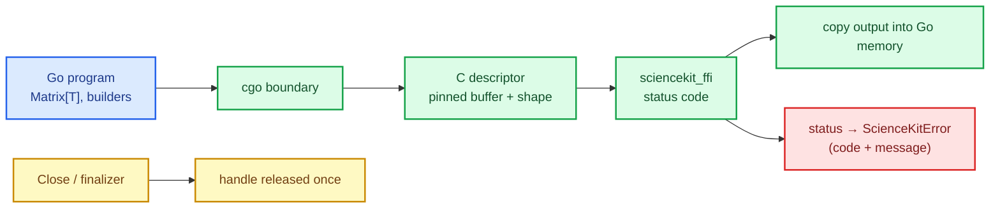

# Go bindings: cgo over a stable C ABI

Go is the language of infrastructure and data tooling, and it is unusually good at what a
machine-learning binding needs: explicit errors, predictable lifetimes and cheap concurrency.
It also has **cgo**, which lets Go call C directly — and that is both the opportunity and the
hazard. The binding must wrap the ABI without leaking a single handle, without copying unsafe
pointers into Go memory, and without hiding the status codes that the ABI was built around.

This chapter builds the Go module: a typed layer over `sciencekit_ffi` with builders, models,
matrices, structured errors and a lifecycle that survives a garbage collector.

The capability is `go-bindings`; the code lives in `go/` at the repository root.

## 1. The problem, in plain words

A Go value is managed by the Go runtime; a C handle is not. cgo crosses that boundary, and the
crossing has four rules:

1. **C memory is not Go memory.** A pointer returned by C must never be stored in a Go pointer
   that the collector may move or free.
2. **The collector may run at any time.** A model that becomes unreachable must release its
   handle — but only once, even if `Close` also runs.
3. **cgo calls are cheap but not free.** A builder must be safe when several goroutines use it.
4. **Errors must stay errors.** The ABI communicates through integer status codes; the binding
   must turn them into Go errors carrying the code, without inventing a second taxonomy.

## 2. The decisions, and the roads not taken

1. **Typed generics, one C surface.** `Matrix[T]` and the builders are generic over `Float`
   (`float32`, `float64`), while the ABI sees a data-type code. Go's type system carries the
   scalar; C never does.
2. **C-allocated, pinned buffers.** A matrix is copied into a C buffer for the call and released
   after it; `runtime.KeepAlive` keeps the Go slice alive until the C call returns. No Go
   pointer is stored in C.
3. **Explicit `Close` plus a finalizer.** Both funnel into one idempotent release guarded by a
   mutex, and a live-handle counter makes double-free and leaks testable.
4. **Errors carry the ABI code.** `ScienceKitError` exposes `Status` and `Message`, and
   `IsStatus(err, status)` lets a caller branch on the error kind without string matching.
5. **Go-side validation before the boundary.** Ragged matrices, wrong target counts, empty paths
   and unknown backends are rejected in Go with ordinary errors; the ABI only sees valid input.
6. **A build script and a CI job.** Linking a cdylib needs flags; the repository ships a script
   and a workflow, so "it compiles on my machine" is not the test.

*Roads not taken.* A pure-Go reimplementation (drift), storing C pointers inside Go structs
(collector hazards), panicking instead of returning errors (un-Go-like), and a single
non-generic API returning `[]float64` (loses `f32` without simplifying anything).

## 3. The concepts, taught from zero

### cgo in one paragraph

`import "C"` lets Go call C functions declared in a preamble. The call itself is a real
function call with a stack switch; the expensive part is the boundary crossing and the copy.
The **cgo pointer rules** forbid passing a Go pointer that contains another Go pointer, which
is why a matrix is copied into a C buffer rather than handing the Go slice directly.

### Why cgo needs a C-owned copy

The cgo pointer rules forbid storing a Go pointer inside C memory. A descriptor whose `data`
field points at a Go slice — even one kept alive with `runtime.KeepAlive` — violates that rule,
because `KeepAlive` only extends reachability; it does not pin the object or make the pointer
safe to store in C. The binding therefore allocates the shape array and the data buffer with
`C.malloc`, copies the values in, and frees both after the call. `GOEXPERIMENT=cgocheck2`
turns any remaining violation into a runtime abort, which is why CI runs the suite in that
mode.

### Finalizers are a safety net, not a lifecycle

A finalizer runs on the collector's schedule, possibly never. It protects against a forgotten
`Close`, but deterministic code calls `Close`. The binding implements both with the same
idempotent release, so the finalizer can never double-free.

## 4. Each public object, explained

- **`NewMatrix(rows, columns, data)` / `Matrix[T]`** — shape validation and a typed dense matrix.
- **`NewLinearRegressionBuilder[T]()`** with `IncludeIntercept`, `Backend`, `Fit`, `Close`, and
  **`NewStandardScalerBuilder[T]()`** with `WithMean`, `WithStd`, `Backend`, `Fit`, `Close`.
- **`LinearRegressionModel[T]`** — `Predict`, `Score`, `Save`, `Close`; **`StandardScalerModel[T]`**
  — `Transform`, `Save`, `Close`.
- **`ScienceKitError`**, **`Status`**, **`IsStatus`** — the error surface with the ABI codes.
- **`VersionInfo`** and the package-level version/feature functions — ABI introspection at init.

## 5. A real walk-through, using the tests

### `TestLinearRegressionFitPredictAndScore`

The end-to-end path through cgo: matrix → descriptor → fit → predict → score, with the known
linear fixture and `R² ≈ 1`.

### `TestLinearRegressionFloat32`

The generic surface is real: an `f32` matrix goes through the same code with the `F32` data-type
code and comes back as `[]float32`.

### `TestDescriptorRejectsMalformedMatrix` and `TestNewMatrixRejectsBadShapes`

Malformed input never reaches C: ragged data, zero columns and inconsistent lengths are Go
errors, so the ABI is only asked to do valid work.

### `TestBuilderFinalizerReleasesHandle` and `TestModelFinalizerReleasesHandle`

A value dropped without `Close` still releases its handle, observed through the live-handle
counter. The test proves the safety net works *and* that it runs once.

### `TestConcurrentCloseAndPredict`

A `Close` racing a prediction is the classic use-after-free. The binding serialises it with a
mutex: either the prediction completes, or it returns a closed-handle error — never a crash.

### `TestConcurrentFitSerializesOneBuilder`

One builder used from several goroutines is serialised; the ABI builder is mutable, so the
binding owns the lock rather than hoping the C side is thread-safe.

### `TestPersistenceRoundTrip` and `TestSaveRejectsUnsupportedModels`

The ABI's persistence scope (f64 linear regression) is surfaced honestly: a supported model
round-trips, an unsupported one returns `UNSUPPORTED` rather than writing a broken file.

### The devcontainer run

The whole suite runs inside the devcontainer (`go test ./go/...`) against a release cdylib,
plus `go vet`, `gofmt -l`, `go test -race` and `GOEXPERIMENT=cgocheck2 go test ./go/...`,
which is what the CI job reproduces.

## 6. Look inside

| File | Responsibility |
|---|---|
| `go/cgo.go` | the cgo preamble, native handles and descriptors |
| `go/builders.go`, `go/models.go` | typed builders and models, `Close` and finalizers |
| `go/types.go` | `Matrix[T]`, `Float`, `BackendKind` validation |
| `go/errors.go` | `ScienceKitError`, `Status`, `IsStatus` |
| `go/version.go` | ABI version and feature introspection |
| `go/README.md`, `scripts/build-go-library.sh`, `.github/workflows/go-bindings.yml` | build, docs and CI |
| `go/*_test.go`, `go/examples/` | unit, concurrency, large-array and example coverage |

## 7. What this unlocks

The Go module proves the ABI is usable from a language with its own collector and its own
concurrency model — the hardest case after Rust itself. The Julia and JVM bindings follow with
different marshalling and their own lifecycle idioms, and the Arrow/Polars interop changes sit
underneath all of them.
