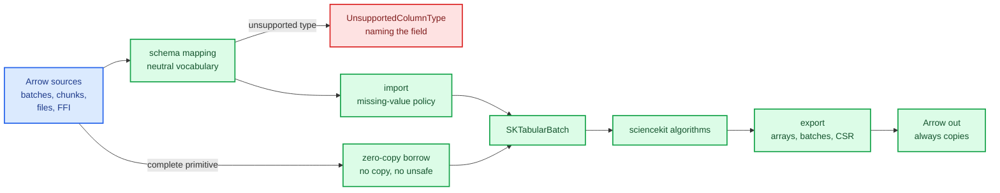

# Arrow interop: one memory model for every engine

Apache Arrow is the closest thing the data world has to a shared ABI for tables. Polars,
DataFusion, pandas/pyarrow, Spark, Julia's `Arrow.jl` and most columnar file formats all
agree on one thing: what a table is made of. A table is a schema plus, for each column, a
set of buffers — a validity bitmap, the values, and (for text) an offsets buffer — plus a
data type and a length. Nothing about that description mentions rows.

That agreement is enormously useful, and it is also the source of almost every subtlety in
this chapter. sciencekit's algorithms want a **row-major matrix**. Arrow wants **contiguous
columns**. A matrix cannot alias a multi-column table. A table's chunks are not a table. A
`Float32` column is not a `Float64` column. A null is not a NaN.

This chapter builds the Arrow adapter: the first concrete engine behind the neutral seam
described in [the dataset-interop chapter](./ch26-dataset-interop.html). It maps Arrow types
onto sciencekit's neutral vocabulary, imports record batches and chunked columns, borrows
primitive buffers without copying, applies the declared missing-value policy to Arrow's
validity bitmaps, exports results back to Arrow, and speaks the Arrow C Data Interface in
both directions.

The capability is `arrow-columnar-interop`; the code lives in
`crates/sciencekit_interop/src/arrow/`, behind the `arrow` feature of `sciencekit_interop`.

## 1. The problem, in plain words

Suppose you have a Parquet file with 500 columns and you want to fit a scaler on columns 3,
17 and 42. Three questions decide how the adapter must behave:

1. **What is a column, here?** Arrow says "a buffer of `Float64` with a validity bitmap".
   sciencekit says "a column of logical type `Float64` with role `Feature`". The adapter must
   translate — and must refuse anything it cannot translate, *before* reading a single row.
2. **When is a copy allowed?** Arrow stores columns contiguously, so a single complete
   `Float64` column is already exactly the memory a numeric column view wants. Copying it
   would be pure waste. But a column *with nulls* has a bitmap, and the numeric path needs
   a materialized sentinel instead.
3. **What goes back out?** A fitted model must return its results to the caller's engine —
   as Arrow arrays, record batches, or a C stream — without a detour through text.

The whole adapter is the answer to those three questions, plus the discipline of making
every refusal a structured, named error rather than a panic.

## 2. The decisions, and the roads not taken

1. **A narrow, closed type vocabulary.** `sk_logical_type_from_arrow_data_type` maps Arrow
   types onto sciencekit's six logical types (`Float32`, `Float64`, `Integer64`, `Boolean`,
   `Nominal`, `CategoryCode`). Nested, temporal, binary, decimal, `Float16`, `UInt64` and
   `Null` columns are rejected up front with `SKError::UnsupportedColumnType` naming the
   field and suggesting a conversion.
2. **Roles travel as field metadata.** `sk_arrow_schema_from_tabular_schema` writes
   `sciencekit:role` and `sciencekit:logical_type` into each field's metadata, so a schema
   exported by sciencekit round-trips its roles without the caller restating them. The
   `sciencekit:logical_type` key exists for exactly one ambiguity: `CategoryCode` and
   `Integer64` both travel as Arrow `Int64`.
3. **Zero-copy means borrowed, and only for complete primitive columns.**
   `sk_arrow_borrowed_column` returns `SKArrowBorrowedColumn::Float32`/`Float64`/`Integer64`
   — a plain slice borrowed from the Arrow buffer, with **no `unsafe` at all**. A column with
   nulls, or of any other type, is refused with `UnsupportedRepresentation` so the caller
   materializes through the normal import path instead.
4. **The missing-value policy decides what a null means.** Arrow's validity bitmap is
   translated eagerly for numeric columns: `Reject` fails naming the column, `NumericNaN`
   writes `NaN`, `ConstantFill(value)` writes the value, `CategoricalMissingCode` keeps the
   null for the categorical path. Text and boolean columns *retain* their nulls, because the
   sentinel decisions there belong to the categorical and target paths.
5. **A dictionary column is a label table plus codes.** `sk_dictionary_label_table` builds a
   reversible `SKLabelTable` following the dictionary's own value order, so code `i` restores
   `label_of(i)` exactly. The import path converts the keys to `SKColumnData::CategoryCode`.
6. **The C Data Interface is the binding ABI.** Export produces Arrow's own `FFI_ArrowArray`
   and `FFI_ArrowSchema`; import consumes them and *takes ownership of the release
   callback*, which is exactly what keeps the data alive after the producer drops its
   handle. `unsafe` is confined to the `ffi` module; every public entry point is safe and
   transfers ownership exactly once.
7. **File formats are reopenable sources, not one-shot readers.**
   `SKArrowFileSource` opens a fresh reader per pass, so an iterative estimator sees the
   same batches in the same order on every epoch. Parquet and IPC push the projection down
   into the reader; CSV and JSON are projected by the cursor after decoding.
8. **Export always copies, and says so.** `SKArrowExportedArray::is_zero_copy()` and
   `SKArrowExportedRecordBatch::is_zero_copy()` exist so callers can branch on the same
   report shape as the import path — but they are always `false`, because Arrow buffers and
   sciencekit buffers are separate allocations.

*Roads not taken.* Depending on Polars or DataFusion instead of the `arrow-*` crates (they
pin Arrow versions and drag a query engine along); a bespoke C ABI of `(data, indices,
indptr, shape)` (every binding would have to reimplement it, and it could not carry null
bitmaps or schemas); densifying a sparse input (the representation-parity rule forbids it);
and accepting nested types by flattening them silently (it would change a column's meaning
without telling anyone).

## 3. The concepts, taught from zero

### Columns, not rows

Arrow's central decision: a table's storage is a set of **column buffers**. The row `i` of
column `j` is the `i`-th element of that column's buffer. This is why a 500-column Parquet
file can be read two columns at a time (only those buffers are decoded) and why a row-major
matrix can never alias it — the matrix's element `(i, j)` is `i * ncols + j` bytes apart
from `(i, j+1)`, while Arrow's are `stride_j` bytes apart. `sk_export_dense_matrix` makes
this explicit: a **one-column** matrix exports as a primitive array; a **wider** matrix
exports as a `StructArray` with one field per column, because there is no row-major buffer
to alias.

### The validity bitmap

Every Arrow array carries an optional **validity bitmap**: one bit per row, `1` meaning
"this row has a value". `null_count() > 0` means the bitmap has at least one zero bit. The
bitmap is *not* the data — a null row still occupies a slot in the values buffer. That is
why a column with nulls cannot be borrowed as a plain slice: the slice would contain
garbage where the nulls are, and the reader would have no way to know.

### Buffers, offsets and slices

Arrow arrays also carry an **offset**. `Array::slice(offset, length)` produces a *view* over
the same buffers, starting at a different position. It is zero-copy, and it is why the
import path must resolve the offset rather than assume position zero. The record-batch
import handles this naturally: `sk_tabular_batch_from_record_batch` reads the sliced
window's logical values through Arrow's own accessors, and the test
`sk_sliced_record_batch_imports_the_logical_window` proves it.

### The chunked column

A `Table` in Arrow is a schema plus, per column, a *list of chunks*. The logical column is
the concatenation of the chunks. This adapter does not import a `Table` type: it takes the
chunks directly, as `&[Vec<ArrayRef>]` — one vector of chunk arrays per column — and
concatenates them in declaration order with Arrow's own `concat`. A column with zero chunks
becomes a typed empty column instead of an error. This is a documented deviation from the
original plan, which spoke of `Table` and `ChunkedArray`: the adapter depends on
`arrow-array` directly and models the chunk list itself, so no `Table` type crosses the seam.

### The C Data Interface

The Arrow C Data Interface is a C ABI for handing an array between two runtimes. An
`FFI_ArrowSchema` describes the type; an `FFI_ArrowArray` describes the buffers and owns a
**release callback**. The contract is: whoever consumes the structure owns it, and calls the
release callback exactly once when done. An `FFI_ArrowArrayStream` is the streaming
equivalent — a producer-owned `private_data` plus a `get_next`/`get_schema`/`release`
callback trio.

Two rules follow, and the adapter honours both:

- **Export is a transfer.** `sk_export_array_to_ffi` produces a pair that, when dropped,
  calls the release callback exactly once.
- **Import is the mirror.** `sk_import_array_from_ffi` takes the pair *by value*, consumes
  it and thereby assumes ownership of the release callback. The imported array stays valid
  after the producer drops its own handle — the imported side now owns the buffers.

### Missing values, three ways

A null in Arrow, a NaN in a numeric matrix and a missing code in a categorical column are
three different things. `SKMissingValuePolicy` names all four behaviours explicitly —
`Reject`, `NumericNaN`, `CategoricalMissingCode`, `ConstantFill(f64)` — and the adapter
never guesses. The default is `Reject`: an unexpected null fails with
`SKError::NullValueInColumn` naming the Arrow field, instead of silently poisoning a fit.

## 4. Each public object, explained

Everything below lives in `sciencekit_interop::arrow` and is compiled only when the
`arrow` feature is on.

### Schema and types

- **`sk_logical_type_from_arrow_data_type(data_type, field_name)`** — one Arrow data type to
  one neutral logical type, or a structured rejection naming the field.
- **`SKArrowColumnRoles`** — the role assignment for an import: `.role(name, role)`,
  `.target(name)`, `.role_of(name)`. Columns without an entry default to
  `SKColumnRole::Feature`.
- **`sk_tabular_schema_from_arrow_schema(schema, roles)`** — an Arrow schema to a validated
  neutral `SKTabularSchema`, preserving names and order.
- **`sk_arrow_schema_from_tabular_schema(schema)`** — the reverse direction, writing the
  role and logical-type metadata keys.
- **`sk_arrow_data_type_from_logical_type(logical_type)`** — the neutral type to its Arrow
  counterpart.

### Import

- **`sk_tabular_batch_from_record_batch(batch, policy, position, is_final)`** — one record
  batch to one `SKTabularBatch`.
- **`sk_tabular_batch_from_column_chunks(schema, column_chunks, policy, position,
  is_final)`** — the chunked representation, concatenated in order.
- **`sk_column_data_from_arrow_array(name, array, policy)`** — one Arrow array to one
  `SKColumnData`, dispatching on the data type.
- **`sk_dictionary_label_table(array)`** and **`sk_label_tables_from_record_batch(batch)`** —
  the reversible label tables.
- **`sk_boolean_category_codes(column_name, column, policy)`** — a boolean column to `0`/`1`
  category codes, on request.
- **`sk_text_borrowed_view(array)`** — `SKArrowTextBorrowedView`, a row-indexed view whose
  bytes are Arrow's own UTF-8 payload.

### Zero-copy

- **`sk_arrow_borrowed_column(array)`** — `SKArrowBorrowedColumn`, a borrowed slice of
  `f32`, `f64` or `i64` values, or `UnsupportedRepresentation`.
- **`sk_arrow_conversion_report::<F>(array)`** — `SKArrowConversionReport`, with
  `is_zero_copy()` and `is_cast()`.

### Sources

- **`SKArrowRecordBatchSource`** — a reopenable source over a reader factory:
  `.new(factory, selection, batch_size, policy)`.
- **`SKArrowOneShotTabularSource`** — a source that consumes one reader exactly once.
- **`SKArrowFileSource`** — a path-based source: `.new(path, format)`, `.with_batch_size()`,
  `.with_selection()`, `.with_missing_value_policy()`, `.with_explicit_schema()`,
  `.with_csv_header()`, `.with_csv_delimiter()`, `.with_json_schema_inference()`.
- **`SKArrowFileFormat`** — `Parquet`, `Csv`, `IpcFile`, `IpcStream`, `Json`, `NdJson`.
- **`SKArrowFileOptions`** — the shared options struct behind those builders.

### Export

- **`sk_export_prediction(values)`** — a prediction vector to `SKArrowExportedArray`.
- **`sk_export_dense_matrix(matrix, name)`** — a dense matrix to an Arrow array (primitive
  for one column, `StructArray` for several).
- **`sk_export_data_batch(batch)`** — `SKArrowBatchExport`, either `Dense` or `Sparse`.
- **`sk_export_supervised_batch(batch, target_name)`** — features plus a target column.
- **`sk_export_csr_matrix(matrix)`** — `SKArrowCsrExport` with `indptr()`, `indices()`,
  `data()`, `shape()`, and the `sciencekit:number_of_rows` /
  `sciencekit:number_of_columns` metadata keys.

### The C Data Interface

- **`sk_export_array_to_ffi(array)`** / **`sk_import_array_from_ffi(ffi)`** — the array pair.
- **`sk_export_record_batch_reader_to_stream(reader)`** / **`sk_import_stream(ffi)`** — the
  stream.
- **`SKArrowFfiArray`** and **`SKArrowFfiStream`** — the owning wrappers, with
  `.into_parts()` / `.from_parts()` and `.into_stream()` / `.from_stream()`.

## 5. A real walk-through, using the tests

The suites are the executable version of this chapter; each file below sits beside the
implementation it covers.

### `schema_mapping_tests.rs` — the vocabulary

`sk_primitive_and_text_types_map_to_neutral_logical_types` walks the accepted types;
`sk_string_dictionary_maps_to_category_codes` shows a dictionary arriving as
`CategoryCode`; `sk_nested_temporal_and_binary_columns_are_rejected_with_the_field_name`
shows a `List` column refused by name; `sk_roles_come_from_the_request_and_from_field_metadata`
shows the request winning only when the metadata is absent; and
`sk_round_trip_preserves_names_types_and_roles` closes the loop — export a neutral schema,
re-import it, get the same names, types and roles.

### `zero_copy_tests.rs` — the borrow

`sk_complete_f64_column_borrows_the_arrow_buffer` asserts pointer identity: the borrowed
slice *is* the Arrow buffer, not a copy of it. `sk_complete_f32_and_i64_columns_borrow_the_arrow_buffer`
extends that to the other two borrowable types.
`sk_nullable_column_is_not_borrowed` shows the refusal path. And
`sk_conversion_report_distinguishes_zero_copy_from_cast_and_materialization` is the
three-way distinction the whole design turns on: a matching complete column is
zero-copy, a complete column of the other precision is a *cast*, and a nullable column is
*neither* — it must be materialized.

### `null_policy_tests.rs` — the four policies

`sk_numeric_nan_policy_writes_nan_at_null_positions`,
`sk_constant_fill_policy_writes_the_constant_at_null_positions` and
`sk_reject_policy_reports_the_arrow_field` cover three policies on the same fixture.
`sk_nullable_integer_promotes_to_float64_for_the_nan_policy` covers the promotion: a
nullable integer column cannot hold a NaN, so it is promoted to `Float64` — and the
imported schema is rewritten to describe the data it now carries.
`sk_lossy_integer_promotion_is_rejected` is the guard on the other side: a value too large
to survive the promotion fails instead of being rounded.
`sk_non_finite_fill_overflowing_f32_is_rejected` catches the `f32` narrowing case.

### `record_batch_import_tests.rs` and `chunked_import_tests.rs`

`sk_record_batch_becomes_a_tabular_batch_preserving_names_order_and_values` is the basic
contract; `sk_empty_record_batch_imports_with_zero_rows` and
`sk_sliced_record_batch_imports_the_logical_window` are the edges.
`sk_chunks_concatenate_in_order_with_the_total_length` proves the chunked path;
`sk_zero_chunks_become_an_empty_column`, `sk_single_chunk_is_imported_verbatim` and
`sk_mismatched_column_count_or_chunk_type_is_rejected` close the corners.

### `boolean_import_tests.rs` and `dictionary_import_tests.rs`

`sk_boolean_feature_imports_as_zero_and_one` shows the numeric path;
`sk_boolean_column_becomes_category_codes_on_request` the categorical one;
`sk_boolean_null_becomes_the_missing_category_code` the missing-value interaction.
`sk_dictionary_imports_codes_and_a_deterministic_label_table` is the reversible mapping;
`sk_dictionary_codes_are_stable_across_repeated_imports` proves the label order does not
drift between imports; and
`sk_text_import_owns_the_values_but_the_borrowed_view_aliases_the_text` separates the two
text paths — the imported column owns its bytes, while `sk_text_borrowed_view` aliases
Arrow's.

### `source/source_tests.rs` — streaming

`sk_batch_size_is_respected_and_only_the_last_batch_is_final` is the batching contract:
the cursor keeps one batch in flight and one buffered ahead, so it knows whether the batch
it is delivering is truly the last one before it marks it final.
`sk_reader_error_propagates_after_complete_batches` proves the lookahead discipline — a
failure while peeking must not swallow a complete window the reader already produced.
`sk_reopenable_source_replays_the_same_batches` is the epoch guarantee, and
`sk_one_shot_source_rejects_a_second_open` is the counterpart: a one-shot source refuses
to be reopened.

### `file/projection_tests.rs` and `file/*_tests.rs` — the formats

`sk_parquet_projection_reads_only_the_selected_columns_in_selection_order` is the
performance requirement in the spec: a 500-column file must not decode 497 of them.
`sk_csv_projection_preserves_selection_order` shows the same result for CSV, where the
projection happens *in the cursor* rather than in the reader — arrow-csv decodes eagerly,
so the columns are dropped after decoding. That difference is deliberate and documented:
CSV projection saves the conversion, not the decode.

The format suites cover the rest: `sk_csv_schema_is_inferred_from_the_header_by_default`
and `sk_csv_explicit_schema_overrides_inference`; `sk_csv_malformed_row_is_a_structured_error`;
`sk_parquet_batches_never_exceed_the_configured_size`,
`sk_parquet_row_order_is_preserved_across_batches` and
`sk_truncated_parquet_file_is_a_structured_error`; `sk_json_requires_a_schema_unless_inference_is_opted_in`
— the JSON deviation, discussed below; and
`sk_truncated_ipc_stream_fails_after_the_complete_batches`.

`file/large_file_tests.rs` closes the acceptance loop: `sk_large_file_delivers_bounded_batches_and_every_row`
keeps the resident memory bounded while every row still arrives, and
`sk_concurrent_readers_produce_identical_results` shows two readers agreeing.

### `export/export_tests.rs` — the way back

`sk_prediction_vector_exports_as_a_floating_arrow_column` is the simplest export.
`sk_dense_data_batch_exports_feature_columns` and
`sk_supervised_batch_exports_features_and_the_target_column` cover the streaming blocks.
`sk_csr_export_preserves_pointers_indices_values_and_shape` is the sparse export — three
arrays and a shape, because Arrow has no sparse type.
`sk_both_scalar_precisions_export_and_cast_reports_zero_copy_false` is the honest report:
the export always copies, and it says so.

### `ffi/ffi_tests.rs` — ownership

`sk_dense_matrix_round_trips_through_the_c_data_interface` and
`sk_stream_round_trips_batch_for_batch` prove the round trip. The ownership tests are the
important ones: `sk_release_callback_runs_exactly_once` counts the release calls,
`sk_failed_import_releases_the_exported_array_once` proves the *error* path also releases
exactly once, and `sk_dictionary_and_text_round_trip_through_the_c_data_interface` shows
the richer types survive the boundary too.

### `provider_bridge_tests.rs` — the seam in action

`sk_reopenable_arrow_source_serves_multiple_epochs_through_the_provider` is the whole point
of the adapter: an Arrow source drives a multi-epoch fit.
`sk_supervised_provider_reads_the_arrow_target_column` shows the target column arriving
through the same path. And `sk_arrow_provider_streams_sparse_blocks_without_densifying`
proves the representation-parity rule survives the crossing — a sparse Arrow source stays
sparse.

## 6. Look inside

| File | Responsibility |
|---|---|
| `crates/sciencekit_interop/src/arrow/mod.rs` | the module dispatcher and the public re-exports |
| `.../arrow/schema_mapping.rs` | the Arrow ↔ neutral schema mapping and the metadata keys |
| `.../arrow/data_type_mapping.rs` | one Arrow data type → one logical type, or a named rejection |
| `.../arrow/import/` | record-batch, chunk, column, null, boolean, dictionary and text import |
| `.../arrow/zero_copy.rs` | the borrowed column, the conversion report and the borrow guard |
| `.../arrow/source/` | the batch source, the one-shot source, the cursor and the projection |
| `.../arrow/file/` | the format enum, the options and the Parquet/CSV/IPC/JSON readers |
| `.../arrow/export/` | the array, dense, record-batch and CSR exports |
| `.../arrow/ffi/` | the C Data Interface and the C Stream Interface, and the only `unsafe` |
| `.../arrow/*_tests.rs` | the suites walked through above |

## 7. The documented deviations

Three places where the implementation departs from the original design, on purpose:

1. **`Table` and `ChunkedArray` are not used.** The chunked representation is modelled
   directly as `&[Vec<ArrayRef>]` — one vector of chunk arrays per column — and
   concatenated with Arrow's `concat`. A column with no chunks becomes a typed empty
   column.
2. **JSON is record-oriented.** The JSON reader decodes a *record* stream — one object per
   line, or a concatenated sequence of objects — which is what NDJSON and JSON-lines
   exports look like. It is not a reader for a JSON array document of arbitrary nesting.
   Because untyped JSON has no schema, an explicit schema is required unless inference is
   opted into with `with_json_schema_inference(true)`.
3. **CSV projection happens in the cursor.** `arrow-csv` decodes eagerly, so the columns
   are dropped after decoding rather than before. The observable result — selection order
   preserved, unselected columns absent — is the same as Parquet's, but the saving is
   smaller.
4. **Export always copies.** Arrow buffers and sciencekit buffers are separate
   allocations, so every exported array reports `is_zero_copy() == false`. The flag exists
   so the report shape is the same in both directions.

## 8. What this unlocks

Arrow is the common denominator under Polars, DataFusion and pandas — so the adapters for
those engines become short: they convert their own types to Arrow and reuse this path
entirely. The C Data Interface is in turn the transport for the language bindings, which
can now hand a sciencekit result to Python, Julia or the JVM without an intermediate
format. And the file sources mean a Parquet file is a first-class training input, with
projection pushdown doing the work a hand-rolled reader would have to reinvent.
