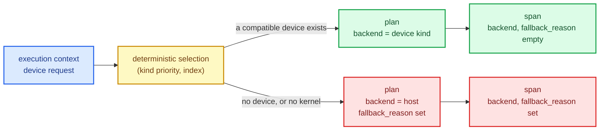

# GPU compute contracts: devices, buffers and honest fallbacks

sciencekit is a CPU library. Every algorithm in it runs on the host, on arrays in ordinary
memory, dispatched through `faer` or a BLAS backend. That is a deliberate choice — but it
is not a permanent one, and the moment a GPU is mentioned, three questions become
unavoidable:

1. **What *is* a GPU here?** Not "the machine has an NVIDIA card" — a *device*: an
   enumerated, identified piece of hardware with a kind, an amount of memory and a list of
   things it can compute.
2. **Which one?** A laptop may have an integrated GPU and a discrete one; a workstation may
   have four devices of the same kind. The choice must be **deterministic** — the same
   inventory and the same request must always pick the same device, or results stop being
   reproducible.
3. **What happens when there is no GPU?** This is the question that separates a serious
   design from a hopeful one. A library that says "GPU not available" is useless. A library
   that silently computes on the CPU and reports the same numbers is *lying in the
   telemetry*: the operator sees a fast operation and cannot tell it ran on the CPU.



This chapter builds the foundation that answers all three: the device vocabulary, the
device buffer, the closed kernel catalogue, the execution plan that carries a **backend**
and a **fallback reason**, and the span fields that tell the truth about which of the two
happened.

The capability is `gpu-compute-contracts`; the code lives in
`crates/sciencekit_common/src/device/`, `crates/sciencekit_common/src/execution/` and the
new `crates/sciencekit_gpu/` crate.

## 1. The problem, in plain words

Suppose you want to add GPU acceleration to a library whose algorithms currently assume a
host array. The temptation is to reach for the vendor SDK directly: allocate a buffer,
copy data, launch a kernel, copy back. But three different vendors (OpenCL, CUDA, ROCm)
would then each invent their own version of that sequence, and the algorithms would have to
know which vendor they are running on. Worse, the *decision* to use a GPU — which device,
whether to fall back, what to tell the operator — would end up scattered across a dozen
algorithm files, each with its own slightly different rules.

The alternative is to fix the shape of the decision now, before any kernel exists:

- a **vocabulary** for describing devices, shared by every backend;
- a **contract** every backend implements, so the algorithms depend on the contract rather
  than on a vendor;
- a **plan** that resolves to exactly one backend, plus the reason when that backend is not
  a device;
- **observability** that records which of the two happened.

This chapter builds exactly that, and nothing more: no kernels, no vendor runtime, no
performance claim.

## 2. The decisions, and the roads not taken

1. **The vocabulary lives in `sciencekit_common`, not in `sciencekit_gpu`.** Execution
   planning resolves the plan; it must consume a device inventory without depending on the
   crate that defines the backend contracts — that would be a cycle. So `SKDeviceInfo`,
   `SKDeviceCapabilities`, `SKGpuKernel`, `SKDevicePreference` and `SKFallbackReason` are
   defined in `sciencekit_common::device`, and `sciencekit_gpu` re-exports them as its
   public contract.
2. **The backend enum stays closed, and gains three device kinds.** `SKBackendKind` becomes
   `Faer`, `MatrixMultiply`, `NdArrayLinalg`, `OpenCl`, `Cuda`, `Rocm`, with `is_host()`
   and `is_device()` distinguishing the two families. Keeping the enum closed means the
   compiler forces every exhaustive match in the workspace to name the device kinds too —
   a new backend cannot be added without every decision point confronting it.
3. **Selection is a pure function.** `sk_select_device(inventory, preference,
   required_kernel)` filters, sorts by `(kind priority, device index)` and takes the first.
   No enumeration, no probing, no I/O: the inventory is an *input*, so planning is
   deterministic and testable without a machine.
4. **The kind priority is fixed and documented.** An explicitly configured backend wins
   outright (priority 0); otherwise OpenCL (1) before CUDA (2) before ROCm (3), because
   OpenCL is vendor-transparent. Within one kind, the lowest device index wins.
5. **Device buffers are validated at construction.** `SKDeviceBuffer` carries its backend
   kind, device index, scalar type, logical shape and capacity. The builder rejects a
   shape that exceeds the capacity and a payload that does not match the shape — a buffer
   can never exist in an inconsistent state.
6. **The transfer policy defaults to an explicit copy.** `SKDeviceTransferPolicy::Explicit`
   is the default; `MappedWhenSupported` opts into a mapped view and falls back to an
   explicit copy when the device does not advertise `supports_mapped_memory`. Transfer
   costs stay visible at the call site.
7. **The kernel catalogue is closed.** Four families — `PairwiseDistance`, `Gemm`,
   `Elementwise`, `TreePredict` — with a stable name each. A backend that does not
   implement one returns `SKError::UnsupportedOperation` *naming the kernel*. It never
   silently computes something else.
8. **The plan records the fallback reason.** `SKExecutionPlan` gained two fields: `backend`
   (the kind the plan runs on) and `fallback_reason` (`Option<SKFallbackReason>`). The
   span records the same two facts as `backend` and `fallback_reason`.
9. **No GPU runtime enters the core crates.** `sciencekit_gpu` is `#![forbid(unsafe_code)]`
   and depends on no vendor SDK. The only device implementation is a **mock** compiled for
   tests. Concrete OpenCL, CUDA and ROCm backends arrive in their own changes
   (`gpu-opencl-backend`, `gpu-cuda-backend`, `gpu-rocm-backend`), each behind its own
   feature flag.

*Roads not taken.* Feature-detecting the vendor at crate load (a library that panics
because a driver is missing is unusable); a `Box<dyn Any>` device abstraction (it erases
the type safety the closed enum provides); allowing "the best available device" to depend
on free memory or temperature (non-deterministic); and making the GPU the *default* backend
so that a machine without one takes a slow path (the plan should say what it did, and the
default should stay the predictable one).

## 3. The concepts, taught from zero

### A device, not a GPU

The word "GPU" hides three different things: the *hardware*, the *runtime* that drives it,
and the *device* — one addressable unit of the runtime with its own memory. This chapter
is about the third. `SKDeviceInfo` describes one:

| Field | Meaning |
|---|---|
| `index` | the enumeration position within the device's backend kind — the stable identity the planner sorts by |
| `kind` | the backend kind that drives it (`OpenCl`, `Cuda`, `Rocm`) |
| `name` | the human-readable name the runtime reported |
| `memory_bytes` | total device memory |
| `capabilities` | what the device advertises |

`kind` names the *runtime*, not the hardware: an NVIDIA card driven through OpenCL is an
`OpenCl` device. That is deliberate — the backend kind is what determines which runtime
handles a dispatch.

### Capabilities are opt-in

`SKDeviceCapabilities` has `supports_f32`, `supports_f64`, `supports_mapped_memory` and
`supported_kernels`, and **every one of them defaults to `false`**. A device must declare
what it can do. The alternative — defaulting to "yes" and letting a backend opt out — means
an unknown backend is mistaken for a capable one, and the failure appears later, as a
wrong answer rather than as an error.

### The device buffer

`SKDeviceBuffer<F>` is a handle to device-resident storage for one dense matrix. It carries
everything an operation must check before touching device memory: which backend owns it,
which device it lives on, what scalar type it stores, its logical shape and its capacity.
The foundation backs it with an owned staging allocation; a concrete backend swaps the
staging vector for its runtime handle behind the same validated surface. The validation
lives in the constructor, so every buffer that exists is consistent.

### The closed kernel catalogue

`SKGpuKernel` names four kernel families, each with a stable kebab-case name
(`pairwise-distance`, `gemm`, `elementwise`, `tree-predict`) that round-trips through
`FromStr`. The catalogue is closed on purpose: a backend either implements one of these or
reports it as unsupported. A backend cannot grow a private kernel and be selected for it —
the planner filters the inventory by the kernel an operation requires, using the same
catalogue.

### Deterministic selection

```
candidates = inventory filtered by is_device() and by the preference
candidates = candidates filtered by supports_kernel(required_kernel)
winner     = candidates sorted by (kind_priority(kind), index), first element
```

Every step is deterministic. `kind_priority` depends on the preference: an explicitly
requested backend gets priority 0, then OpenCL, CUDA and ROCm. The `index` breaks ties
within a kind. Two calls with the same inputs return the same device — the test
`selection_is_deterministic_across_repeated_calls` asserts it.

### The fallback reason

When selection fails, the reason is not free text — it is one of three bounded values:

- **`NoDeviceAvailable`** — no device of the requested kind is in the inventory.
- **`KernelNotSupported`** — devices exist, but none implements the required kernel.
- **`ExplicitModeDoesNotSelectDevice`** — the operation asked for an explicit execution
  mode, which never selects a device.

Each renders as a stable kebab-case token, and that token is what lands on the span.

## 4. Each public object, explained

### The device vocabulary (`sciencekit_common::device`)

- **`SKDeviceInfo`** — one enumerated device: `.new(index, kind, name, memory_bytes,
  capabilities)`, `.is_device()`, `.supports_scalar_type(name)`.
- **`SKDeviceCapabilities`** — `.new(supports_f32, supports_f64, supports_mapped_memory)`,
  `.with_kernels(&[SKGpuKernel])`, `.supports_kernel(kernel)`,
  `.supports_scalar_type(name)`.
- **`SKGpuKernel`** — the closed catalogue: `PairwiseDistance`, `Gemm`, `Elementwise`,
  `TreePredict`, plus `SKGpuKernel::ALL`, `.name()` and `FromStr`.
- **`SKDevicePreference`** — `Backend(SKBackendKind)` or `AnyDevice`.
- **`SKFallbackReason`** — the three reasons above, with stable token rendering.
- **`SKDeviceContext`** — the request an execution context carries:
  `.new(configured_backend)`, `.with_required_kernel(kernel)`, `.with_inventory(devices)`.
- **`sk_select_device(inventory, preference, required_kernel)`** — the deterministic
  selection.
- **`SK_HOST_FALLBACK_BACKEND`** — the host backend a plan falls back to (`Faer`).

### Execution planning (`sciencekit_common::execution`)

- **`SKExecutionContext`** — gains a `device: Option<SKDeviceContext>` field. `None` means
  "no device was considered", and the plan stays on the host backend.
- **`SKExecutionPlan`** — gains `backend: SKBackendKind` and
  `fallback_reason: Option<SKFallbackReason>`.
- **`sk_resolve_execution_plan(intent, context)`** — the resolution, now device-aware.

### The GPU crate (`sciencekit_gpu`)

- **`SKDeviceDiscovery`** — the trait every device backend implements:
  `discover_devices(&self) -> Result<Vec<SKDeviceInfo>, Self::Error>`, with
  `Self::Error: From<SKError>` so a backend reports a structured failure without leaking a
  runtime type into planning.
- **`SKComputeBackend<F>`** — the compute contract: `backend_kind()`,
  `upload(ArrayView2<F>) -> SKDeviceBuffer<F>`, `download(&SKDeviceBuffer<F>) -> Array2<F>`,
  and `dispatch(SKGpuKernel, &[SKDeviceBufferRef<F>]) -> SKDeviceBuffer<F>`.
- **`SKDeviceBuffer<F>`** — the validated device buffer: `.backend_kind()`,
  `.device_index()`, `.scalar_type()`, `.shape()`, `.capacity()`,
  `.to_host_matrix()`.
- **`SKDeviceBufferBuilder<F>`** — the only public constructor: `.new(kind, index)`,
  `.shape(rows, columns)`, `.capacity(elements)`, `.values(vec)`, `.build()`.
- **`SKDeviceTransferPolicy`** — `Explicit` (the default) or `MappedWhenSupported`.
- **`SKDeviceBufferRef<'a, F>`** — a borrowed argument buffer passed to `dispatch`.

### Observability

- **`SKBackendKind`** — the closed enum, with `.is_host()`, `.is_device()`, `.name()` and
  `FromStr`; `OpenCl`, `Cuda` and `Rocm` join the three host kinds.
- **`SKOperationObservation::record_fallback_reason(reason)`** — records the reason on the
  span, and only when a plan actually fell back.

### Errors

Three new `SKError` variants: **`DeviceUnavailable`**, **`UnsupportedScalarType`** and
**`DeviceTransferFailure`** — structured, never a panic.

## 5. A real walk-through, using the tests

### `crates/sciencekit_common/src/device/device_tests.rs` — the vocabulary

`device_info_reports_identity_memory_and_capabilities` shows a device describing itself.
`scalar_type_support_follows_the_capability_flags` ties the scalar query to the flags.
`the_default_capabilities_support_nothing` is the opt-in rule: `SKDeviceCapabilities::default()`
supports nothing at all.

### `crates/sciencekit_gpu/src/device/selection_tests.rs` — deterministic selection

`multiple_devices_are_ordered_by_kind_priority_then_index` is the ordering rule in one
test: the preferred kind first, then OpenCL, CUDA, ROCm, and within a kind the lowest
index. `a_configured_backend_selects_its_first_device` covers the explicit preference;
`no_matching_device_reports_the_host_fallback` and
`an_empty_inventory_falls_back_to_the_host_backend` cover the two failure shapes.
`a_host_backend_preference_never_selects_a_device` proves a CPU backend never selects a
device. `selection_is_deterministic_across_repeated_calls` and
`fallback_reasons_render_as_stable_tokens` close the loop on determinism and on the token
vocabulary.

### `crates/sciencekit_gpu/src/buffer/buffer_tests.rs` and `buffer_validation_tests.rs` — buffers

`a_host_buffer_round_trips_through_a_mock_device` is the basic round trip;
`single_precision_buffers_round_trip` covers `f32`; `a_device_buffer_reports_its_allocation`
shows the buffer describing itself; and `the_default_transfer_policy_is_explicit` pins the
default.

The validation suite is the interesting half. `a_shape_exceeding_the_buffer_capacity_is_rejected`
and `a_payload_that_does_not_match_its_shape_is_rejected` prove the constructor's
invariants. `an_upload_exceeding_the_device_capacity_returns_shape_mismatch` covers the
device's own capacity limit. `an_unsupported_scalar_type_is_rejected` covers a device that
does not run `f64`. `a_failed_upload_transfer_is_a_structured_error` and
`a_failed_download_transfer_is_a_structured_error` prove failures are structured.
`uploading_to_a_backend_without_devices_reports_the_device_unavailable` and
`downloading_a_buffer_from_another_backend_is_rejected` cover the two ownership mistakes
that would otherwise become silent corruption.

### `crates/sciencekit_gpu/src/kernel/kernel_tests.rs` — the closed catalogue

`the_kernel_catalogue_lists_every_kernel` asserts the catalogue has exactly the four
documented families. `a_supported_kernel_dispatches_and_returns_a_buffer` is the happy
path; `an_unsupported_kernel_names_itself_in_the_error` is the important one — the error
carries the kernel's name, so the caller learns *what* is missing rather than just that
something failed. `dispatching_without_arguments_is_rejected` covers a malformed call, and
the two selection tests prove a device is picked (or not) according to the kernel it
implements.

### `crates/sciencekit_common/src/execution/gpu_planning_tests.rs` — planning

`automatic_plan_selects_the_configured_device_when_available` is the primary scenario.
`automatic_plan_falls_back_to_host_without_a_device` and
`automatic_plan_falls_back_when_the_kernel_is_missing` cover the two fallback reasons.
`automatic_plan_keeps_the_configured_host_backend` shows a CPU configuration is left alone.
`a_context_without_devices_plans_on_the_default_host_backend` covers the `None` context.
`an_explicit_mode_never_selects_a_device` covers
`ExplicitModeDoesNotSelectDevice`. And `gpu_planning_is_deterministic` is the property the
whole design rests on: the same context always yields the same plan.

### `crates/sciencekit_common/src/observability/gpu_span_tests.rs` — the truth on the span

`the_selected_device_kind_is_recorded_in_the_span` proves the span records the *device*
kind (`opencl`), never a hardcoded CPU value.
`the_fallback_reason_is_recorded_on_the_span` proves the reason reaches the span.
`a_device_plan_records_its_backend_and_no_fallback` and
`a_fallback_plan_records_the_reason_it_carries` distinguish the two cases: a device plan
leaves the field empty, a fallback plan fills it. That is the difference between an honest
fallback and a silent one.

### `crates/sciencekit_common/src/observability/backend_kind_tests.rs` — the closed enum

`display_names_round_trip_through_parsing`,
`display_names_are_the_documented_spellings` and `parsing_rejects_an_unknown_name` pin the
name vocabulary. `device_kinds_are_distinguished_from_host_kinds` and
`the_default_kind_is_the_pure_rust_host_backend` cover the two families and the default.

### `crates/sciencekit_gpu/src/backend/concurrency_tests.rs` — concurrency

`contract_types_are_send_and_sync` asserts the contract types are thread-safe.
`concurrent_discovery_agrees`, `concurrent_planning_agrees` and `concurrent_transfers_agree`
show that several threads doing the same thing get the same answer — the property that
makes an inventory safe to share.

### The mock device

The only device implementation is `SKMockComputeBackend`, compiled for tests only. It owns
a fixed inventory, can be told to fail discovery (`failing_discovery`), to fail transfers
(`failing_transfers`) or to cap its capacity (`limited_to_elements`), and it executes
buffers and kernels in host memory. Its purpose is to make the *contract* testable without
a GPU — which is exactly why the core crates stay free of a runtime dependency.

## 6. Look inside

| File | Responsibility |
|---|---|
| `crates/sciencekit_common/src/device/info.rs` | `SKDeviceInfo`, the description of one enumerated device |
| `crates/sciencekit_common/src/device/capabilities.rs` | the opt-in capability summary |
| `crates/sciencekit_common/src/device/kernel.rs` | the closed `SKGpuKernel` catalogue |
| `crates/sciencekit_common/src/device/selection.rs` | the deterministic selection rule |
| `crates/sciencekit_common/src/device/context.rs` | the device request an execution context carries |
| `crates/sciencekit_common/src/device/fallback.rs` | the fallback vocabulary and the host backend constant |
| `crates/sciencekit_common/src/execution/device_plan.rs` | the backend and fallback reason of a plan |
| `crates/sciencekit_common/src/execution/plan.rs` | the resolved plan, with its two new fields |
| `crates/sciencekit_common/src/observability/operation_attributes.rs` | the closed `SKBackendKind` and its display/parse surface |
| `crates/sciencekit_common/src/observability/operation_observation.rs` | `record_fallback_reason` and the span field |
| `crates/sciencekit_gpu/src/backend/contract.rs` | `SKComputeBackend`: upload, download, dispatch |
| `crates/sciencekit_gpu/src/backend/discovery.rs` | `SKDeviceDiscovery` |
| `crates/sciencekit_gpu/src/buffer/` | the validated device buffer, its builder and the transfer policy |
| `crates/sciencekit_gpu/src/kernel/` | the kernel dispatch surface and the borrowed argument buffer |
| `crates/sciencekit_gpu/src/backend/mock_device.rs` | the test-only mock device |

## 7. What this unlocks — and what it deliberately does not

This change ships **no GPU runtime dependency into the core crates**. `sciencekit_gpu`
depends on no vendor SDK and forbids `unsafe`; the only device implementation is a mock
compiled for tests. The concrete OpenCL, CUDA and ROCm backends arrive in their own
changes (`gpu-opencl-backend`, `gpu-cuda-backend`, `gpu-rocm-backend`), each behind its
own feature flag, each implementing the contracts this change defines.

That separation is the point. A backend written later inherits the vocabulary, the
deterministic selection rule, the buffer validation, the closed kernel list and the
fallback reporting for free — and it cannot invent its own, because the traits it must
implement already say what they mean.

What exists today is honest: a machine with no GPU gets the CPU path, and the span says
so, with a reason. When a real backend lands, the same span will say `opencl` instead.
