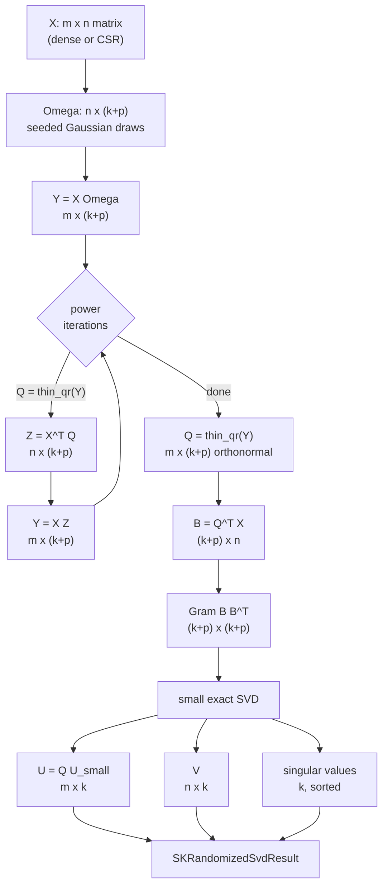

# Randomized SVD: a big factorization from small pieces

## Why this chapter exists

Principal component analysis, truncated SVD and incremental PCA all need the same
thing: the few directions along which a matrix varies the most. Computing them
exactly is possible, and `sciencekit_math` can do it, but the exact algorithm pays a
price that grows with the whole matrix. For a data table with 20 000 columns and a
few thousand rows, the exact decomposition wants to hold factors the size of the
matrix squared.

The randomized singular-value decomposition avoids that price. Instead of looking at
the whole matrix at once, it asks a small number of random questions, watches which
directions the answers point to, refines those directions a few times, and then solves
a tiny exact problem. The surprising result — proved in the Halko–Martinsson–Tropp
paper that the method comes from — is that the answer is extremely close to the exact
one whenever the matrix has a dominant part, which is exactly the case in which
anyone asks for a truncated decomposition.

This chapter tells the story of the implementation in
`crates/sciencekit_math/src/decomposition/`, the decisions behind it, and the tests
that prove it behaves.

## The idea in one picture



Every intermediate that carries a matrix dimension is `m x (k+p)` or `n x (k+p)`.
The only matrix that is squared is the Gram matrix, and its side is `k+p`, not `m`
and not `n`.

## The public surface

The kernel is exposed through a builder, as every public operation in this library
is:

```rust,ignore
use sciencekit_common::{SKBackendKind, SKDataView};
use sciencekit_math::decomposition::SKRandomizedSvdBuilder;

let result = SKRandomizedSvdBuilder::new()
    .number_of_components(3)
    .number_of_power_iterations(4)
    .oversampling(10)
    .random_seed(42)
    .backend(SKBackendKind::Faer)
    .compute(SKDataView::Dense(matrix.view()), None)?;

// result.u            m x 3 left singular vectors
// result.singular_values  3 non-increasing values
// result.v            n x 3 right singular vectors
```

`SKRandomizedSvdBuilder::new()` starts with one component, one power iteration, an
oversampling of ten, the seed `0` and the `Faer` backend. The builder is a `Copy`
value, so a configured builder can be reused without cloning.

There is also a free function for the common case, with the same defaults for the
backend:

```rust,ignore
pub fn sk_randomized_svd<F: SKBackendSelection>(
    matrix: SKDataView<'_, F>,
    number_of_components: usize,
    number_of_power_iterations: usize,
    oversampling: usize,
    random_seed: u64,
    centering: Option<ArrayView1<'_, F>>,
) -> Result<SKRandomizedSvdResult<F>, SKError>
```

`SKRandomizedSvdResult` carries three public fields — `u`, `singular_values` and `v`
— plus three helpers: `number_of_components`, `reconstruct` (which multiplies the
factors back together) and `relative_frobenius_error`, which compares the
reconstruction with a reference matrix and returns $\lVert X - U \Sigma V^{\mathsf T} \rVert_F / \lVert X \rVert_F$.

### Why `SKBackendSelection` and not `SKFloat`

The kernel needs a backend to run the *small* algebra, and the backend trait is only
implemented for the sealed scalar set (`f32` and `f64`). Using `SKBackendSelection`
as the bound says that precisely. The estimator rule from `AGENTS.md` — the scalar
appears as the only type parameter when the configuration carries scalar values —
still holds: the builder itself carries no scalar, and the scalar is chosen at the
call site that owns the data.

The backend kind stays a runtime value and is dispatched per call, never in `build()`.
Nothing here is a type parameter over the backend.

## Step 1: a random basis that is not really random

The first ingredient is `Omega`, an `n x (k+p)` matrix of standard-normal draws. The
draws come from the shared deterministic generator
(`sciencekit_common::random::SKRandomGenerator`) seeded through a **domain**:

```rust,ignore
let mut generator = SKRandomGenerator::new(sk_derive_seed(
    random_seed,
    SK_RANDOM_DOMAIN_PROJECTION,
    0,
));
```

Domains are how this library keeps unrelated random decisions from colliding. A
forest derives its per-tree seeds in the tree domain, a k-means initialization in the
initialization domain, and this kernel in the projection domain. Two subsystems asked
for seed `7` therefore get different streams without coordinating.

`sk_seeded_projection(rows, columns, random_seed)` is public because the property it
promises is worth testing on its own: the stream is a pure function of the seed and
the shape.

```rust,ignore
let first = sk_seeded_projection::<f64>(16, 4, 11);
let again = sk_seeded_projection::<f64>(16, 4, 11);
let other = sk_seeded_projection::<f64>(16, 4, 12);
assert_eq!(first, again);          // randomized_projection_is_reproducible_for_the_same_seed
assert_ne!(first, other);          // randomized_projection_differs_across_seeds
```

The test `randomized_projection_is_stable_for_the_single_precision_scalar` runs the
same shape with `f32`, so the draw order does not depend on the scalar width.

## Step 2: project, refine, orthonormalize

The projection is one sparse or dense product:

$$Y = X \cdot \Omega \quad (m \times (k+p))$$

`Y` already spans a good approximation of the dominant column space — but a random
basis is a noisy approximation. The power iterations sharpen it:

$$\begin{aligned}
&\text{repeat } q \text{ times:} \\
&\quad Q = \operatorname{thin\_qr}(Y) && (m \times r,\ r = k + p) \\
&\quad Z = X^{\mathsf T} Q && (n \times r) \\
&\quad Y = X Z && (m \times r) \\
&Q = \operatorname{thin\_qr}(Y) && (\text{final basis})
\end{aligned}$$

Each pass multiplies the components of `Y` by the squared singular values of `X`, so
the dominant directions grow relative to the rest. That is the whole trick: a small
number of matrix products, no factorization of the big matrix.

The test `randomized_dense_power_iterations_improve_a_decaying_spectrum` builds a
low-rank fixture with a decaying spectrum and asserts that seven power iterations do
not reconstruct worse than one:

```rust,ignore
let single = sk_randomized_svd(SKDataView::Dense(matrix.view()), 4, 1, 6, 3, None)?;
let repeated = sk_randomized_svd(SKDataView::Dense(matrix.view()), 4, 7, 6, 3, None)?;
assert!(relative_error(&matrix, &repeated.reconstruct())
        <= relative_error(&matrix, &single.reconstruct()) + 1e-12);
```

The assertion is deliberately one-sided: power iterations must never *hurt*, and on a
decaying spectrum they help. Demanding a strict improvement in every fixture would
make the test a statement about the fixture rather than about the algorithm.

### The thin QR decision

The obvious implementation calls the backend's QR decomposition. That was the first
version, and it was wrong for this library's target sizes: the backend returns the
**full** $m \times m$ orthogonal factor. For a 4 000-row matrix that is 128 MB of `f64`
that nobody needs; for wider problems it is worse, and the measurement was 161
seconds on a fixture that should take a fraction of a second.

So the kernel owns a small Householder QR (`qr.rs`) that returns exactly the thin
factor, $m \times \min(m, n)$ — here $m \times (k+p)$. A rank-deficient column is completed with
a canonical direction so the basis always has `k+p` orthonormal columns; the algorithm
then works on whatever rank the matrix actually has.

This is a deliberate departure from "always delegate to the backend". The rule is not
"the backend does all algebra"; it is "the backend is the selection surface, and heavy
algebra goes through it". A `k+p`-column Householder sweep is not heavy algebra: it
is a handful of vector operations on a matrix with ten or twenty columns.

## Step 3: solve a tiny exact problem

With `Q` in hand, project the matrix from the left:

$$B = Q^{\mathsf T} X \quad ((k+p) \times n)$$

`B` is the matrix `X` seen through the random basis. Its row space is the same as the
dominant row space of `X`. Instead of decomposing `B` (still wide), the kernel forms
its Gram matrix:

$$G = B B^{\mathsf T} \quad ((k+p) \times (k+p))$$

and runs an exact symmetric eigendecomposition on `G` (`small_svd.rs`). The
eigendecomposition of a matrix whose side is `k+p` is cheap, exact enough, and
independent of `m` and `n`. The right singular vectors come from `B` and the left ones
are lifted back through the basis:

$$U = Q \cdot U_{\text{small}} \quad (m \times k)$$

Finally the factors are truncated to `k`, the singular values are sorted
non-increasingly, and a **sign convention** is applied: the entry of each singular
vector with the largest absolute value is made positive. Without it, `U` and `V` could
each flip sign and the reconstruction would still be correct, which makes comparisons
and snapshots awkward. The test
`randomized_dense_sign_convention_makes_the_pivot_entry_positive` pins it down.

## Sparse input never becomes dense

The kernel takes an `SKDataView`, so a CSR matrix arrives as a CSR matrix. Two
operations need care:

- `X · Omega` gathers rows of `Omega` weighted by the non-zero values. It reads the
  matrix exactly once and never materializes a dense `X`.
- $X^{\mathsf T} \cdot Q$ is the transpose product, implemented over the same CSR structure.

The dense intermediates are $Y$, $Z$ and $Q$, all of shape $m \times (k+p)$ or
`n x (k+p)`. The test `randomized_sparse_does_not_densify_a_wide_matrix` is a guard:
it factorizes a wide sparse fixture and checks that nothing the size of the input
appeared.

`randomized_sparse_keeps_the_dense_intermediates_small_on_a_large_matrix` makes that
guard quantitative. It builds a `4 000 x 20 000` CSR matrix, instruments the kernel
with a test-only counter (`instrumentation.rs`, compiled only under `cfg(test)`), and
asserts:

```rust,ignore
let allowed = (components + oversampling) * rows.max(columns);
assert!(sk_largest_dense_intermediate() <= allowed);
assert!(sk_largest_dense_intermediate() < rows * columns);
```

The second assertion is the one that would have failed before the thin-QR fix: a full
`4 000 x 4 000` factor is 16 million cells, far above the 60 000 cells (`15 x 4 000`)
allowed by the first.

The sparse and dense paths are cross-checked by
`randomized_sparse_matches_the_dense_factorization`, which factorizes the same data
both ways and compares the singular values within the documented tolerance.

## Centering without copying

PCA centers the data: the mean of every feature is subtracted before the
decomposition. Doing that literally would turn a sparse matrix dense, because the
subtracted mean touches every cell.

Instead the kernel accepts an optional `centering: Option<ArrayView1<F>>` holding one
mean per feature, and applies the centering **inside the products**:
`X_c · Omega` is computed as `X · Omega` minus the mean contribution to each row.
The same trick applies to the transpose product. The matrix is never materialized in
centered form.

Three tests pin the behaviour:

- `randomized_centered_dense_matches_the_explicit_centering` compares against a
  manually centered copy;
- `randomized_centered_sparse_matches_the_centered_dense` does the same across
  representations;
- `randomized_centered_sparse_does_not_densify_the_centered_matrix` proves the
  intermediate stays bounded.

A centering vector whose length differs from the number of features is rejected with
a shape mismatch before any work happens.

## Validation, determinism and concurrency

The kernel rejects an invalid configuration up front
(`randomized_validation_*`):

| Condition | Error |
|---|---|
| zero rows or zero columns | `EmptyInput` |
| `number_of_components == 0` | `InvalidHyperparameter` |
| `number_of_components > min(rows, columns)` | `InvalidHyperparameter` |
| `number_of_power_iterations == 0` | `InvalidHyperparameter` |
| `oversampling == 0` | `InvalidHyperparameter` |
| centering length $\neq$ number of features | shape mismatch |

`oversampling` is a `usize`, so a negative oversampling is not representable; the
zero case is what the builder must reject, and it does.

Determinism is a contract, not an accident. Because every draw comes from the seeded
generator and the projection is a pure function of the seed, the same configuration
gives the same answer:

- `randomized_concurrency_repeated_calls_are_identical`;
- `randomized_concurrency_concurrent_calls_agree_with_the_single_threaded_result`;
- `randomized_concurrency_does_not_depend_on_the_thread_count` — the result is
  computed with a one-thread rayon pool and with the default pool and compared;
- `randomized_concurrency_result_is_send_and_sync`, because the result must be
  shareable across threads.

## Accuracy: what "close enough" means

The kernel does not return an exact decomposition, and it should not pretend to. The
documented bound is:

- the relative error of each retained singular value stays below `1e-6` once the range
  search has enough power iterations and oversampling;
- the reconstruction error never exceeds the error of the optimal rank-`k` truncation
  by more than `1e-6`, relative;
- the dense and the sparse paths agree within the same tolerance.

The acceptance suite (`acceptance_tests.rs`, `sparse_acceptance_tests.rs`) turns that
into executable statements. `randomized_acceptance_singular_values_match_the_exact_decomposition`
computes the exact singular values with a reference implementation and compares them.
`randomized_acceptance_reconstruction_matches_the_exact_decomposition` compares the
reconstruction, and `randomized_acceptance_a_decaying_spectrum_is_recovered` checks
the case the method is designed for. The helper `expected_truncation_error` computes
the Eckart–Young bound, so the assertion is against the mathematically optimal
truncation and not against an arbitrary number.

`randomized_acceptance_produces_the_reconstruction_error_metric` checks the public
`relative_frobenius_error` helper, including its two edge cases: a zero reference
reports zero, and a reference of the wrong shape is rejected.

## What the result is used for

The kernel is the heavy lifting behind the decomposition estimators that follow in
the roadmap: PCA (with and without centering), truncated SVD and incremental PCA.
Those changes add the estimator surface — builders, `fit`, `transform`, explained
variance — on top of exactly this kernel. Keeping the kernel in `sciencekit_math`
means the estimators do not reimplement the numerics, and the determinism and accuracy
guarantees are stated once.

## Summary of the decisions

| Decision | Why |
|---|---|
| Seeded Gaussian basis, domain `SK_RANDOM_DOMAIN_PROJECTION` | Reproducible results without coordinating with other subsystems |
| Thin Householder QR in the kernel | The backend's full `m x m` factor is prohibitive; the kernel only needs `k+p` columns |
| Gram matrix of $B$ for the small SVD | Exact symmetric eigendecomposition on a $(k+p)^2$ matrix, independent of $m$ and $n$ |
| Sign convention on the singular vectors | Deterministic, comparable output despite the sign ambiguity |
| Implicit centering | PCA semantics without densifying sparse input |
| `SKBackendSelection` bound | The kernel needs a backend; the backend exists for the sealed scalar set |
| Validation before any work | A bad configuration fails fast with a structured error |

## The tests are the specification

The `*_tests.rs` modules beside the implementation are the executable version of this
chapter. When the algorithm changes, they are what says whether the promise still
holds:

- `projection_tests.rs` — the seeded basis;
- `dense_tests.rs` — shapes, ordering, sign, power iterations, wide matrices;
- `sparse_tests.rs` — parity with dense, no densification, bounded intermediates;
- `centered_tests.rs` — implicit centering;
- `validation_tests.rs` — the error table above;
- `concurrency_tests.rs` — determinism and thread-count invariance;
- `acceptance_tests.rs` and `sparse_acceptance_tests.rs` — accuracy against the exact
  decomposition;
- `result_tests.rs` — the result container helpers.
