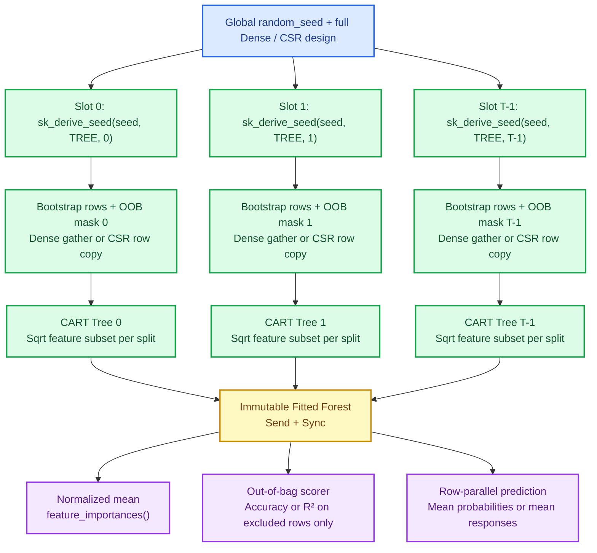

# Random forests: bootstrap samples, de-correlated splits and honest out-of-bag scores

A single decision tree ([Chapter 28](./ch28-decision-trees.html)) is fast, nonlinear and easy to
inspect, yet it has one notorious weakness: **high variance**. Perturb a handful of training rows
and the root split can jump to another feature, rewriting every branch below it. Leo Breiman's
random forest turns that instability into an asset. Grow many trees on independent bootstrap
resamples, force each split to choose from a random subset of features so a single dominant column
cannot make every tree look alike, and average their predictions. Variance drops, bias stays low,
and the rows each tree *did not* draw give a built-in generalization estimate — the **out-of-bag
(OOB) score** — without holding out a separate validation split.

This chapter introduces `crates/sciencekit_ensemble` and its first two estimators,
`SKRandomForestClassifier` and `SKRandomForestRegressor`, implementing the `random-forests`
specification.

---

## 1. The problem, in plain words

Suppose you ask one hundred colleagues to estimate a quantity. Averaging their answers only beats a
single answer if two things are true:

1. Each colleague is reasonably accurate on average (**low bias**).
2. Their mistakes are not identical (**low correlation**).

If every CART tree saw the exact same training table and scanned every feature at every node, our
deterministic tree builder would grow the **exact same tree one hundred times** — averaging one
hundred copies of one tree changes nothing. Random forests inject controlled diversity in two
orthogonal places:

- **Row diversity (bagging):** tree $t$ draws $m$ row indices *with replacement* from the $n$
  training rows. On a full-size draw ($m = n$), each row has probability
  $(1 - 1/n)^n \approx e^{-1} \approx 0.368$ of never being drawn by tree $t$.
- **Feature diversity (subspace selection):** at every internal node, the splitter only inspects a
  seeded random subset of features — by default $\lfloor\sqrt{p}\rfloor$ out of $p$ features
  (`SKMaximumFeatures::Sqrt`). Even if feature $8$ is slightly stronger globally, trees whose root
  draw omits feature $8$ discover informative splits on the remaining columns.

For classification over $C$ canonical classes, if tree $t$ predicts leaf class distribution
$\hat{\mathbf{p}}^{(t)}(x) \in [0, 1]^C$, the forest averages the distributions and picks the
largest class (breaking ties toward the smallest canonical index):

$$
\bar{p}_c(x) = \frac{1}{T} \sum_{t=1}^{T} \hat{p}_c^{(t)}(x),
\qquad
\hat{y}(x) = \arg\max_{c \in \{0,\dots,C-1\}} \bar{p}_c(x).
$$

For regression, where tree $t$ predicts scalar leaf response $\hat{y}^{(t)}(x)$, the forest
predicts the arithmetic mean:

$$
\hat{y}(x) = \frac{1}{T} \sum_{t=1}^{T} \hat{y}^{(t)}(x).
$$

---

## 2. The decisions, and the roads not taken

| Decision | Why we chose it | Alternatives we discarded |
|---|---|---|
| **Delegate CART to `sciencekit_tree`; own ensemble logic in `sciencekit_ensemble`** | `SKDecisionTreeClassifier` and `SKDecisionTreeRegressor` already implement sorted dense scans, CSC sparse scans, class weights, feature subsampling and node importances. Reusing them keeps one source of truth for split math. | Duplicating a private tree builder inside `sciencekit_ensemble` — double maintenance and subtle drift between single trees and forests. |
| **Pure per-tree seed derivation via `sk_derive_seed`** | Tree $t$ derives `tree_seed = sk_derive_seed(global_seed, SK_RANDOM_DOMAIN_TREE, t)` for node feature draws and folds `SK_RANDOM_DOMAIN_STAGE` on top for its bootstrap draw. Neither stream collides, and tree $t$ produces the exact same structure whether fitted on 1 thread or 64 threads. | Sharing one mutable RNG protected by a `Mutex` across threads — thread scheduling changes which tree gets which seed, destroying reproducibility. |
| **Lock-free slot fitting** | `(0..number_of_trees).into_par_iter()` maps each tree index into its own owned slot; no mutex or shared mutable accumulator exists during `fit` or `predict`. | Appending trees or summing importances into a locked shared vector — contention and non-associative floating-point order dependence. |
| **Row-copy CSR bootstrap, never densification** | Sampling sparse rows copies only stored `(column, value)` slices into a fresh `CsMat` (`O(nnz)` memory). Wide text or high-cardinality one-hot matrices never materialize dense zeros. | Calling `.to_dense()` before bootstrapping — a $128 \times 100\,000$ sparse batch would explode from kilobytes to gigabytes across trees. |
| **Canonical class table fixed once on full targets, with local-to-forest mapping per tree** | `sk_canonicalize_labels` orders classes by first occurrence. A bootstrap draw can permute first-occurrence order, omit a rare class, or on tiny data draw a single class. Mapping each tree's local classes back to the forest's canonical table (and storing a `PureLeaf` when a draw has one class) makes every sample size safe and exact. | Assuming every bootstrap draw sees all classes in the same order — swaps probability columns when row 0 is not drawn first, and fails on tiny datasets. |
| **Explicit `Result<F, SKError>` for `oob_score()`** | When `oob_score` is disabled, or when a tiny forest leaves zero rows out of bag, `model.oob_score()` returns `SKError::UnsupportedOperation` while `model.oob_scored_rows()` reports `0`. | Returning `0.0` or `NaN` — `0.0` is indistinguishable from a genuine accuracy or $R^2$ of zero, and `NaN` silently poisons downstream comparisons. |

---

## 3. The concepts, taught from zero

### Deterministic parallelism without locks

Parallelism and determinism often feel at odds: operating-system threads finish work in
unpredictable order. The trick is to make **every random choice a pure function of coordinates,
never of arrival order**. From the user's `random_seed`, tree $t$ computes two independent 64-bit
SplitMix64 seeds ([Chapter 21](./ch21-deterministic-randomness.html)): one for drawing its
bootstrap rows and one handed to `sciencekit_tree` for per-node feature subsampling. Each worker
builds its tree in isolation and writes slot $t$ of the output vector. Whether `rayon` runs on one
core (`InProcessSynchronous`) or across a multi-core pool (`Automatic`), every slot contains the
exact same tree bit-for-bit.

### How out-of-bag estimation stays honest

Suppose a forest memorizes noisy training rows. Evaluating the whole forest on the training set lets
the roughly $63.2\%$ of trees that *saw* row $i$ vote on row $i$, inflating accuracy toward $1.0$.
Out-of-bag estimation fixes that leak without splitting the dataset:

1. While building tree $t$, `sk_out_of_bag_rows` records every training row index $i \in \{0,\dots,n-1\}$
   that never appeared in tree $t$'s bootstrap draw.
2. After all $T$ trees finish, row $i$ accumulates predictions **only** from the subset
   $\mathcal{O}_i = \{t : i \notin \text{bootstrap}(t)\}$.
3. Rows with $|\mathcal{O}_i| = 0$ (possible when $T$ is tiny) are excluded rather than guessed;
   `oob_scored_rows()` reports how many rows had $|\mathcal{O}_i| \ge 1$.
4. Over those scored rows, classification computes `sk_accuracy_score` and regression computes
   `sk_r2_score` from `sciencekit_metrics`.

If `bootstrap(false)` is configured, every tree sees every row ($\mathcal{O}_i = \emptyset$), so
combining `bootstrap(false)` with `oob_score(true)` is rejected immediately in `build()` with
`SKError::InvalidHyperparameter { name: "oob_score", .. }`.

### Aggregating feature importances

Each fitted tree already normalizes its weighted impurity decreases so its `feature_importances()`
sum to one ([Chapter 28](./ch28-decision-trees.html)). The forest averages those per-tree vectors
across all $T$ trees and re-normalizes by the total when at least one tree split:

$$
I_j = \frac{\frac{1}{T}\sum_{t=1}^{T} I_j^{(t)}}{\sum_{k=0}^{p-1} \frac{1}{T}\sum_{t=1}^{T} I_k^{(t)}}.
$$

When no tree in the forest makes a split (for example `maximum_depth(0)`), every coordinate of
`feature_importances()` remains `0.0`.

---

## 4. Each public object, explained

- **`SKRandomForestClassifier<F>` / `SKRandomForestClassifierBuilder<F>`** and
  **`SKRandomForestRegressor<F>` / `SKRandomForestRegressorBuilder<F>`** — builder-only estimators
  exposing `number_of_trees` (default `100`), `criterion` (`Gini` / `Entropy` for classification,
  `SquaredError` / `AbsoluteError` for regression), `maximum_depth` (default unlimited),
  `minimum_samples_split` (default `2`), `minimum_samples_leaf` (default `1`), `maximum_features`
  (`SKMaximumFeatures::Sqrt` default), `bootstrap` (default `true`), `maximum_samples`
  (`SKMaximumSamples::All` default), `random_seed` (default `0`), `class_weight` (classifier,
  default `SKClassWeight::None`), `oob_score` (default `false`), `backend` (default
  `SKBackendKind::Faer`) and `execution_mode` (default `SKExecutionMode::Automatic`).
- **`SKMaximumSamples<F>`** — controls how many rows each tree draws: `All` ($n$ rows),
  `Count(usize)` (clamped to $[1, n]$ at fit time, rejected at build if $0$) or `Fraction(F)` (must
  be finite and in $(0, 1]$).
- **`SKRandomForestClassifierModel<F>`** — the immutable fitted classification forest implementing
  `SKClassifierPredictor<F>` (`predict_labels`, `predict_probabilities`) plus `probabilities`,
  `number_of_trees`, `feature_count`, `classes`, `number_of_classes`, `feature_importances`,
  `oob_score`, `oob_scored_rows`, `out_of_bag_rows`, `tree`, `criterion`, `backend` and
  `execution_intent`.
- **`SKRandomForestRegressorModel<F>`** — the immutable fitted regression forest implementing
  `SKRegressorPredictor<F>` (`predict`) plus `predict_values`, `number_of_trees`, `feature_count`,
  `trees`, `tree`, `feature_importances`, `oob_score`, `oob_scored_rows`, `out_of_bag_rows`,
  `criterion`, `backend` and `execution_intent`.
- **Re-exported tree vocabulary** — `SKTreeCriterion`, `SKMaximumFeatures` and `SKClassWeight` are
  re-exported at the `sciencekit_ensemble` root so callers configure a forest without adding a
  separate dependency on `sciencekit_tree`.

---

## 5. A real walk-through, using the tests

### `bootstrap_samples_are_reproducible_per_tree` and `out_of_bag_rows_are_exact_complement_of_drawn_sample`

Located in `bootstrap/sampler_tests.rs` and `bootstrap/oob_tests.rs`, these verify the foundation:
the same `(global_seed, tree_index)` pair always draws the exact same multiset of row indices,
distinct tree indices diverge, the tree split seed never collides with the bootstrap seed, and the
out-of-bag slice is the strictly ascending set complement of the drawn rows.

### `classifier_builder_defaults_match_contract` and `oob_score_without_bootstrap_is_rejected`

Located in `random_forest/forest_builder_tests.rs`, these verify every default on both builders and
prove that invalid combinations — `number_of_trees(0)`, out-of-range `SKMaximumSamples::Fraction`,
wrong-family criteria, all-zero explicit class weights, and `bootstrap(false)` paired with
`oob_score(true)` — fail in `build()` with `SKError::InvalidHyperparameter` naming the offending
field.

### `parallel_fit_equals_sequential_fit` and `thread_count_does_not_change_fitted_forest`

Located in `random_forest/forest_fit_tests.rs`, the first fits both forests under
`SKExecutionMode::InProcessSynchronous` and `SKExecutionMode::Automatic` and asserts
`sequential.tree(index) == parallel.tree(index)` across every slot. The second installs custom
1-thread and 4-thread `rayon` pools and verifies that the fitted node arrays are identical. In the
same module, `feature_subsampling_sqrt_and_all_control_candidate_splits` uses a nine-feature design
to show `All` picking feature `8` at every root while `Sqrt` ($\sqrt{9} = 3$ features per split)
diversifies the root splits.

### `hand_computed_two_tree_forest_averages_probabilities` and `equal_average_probabilities_break_ties_by_smallest_canonical_index`

Located in `random_forest/forest_classifier_tests.rs`, the first builds a two-tree zero-depth forest
whose trees carry class-0 probabilities `0.2` and `0.6`, confirming the forest predicts `0.4` for
class `0` and `0.6` for class `1`. The second creates an exact `0.5` / `0.5` tie over nominal labels
`["beta", "alpha"]` (canonical index `0` is `"beta"`) and confirms `predict_labels` deterministically
chooses `0`. `configured_backend_is_recorded_in_prediction_span` attaches a `tracing_subscriber`
layer to prove `SKBackendKind::MatrixMultiply` reaches the model's `predict` span.

### `three_tree_forest_predicts_exact_arithmetic_mean`

Located in `random_forest/forest_regressor_tests.rs`, this builds a three-tree forest whose leaves
predict `1.0`, `2.0` and `6.0`, confirming the forest predicts their mean `3.0`.

### `oob_score_covers_rows_and_excludes_in_bag_trees`

Located in `random_forest/forest_oob_tests.rs`, this constructs a memorization trap — unique row IDs
paired with alternating labels — where in-bag training accuracy exceeds `0.95`, yet `oob_score()`
drops below `0.35` because no tree is allowed to score a row it trained on. On clean regression
data, it also recomputes OOB predictions manually from `regressor.trees()` and
`regressor.out_of_bag_rows(t)` and asserts agreement with `oob_score()` to $10^{-12}$. Companion
tests `disabled_oob_score_reports_unsupported_operation` and
`no_scored_oob_rows_reports_unsupported_operation` check both `UnsupportedOperation` paths.

### `classifier_dense_and_sparse_fit_and_predict_are_equivalent` and `ultra_wide_sparse_forest_fits_and_predicts_without_densifying`

Located in `random_forest/forest_representation_tests.rs`, these verify all four dense/CSR fit and
predict combinations (`dense->dense`, `dense->sparse`, `sparse->dense`, `sparse->sparse`), plus a
$128 \times 100\,000$ CSR matrix with two stored entries per row (`nnz = 256`) that would exceed
$1.6\text{ GB}$ across 16 trees if densified.

### `shared_classifier_serves_concurrent_threads_deterministically` and `large_forest_is_invariant_across_rayon_thread_counts`

Located in `random_forest/forest_concurrency_tests.rs` and `acceptance_tests/large_tests.rs`, these
share `Arc`-wrapped models across eight OS threads and fit $20\,000$-row dense and CSR problems with
`sciencekit_metrics` accuracy, macro-$F_1$, MSE, MAE and $R^2$.

---

## 6. Look inside

| Path | Responsibility |
|---|---|
| `crates/sciencekit_ensemble/src/lib.rs` | Crate root, public exports and `sciencekit_tree` vocabulary re-exports |
| `bootstrap/maximum_samples.rs` | `SKMaximumSamples<F>` (`All`, `Count`, `Fraction`) and sample-count resolution |
| `bootstrap/sampler.rs` | `sk_tree_seed`, `sk_bootstrap_seed`, `sk_sample_indices` and dense/CSR row gathers |
| `bootstrap/oob.rs` | `sk_out_of_bag_rows` set-complement mask |
| `random_forest/classifier_builder.rs`, `regressor_builder.rs` | Builder-only configuration surfaces and defaults |
| `random_forest/validation.rs`, `input_validation.rs` | Hyperparameter, dimension, CSR, target and finiteness checks |
| `random_forest/execution.rs` | Sequential vs `rayon` grain-controlled slot and row execution |
| `random_forest/classifier_fit.rs`, `regressor_fit.rs` | Per-tree bootstrap fitting, local-to-forest class mapping and model assembly |
| `random_forest/classifier_predict.rs`, `regressor_predict.rs` | Single-dispatch row-parallel probability and response averaging |
| `random_forest/oob_scoring.rs` | Out-of-bag accuracy and $R^2$ over excluded rows |
| `random_forest/importances.rs` | Normalized arithmetic mean of per-tree feature importances |
| `random_forest/*_tests.rs`, `acceptance_tests/` | Companion unit suites and $20\,000$-row end-to-end acceptance tests |

---

## 7. What this unlocks

`sciencekit_ensemble` now owns a reusable, thread-count-invariant bootstrap and out-of-bag
foundation. Generic bagging (`SKBaggingClassifier` and `SKBaggingRegressor`) will reuse the same
seeded row sampler and OOB mask over arbitrary base estimators, while gradient boosting will pair
the same `SK_RANDOM_DOMAIN_TREE` sub-seed convention with sequential residual trees.
