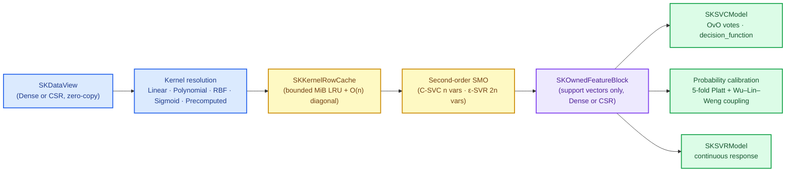
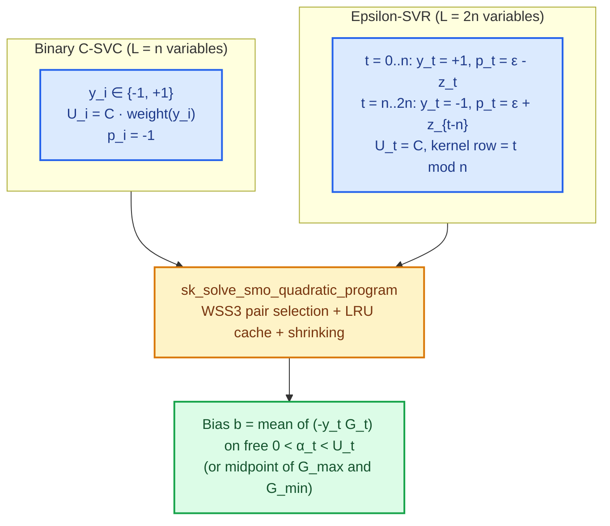

# Support-vector machines: kernels, SMO and calibrated margins

Up to now, every supervised boundary in sciencekit has either been a **flat hyperplane**
(linear regression, ridge, lasso, elastic net, logistic regression, SGD) or a **local
lookup** (nearest neighbours and decision trees). Support-vector machines (`SKSVC` and
`SKSVR`) bridge those two worlds: they fit a maximum-margin linear boundary, but inside an
implicit feature space defined only through **pairwise similarities** — **kernels** — and
they keep only the handful of training rows that actually hold the boundary in place: the
**support vectors**.

Building that cleanly in pure Rust forces five engineering questions into the open:

1. **Where do kernels live?** Kernel PCA and kernel ridge will need the exact same inner
   products and radial basis functions, over dense, CSR and mixed inputs, without ever
   densifying a sparse matrix.
2. **How do you solve a quadratic program over $n$ (or $2n$) coupled dual variables without
   materializing an $n \times n$ matrix?** A $10\,500$-row dataset has an $880\text{ MiB}$
   dense Gram matrix; materializing it up front does not scale.
3. **How can classification and regression share one solver?** C-SVC has $n$ variables and
   two classes; $\varepsilon$-SVR has $2n$ variables and a tube around a continuous curve.
4. **How does a binary margin become multiclass labels and calibrated probabilities?** Raw
   margins are signed distances, not probabilities, and one-vs-one produces $\binom{c}{2}$
   pairwise margins that can even tie in a cycle.
5. **What does the fitted model own?** It must outlive the caller's slice, stay
   `Send + Sync` for concurrent inference, and preserve CSR sparsity when trained on sparse
   data.

This chapter walks through the two capabilities delivered by `svm-svc-svr`:
`kernel-functions` in `crates/sciencekit_math/src/kernels/` and `support-vector-machines`
in the new `crates/sciencekit_svm/` crate.

---

## 1. The problem, in plain words

Imagine points on a plane where class $0$ sits at $(-1, -1)$ and $(+1, +1)$ while class $1$
sits at $(-1, +1)$ and $(+1, -1)$ — the classic XOR layout. No straight line separates the
two classes. Yet if you map every point $x = (x_1, x_2)$ to quadratic combinations of its
coordinates, a flat plane in that higher-dimensional space slices the two classes cleanly,
and projects back down to a smooth curved boundary.

The **kernel trick** says you never need to build those higher-dimensional coordinates at
all. Whenever a learning algorithm depends on the features only through inner products
$\langle \phi(x), \phi(y) \rangle$, you can replace that inner product with a **kernel
function** $K(x, y)$ evaluated directly on the original rows:

- **Linear:** $K(x, y) = \langle x, y \rangle$
- **Polynomial:** $K(x, y) = (\gamma \langle x, y \rangle + c_0)^d$
- **Radial Basis Function (RBF):** $K(x, y) = \exp(-\gamma \|x - y\|_2^2)$
- **Sigmoid:** $K(x, y) = \tanh(\gamma \langle x, y \rangle + c_0)$
- **Precomputed:** $K_{ij}$ supplied directly as a validated square matrix

Meanwhile, the maximum-margin objective pushes the separating slab as wide as possible while
charging a budget $C$ for points that trespass inside the margin. Points comfortably on the
right side of the margin end up with a multiplier $\alpha_i = 0$ — they can be thrown away
after training without changing the boundary by a single bit. Only the **support vectors**
($\alpha_i > 0$) remain.

---

## 2. The decisions, and the roads not taken

| Decision | Why we chose it | Roads not taken |
|---|---|---|
| **Kernels live in `sciencekit_math::kernels`** | Kernels are general numerical primitives over `SKDataView`, reused by kernel PCA and kernel ridge. Keeping `SKKernel` as a closed enum avoids dynamic dispatch in hot loops. | Putting kernels inside `sciencekit_svm` (blocks reuse) or using `Box<dyn Kernel>` trait objects (virtual calls in inner loops). |
| **Reuse the norm-expanded pairwise distance dispatcher for RBF** | `sk_pairwise_distance_matrix` already handles dense, CSR and mixed pairs without densifying sparse matrices; clamping tiny negative cancellation errors $\max(\|x - y\|_2^2, 0)$ guarantees $K(x, x) = 1$ and finite values in $[0, 1]$. | Subtracting dense row copies per pair (allocates and densifies CSR inputs). |
| **One generalized second-order SMO solver for both C-SVC and $\varepsilon$-SVR** | Both problems reduce to minimizing $\frac{1}{2}\alpha^\top Q \alpha + p^\top \alpha$ subject to $0 \le \alpha_t \le U_t$ and $y^\top \alpha = 0$ with $y_t \in \{-1, +1\}$. Second-order working-set selection (Fan, Chen & Lin 2005) cuts iteration counts dramatically on curved kernels. | A generic interior-point QP solver (cubic per step and dense $n \times n$ storage) or stochastic subgradient (a different objective contract belonging to SGD). |
| **Bounded in-memory LRU kernel-row cache (`cache_size` in MiB)** | SMO touches one pair of rows per iteration while keeping the $O(n)$ kernel diagonal resident. Caching rows in an LRU map capped by `cache_size` MiB bounds memory; `cache_size = 0` recomputes on demand. `memmap2` cache spilling, persistence and model export are explicitly deferred to Phase 7 (interop). | Materializing the full $n \times n$ Gram matrix (unbounded $O(n^2)$ RAM) or growing a private `memmap2` layer inside `sciencekit_svm` ahead of Phase 7. |
| **One-vs-one (OvO) multiclass with smallest-index tie-breaking** | Fitting $\binom{c}{2}$ binary problems touches only the rows of two classes at a time, parallelizes naturally across rayon, and matches the standard C-SVC decision geometry. Ties break deterministically to the smallest canonical `SKLabelTable` index. | One-vs-rest for kernel SVC (imbalanced full-$n$ QPs per class; `SKLinearSVC` will use OvR where primal weights collapse $n$). |
| **Opt-in probability calibration (`probability(true)`): 5-fold Platt + Wu–Lin–Weng coupling** | Cross-validated Platt scaling avoids overfitting the sigmoid to training margins, and pairwise coupling solves the unique distribution consistent with all $\binom{c}{2}$ binary probabilities. Keeping `probability` `false` by default avoids $5\times$ fit cost when callers only want labels; calling `predict_probabilities` when disabled returns `UnsupportedOperation`. | Always running 5-fold CV on every fit, or returning uncalibrated vote ratios as fake probabilities. |
| **Owned `SKOwnedFeatureBlock` support-vector state** | Copying only the support vectors in their native dense or CSR representation lets `SKSVCModel` and `SKSVRModel` outlive borrowed inputs, remain `Send + Sync`, and never densify sparse designs. | Borrowing training data with a lifetime parameter or storing dense copies of sparse rows. |

---

## 3. The concepts, taught from zero

### Resolving $\gamma$: `Scale`, `Auto` and `Value`

Three of the kernels multiply inner products or squared distances by a positive scale
$\gamma$. What happens if one feature is measured in millimetres ($1\,000$) and another in
metres ($1.0$)? A fixed $\gamma = 1$ makes $\exp(-\gamma \|x - y\|_2^2)$ underflow to zero
for almost every pair of distinct rows. `SKKernelGamma<F>` provides three policies resolved
at fit time by `sk_resolve_kernel_gamma`:

$$\gamma_{\text{scale}} = \frac{1}{p \cdot \operatorname{Var}(X)}, \qquad \gamma_{\text{auto}} = \frac{1}{p}, \qquad \gamma_{\text{value}} = \gamma$$

where $p$ is the feature count and $\operatorname{Var}(X)$ is the population variance over
all $n \cdot p$ logical entries of $X$ (`sk_feature_population_variance`). Crucially, CSR
implicit zeros are real observed zeros: the sparse variance helper folds the stored values
and accounts for the $(n \cdot p - \operatorname{nnz})$ zero entries algebraically in
$O(\operatorname{nnz})$ work, so dense and CSR twins resolve to the exact same scalar
$\gamma$.

### Sequential Minimal Optimization (SMO) in one picture

Both C-SVC and $\varepsilon$-SVR share a single linear equality constraint
$\sum_{t=1}^{L} y_t \alpha_t = 0$ alongside box bounds $0 \le \alpha_t \le U_t$ and
$y_t \in \{-1, +1\}$. If you try to nudge just **one** multiplier $\alpha_i$, the equality
constraint breaks immediately. The smallest legal move changes **two** multipliers
$(\alpha_i, \alpha_j)$ together so that $y_i \Delta \alpha_i + y_j \Delta \alpha_j = 0$:

$$\Delta \alpha_i = +y_i \delta, \qquad \Delta \alpha_j = -y_j \delta$$

Because only two coordinates move, minimizing the quadratic objective along $\delta$ is a
one-dimensional parabola you can solve in closed form and clip to the box $[0, U_i] \times
[0, U_j]$:

$$\delta_{\text{unclipped}} = \frac{-y_i G_i + y_j G_j}{\max(K_{ii} + K_{jj} - 2 K_{ij},\; \tau)}$$

where $G_t = (Q\alpha)_t + p_t$ is the gradient at coordinate $t$ and $\tau = 10^{-12}$
guards zero or negative curvature (such as duplicate points or non-PSD sigmoid kernels).

Which pair $(i, j)$ should move next?
1. Define the **upper** set $I_{\text{up}}(\alpha)$ of indices free to increase $y_t \alpha_t$
   and the **lower** set $I_{\text{low}}(\alpha)$ free to decrease $y_t \alpha_t$.
2. Pick $i = \arg\max_{t \in I_{\text{up}}} (-y_t G_t)$. Let $G_{\max} = -y_i G_i$ and
   $G_{\min} = \min_{t \in I_{\text{low}}} (-y_t G_t)$.
3. **KKT stopping rule:** when $G_{\max} - G_{\min} \le \text{tolerance}$, no feasible pair
   can improve the objective beyond tolerance — the solver has converged! If the iteration
   counter hits `maximum_number_of_iterations` first, the solver returns
   `SKError::NotConverged { iterations }` rather than silently returning an under-fitted
   model.
4. Otherwise, fetch **one** kernel row $K_{i, \cdot}$ from `SKKernelRowCache` and pick
   $j \in I_{\text{low}}$ maximizing the second-order objective gain
   $\frac{(G_{\max} + y_t G_t)^2}{2 \tilde{a}_{it}}$, breaking ties by the smallest index.

Look at why $\varepsilon$-SVR fits the **exact same** solver with zero special cases: each
training point $i$ gets an upper-tube variable $\alpha_i$ ($y_i = +1$, $p_i = \varepsilon -
z_i$) and a lower-tube variable $\alpha_i^*$ ($y_{n+i} = -1$, $p_{n+i} = \varepsilon +
z_i$). Both variables reference the same training row $i = t \bmod n$ in `SKKernelRowCache`,
and after convergence the net dual weight is simply $\alpha_i - \alpha_i^*$. Points lying
strictly inside the $\pm \varepsilon$ tube have $\alpha_i = \alpha_i^* = 0$ and vanish from
the model!

### Shrinking without ever sacrificing exactness

During training, many points quickly either drop to $\alpha_t = 0$ (far outside the margin)
or saturate at $\alpha_t = U_t$ (deep inside the margin). Active-set **shrinking**
temporarily removes those pinned coordinates from the inner scan. Before declaring
convergence, `sk_solve_smo_quadratic_program` always calls `sk_reconstruct_full_gradients`
and re-evaluates the KKT violation across all $L$ variables — so `shrinking(true)` and
`shrinking(false)` obey the exact same KKT optimality guarantee.

### From margins to calibrated probabilities: Platt scaling and pairwise coupling

A binary SVM outputs a signed margin $f(x) = \sum_{k} c_k K(x, s_k) + b$. When
`probability(true)` is configured on `SKSVCBuilder`:

1. **Five-fold Platt scaling (`sk_calibrate_binary_platt` + `sk_fit_platt_sigmoid`):**
   Using a per-pair seed derived via `sk_derive_seed(random_seed, SK_RANDOM_DOMAIN_FOLD,
   pair_index)`, each binary pair shuffles its positive and negative indices with
   `SKRandomGenerator` into stratified folds, collects out-of-fold margins $f_i$, and fits
   $P(y = +1 \mid f) = \frac{1}{1 + \exp(A f + B)}$ by regularized Newton steps with a fixed Hessian
   damping term against Laplace-smoothed targets $t_+ = \frac{N_+ + 1}{N_+ + 2}$
   and $t_- = \frac{1}{N_- + 2}$ (Lin, Lin & Weng 2007).
2. **Pairwise coupling (`sk_couple_pairwise_probabilities`):**
   For $c \ge 3$ classes, the $\binom{c}{2}$ pairwise probabilities $r_{ab} = P(y = a \mid
   y \in \{a, b\}, x)$ are coupled into a single class distribution $p \in \Delta^{c-1}$
   solving the positive-definite linear system $Q p = 0, \sum_{a=0}^{c-1} p_a = 1$ by the
   fixed-point iteration of Wu, Lin & Weng (2004).

---

## 4. Each public object, explained

### Kernel catalogue (`sciencekit_math::kernels`)

- **`SKKernel`** — closed enum: `Linear`, `Polynomial`, `RadialBasisFunction` (default),
  `Sigmoid`, `Precomputed`.
- **`SKKernelGamma<F>`** — `Scale` (default), `Auto`, `Value(F)`.
- **`SKKernelParameters<F>`** — resolved `.kernel`, `.gamma`, `.degree`, `.coef0`.
- **Resolution & validation** — `sk_validate_kernel_hyperparameters`,
  `sk_resolve_kernel_gamma`, `sk_resolve_kernel_parameters`,
  `sk_feature_population_variance`.
- **Matrix functions** — `sk_linear_kernel_matrix`, `sk_polynomial_kernel_matrix`,
  `sk_radial_basis_function_kernel_matrix`, `sk_sigmoid_kernel_matrix`,
  `sk_precomputed_kernel_matrix`, `sk_validate_precomputed_query_kernel`,
  `sk_kernel_matrix`, `sk_kernel_matrix_sequential`, and `SK_KERNEL_PARALLEL_GRAIN` ($1\,024$
  pairs).

### SMO and kernel storage (`sciencekit_svm::kernel` and `sciencekit_svm::smo`)

- **`SKOwnedFeatureBlock<F>`** — `Dense(Array2<F>)` or `Sparse(CsMat<F>)` built via
  `select_rows`, borrowing back via `.view()`.
- **`SKKernelRowCache<'a, F>`** — bounded LRU row cache (`from_megabytes`,
  `with_capacity_bytes`, `.diagonal()`, `.row(index)`, `.hits()`, `.misses()`,
  `.cached_rows_count()`, `.maximum_cached_rows()`).
- **`SKSmoState<F>`**, **`SKSmoWorkingPair<F>`**, **`SKSmoTracker<F>`**,
  **`SKSmoOptions<F>`**, **`SKSmoSolution<F>`** — gradient state, WSS3 pair selector
  (`sk_select_first_working_index`, `sk_select_working_pair`), KKT violation and bias
  recovery (`sk_maximal_kkt_violation`, `sk_recover_smo_bias`), active-set shrinking
  (`sk_shrink_active_set`, `sk_reconstruct_full_gradients`), and problem solvers
  (`sk_solve_smo_quadratic_program`, `sk_solve_binary_c_svc`, `sk_solve_epsilon_svr`).

### Estimators, models and calibration (`sciencekit_svm`)

- **`SKSVC<F>` & `SKSVCBuilder<F>`** — builder setters `.C(1.0)`,
  `.kernel(SKKernel::RadialBasisFunction)`, `.degree(3)`, `.gamma(SKKernelGamma::Scale)`,
  `.coef0(0.0)`, `.tolerance(1e-3)`, `.maximum_number_of_iterations(10_000)`,
  `.cache_size(200)`, `.shrinking(true)`, `.class_weight(SKClassWeight::None)`,
  `.probability(false)`, `.random_seed(0)`, `.backend(SKBackendKind::Faer)`,
  `.execution_mode(SKExecutionMode::Automatic)`.
- **`SKClassWeight<F>`** — `None`, `Balanced`, `Explicit(Vec<F>)`, and
  `LabelMap(BTreeMap<String, F>)` via `SKClassWeight::from_labels`.
- **`SKSVCModel<F>` & `SKBinarySVCModel<F>`** — implements `SKClassifierPredictor<F>`
  (`predict_labels`, `predict_probabilities`) plus `decision_function` (`(m, 1)` for binary,
  `(m, c)` OvO confidences for multiclass) and `pairwise_decision_function`.
- **`SKSVR<F>`, `SKSVRBuilder<F>` & `SKSVRModel<F>`** — adds `.epsilon(0.1)` and implements
  `SKSupervisedFit<F>` and `SKRegressorPredictor<F>` (`predict`) over support-vector-only
  state.
- **`sciencekit_svm::probability`** — `SKPlattParameters<F>`, `sk_fit_platt_sigmoid`,
  `sk_calibrate_binary_platt`, `sk_couple_pairwise_probabilities`,
  `sk_couple_pairwise_probabilities_with_budget`.

---

## 5. A real walk-through, using the tests

### `crates/sciencekit_math/src/kernels/*_tests.rs` — the kernel catalogue

- `config_tests.rs`: `kernel_gamma_resolves_scale_auto_and_explicit_value` verifies
  $\gamma_{\text{scale}} = 0.25$ and $\gamma_{\text{auto}} = 0.5$ on a hand-computed $2
  \times 2$ matrix; `kernel_gamma_scale_matches_between_dense_and_csr` proves implicit CSR
  zeros yield the exact same variance; `kernel_invalid_parameters_are_rejected_with_named_errors`
  checks `InvalidHyperparameter` for negative $\gamma$, zero degree, `NaN` `coef0` and
  constant-feature `Scale`.
- `linear_tests.rs`: `linear_kernel_matches_across_all_four_dense_and_sparse_pairs` checks
  dense$\times$dense, sparse$\times$sparse, sparse$\times$dense and dense$\times$sparse;
  `linear_kernel_handles_ultra_wide_csr_without_densifying` runs a $4 \times 100\,000\,000$
  CSR pair ($3.2\text{ GB}$ if densified) in sub-millisecond time.
- `polynomial_tests.rs`, `radial_basis_tests.rs`, `sigmoid_tests.rs`,
  `precomputed_tests.rs` and `parallel_tests.rs`:
  `polynomial_kernel_degree_one_with_unit_gamma_and_zero_offset_equals_linear`,
  `radial_basis_function_kernel_handles_identical_and_distant_rows_and_cancellation`,
  `precomputed_kernel_rejects_non_square_row_mismatch_and_sparse_views`, and
  `parallel_kernel_matches_sequential_on_large_dense_and_sparse_inputs` close every
  scenario of `kernel-functions`.

### `crates/sciencekit_svm/src/smo/*_tests.rs` — the SMO engine and cache

- `working_set_tests.rs`: `smo_working_set_selects_hand_computed_toy_pair_and_updates_gradients`
  and `smo_working_set_maximizes_second_order_gain_among_all_lower_candidates` verify that
  second-order curvature picks the steepest quadratic descent pair rather than the naive
  first-order heuristic.
- `stopping_tests.rs`: `smo_stopping_detects_converged_toy_problem_and_recovers_bias` and
  `smo_stopping_returns_not_converged_with_exact_iteration_count_on_exhaustion` pin KKT
  optimality and `NotConverged { iterations }`.
- `cache_tests.rs`: `cache_tracks_hits_misses_lru_eviction_and_recomputation_on_dense_view`
  caps the cache to two $32$-byte rows, touches row $0$, evicts row $1$, and verifies hit
  and miss counts; `cache_supports_csr_views_and_zero_cache_size_recomputes_every_row`
  verifies `cache_size = 0` on a $1\,000\,000$-column CSR matrix.
- `svc_loop_tests.rs` & `svr_loop_tests.rs`:
  `svc_smo_matches_hand_computed_two_point_dual_solution` checks exact $\alpha = [0.5, 0.5]$
  and $b = -3.0$;
  `svr_smo_fits_smooth_one_dimensional_response_and_widening_epsilon_reduces_support_vectors`
  verifies both smooth $\sin(x)$ approximation and monotonic support-vector reduction as
  $\varepsilon$ widens.

### `crates/sciencekit_svm/src/svc/*_tests.rs`, `probability/*_tests.rs` & `svr/*_tests.rs`

- `svc_fit_tests.rs` & `svc_multiclass_tests.rs`:
  `svc_fit_binary_separable_retains_support_vectors_and_separates_training_rows` verifies
  support vectors are a strict subset of training rows;
  `svc_multiclass_fits_deterministic_one_vs_one_pairs_using_only_each_pairs_rows` proves a
  three-class fit retains `(0, 1)`, `(0, 2)` and `(1, 2)` in canonical order.
- `svc_predict_tests.rs`, `svc_decision_tests.rs` & `svc_weights_tests.rs`:
  `svc_predict_breaks_hand_built_vote_ties_by_smallest_canonical_index` tests a 3-way
  Condorcet cycle `[1, 1, 1]` and a 4-class tie;
  `svc_weights_balanced_shifts_decision_boundary_on_imbalanced_fixture` and
  `svc_weights_explicit_vector_and_label_map_produce_identical_weighted_models` verify
  `Balanced`, `Explicit` and `from_labels`.
- `platt_tests.rs`, `coupling_tests.rs` & `svc_probability_tests.rs`:
  `platt_sigmoid_matches_hand_computed_formula_bounds_and_monotonicity`,
  `coupling_recovers_exact_three_class_distribution_and_differs_from_vote_counts`, and
  `svc_probability_disabled_returns_unsupported_operation` verify calibrated probabilities
  end to end.
- `svr_tests.rs`: `svr_fits_smooth_one_dimensional_response_and_retains_only_support_vectors`
  and `svr_widening_epsilon_band_never_increases_support_vector_count` verify the regressor
  estimator.

### Parity, determinism, concurrency and acceptance

- `representation_fit_tests.rs` & `representation_predict_tests.rs`:
  `representation_fit_ultra_wide_csr_succeeds_without_densifying` ($50\,000\,000$ CSR
  columns) and `representation_predict_supports_all_four_fit_and_query_combinations_for_svc`
  / `_for_svr` cover every dense/CSR combination.
- `determinism_tests.rs` & `concurrency_tests.rs`:
  `determinism_repeated_fits_and_thread_counts_produce_bit_identical_models` compares 1-thread
  and 4-thread rayon pools bit-for-bit;
  `concurrency_shared_models_predict_identically_across_threads` shares `Arc<SKSVCModel>`
  and `Arc<SKSVRModel>` across six OS threads;
  `concurrency_large_batch_parallel_prediction_matches_single_row_sequential` proves batch
  rayon parallelism matches single-row evaluation.
- `acceptance_tests/`: `acceptance_nonlinear_xor_fixture_separates_with_rbf_better_than_linear`,
  `acceptance_large_dense_and_csr_svc_fits_and_predicts_over_ten_thousand_rows` ($10\,500$
  rows), `acceptance_large_svr_fits_and_predicts_over_ten_thousand_rows` ($21\,000$ dual
  variables), and `acceptance_metrics_evaluate_svc_labels_probabilities_and_svr_responses`
  (through `SKAccuracyScorer`, `SKF1Scorer`, `SKLogLossScorer` and `SKR2Scorer`).

---

## 6. Recap

- **Kernels** live in `sciencekit_math::kernels`, dispatch once per representation pair,
  never densify sparse CSR matrices, clamp RBF cancellation errors, and parallelize across
  rows with rayon.
- **One second-order SMO solver** solves both binary C-SVC ($n$ variables) and
  $\varepsilon$-SVR ($2n$ variables) over a bounded MiB LRU row cache, returning explicit
  `SKError::NotConverged { iterations }` when the iteration budget is exhausted.
- **Fitted models** (`SKSVCModel`, `SKSVRModel`) retain only owned support vectors in their
  training representation (`SKOwnedFeatureBlock`), keeping inference zero-copy on queries and
  `Send + Sync` across threads.
- **Multiclass & probabilities** use deterministic one-vs-one voting with smallest-index
  tie-breaking, OvO confidence aggregation in `decision_function`, and opt-in 5-fold Platt
  scaling plus Wu–Lin–Weng pairwise coupling.
- **Phase 7 boundary:** `memmap2`-backed kernel caches, persistence and model export remain
  Phase 7 (`sciencekit_interop`) deliverables.
