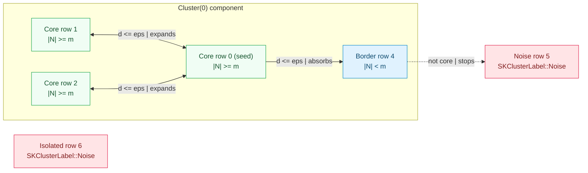
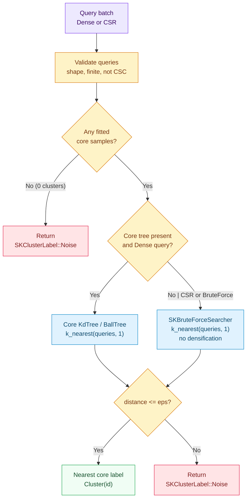

# DBSCAN: density, reachability and honest noise

`SKKMeans` ([Chapter 27](./ch27-kmeans.html)) asks two things up front that real datasets often
refuse to grant: you must tell it *how many* clusters exist, and every cluster must look roughly
like a round ball around a centre, with *every* row forced into one of those balls. Give it two
concentric rings, two interleaved crescents, or clean groups peppered with stray outliers, and
a straight hyperplane between centroids cuts right across the true geometry while outliers drag
every centre off course.

**DBSCAN** (*Density-Based Spatial Clustering of Applications with Noise*) turns the question
upside down. Instead of placing $k$ centres and pulling points toward them, it asks a local
question around every point: *are there enough neighbours nearby to call this neighbourhood
dense?* Dense neighbourhoods chain together into clusters of arbitrary shape; isolated points in
thin air are labelled as explicit noise rather than forced into the nearest group.

This chapter builds `SKDBSCAN`: the region query over spatial trees and sparse brute force, the
core/border/noise taxonomy, deterministic cluster numbering and border resolution, and the
nearest-core `predict_clusters` extension.

The capability is `dbscan`; the code lives in `crates/sciencekit_cluster/src/dbscan/`.

## 1. The problem, in plain words

Imagine looking at a night-time satellite map of cities and country roads. You do not count the
cities beforehand, and cities are not circles — one hugs a curved coastline, another stretches
along a river valley, and isolated farmhouses sit miles from any town. Yet your eye separates
them effortlessly because **towns are dense** and **open countryside is sparse**.

DBSCAN formalises that intuition with just two numbers:

- $\varepsilon$ (`eps`): the radius of a "walking-distance" circle around each point, and
- $m$ (`minimum_samples`): how many points (counting the point itself) must fall inside that
  circle for the spot to count as **dense**.

Everything else — how many clusters exist, what shapes they trace, and which rows are outliers —
falls out of chaining overlapping dense circles together.

## 2. The decisions, and the roads not taken

1. **Reuse the shared searchers from `sciencekit_neighbors` for the region query.** Every point's
   inclusive $\varepsilon$-neighbourhood comes from `SKNearestNeighborsSearcher::radius_neighbors`:
   `SKKDTree` for dense inputs up to $20$ features, `SKBallTree` above $20$ features, and
   `SKBruteForceSearcher` whenever the input is sparse CSR or uses cosine distance.
2. **Self-inclusion is unconditional.** For any true metric, $d(x_i, x_i) = 0 \le \varepsilon$, so
   row $i$ naturally appears in its own neighbourhood. Under cosine distance, however, a zero-norm
   row has convention distance $1 - 0 = 1$, which exceeds $\varepsilon < 1$. `sk_radius_neighborhoods`
   therefore guarantees that row $i$ is always sorted into `neighborhoods[i]`, matching
   scikit-learn's `min_samples` definition everywhere.
3. **Typed `SKClusterLabel::Noise`, never a magic `-1` integer.** In Python, DBSCAN returns `-1`
   for noise, inviting accidental array indexing (`centers[-1]` silently reads the *last*
   cluster!). Here every row receives `SKClusterLabel::Cluster(id)` or `SKClusterLabel::Noise`, a
   four-byte niche-optimised Rust enum introduced in [Chapter 31](./ch31-clustering-metrics.html);
   external callers that want `-1` opt in explicitly via `label.to_i64()`.
4. **Deterministic component IDs and border resolution.** Unvisited core points are scanned in
   ascending training-row order `0..n`, and each neighbour list is sorted by training index. As a
   result, the component containing the smallest core row index always becomes `Cluster(0)`, the
   next becomes `Cluster(1)`, and a border point reachable from two clusters deterministically
   joins the cluster seeded first — regardless of how many `rayon` threads executed the parallel
   radius query.
5. **A documented nearest-core `predict_clusters` extension.** Classical DBSCAN is transductive:
   adding new points could bridge two clusters, so scikit-learn omits `DBSCAN.predict`. In
   production pipelines, however, scoring or routing new rows against a frozen density partition
   is genuinely useful. `SKDBSCANModel` implements `SKClustererPredictor` by indexing only the
   fitted **core samples** and assigning each query row to its nearest core sample's cluster when
   $d(q, c^\star) \le \varepsilon$, or `SKClusterLabel::Noise` otherwise.
6. **Zero densification, plus upfront CSC and metric/tree guards.** Sparse CSR designs stay CSR
   both during the region query and when extracting the core-sample sub-matrix
   (`sk_extract_core_samples`). Requesting `KdTree` or `BallTree` with `Cosine` fails immediately
   at `build()`, and passing a compressed-column (`CSC`) view or requesting a tree over CSR fails
   up front with `SKError::UnsupportedRepresentation` and actionable guidance.

*Roads not taken.* Reimplementing a bespoke spatial tree inside `sciencekit_cluster` (duplicating
`sciencekit_neighbors`); densifying sparse CSR rows to feed a KD-tree (blowing up memory on wide
text/one-hot matrices); assigning new queries via nearest *border* points (which would let new
points drift past $\varepsilon$ from actual dense regions); and shuffling or parallelising the BFS
expansion itself (the expansion over integer neighbour lists is already linear in the output size
and keeping it sequential guarantees exact determinism).

## 3. The concepts, taught from zero

### Core points, border points and noise

Fix a distance $d$, a radius $\varepsilon > 0$ and a threshold $m = \text{minimum\_samples} \ge 1$.
For each training row $x_i$, define its inclusive $\varepsilon$-neighbourhood:

$$
N_\varepsilon(x_i) = \{\, j \in \{0, \dots, n - 1\} \mid d(x_i, x_j) \le \varepsilon \,\} \cup \{i\}
$$

Every point falls into **exactly one** of three roles:

- **Core point:** $|N_\varepsilon(x_i)| \ge m$. The neighbourhood around $x_i$ is genuinely dense.
- **Border point:** $|N_\varepsilon(x_i)| < m$, *and* $x_i$ lies inside $N_\varepsilon(x_c)$ for at
  least one core point $x_c$. It sits on the thin fringe of a dense region.
- **Noise point:** $|N_\varepsilon(x_i)| < m$, and *no* core point lies within $\varepsilon$ of
  $x_i$.

Look closely at the dashed arrow between **Border row 4** and **Noise row 5** in the diagram.
Even though row 5 sits within $\varepsilon$ of row 4, row 4 is *not* a core point, so the
breadth-first expansion queue never expands row 4's own neighbours. That asymmetric rule is what
stops two separate clouds from leaking into one giant cluster across a single thin bridge of two
stray points.

### Why deterministic breadth-first expansion matters

Between core points, density connectivity is symmetric: if core point $a$ and core point $b$ lie
within $\varepsilon$, each is in the other's neighbourhood, so the core-point graph breaks cleanly
into connected components regardless of visit order. Two things *do* depend on order unless we pin
them down:

1. **Which cluster gets `0`, `1`, `2`?** Scanning `seed` from `0` to `n - 1` means the component
   whose earliest core point has the smallest row index always gets `Cluster(0)`.
2. **What if a border point touches two clusters?** Because `Cluster(0)` finishes its full
   breadth-first expansion before `Cluster(1)` begins, a shared border point's label flips from
   `Noise` to `Cluster(0)` first and is never overwritten later.

Notice how clean the separation of concerns is: the expensive work — computing distances and
collecting $N_\varepsilon(x_i)$ for all $n$ rows — runs in parallel across `rayon` worker threads
inside `SKKDTree`, `SKBallTree` or `SKBruteForceSearcher`, writing each row's sorted neighbour
indices into its own slot `neighborhoods[row]`. Once those sorted vectors return, `sk_expand_clusters`
walks them deterministically in milliseconds, so $1$ thread and $16$ threads produce bit-for-bit
identical `SKClusterLabel` arrays.

### How out-of-sample `predict_clusters` works

When `fit` finishes and at least one core point exists, `fit.rs` slices the core rows out of the
training matrix (`sk_extract_core_samples` — preserving dense `Array2` or sparse `CsMat` without
densifying) and builds `SKDBSCANCoreSearch`:

- an optional spatial tree (`KdTree` or `BallTree`) over those core rows when the fit strategy
  was a tree, plus
- a representation-agnostic `SKBruteForceSearcher` over the same core rows.

Notice why indexing **only core samples** (rather than all training samples) is essential: if a
new query lands near a *border* point of `Cluster(0)` while sitting farther than $\varepsilon$
from every *core* point, an index over all training rows would mistakenly report distance
$\le \varepsilon$ to that border point and pull the query into `Cluster(0)`! Querying the
core-sample index enforces $d(q, c^\star) \le \varepsilon$ strictly against dense cores.

## 4. Each public object, explained

- **`SKDBSCAN<F>` / `SKDBSCANBuilder<F>`** — builder-only estimator configuration: `eps`
  (default $0.5$, finite and strictly positive), `minimum_samples` (default $5$, strictly
  positive), `metric` (`SKDBSCANMetric::Euclidean` default, `Manhattan`, `Chebyshev`, `Cosine`),
  `algorithm` (`SKDBSCANAlgorithm::Auto` default, `KdTree`, `BallTree`, `BruteForce`),
  `leaf_size` (default $40$, strictly positive), `backend` (default `SKBackendKind::Faer`) and
  `execution_mode` (default `SKExecutionMode::Automatic`).
- **`SKDBSCANModel<F>`** — immutable, `Send + Sync` fitted state exposing `labels()`,
  `core_sample_indices()`, `number_of_clusters()`, `number_of_features()`, `eps()`,
  `minimum_samples()`, `metric()`, `search_strategy()`, `training_representation()`, `backend()`
  and `execution_mode()`.
- **`SKDBSCANMetric` / `SKDBSCANAlgorithm` / `SKDBSCANSearchStrategy`** — the closed vocabulary of
  distances, requested search algorithms and resolved fit-time strategies (`KdTree`, `BallTree`,
  `BruteForce` — never `Auto`, with `is_tree()` reporting whether a spatial tree backed the fit).
- **Fit and assignment contracts** — `SKUnsupervisedFit<F>` (`fit`), `SKDBSCAN::fit_predict`, and
  `SKClustererPredictor<F>` (`predict_clusters`) returning `Array1<SKClusterLabel>`.

## 5. A real walk-through, using the tests

### `dbscan_fit_identifies_core_border_and_noise_points_on_hand_checked_fixture`

In `dbscan/dbscan_fit_tests.rs`, seven 2D points are clustered with `eps = 1.0` and
`minimum_samples = 4`:

- Rows `0..4` form a $0.5 \times 0.5$ square (`[0,0]`, `[0.5,0]`, `[0,0.5]`, `[0.5,0.5]`), so
  every corner sees at least $4$ points within $1.0$ and becomes a **core** point in
  `core_sample_indices == [0, 1, 2, 3]`.
- Row `4` at `[-0.9, 0.0]` sees only `{0, 4, 5}` ($3 < 4$), so it is **not** core — yet because
  core row `0` reaches it, row `4` receives `SKClusterLabel::cluster(0)` as a **border** point.
- Row `5` at `[-1.8, 0.0]` sits $0.9 \le 1.0$ from border row `4`, and $1.8 > 1.0$ from core row
  `0`. Because border points do not propagate density, row `5` stays `SKClusterLabel::Noise`
  alongside isolated row `6` at `[10.0, 10.0]`.

### `dbscan_fit_assigns_cluster_ids_in_smallest_core_index_order` and `dbscan_fit_resolves_shared_border_point_to_earliest_seeded_cluster`

The first interleaves two blobs after a leading noise point at row `0`, placing the `(20, 20)`
blob's first core row at index `1` and the `(0, 0)` blob's first core row at index `2`, and
verifies `(20, 20)` gets `Cluster(0)` while `(0, 0)` gets `Cluster(1)`. The second places a
non-core border point at row `0` equidistant ($0.9 \le 1.0$) from two separate four-point core
groups and confirms it joins `Cluster(0)` — the earlier-seeded component.

### `dbscan_query_radius_neighborhoods_include_each_point_itself`

Tests `KdTree`, `BallTree` and `BruteForce` on dense points, plus `Cosine` with a `[0.0, 0.0]`
zero-norm row under `eps = 0.25`, confirming `neighbors.contains(&row)` holds for every row even
when the pairwise cosine convention reports self-distance $1.0$.

### `dbscan_representation_wide_sparse_design_and_core_extraction_never_densify`

Builds a $6 \times 10{,}000{,}000$ CSR matrix directly from six stored entries (densifying it
would allocate $480\text{ MB}$), runs the partition and `sk_extract_core_samples`, and verifies
both stay `"csr"` with `csr.nnz()` untouched.

### `dbscan_predict_assigns_nearby_queries_to_nearest_core_cluster_and_distant_to_noise` and `dbscan_predict_covers_all_four_dense_and_sparse_combinations_without_densifying`

In `dbscan/dbscan_predict_tests.rs`, five queries exercise every branch of `predict_clusters`:
inside `Cluster(0)`, inside `Cluster(1)`, right on the inclusive boundary $d = \varepsilon = 0.9$,
within $0.45$ of a *border* row yet $1.3 > 0.9$ from the nearest *core* row (confirming it yields
`SKClusterLabel::Noise`), and far away. The companion parity test fits dense and CSR models and
queries each with dense and CSR batches, asserting all four combinations return identical
assignments.

### `dbscan_acceptance_large_twenty_thousand_row_fit_recovers_chains_and_noise`, `dbscan_acceptance_metrics_recovers_non_convex_concentric_rings_where_kmeans_cannot` and `dbscan_acceptance_metrics_silhouette_excludes_noise_and_scores_fitted_model`

In `acceptance_tests/`, the large-scale test plants $20{,}000$ rows across $4$ elongated,
$100$-station density chains plus $200$ isolated noise points ($20{,}200$ rows total) and verifies
exact recovery of all $4$ chains and all $200$ `Noise` labels via `SKKDTree`. In
`dbscan_metric_tests.rs`, `dbscan_acceptance_metrics_recovers_non_convex_concentric_rings_where_kmeans_cannot`
fits `SKDBSCAN` and `SKKMeans` on two concentric rings ($r = 1$ and $r = 4$) with noise:
`SKDBSCAN` achieves `sk_adjusted_rand_score == 1.0` and `sk_v_measure_score == 1.0` while
`SKKMeans` scores below $0.25$; and
`dbscan_acceptance_metrics_silhouette_excludes_noise_and_scores_fitted_model` verifies that
`SKSilhouetteScorer` evaluates `SKDBSCANModel` directly via `SKUnsupervisedScorer::score` while
excluding `SKClusterLabel::Noise` rows.

## 6. Look inside

| File | Responsibility |
|---|---|
| `dbscan/config.rs` | `SKDBSCANMetric`, `SKDBSCANAlgorithm`, `SKDBSCANSearchStrategy`, validated configuration |
| `dbscan/builder.rs`, `dbscan/core_implementation.rs` | `SKDBSCANBuilder` defaults/validation and immutable `SKDBSCAN` |
| `dbscan/region_query.rs` | `Auto` strategy resolution, `SKDBSCANIndex`, inclusive `sk_radius_neighborhoods` |
| `dbscan/expansion.rs` | core detection, deterministic BFS expansion and representation-preserving `sk_extract_core_samples` |
| `dbscan/validation.rs` | empty, shape, finiteness and CSR/CSC guards |
| `dbscan/fit.rs`, `dbscan/model.rs` | `SKUnsupervisedFit`, `fit_predict`, `SKDBSCANModel` and `SKDBSCANCoreSearch` |
| `dbscan/predict.rs` | nearest-core `SKClustererPredictor` across all four dense/CSR pairs |
| `acceptance_tests/dbscan_*_tests.rs` | tiny, $20{,}200$-row large, representation, determinism, concurrency and metric suites |

## 7. What this unlocks

`sciencekit_cluster` now pairs centroid partitioning (`SKKMeans`) with non-convex density
clustering (`SKDBSCAN`). Both speak the same `SKClusterLabel` and `SKClustererPredictor`
contracts, and `SKDBSCAN` gives the spatial trees from [Chapter 25](./ch25-spatial-indexes.html)
their first real `radius_neighbors` consumer while proving that noise-aware clustering metrics
([Chapter 31](./ch31-clustering-metrics.html)) compose end to end without sentinel-integer bugs.
