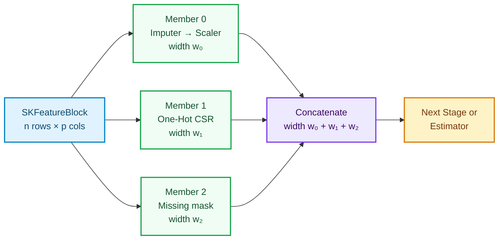
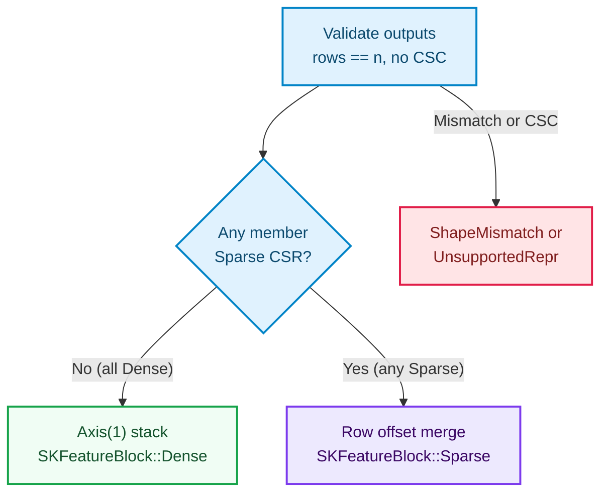

# Feature unions: parallel feature branches and honest concatenation

A linear pipeline is a single conveyor belt: stage one transforms the input, stage two transforms
stage one's output, and the final estimator learns from the last stage. Real tabular and text
problems rarely fit on a single belt. One branch may standardize continuous measurements, a second
branch may one-hot encode categorical codes into a wide sparse indicator matrix, and a third branch
may impute missing values and attach a missingness mask — all computed from the **same** input rows
and glued side by side before a classifier or regressor sees them.

This chapter builds `SKFeatureUnion` in `crates/sciencekit_pipeline/src/feature_union/` (capability
`feature-union`): compile-time heterogeneous branches through tuples, a dynamic boxed fallback for
runtime lists, CSR-preserving horizontal concatenation, member-indexed error context, and seamless
nesting inside `SKPipeline`.

---

## 1. The problem, in plain words

Suppose an input table $X$ has $n$ rows and $p$ columns, and $m$ different feature transformers
$T_0, T_1, \dots, T_{m-1}$ each extract a different view of $X$:

$$
Z = \bigl[\, T_0(X) \;\big|\; T_1(X) \;\big|\; \dots \;\big|\; T_{m-1}(X) \,\bigr]
$$

If branch $k$ produces $w_k$ columns, the combined matrix $Z$ still has $n$ rows and its width is
the sum of the branch widths:

$$
W = \sum_{k=0}^{m-1} w_k
$$

Four engineering hazards hide behind that simple picture:

1. **Different types per branch.** A `SKStandardScaler`, a `SKSimpleImputer<f64>` and a
   `SKMissingIndicator<f64>` are distinct Rust structs whose fitted models have distinct types.
   Forcing every branch into `Box<dyn ...>` erases those types even when the caller knows every
   branch at compile time.
2. **Dense and sparse outputs side by side.** If branch zero emits a 2-column dense matrix and
   branch one emits a 10,000-column sparse one-hot matrix, converting the sparse branch to dense
   would allocate $10{,}000 \times n$ zeros and destroy memory.
3. **Silent column-offset bugs.** When stacking sparse compressed-row (CSR) matrices horizontally,
   stored column $c$ of branch $k$ must land at global column $c + \sum_{j < k} w_j$. Off-by-one
   offsets corrupt downstream weights without crashing.
4. **Opaque errors.** When the third branch of a union rejects an input, knowing *only* "shape
   mismatch" without knowing *which* branch failed turns debugging into guesswork.

---

## 2. The decisions, and the roads not taken

| Decision | Why we chose it | Alternatives we discarded |
|---|---|---|
| **Tuple-based `SKFeatureUnionStages<F>` up to eight members, plus `Vec<Box<dyn SKBlockTransformer<F>>>` fallback** | Most unions combine two to five branches known at compile time; tuples keep every concrete `Fitted` model accessible without heap boxing. Runtime-built or larger unions (> 8 branches) drop cleanly to the boxed list over the exact same `SKFeatureBlock` medium. | A boxed-only `Vec<Box<dyn ...>>` design (loses concrete fitted-stage inspection in the common case) or left-nested pairs like `((A, B), C)` (awkward to destructure when all branches are peers). |
| **Any sparse member promotes the union output to CSR; all-dense stays dense** | Converting a narrow dense branch into CSR entries costs $O(\text{non-zeros})$ work; densifying a wide sparse branch costs $O(n \times w_{\text{sparse}})$ memory. Promoting to CSR preserves sparsity end-to-end. | Always emitting dense (memory blow-up on categoricals/text) or always emitting CSR (unnecessary overhead when every branch is dense). |
| **Scalar-free `SKFeatureUnion<Stages>` configuration + `SKFeatureUnionArity`** | `SKFeatureUnion` holds no floating-point constants of its own. Separating member counting (`SKFeatureUnionArity`) from `SKFeatureUnionStages<F>` lets `.build()` validate non-emptiness without a turbofish scalar, and lets scalar-generic branches serve both `f32` and `f64`. | Adding `PhantomData<F>` to `SKFeatureUnion<F, Stages>` (forces callers to annotate `f64` even before data arrives). |
| **Direct `SKPipelineTransformer` implementations over sealed `f32` and `f64`** | `sciencekit_pipeline` already provides a blanket `SKPipelineTransformer<F>` implementation for any `T: SKUnsupervisedFit<F>`. Implementing `SKPipelineTransformer<f32>` and `SKPipelineTransformer<f64>` directly for `SKFeatureUnion<Stages>` and non-empty `SKPipelineBuilder` satisfies Rust's orphan/coherence rules because `SKFloat` is sealed to `f32` and `f64`. | Implementing `SKUnsupervisedFit` on `SKFeatureUnion` (would clone the input block an extra time at every nested boundary). |
| **Dual error surface (`fit` / `fit_checked` and `transform` / `transform_checked`)** | `SKError` variants that carry messages gain `"feature union member {index}: ..."` automatically, while structured fixed-field variants (`ShapeMismatch`, `UnsupportedRepresentation`) stay intact for pattern matching and also expose `.member_index()` through `SKFeatureUnionMemberError` recorded directly on the operation span. | Flattening every member failure into `SKError::Conversion(String)` (breaks callers matching structured `SKError` variants). |

---

## 3. The concepts, taught from zero

### Fan-out and horizontal concatenation

In a linear pipeline (`SKPipeline`), data flows **serially**: stage two sees the output of stage
one. In a feature union (`SKFeatureUnion`), data **fans out**: every member sees the exact same
input block `&SKFeatureBlock<F>`, fits its own independent model, and transforms the input into its
own output block before the union stitches the columns left-to-right.

### How CSR horizontal stacking works without densifying

A **Compressed Sparse Row (CSR)** matrix stores only non-zero entries row by row using three flat
arrays:
- `values`: each stored non-zero number;
- `column_indices`: which column each stored number belongs to;
- `row_pointers`: where each row starts and ends inside `values` and `column_indices`.

Suppose for row $r$, member $0$ (width $w_0 = 2$, dense) produces $[1.5, 0.0]$ and member $1$
(width $w_1 = 3$, CSR) stores $4.0$ at local column $1$. Rather than expanding member $1$ into
$[0.0, 4.0, 0.0]$, the union pre-counts total stored entries across all members, reserves exact
buffer capacities once, and walks row $r$ across all members keeping a cumulative column offset:

- **Offset $0$ (member $0$, width $2$):** non-zero entry $(0 + 0,\; 1.5)$ is appended; the exact
  zero at column $1$ stays implicit.
- **Offset $2$ (member $1$, width $3$):** stored entry $(2 + 1,\; 4.0) = (3,\; 4.0)$ is appended.

Because each member's columns are visited in ascending order and each member's offset shifts past
all previous widths, every row's combined column indices are strictly increasing by construction.

### Object-safe erasure for dynamic unions (`SKBlockTransformer`)

Why can we not write `Vec<Box<dyn SKPipelineTransformer<f64>>>` directly? In Rust, a trait with an
associated type (`type Fitted`) requires every trait object in the `Vec` to share the *same*
`Fitted` type — which fails as soon as you mix a scaler and an imputer.

`SKBlockTransformer<F>` solves that cleanly by erasing only the fitted state behind
`SKBoxedFittedStage` (`Box<dyn Any + Send + Sync>`): `fit_block` boxes the concrete `Stage::Fitted`
value, and `transform_block` downcasts it back to `&Stage::Fitted` inside the blanket
implementation. Every `Send + Sync` pipeline transformer gets `SKBlockTransformer<F>` for free,
without requiring `Clone` on estimators.

---

## 4. Each public object, explained

- **`SKFeatureUnion<Stages>`** — the configured union estimator. Built exclusively via
  `SKFeatureUnion::build()` (alias `SKFeatureUnion::start()`) or `SKFeatureUnion::boxed::<F>()`.
  Stores `Arc<Stages>` internally so `.fit(&block)` borrows `&self` without requiring `Stages: Clone`
  and transfers shared stage configuration into the fitted model.
- **`SKFeatureUnionBuilder<Stages>`** — configures `.stages(tuple_or_vec)`, incremental
  `.with_stage(stage)` (flat tuples up to eight members via `SKAppendUnionStage`),
  `.with_boxed_stage(stage)` (dynamic `Vec`), `.backend(SKBackendKind)` (default `Faer`), and
  `.execution_mode(...)` (default `Automatic`). `.build()` rejects zero members with
  `SKError::InvalidHyperparameter`.
- **`SKFeatureUnionArity` and `SKFeatureUnionStages<F>`** — `SKFeatureUnionArity` reports
  `number_of_members(&self)` without needing a float parameter; `SKFeatureUnionStages<F>` fits and
  transforms tuples `(Stage0,)` through `(Stage0, ..., Stage7)` and
  `Vec<Box<dyn SKBlockTransformer<F>>>`.
- **`SKBlockTransformer<F>` and `SKBoxedFittedStage`** — the object-safe dynamic fallback contract
  and its `Send + Sync` type-erased fitted state.
- **`SKFeatureUnionModel<F, Stages>`** — the `Send + Sync` fitted union returned by `.fit(&block)`.
  Exposes `.transform(&block)`, `.transform_checked(&block)`, `.number_of_members()`,
  `.member_widths()`, `.number_of_features()` (and `.number_of_output_features()`),
  `.number_of_input_features()`, `.stages()`, `.fitted_stages()`, `.backend()`, and
  `.execution_mode()`.
- **`SKFeatureUnionMemberError`** — exposes `.member_index()` (`Option<usize>`), `.error()`
  (`&SKError`), and `.into_sk_error()` so callers using `fit_checked` or `transform_checked` know
  both the failing member and the exact `SKError` variant.

---

## 5. Walking through the real companion tests

Every behavior in the `feature-union` specification is locked down by companion `*_tests.rs`
modules under `crates/sciencekit_pipeline/src/feature_union/` and `acceptance_tests/`:

### `two_member_scalar_chain_counts_members_and_fits_both_stages` & `incremental_with_stage_builds_tuples_up_to_eight_members`

In `union_stages_tests.rs`, a `(SKStandardScaler, SKMinMaxScaler<f64>)` tuple is built and fitted
on a $2 \times 2$ block, proving both concrete fitted models (`fitted_stages.0` and
`fitted_stages.1`) keep their static types. The second test chains eight `.with_stage(...)` calls
and fits the resulting scalar-generic union on an `f32` block without rebuilding.

### `hand_checkable_two_member_concatenation_preserves_member_order` & `every_member_sees_the_same_input_rows_and_columns`

In `union_fit_tests.rs`, input `[[1.0, 10.0], [3.0, 20.0]]` passes through a standard scaler
($[-1, -1]$ and $[1, 1]$) and a min-max scaler ($[0, 0]$ and $[1, 1]$), asserting the exact $2
\times 4$ output `[[-1.0, -1.0, 0.0, 0.0], [1.0, 1.0, 1.0, 1.0]]`. Pairing `SKStandardScaler` with
`SKSimpleImputer` then proves both members learn raw means `[4.0, 20.0]` — unlike a serial
pipeline, where the second stage would see centered zero means.

### `all_sparse_members_concatenate_to_csr_with_shifted_column_offsets` & `mixed_dense_then_sparse_promotes_union_output_to_csr_with_exact_offsets`

In `union_concatenation_tests.rs`, a sparse-only test stage (`SKSparseOnlyShiftStage`) returns
`UnsupportedRepresentation` if its input is ever densified; pairing it with `SKSimpleImputer` on a
CSR input proves the input remains sparse and the shifted columns land at offsets `0..2` and `2..5`.
Combining dense `SKSimpleImputer` output with sparse `SKMissingIndicator` output (`sparse_output(true)`)
then proves a single sparse member promotes the entire union output to CSR.

### `boxed_dynamic_union_matches_tuple_union_on_dense_outputs` & `boxed_dynamic_union_supports_more_than_eight_members`

In `union_boxed_tests.rs`, a `Vec<Box<dyn SKBlockTransformer<f64>>>` union is compared element-for-element
against its tuple twin on both dense and mixed CSR outputs, and a 10-member dynamic union verifies
construction beyond the 8-member static tuple ceiling.

### `empty_tuple_and_empty_boxed_unions_are_rejected_with_invalid_hyperparameter`, `member_failure_in_fit_wraps_member_index_in_tuple_and_boxed_unions` & `row_count_mismatch_and_feature_count_mismatch_return_shape_mismatch`

In `union_validation_tests.rs`, empty tuple and empty boxed builders fail at `.build()` with
`SKError::InvalidHyperparameter`. Failing stages at indices 1 and 2 verify `"feature union member k"`
context and `fit_checked` / `transform_checked` structured error preservation, while mismatched
member row counts, wrong query column counts, and CSC sparse outputs fail before any output buffer
is written.

### `accessors_report_member_count_widths_and_summed_total_width`, `non_default_backend_and_execution_mode_propagate_to_fitted_model` & `concurrent_transform_across_threads_agrees_with_sequential_result`

In `union_model_tests.rs`, a three-branch union with widths `[2, 1, 2]` verifies that
`member_widths().iter().sum()` equals `number_of_features()` (`5`), non-default
`SKBackendKind::MatrixMultiply` and `SKExecutionMode::InProcessSynchronous` overrides propagate into
the fitted model, compile-time `Send + Sync` bounds hold for both tuple and boxed models, and eight
threads transforming concurrently inside `std::thread::scope` match the sequential result
bit-for-bit.

### `scaler_union_one_hot_encoder_into_classifier_concatenates_columns_and_predicts`, `sub_pipeline_branch_composes_inside_feature_union_and_regressor_pipeline`, `nested_feature_unions_and_sub_pipelines_compose_into_regressor_metrics` & `large_sparse_feature_union_pipeline_fits_without_densification`

In `union_pipeline_tests.rs` and `acceptance_tests/feature_union_{small,large}_tests.rs`,
`SKFeatureUnion` runs as a stage inside `SKPipeline` — uniting a continuous scaler with a sparse
`SKOneHotEncoder` ahead of `SKLogisticRegression`, nesting multi-stage `SKPipelineBuilder` chains
and inner unions ahead of `SKLinearRegression` ($R^2 > 0.99$), and fitting 600-row sparse designs
end-to-end without densification.

---

## 6. Look inside

| File | Responsibility |
|---|---|
| `crates/sciencekit_pipeline/src/feature_union/mod.rs` | Pure dispatcher declaring submodules, re-exports, and companion test suites. |
| `crates/sciencekit_pipeline/src/feature_union/builder.rs` | `SKFeatureUnion` and `SKFeatureUnionBuilder`, empty-union guard, backend and execution-mode configuration. |
| `crates/sciencekit_pipeline/src/feature_union/append.rs` | `SKAppendUnionStage` extending flat tuples from zero up to eight members. |
| `crates/sciencekit_pipeline/src/feature_union/stages.rs` | `SKFeatureUnionArity` and `SKFeatureUnionStages<F>` implemented for tuples of one through eight stages. |
| `crates/sciencekit_pipeline/src/feature_union/boxed.rs` | `SKBlockTransformer<F>` and `SKBoxedFittedStage` dynamic fallback for runtime member lists. |
| `crates/sciencekit_pipeline/src/feature_union/concatenate.rs` | Upfront shape/representation checks, dense `Axis(1)` stacking, and pre-sized CSR horizontal concatenation. |
| `crates/sciencekit_pipeline/src/feature_union/errors.rs` | `SKFeatureUnionMemberError` and `sk_wrap_member_error` preserving structured `SKError` variants with member indices. |
| `crates/sciencekit_pipeline/src/feature_union/model.rs` | `SKFeatureUnionModel<F, Stages>`, `fit` / `fit_checked`, and `transform` / `transform_checked` under `sk_run_operation`. |
| `crates/sciencekit_pipeline/src/feature_union/accessors.rs` | Width, member-count, stage, fitted-stage, backend, and execution-mode accessors. |
| `crates/sciencekit_pipeline/src/feature_union/pipeline_stage.rs` | `SKPipelineTransformer` implementations for `SKFeatureUnion` and nested `SKPipelineBuilder` branches. |

---

## 7. Recap

- **`SKFeatureUnion` fans one input block out to parallel branches** and concatenates their outputs
  left-to-right in declaration order.
- **Static tuples up to eight members keep concrete types;** `Vec<Box<dyn SKBlockTransformer<F>>>`
  provides an object-safe runtime escape hatch over the same `SKFeatureBlock` medium.
- **Sparsity is respected end-to-end:** all-dense outputs stay dense, any sparse member promotes the
  concatenated block to CSR with cumulative column offsets, and sparse inputs are never densified.
- **Errors stay structured and indexed:** every member failure surfaces its zero-based member index
  while preserving the underlying `SKError` variant and recording directly on its observability
  span.
- **Unions and pipelines nest freely:** a union is a stage in `SKPipeline`, and a multi-stage
  `SKPipelineBuilder` is a valid branch inside `SKFeatureUnion`.
