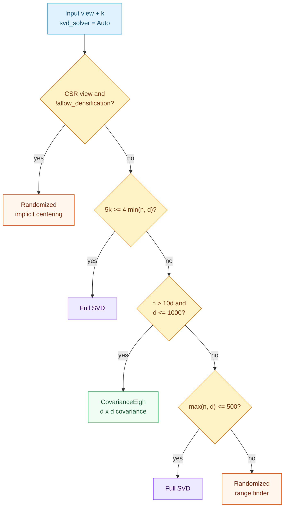

# Principal Component Analysis: centering, three solvers and honest sparsity

Most real feature tables carry redundancy: measurements move together along a handful of hidden
directions while the remaining coordinates contribute mostly noise. **Principal Component
Analysis** (`SKPCA`) finds the orthogonal unit axes along which a centered dataset varies the
most, orders them by how much variance each axis captures, and projects observations onto the
leading $k$ axes.

The algebra looks short on a blackboard, yet turning it into a production estimator forces
three engineering choices into the open:

1. **One algorithm, three regimes.** Exact full SVD is unbeatable on small or nearly full-rank
   matrices, symmetric covariance eigendecomposition wins on tall-and-narrow tables, and the
   seeded randomized SVD from [Chapter 39](./ch39-randomized-svd.html) scales when only a few
   components are needed from a large matrix.
2. **Centering changes sparsity.** Subtracting a non-zero column mean turns every implicit zero
   of a sparse CSR matrix into a non-zero number. Pretending otherwise silently allocates
   gigabytes; rejecting all sparse input throws away the implicit-centering capability we just
   built in `sciencekit_math`.
3. **Sign and thread-count determinism.** Singular vectors and eigenvectors are only defined up
   to $\pm 1$, and parallel matrix products can re-associate floating-point sums unless row
   blocks are fixed.

This chapter walks through `crates/sciencekit_decomposition/` (capability
`principal-component-analysis`), explaining the mathematics from zero, every public type and
method, and the companion tests that pin each guarantee down.

---

## 1. The problem, in plain words

Suppose we observe $n$ rows and $d$ numeric features in a matrix $X \in \mathbb{R}^{n \times d}$.
Before looking for directions of spread, we shift the cloud so its empirical centre sits at the
origin:

$$
\mu_j = \frac{1}{n} \sum_{i=1}^{n} X_{i,j}, \qquad X_c = X - \mathbf{1}\mu^{\top}
$$

Given a target dimension $k \le \min(n, d)$, we want $k$ orthonormal row vectors
$W \in \mathbb{R}^{k \times d}$ ($W W^{\top} = I_k$) whose projections

$$
Z = X_c W^{\top} \in \mathbb{R}^{n \times k}
$$

capture as much of the unbiased sample variance as possible, and reconstruct the original table
with minimal Frobenius error via

$$
\widehat{X} = Z W + \mathbf{1}\mu^{\top}.
$$

---

## 2. The decisions — and the roads not taken

| Decision | Why we chose it | Alternatives we discarded |
|---|---|---|
| **Dedicated `sciencekit_decomposition` crate with `SKPCA<F>` and `SKPCAModel<F>`** | Keeps configuration (`SKPCA`) immutable and separate from learned state (`SKPCAModel`), matching every estimator in the workspace and preparing a shared home for `SKTruncatedSVD` and `SKIncrementalPCA`. | Mutating `SKPCA` in place during `fit` — makes "not yet fitted" a runtime error instead of a type error. |
| **Three concrete solvers behind `SKPCASolver` (`Full`, `Randomized`, `CovarianceEigh`) plus deterministic `Auto`** | Each regime has a different asymptotic bottleneck: full SVD for small or high-rank requests, $d \times d$ covariance `eigh` when $n \gg d$, and randomized range finding when $k \ll \min(n, d)$. Recording `resolved_solver()` on the model makes the heuristic inspectable. | Hard-coding full SVD everywhere (too slow on wide or tall tables) or randomized SVD everywhere (unnecessary approximation on a $20 \times 6$ table). |
| **Implicit sparse centering on `Randomized`; explicit `allow_densification(true)` gate on `Full` and `CovarianceEigh`** | `SKRandomizedSvdBuilder` folds rank-one mean corrections into its thin products without ever allocating $X_c$. `Full` and `CovarianceEigh` genuinely need dense storage, so they reject CSR with `UnsupportedRepresentation` naming `Randomized` and `SKTruncatedSVD` unless the caller opts in, in which case a `tracing::warn!` reports `estimated_dense_bytes`. | Silently calling `to_dense()` on CSR inputs — an out-of-memory trap in production pipelines. |
| **Component-row sign convention and orthonormal completion (`sk_orient_components`)** | Completing zero-norm directions on rank-deficient inputs via deterministic Gram-Schmidt and making the largest-magnitude coordinate of each row of `components` non-negative works identically whether the solver computed $U$ (`Full`, `Randomized`) or only eigenvectors (`CovarianceEigh`), so all three solvers satisfy $W W^{\top} = I_k$ and agree in sign. | Orienting only by left singular vectors $U$ — `CovarianceEigh` never materializes $U$, and zero singular values in `Randomized` would leave zero rows. |
| **Fixed 256-row blocks for dense `transform` and `inverse_transform`** | Splitting row projections into fixed-size 256-row chunks (run sequentially or via `rayon` depending on the resolved `SKExecutionPlan`) keeps scratch memory bounded and ensures identical floating-point evaluation across thread counts. | Passing a thread-dependent chunk size into GEMM — 1-thread and 4-thread runs could differ by rounding order. |

  <strong>Explicit non-goals for this change.</strong> Sparse exact full/eigh solvers, kernel
  PCA, streaming/incremental PCA (<code>SKIncrementalPCA</code>), GPU kernels,
  <code>memmap2</code>-backed storage and model export (Wave 7) are intentionally out of scope
  here and recorded in <code>docs/PRD.md</code>.

---

## 3. The concepts, taught from zero

### Why SVD and covariance eigendecomposition find the same axes

Write the thin singular-value decomposition of the centered matrix as
$X_c = U \Sigma V^{\top}$, where $U$ has orthonormal columns, $\Sigma = \operatorname{diag}(\sigma_1, \dots, \sigma_r)$
has $\sigma_1 \ge \sigma_2 \ge \dots \ge 0$, and $V$ has orthonormal columns in $\mathbb{R}^d$.
Form the unbiased sample covariance matrix ($n \ge 2$):

$$
C = \frac{1}{n - 1} X_c^{\top} X_c
  = \frac{1}{n - 1} V \Sigma^2 V^{\top}.
$$

Read that equation from right to left: the columns of $V$ are eigenvectors of $C$, and the
corresponding eigenvalues are the **explained variances**

$$
\lambda_j = \frac{\sigma_j^2}{n - 1}.
$$

Dividing each $\lambda_j$ by the total centered variance

$$
\sigma_{\text{total}}^2 = \frac{1}{n - 1} \lVert X - \mathbf{1}\mu^{\top} \rVert_F^2
$$

gives `explained_variance_ratio`. Computing $\sigma_{\text{total}}^2$ directly from $(X, \mu)$
matters: `Randomized` only computes the top $k$ singular values, yet its variance ratios still
divide by the *entire* variance of the dataset rather than only the retained $k$ modes.

### Non-negative two-pass variance on sparse CSR

For a sparse CSR matrix, expanding $\sum (x - \mu)^2 = \sum x^2 - n\mu^2$ can suffer
catastrophic cancellation when $\mu$ is large. Instead, `sk_total_centered_variance` in
`centering.rs` sums $(v - \mu_j)^2$ over the `nnz` stored entries in column $j$ and adds
$(n - \text{nnz}_j)\mu_j^2$ for the implicit zeros. Every term is non-negative, the cost is
$\mathcal{O}(\text{nnz} + d)$, and no dense matrix is allocated.

### How `Auto` picks a solver

Notice the integer test `5 * k >= 4 * min(n, d)`: it expresses $k \ge 0.8 \min(n, d)$ without
floating-point rounding ambiguity at boundaries.

### Whitening and near-zero variance safety

When `whiten(true)` is configured, each projected coordinate $c$ is divided by its spread so
every retained axis has unit sample variance:

$$
s_c = \sqrt{\max(\lambda_c, \varepsilon)}, \qquad
Z_{\text{white}}[:, c] = \frac{Z[:, c]}{s_c}.
$$

Flooring $\lambda_c$ at machine epsilon ($\varepsilon = \text{F::epsilon}()$) before taking the
square root prevents rank-deficient or constant columns from producing `NaN` or $\pm\infty$,
while leaving genuine components untouched. `inverse_transform` multiplies component row $c$ by
$s_c$ before adding $\mu$, so whitening remains invertible on full-rank subspaces.

---

## 4. Each public object, explained

```mermaid
flowchart LR
    accTitle: Data and state flow across SKPCABuilder, SKPCA and SKPCAModel
    accDescr: SKPCABuilder validates configuration into an immutable SKPCA estimator. Calling fit dispatches to Full, Randomized or CovarianceEigh under a Fit observability span and produces SKPCAModel, which runs transform and inverse_transform under Transform spans carrying the configured backend.
    classDef builder fill:#e0f2fe,stroke:#0284c7,color:#0c4a6e
    classDef est fill:#ede9fe,stroke:#7c3aed,color:#3b0764
    classDef model fill:#f0fdf4,stroke:#16a34a,color:#14532d
    classDef op fill:#fff7ed,stroke:#ea580c,color:#7c2d12

    B["SKPCABuilder&lt;F&gt;<br/>defaults + validation"]:::builder -->|build| E["SKPCA&lt;F&gt;<br/>immutable config"]:::est
    E -->|fit| S["Solver portfolio<br/>Fit span + backend"]:::op
    S --> M["SKPCAModel&lt;F&gt;<br/>W, variance, mean"]:::model
    M -->|transform| Z["Projected Array2&lt;F&gt;<br/>m x k"]:::op
    Z -->|inverse_transform| X["Reconstructed Array2&lt;F&gt;<br/>m x d"]:::op
```

### `SKPCASolver`

*What it is* — the closed solver enum in `pca/config.rs`: `Auto` (default), `Full`,
`Randomized` and `CovarianceEigh`.

*Why it exists* — lets callers either rely on `Auto` or pin an exact numerical path while
reading back the concrete choice from `model.resolved_solver()`.

### `SKPCABuilder<F>` and `SKPCA<F>`

*What they are* — the mandatory builder (`pca/builder.rs`) and immutable estimator
(`pca/core_implementation.rs`), generic over `F: SKFloat` because `tolerance` is a scalar.

*Defaults and setters*:
- `number_of_components(usize)` — optional (`None` by default, resolving to $\min(n, d)$ at
  fit time);
- `svd_solver(SKPCASolver)` — `SKPCASolver::Auto`;
- `whiten(bool)` — `false`;
- `tolerance(F)` — `0.0` (must be finite and $\ge 0$);
- `number_of_power_iterations(usize)` — `5` (must be $> 0$);
- `allow_densification(bool)` — `false`;
- `random_seed(u64)` — `0`;
- `backend(SKBackendKind)` — `SKBackendKind::Faer`;
- `execution_mode(...)` — `SKExecutionMode::Automatic`.

`SKPCA<F>` implements `SKUnsupervisedFit<F, Model = SKPCAModel<F>, Error = SKError>` (for
`F: SKBackendSelection`) and provides `fit_transform`, which fits and projects under a single
`FitTransform` observability span.

### `SKPCAModel<F>`

*What it is* — the fitted model (`pca/model.rs`), `Clone + Debug + Send + Sync`.

*Accessors and operations*:
- `components()` (`k × d` view), `explained_variance()`, `explained_variance_ratio()`,
  `singular_values()`, `mean()`;
- `resolved_solver()`, `number_of_components()`, `number_of_features()`, `whiten()`,
  `backend()`, `execution_mode()`;
- `transform` (inherent and via `SKFeatureTransformer<F>`) accepting both dense and CSR views
  without densifying sparse inputs — for CSR it computes $X W^{\top} - \mathbf{1}(W\mu)^{\top}$
  through `sk_csr_dense_product`;
- `inverse_transform` accepting projected coordinates and mapping back to $\mathbb{R}^{m \times d}$.

Because `SKPCA<F>` implements `SKUnsupervisedFit<F>` and `SKPCAModel<F>` implements
`SKFeatureTransformer<F, Output = Array2<F>>`, `SKPCA<F>` automatically satisfies
`sciencekit_pipeline::SKPipelineTransformer<F>`.

---

## 5. Walking through the real companion tests

Every guarantee above is locked by a companion `*_tests.rs` module under
`crates/sciencekit_decomposition/src/`:

1. **Zero-mean centering and honest sparse moments (`pca_centering_tests.rs`).**
   `pca_centering_computes_hand_checked_means_and_zero_mean_centered_data` checks hand-computed
   means `[4.0, 25.0, 2.0]` and verifies every centered column averages to zero.
   `pca_centering_sparse_means_and_total_variance_match_dense_without_densifying` proves the
   two-pass CSR variance equals the dense calculation.
2. **Exact full SVD, randomized SVD and covariance `eigh` (`pca_full_tests.rs`,
   `pca_randomized_tests.rs`, `pca_covariance_tests.rs`).**
   `pca_full_recovers_diagonal_principal_axes_and_reconstructs_centered_data` checks the
   $(1/\sqrt{2}, 1/\sqrt{2})$ principal axis, orthonormal rows and exact reconstruction.
   `pca_randomized_agrees_with_full_svd_on_low_rank_dense_design` and
   `pca_covariance_sorts_eigenvalues_descending_and_matches_full_svd` verify that all three
   solvers agree on components, singular values, variances and ratios.
3. **Solver routing (`pca_solver_tests.rs`).**
   `pca_solver_auto_routes_small_high_rank_covariance_and_large_designs` exercises every branch
   of `sk_resolve_pca_solver`: small dense $\to$ `Full`, high rank fraction $\to$ `Full`,
   tall-skinny $\to$ `CovarianceEigh`, large truncated $\to$ `Randomized`, and default sparse
   $\to$ `Randomized`.
4. **Spans, whitening and round-trip reconstruction (`pca_fit_tests.rs`,
   `pca_transform_tests.rs`).**
   `pca_fit_transfers_configured_backend_and_records_fit_span` and
   `pca_transform_records_model_backend_in_transform_and_fit_transform_spans` capture
   `sciencekit.operation` spans to prove a configured non-default backend flows from builder to
   estimator to fitted model spans.
   `pca_transform_whitening_normalizes_component_variance_and_handles_near_zero_variance`
   verifies unit sample variance on full-rank data and finite outputs on collinear data.
5. **Sparse representation policy and warnings (`pca_validation_tests.rs`).**
   `pca_validation_sparse_randomized_matches_dense_without_densifying` fits CSR data with zero
   warnings; `pca_validation_full_and_covariance_reject_sparse_by_default_with_alternatives`
   checks the `UnsupportedRepresentation` error naming `Randomized` and `SKTruncatedSVD`; and
   `pca_validation_allow_densification_warns_with_memory_cost_and_matches_dense` asserts the
   warning records `estimated_dense_bytes = 400` on a $10 \times 5$ `f64` CSR matrix.
6. **Thread-count invariance, concurrency and metrics (`pca_concurrency_tests.rs`,
   `acceptance_tests/`).**
   `pca_concurrency_repeated_fits_agree_across_runs_and_rayon_thread_counts` runs 1-thread and
   4-thread `rayon` pools and asserts exact `assert_eq!` equality on components and projections.
   `acceptance_pca_produces_reconstruction_metrics_via_sciencekit_metrics` evaluates
   `sk_mean_squared_error` and `sk_r2_score` across $k = 1, 2, 3$ on a planted rank-3 table,
   confirming reconstruction error drops monotonically and reaches $R^2 > 0.9999$ at $k = 3$.

---

## 6. Recap

- `SKPCA<F>` centers features, chooses among `Full`, `Randomized` and `CovarianceEigh` (or
  resolves `Auto` deterministically), fixes component signs by largest-magnitude coordinate and
  returns `SKPCAModel<F>`.
- Sparse CSR inputs fit natively without densification under `Randomized`, and fail loudly with
  actionable alternatives under dense-only solvers unless `allow_densification(true)` is set.
- `transform` and `inverse_transform` preserve zero-copy input boundaries, support optional
  epsilon-floored whitening, record the model's `SKBackendKind` in observability spans and stay
  bit-identical across thread counts.
