# JSON debug format: reading a fitted model with your eyes

## 1. The problem we were solving

Production model persistence wants binary files: contiguous IEEE-754 buffers, random
access by tensor offset and zero text parsing. That is the job of the binary Safetensors
adapter. Binary efficiency, however, comes with an immediate tax whenever a human needs
to answer a simple question:

- *Did my `SKStandardScaler` actually center column 2, or did `with_mean` default to
  `false`?*
- *Why did two training runs on different machines diverge in the third decimal place?*
- *Can I check a tiny golden model fixture into Git and review parameter changes with
  `git diff`?*

With a binary file, every one of those questions requires a bespoke inspection tool. In
`sciencekit`, fitted estimators already speak a single format-agnostic vocabulary in
`sciencekit_common`: `SKExportable` produces an `SKModelState<F>`, and `SKImportable`
reconstructs a fitted estimator from it. Adding a human-readable JSON debug adapter in
`crates/sciencekit_interop/src/json/` gives every exportable model a diffable,
hand-inspectable text representation without touching a single estimator crate.

---

## 2. The idea in one picture

```mermaid
flowchart LR
    accTitle: JSON debug export, inspection and validated import pipeline
    accDescr: An SKExportable model produces an SKModelState, which SKJsonDebugWriter validates for finite scalars and renders as deterministic pretty or compact JSON. SKJsonDebugReader parses the JSON, validates format_version, dtypes, unique names and tensor shapes before reconstructing SKModelState and importing back into SKImportable.

    M1["Fitted model<br/>SKExportable"]:::violet --> S1["SKModelState<br/>metadata + BTreeMap"]:::blue
    S1 --> W["SKJsonDebugWriter<br/>Pretty | Compact"]:::green
    W --> J["Deterministic JSON<br/>sorted keys + flat arrays"]:::amber
    J --> R["SKJsonDebugReader<br/>validate before work"]:::orange
    R -->|"valid v1"| S2["SKModelState<br/>exact round-trip"]:::blue
    R -->|"corrupt / mismatch"| E["Structured SKError<br/>no partial model"]:::rose
    S2 --> M2["Reconstructed model<br/>SKImportable"]:::violet

    classDef blue fill:#e0f2fe,stroke:#0284c7,color:#0c4a6e
    classDef green fill:#f0fdf4,stroke:#16a34a,color:#14532d
    classDef orange fill:#fff7ed,stroke:#ea580c,color:#7c2d12
    classDef violet fill:#ede9fe,stroke:#7c3aed,color:#3b0764
    classDef amber fill:#fef3c7,stroke:#d97706,color:#78350f
    classDef rose fill:#ffe4e6,stroke:#e11d48,color:#7f1d1d
```



The central state `SKModelState<F>` sits on both sides of the wire. Neither `SKLinearRegressionModel` nor `SKStandardScaler` knows JSON exists; they export and import `SKModelState<F>`, while `sciencekit_interop::json` owns the text grammar and every byte of `serde_json` dependency.

---

## 3. The decisions — and the roads not taken

| Decision | Why we chose it | Alternatives we discarded |
|---|---|---|
| **Keep `sciencekit_common` free of `serde` and own the wire schema in `sciencekit_interop::json`** | Format policy (field names, version envelope, untagged hyperparameters, forward-compatible unknown fields) belongs to the format adapter, not the core trait crate. | Deriving `Serialize`/`Deserialize` directly on `SKModelState` — couples internal Rust enum layout to the wire format and leaks `serde` into `sciencekit_common`. |
| **Deterministic `BTreeMap` key order + shortest exact float formatting** | Two runs that learn the same parameters emit byte-for-byte identical JSON regardless of insertion order, so `git diff` only highlights genuine numerical changes. Native `f32` slices serialize directly as `f32` (`0.1` instead of `0.10000000149011612`). | `HashMap` maps or casting `f32` through `f64` on write — scrambles key order across runs and pollutes single-precision fixtures with binary64 conversion noise. |
| **Custom duplicate-preserving map visitor on read** | Standard `serde` `BTreeMap` deserialization silently overwrites duplicate object keys (`"w": ..., "w": ...`). Reading entries into a sequence first lets validation deterministically reject duplicate tensor or hyperparameter names. | Deserializing straight into `BTreeMap` or `serde_json::Value` — silently drops the earlier duplicate tensor and hides file corruption. |
| **Check `format_version` before requiring version-1 fields, ignore unknown fields within version 1** | If major version 2 renames top-level sections, a version-1 reader still reports `UnsupportedRepresentation` on the version header rather than a confusing missing-field parse error, while minor additive hints inside version 1 stay forward-compatible. | `#[serde(deny_unknown_fields)]` — breaks older readers whenever an optional diagnostic annotation is added within major version 1. |
| **Document memory expansion for large tensors instead of pretending JSON is a checkpoint format** | Flat UTF-8 decimal arrays expand past raw 8-byte binary buffers and materialize in memory. Stating that boundary clearly points production checkpoints at Safetensors while keeping JSON simple and self-contained. | Base64-encoding tensor buffers inside JSON — destroys the entire point of reading tensor values with human eyes. |

---

## 4. The JSON debug schema, taught from zero

When `SKJsonDebugWriter` serializes a fitted four-feature `SKStandardScaler` in the default `SKJsonFormatMode::Pretty` mode, it produces:

```json
{
  "format_version": 1,
  "estimator": "SKStandardScaler",
  "dtype": "f64",
  "feature_count": 4,
  "class_labels": null,
  "hyperparameters": {
    "with_mean": true,
    "with_std": true
  },
  "tensors": {
    "standard_scaler.mean": {
      "dtype": "F64",
      "shape": [
        4
      ],
      "values": [
        1.0,
        2.0,
        3.0,
        4.0
      ]
    }
  }
}
```

Every field has one job:

1. **`format_version`** (`SK_JSON_DEBUG_FORMAT_VERSION = 1`): the major version of the JSON debug envelope itself. Any other value is rejected immediately with `SKError::UnsupportedRepresentation`. When an estimator's own `SKModelMetadata::format_version()` differs from `1`, an optional `estimator_format_version` field is emitted so arbitrary metadata versions round-trip losslessly without cluttering version-1 fixtures.
2. **`estimator`**, **`dtype`**, **`feature_count`**, **`class_labels`**: the model identity contract from `SKModelMetadata`. The top-level `"dtype"` names the Rust model scalar (`"f32"` or `"f64"`), while classifiers populate `"class_labels"` in canonical index order so `SKLabelTable` mappings remain reversible.
3. **`hyperparameters`**: a sorted map of untagged JSON booleans, 64-bit signed integers, finite 64-bit floats, strings and nested lists mirroring `SKParameterValue`. Because `serde_json` always emits a decimal point on floating-point numbers (`1.0`) and omits it on integers (`1`), `SKParameterValue::Float(1.0)` and `SKParameterValue::Integer(1)` round-trip without variant wrapper tags.
4. **`tensors`**: a sorted map keyed by stable dotted tensor names (`"standard_scaler.mean"`, `"linear.coefficients"`, `"tree.is_leaf"`). Each entry carries its element `"dtype"` (`"F32"`, `"F64"`, `"I64"` or `"Bool"`), its dimension vector `"shape"` ($[s_1, s_2, \dots, s_r]$, with $[]$ for a scalar tensor because the empty product equals $1$), and its flat `"values"` array whose length $N$ must satisfy:

$$\prod_{d=1}^{r} s_d = N$$

Checked multiplication (`usize::checked_mul`) guards that product on read so an adversarial shape such as `[18446744073709551615, 2]` returns `SKError::ShapeMismatch` rather than overflowing.

<div class="sk-box sk-box--warning">
  <strong>Large-tensor memory behavior.</strong> Unlike binary Safetensors, JSON formats every scalar as decimal UTF-8 text and materializes flat arrays in memory during serialization and parsing. Use the JSON debug format for inspection, diffs and test fixtures; use Safetensors for large production checkpoints.
</div>

---

## 5. Each public object, explained

All public types and functions live in `sciencekit_interop::json` and follow the workspace naming and builder conventions (`SK` on types, `sk_` on free functions, no abbreviations):

- **`SK_JSON_DEBUG_FORMAT_VERSION`**: `u32` constant equal to `1`.
- **`SKJsonFormatMode`**: `Pretty` (default, two-space indented multi-line JSON) and `Compact` (single-line JSON with no insignificant whitespace).
- **`SKJsonDebugWriter` & `SKJsonDebugWriterBuilder`**: builder-configured writer implementing `SKBuilder<SKJsonDebugWriter>`, exposing `.format_mode(...)`, `.backend(SKBackendKind)` (default `Faer`) and `.execution_mode(...)` (default `Automatic`). Its methods `write_state_to_string`, `write_state_to_writer`, `write_state_to_path`, `export_to_string` and `export_to_path` validate scalar finiteness up front, borrow tensor slices without copying, and emit a `sciencekit.interop.json.write` `tracing` span.
- **`SKJsonDebugReader` & `SKJsonDebugReaderBuilder`**: builder-configured reader implementing `SKBuilder<SKJsonDebugReader>`, exposing `.backend(SKBackendKind)` and `.execution_mode(...)`. Its methods `read_state_from_string`, `read_state_from_reader`, `read_state_from_path`, `import_from_string` and `import_from_path` validate headers before materializing tensors and emit a `sciencekit.interop.json.read` `tracing` span.
- **Convenience entry points**: `sk_write_model_state_json`, `sk_write_model_state_json_pretty`, `sk_write_model_state_json_compact`, `sk_write_model_state_json_file`, `sk_read_model_state_json`, `sk_read_model_state_json_file`, `sk_export_model_json` and `sk_import_model_json`.

```rust,ignore
use sciencekit_interop::json::{
    SKJsonFormatMode, sk_export_model_json, sk_import_model_json,
};

let json = sk_export_model_json(&fitted_model, SKJsonFormatMode::Pretty)?;
let restored: SKLinearRegressionModel<f64> = sk_import_model_json(&json)?;
```

---

## 6. Validation table: every rejection is structured

Validation runs before tensor allocation so a malformed or mismatched document never leaves a half-built model behind:

| Failure condition | Returned `SKError` |
|---|---|
| Invalid JSON syntax, wrong root type, trailing bytes, missing required v1 field | `SKError::Conversion` |
| Missing or unreadable file path / stream I/O failure | `SKError::Io` |
| `format_version != 1` (including `0`, `2`, or evolved schemas) | `SKError::UnsupportedRepresentation` |
| `NaN` or `±Infinity` in floating tensor or hyperparameter (or `f32` overflow on read) | `SKError::NonFiniteValue { position }` |
| Tensor value count $\neq \prod s_d$, or dimension product overflow | `SKError::ShapeMismatch` |
| Unknown/mismatched scalar `dtype` (`"f16"`, or `"f32"` read into `SKModelState<f64>`) | `SKError::InvalidHyperparameter { name: "dtype", .. }` |
| Duplicate tensor names in `"tensors": { ... }` | `SKError::InvalidHyperparameter { name: "tensor_names", .. }` |
| Empty tensor name | `SKError::InvalidHyperparameter { name: "tensor_name", .. }` |
| Unknown tensor `dtype` (`"U8"`) or element type disagreeing with tensor `dtype` | `SKError::InvalidHyperparameter { name: "tensor_data_type", .. }` |
| Duplicate hyperparameter keys or unsupported JSON `null`/object hyperparameter | `SKError::InvalidHyperparameter { name: "hyperparameters", .. }` |

---

## 7. Walking through the companion tests

The implementation in `crates/sciencekit_interop/src/json/` is split into small single-responsibility files (`mod.rs` pure dispatcher, `format_mode.rs`, `schema.rs`, `writer_builder.rs`, `writer.rs`, `parameter_deserialization.rs`, `schema_deserialization.rs`, `tensor_decoding.rs`, `state_decoding.rs`, `reader_builder.rs`, `reader.rs`), paired with six companion test suites:

- **Schema & hand-written fixture (`json_schema_tests.rs`)**:
  - `json_schema_matches_hand_written_standard_scaler_fixture` asserts byte-for-byte equality against the documented `SKStandardScaler` JSON fixture.
  - `json_schema_renders_readable_metadata_and_typed_hyperparameters` checks `f32` single-precision formatting (`0.1` rather than `0.10000000149011612`), class labels and every `SKParameterValue` kind including nested lists.
  - `json_schema_renders_all_tensor_data_types_and_shapes_as_flat_arrays` verifies `F64`, scalar `[]` shapes, `I64` and `Bool` tensors.
  - `json_schema_rejects_non_finite_values_before_serialization` confirms `f64::NAN` at index `1` fails up front with `SKError::NonFiniteValue { position: 1 }`.
- **Deterministic writer (`json_writer_tests.rs`)**:
  - `json_writer_defaults_to_pretty_format_and_deterministic_key_ordering` and `json_writer_produces_byte_identical_output_across_insertion_orders` insert parameters and tensors in forward and reverse order and verify identical output bytes.
  - `json_writer_compact_mode_emits_single_line_json` and `json_writer_writes_to_io_sink_file_and_exportable_model` verify single-line compact mode, `io::Write` sinks, file output and `SKExportable`.
- **Round-trip fidelity (`json_round_trip_tests.rs`)**:
  - `json_round_trip_reconstructs_identical_model_state` and `json_round_trip_preserves_single_precision_state_and_nested_lists` verify exact `SKModelState` equality across `f64` and `f32`.
  - `json_round_trip_reconstructs_model_through_export_and_import_traits` round-trips a fitted model through `SKExportable` and `SKImportable`.
  - `json_round_trip_supports_files_streams_and_ignores_unknown_fields` verifies stream/file reads and forward compatibility when extra unknown fields appear inside version `1`.
- **Validation (`json_validation_tests.rs`)**:
  - `json_validation_rejects_malformed_json_with_conversion_error`, `json_validation_rejects_unknown_major_versions`, `json_validation_rejects_duplicate_tensor_and_hyperparameter_names`, `json_validation_rejects_invalid_and_mismatched_dtypes` and `json_validation_rejects_tensor_shape_mismatches` pin every row of the error table above.
- **Equivalence, large tensors & concurrency (`json_concurrency_tests.rs`)**:
  - `json_concurrency_pretty_and_compact_modes_parse_to_identical_state` confirms pretty and compact outputs reconstruct identical states.
  - `json_concurrency_large_tensor_round_trips_and_validates_shape` round-trips a $256 \times 256$ (`65,536`-element) matrix, checks its text expansion and verifies shape-mismatch rejection.
  - `json_concurrency_concurrent_reads_from_same_file_agree` spawns eight OS threads reading the same JSON file and re-encoding concurrently, confirming thread-safe determinism.
- **End-to-end acceptance (`acceptance_tests/`)**:
  - `json_acceptance_tiny_states_round_trip_for_both_scalars`, `json_acceptance_large_state_preserves_all_dtypes_class_table_and_spans` and `json_acceptance_imported_regressor_reproduces_predictions_and_zero_error` validate tiny/large states, `sk_canonicalize_labels` class tables, `tracing` span recording and zero-drift predictions.
  - `json_acceptance_truncated_prefixes_return_conversion_without_panicking` truncates a valid JSON state at every UTF-8 character offset and proves the reader never panics, paired with `json_acceptance_corrupt_metadata_and_missing_files_return_structured_errors`.
