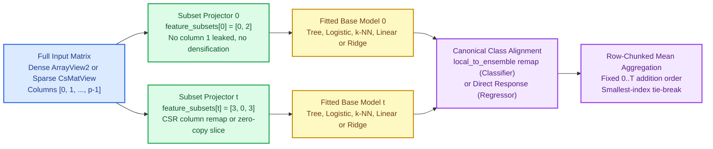
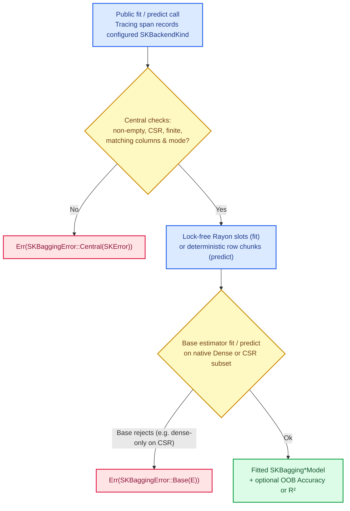

# Generic bagging: composing any learner over bootstrap rows, routed subspaces and honest out-of-bag scores

Random forests ([Chapter 40](./ch40-random-forest.html)) showed how averaging many decision trees
tames high variance. Yet variance is not exclusively a tree problem. A nearest-neighbour classifier
with a small $k$, an unregularized logistic regression on noisy features, or a polynomial-expanded
linear model can also wobble noticeably when a few training rows move. Leo Breiman's **Bootstrap
Aggregating (bagging)**, Tin Kam Ho's **Random Subspaces** and Gilles Louppe and Pierre Geurts's
**Random Patches** generalize the ensemble recipe beyond trees: take *any* supervised estimator, fit
independent copies on resampled subsets of rows and columns, route each copy's inputs strictly
through the columns it saw at training time, and average their predictions.

This chapter introduces `SKBaggingClassifier<B>` and `SKBaggingRegressor<B>` in
`crates/sciencekit_ensemble/src/bagging/`, implementing the `bagging-ensembles` specification as the
library's first generic meta-estimators over an arbitrary base estimator configuration `B`.

---

## 1. The problem, in plain words

Suppose you already have a working learning algorithm — a CART tree, a logistic classifier, a $k$-NN
model or a Ridge regressor — and you want to reduce the variance of its predictions without rewriting
a single line of that algorithm. Bagging wraps that learner in a four-step loop:

1. **Draw $T$ resampled training tables.** Estimator $t \in \{0, \dots, T-1\}$ draws $m$ row indices
   from the $n$ training rows (with replacement when `bootstrap` is `true`, without replacement when
   `false`) and $d$ feature indices from the $p$ columns (without replacement by default, or with
   replacement when `bootstrap_features` is `true`).
2. **Fit one copy per table in parallel.** Every base estimator sees only its $(m \times d)$
   sub-table in the caller's native representation — a dense `ArrayView2` or a borrowed compressed
   sparse row (`CsMatView`) matrix, never densified.
3. **Remember each estimator's column map.** If estimator $t$ trained on original columns $[0, 2]$
   out of $[0, 1, 2]$, column $0$ inside estimator $t$ means original column $0$ and column $1$
   inside estimator $t$ means original column $2$. Passing the full three-column matrix at
   prediction time would either crash with a shape error or feed the wrong numbers into the wrong
   weights.
4. **Aggregate predictions deterministically.** For classification over $C$ canonical classes, the
   ensemble averages the aligned probability vectors and picks the largest class (breaking ties
   toward the smallest canonical index):

$$
\bar{p}_c(x) = \frac{1}{T} \sum_{t=0}^{T-1} \hat{p}_c^{(t)}\!\left(x_{\mathcal{F}_t}\right),
\qquad
\hat{y}(x) = \arg\max_{c \in \{0, \dots, C-1\}} \bar{p}_c(x).
$$

For regression, where estimator $t$ predicts scalar response $\hat{y}^{(t)}\!\left(x_{\mathcal{F}_t}\right)$
on its feature subset $\mathcal{F}_t$, the ensemble predicts the arithmetic mean:

$$
\hat{y}(x) = \frac{1}{T} \sum_{t=0}^{T-1} \hat{y}^{(t)}\!\left(x_{\mathcal{F}_t}\right).
$$

---

## 2. The decisions, and the roads not taken

| Decision | Why we chose it | Alternatives we discarded |
|---|---|---|
| **Two generic structs `SKBaggingClassifier<B>` and `SKBaggingRegressor<B>`, not one runtime trait object** | In Rust, a generic type parameter `B` lets the compiler specialize bagging for the exact base estimator you pass in, keeping zero-copy generic `fit` inputs and catching supervision mismatches (such as passing a regressor to `SKBaggingClassifier`) *before the program can even compile*. | A single `SKBagging` holding `Box<dyn SKEstimator>` — `SKSupervisedFit::fit` is generic over zero-copy input types, which prevents dynamic trait-object dispatch and hides wrong-axis mistakes until runtime. |
| **Reuse existing `SKSupervisedFit`, `SKClassifierPredictor` and `SKRegressorPredictor` directly** | Every supervised estimator in `sciencekit` already implements those contracts ([Chapter 2](./ch02-common-core-contracts.html)). Requiring no new `SKEstimator` supertrait means `SKDecisionTreeClassifier`, `SKLogisticRegression`, `SKKNeighborsClassifier`, `SKLinearRegression` and `SKRidge` work inside bagging immediately without touching their crates. | Inventing a monolithic `SKEstimator` supertrait — pure boilerplate across every algorithm crate with zero extra expressive power. |
| **Preserve base errors via `SKBaggingError<E>` (`Central` vs `Base`) and `SKBaseEstimatorError<E>`** | A base estimator may have its own rich error type `E` (for example a dense-only rejection). Wrapping central checks in `SKBaggingError::Central(SKError)` and base failures in `SKBaggingError::Base(E)` keeps both structured. In Rust, implementing both `From<SKError>` and a blanket `From<E>` on the same enum would collide when `E = SKError`, so `SKBaseEstimatorError<E>` and `SKBaggingError::from_base` disambiguate `Base`, while `From<SKBaggingError<SKError>> for SKError` plugs bagging straight into central scorers and pipelines. | Flattening every base error into a string or forcing `B::Error = SKError` — loses algorithm-specific diagnostics on custom estimators. |
| **Independent SplitMix64 streams for row draws and feature draws** | Estimator $t$ derives `sk_tree_seed(global_seed, t)` and branches into stage `0` for row indices (reusing `bootstrap::sk_sample_indices`) and stage `1` for feature indices. Toggling `bootstrap_features` never perturbs row draws, and slot $t$ is identical on 1 thread or 64 threads. | Advancing one shared RNG sequentially across rows then features across all estimators — thread scheduling or changing `maximum_samples` would scramble every downstream subset. |
| **Strict feature-subset routing at both inference and OOB scoring, including duplicate CSR columns** | Each fitted slot stores `feature_subsets[t]: Vec<usize>`. Inference and OOB scoring slice or project *only* those columns before calling the base model. For sparse CSR inputs, a sorted `(source_column, local_column)` lookup projects non-zeros in $O(\text{nnz} \log d)$ without ever materializing zeros, even when `bootstrap_features(true)` draws duplicate columns such as `[3, 0, 3]`. | Passing the full matrix and hoping the base model ignores unused columns, or calling `.to_dense()` to slice columns — leaks data, breaks dimension checks, and blows up sparse memory. |
| **Single-class bootstrap resilience with a 2-row representation probe** | On tiny datasets (say 4 rows), a bootstrap draw has a high chance of landing in one class. Classifiers like CART or logistic regression reject single-class targets, whereas a dense-only classifier rejects sparse storage. When a 1-class draw fails, bagging probes the base estimator on a 2-row mixed-class slice in the same representation: if the probe also fails, the genuine `SKBaggingError::Base` surfaces; if it succeeds, the slot becomes a `ConstantClass` leaf predicting probability $1.0$ for that class. | Failing whenever a small bootstrap sample hits one class, or blindly swallowing all errors on 1-class draws (which would mask `UnsupportedRepresentation` on dense-only estimators). |

---

## 3. The concepts, taught from zero

### Compile-time composition without Rust jargon

If you have never used Rust, think of `SKBaggingClassifier<B>` as a **typed recipe frame** with one
blank slot `B` for the base learner. When you write:

```rust
let base = SKLogisticRegression::<f64>::build().build()?;
let ensemble = SKBaggingClassifier::build(base)
    .number_of_estimators(25)
    .oob_score(true)
    .build()?;
```

the compiler fills `B` with `SKLogisticRegression<f64>` and checks two rules at compile time:

1. Can `B` fit supervised features and targets (`SKSupervisedFit<F>`)?
2. Does the fitted model `B::Model` know how to predict class probabilities and labels
   (`SKClassifierPredictor<F>`)?

If someone accidentally hands `SKDecisionTreeRegressor` (which predicts continuous numbers, not class
probabilities) to `SKBaggingClassifier` and calls `fit`, the program is rejected by the compiler
before it can run. No runtime type tags and no virtual-call overhead are needed.

### Why feature-subset routing is the main correctness trap

Imagine a dataset with three columns: column $0$ (temperature), column $1$ (sensor ID) and column
$2$ (pressure). Suppose estimator $0$ draws the two-feature subset $\mathcal{F}_0 = [0, 2]$. Inside
estimator $0$, its world has **two** columns: local column $0$ is temperature and local column $1$
is pressure.

At prediction time, a new batch arrives with all three columns $[0, 1, 2]$. If bagging passed that
batch straight through, estimator $0$ would reject the 3-column shape; worse, if someone truncated to
the first two columns $[0, 1]$, estimator $0$ would multiply its pressure weight by the sensor ID!
Instead, `predict/classifier_routing.rs` and `predict/regressor_routing.rs` project every chunk
through `feature_subsets[t]` before estimator $t$ ever sees it, and when `feature_subsets[t]` is the
full identity $[0, 1, \dots, p-1]$, they pass a zero-copy borrowed view directly.



### Bit-for-bit thread-count invariance during prediction

Floating-point addition is not associative: $(a + b) + c$ can differ in the last bit from
$a + (b + c)$. If parallel threads summed estimator predictions in completion order, 4 threads could
disagree with 1 thread in the last ULPs. Bagging avoids that by parallelizing across **disjoint
contiguous row chunks** (`sk_map_row_chunks`), while inside every chunk the loop over estimators
always accumulates in strict slot order $t = 0, 1, \dots, T-1$:



---

## 4. Each public object, explained

- **`SKBaggingClassifier<B>` / `SKBaggingClassifierBuilder<B>`** and
  **`SKBaggingRegressor<B>` / `SKBaggingRegressorBuilder<B>`** — builder-only meta-estimators opened
  with `SKBaggingClassifier::build(base_estimator)` / `SKBaggingRegressor::build(base_estimator)`
  and finalized via `SKBuilder::build`. Setters expose `base_estimator`, `number_of_estimators`
  (default `10`), `maximum_samples` (`SKMaximumSamples::All` default, `Count`, `Fraction`),
  `maximum_features` (`SKMaximumFeatures::All` default, `Count`, `Fraction`, `Sqrt`, `Log2`),
  `bootstrap` (default `true`), `bootstrap_features` (default `false`), `oob_score` (default
  `false`), `random_seed` (default `0`), `backend` (default `SKBackendKind::Faer`) and
  `execution_mode` (default `SKExecutionMode::Automatic`).
- **`SKBaggingClassifierModel<F, M>`** — immutable `Send + Sync` fitted classification ensemble
  implementing `SKClassifierPredictor<F>` (`predict_labels`, `predict_probabilities`), `probabilities`,
  `number_of_estimators`, `feature_count`, `feature_subsets`, `estimator_features`, `estimator`,
  `classes`, `number_of_classes`, `oob_score`, `oob_scored_rows`, `out_of_bag_rows`, `bootstrap`,
  `bootstrap_features`, `backend`, `execution_intent`, and `SKExportable<F>` whenever
  `M: SKExportable<F>`.
- **`SKBaggingRegressorModel<F, M>`** — immutable `Send + Sync` fitted regression ensemble
  implementing `SKRegressorPredictor<F>` (`predict`), `predict_values`, `number_of_estimators`,
  `feature_count`, `estimators`, `estimator`, `feature_subsets`, `estimator_features`, `oob_score`,
  `oob_scored_rows`, `out_of_bag_rows`, `bootstrap`, `bootstrap_features`, `backend`,
  `execution_intent`, and `SKExportable<F>` whenever `M: SKExportable<F>`.
- **`SKBaggingError<E>` and `SKBaseEstimatorError<E>`** — two-variant error enum (`Central(SKError)`
  and `Base(E)`) with `from_base`, `is_central`, `is_base`, `as_central`, `as_base`, `From<SKError>`,
  `From<SKBaseEstimatorError<E>>` and `From<SKBaggingError<SKError>> for SKError`.

---

## 5. A real walk-through, using the tests

Every claim in this chapter is pinned by an executable companion test in
`crates/sciencekit_ensemble/src/bagging/`:

### `central_sk_error_converts_into_central_variant` and `base_error_converts_into_base_variant_preserving_detail`

Located in `bagging/bagging_error_tests.rs`, these verify that central `SKError` values convert into
`SKBaggingError::Central`, custom base errors convert into `SKBaggingError::Base` via
`SKBaseEstimatorError` and `SKBaggingError::from_base` with full `Display` and `Error::source`
fidelity, and `SKBaggingError<SKError>` unwraps back into `SKError` for central scorers.

### `classifier_and_regressor_builders_match_documented_defaults` and `oob_score_without_bootstrap_is_rejected_at_build`

Located in `bagging/bagging_builder_tests.rs`, these build both estimators without calling any
setter to verify every default (`10` estimators, `All` samples and features, `bootstrap = true`,
`bootstrap_features = false`, `oob_score = false`, seed `0`, `Faer`, `Automatic`), then verify that
`number_of_estimators(0)`, invalid sample/feature counts or fractions (`0.0`, `-0.2`, `1.25`, `NaN`),
and `bootstrap(false)` paired with `oob_score(true)` fail with `SKError::InvalidHyperparameter`
naming the exact field.

### `classifier_base_configurations_satisfy_bagging_classifier_contract` and `mismatched_supervision_axis_is_rejected_by_the_type_system`

Located in `bagging/bagging_bounds_tests.rs` (paired with `compile_fail` doctests on
`SKBaggingClassifier` and `SKBaggingRegressor`), these prove at compile time that tree, logistic and
$k$-NN classifiers satisfy `SKBaggingClassifier`, tree, OLS, Ridge and $k$-NN regressors satisfy
`SKBaggingRegressor`, and crossing the supervision axis does not implement `SKSupervisedFit`.

### `dense_and_sparse_submatrix_gathers_agree_including_duplicate_feature_draws`

Located in `bagging/bagging_sampling_tests.rs`, this gathers rows `[2, 0, 3]` and duplicate
out-of-order columns `[3, 0, 3]` from both a dense `Array2` and a CSR `CsMat`, proving the resulting
CSR submatrix stays valid and equals the dense gather without densifying.

### `parallel_fit_matches_sequential_fit_and_repeated_fits_are_deterministic` and `regressor_fit_is_invariant_across_rayon_thread_counts_and_non_tree_bases`

Located in `bagging/bagging_fit_tests.rs`, these verify that `InProcessSynchronous` and `Automatic`
produce identical `feature_subsets()` and identical per-slot tree structures, and that installing
1-thread vs 4-thread `rayon` pools leaves every fitted estimator unchanged.

### `estimator_fitted_on_columns_zero_and_two_receives_only_those_columns` and `routed_single_estimator_matches_manually_subsetted_linear_regression`

Located in `bagging/bagging_routing_tests.rs`, the first injects a sentinel `999_999.0` into column
`1` of a 3-column dense and sparse query matrix and uses a `ColumnSpyRegressor` to prove an
estimator fitted on subset `[0, 2]` receives a 2-column matrix containing *only* columns `0` and `2`:

```rust
assert_eq!(bagging_model.estimator_features(0), Some(&[0usize, 2][..]));
// Query row 0 is [10.0, 999_999.0, 30.0]; the base model only sees [10.0, 30.0].
assert_eq!(routed_predictions, Array1::from_vec(vec![40.0, 100.0]));
```

The second compares a 1-estimator bagging wrapper around `SKLinearRegression` against a standalone
`SKLinearRegression` manually fitted and queried on `select(Axis(1), &[0, 2])`, confirming agreement
to $10^{-10}$.

### `hand_computed_two_estimator_classifier_averages_probabilities`, `equal_average_probabilities_break_ties_toward_smallest_canonical_index` and `three_estimator_regressor_predicts_exact_arithmetic_mean`

Located in `bagging/bagging_classifier_tests.rs` and `bagging/bagging_regressor_tests.rs`, these
verify the exact aggregation formulas: class-0 probabilities `0.2` and `0.6` average to `0.4`; an
exact `0.5` / `0.5` tie over `["beta", "alpha"]` picks canonical index `0` (`"beta"`); and three
base regressors predicting `1.0`, `2.0` and `6.0` average to `3.0`. A companion `tracing_subscriber`
test confirms `SKBackendKind::MatrixMultiply` is recorded on the model's `predict` span.

### `classifier_oob_accuracy_excludes_in_bag_rows_on_memorization_trap` and `regressor_oob_r2_matches_manual_routed_recomputation`

Located in `bagging/bagging_oob_tests.rs`, the first shows full trees memorizing unique row IDs
(`> 0.90` in-bag accuracy) while `oob_score()` drops below `0.45` because in-bag estimators are
excluded. The second fits `SKBaggingRegressor<SKLinearRegression>` with 2-column subspaces, manually
recomputes OOB predictions over `out_of_bag_rows(t)` and `estimator_features(t)`, and matches
`oob_score()` to $10^{-12}$, alongside `disabled_and_no_scored_rows_oob_report_unsupported_operation`.

### `sparse_capable_base_receives_csr_without_densifying_and_matches_dense` and `dense_only_base_estimators_surface_error_through_sk_bagging_error_base`

Located in `bagging/bagging_representation_tests.rs`, these confirm a spy regressor observes `"csr"`
at both fit and predict, verify all four dense/CSR fit-predict combinations plus a $64 \times 100\,000$
CSR matrix, and verify that dense-only bases (`CustomDenseOnlyClassifier`, `SKLinearRegression`, and
`SKKNeighborsClassifier` configured with `KdTree`) surface their rejections through
`SKBaggingError::Base`.

### `non_finite_values_target_errors_and_out_of_range_probabilities_are_rejected`, `shared_classifier_and_regressor_models_serve_eight_threads_identically` and `acceptance_tests`

Located in `bagging/bagging_validation_tests.rs`, `bagging/bagging_concurrency_tests.rs` and
`bagging/acceptance_tests/`, these check `EmptyInput`, `ShapeMismatch`, `NonFiniteValue`,
`ProbabilityOutOfRange` and `ExecutionModeIncompatible`, share `Arc`-wrapped models across 8 OS
threads, export `SKBaggingRegressor<SKLinearRegression>` via `SKExportable::export_state`, and
validate $12\,000$-row dense and CSR ensembles (`SKDecisionTreeClassifier`, `SKDecisionTreeRegressor`,
`SKRidge`) with `sciencekit_metrics` accuracy, macro-$F_1$, MSE, MAE and $R^2$.

---

## 6. Look inside

| Path | Responsibility |
|---|---|
| `bagging/mod.rs` | Pure dispatcher and public re-exports |
| `bagging/error.rs` | `SKBaggingError<E>`, `SKBaseEstimatorError<E>` and `SKError` conversions |
| `bagging/config.rs` | Shared defaults and hyperparameter validation |
| `bagging/builder/` | `SKBaggingClassifierBuilder<B>` and `SKBaggingRegressorBuilder<B>` |
| `bagging/classifier.rs`, `regressor.rs` | Estimator configurations, `SKSupervisedFit` bounds and `compile_fail` doctests |
| `bagging/sampling.rs` | Seeded row/feature draws and non-densifying dense/CSR submatrix projections |
| `bagging/fit/` | Lock-free `rayon` slot execution, 1-class bootstrap probe and model assembly |
| `bagging/predict/` | Feature-subset routing, canonical class alignment and row-chunked aggregation |
| `bagging/oob.rs` | Out-of-bag accuracy and $R^2$ over excluded bootstrap rows |
| `bagging/export.rs` | `SKExportable<F>` state emission over exportable base models |
| `bagging/validation.rs` | Dimension, CSR, finiteness and target canonicalization checks |
| `bagging/*_tests.rs`, `bagging/acceptance_tests/` | Companion TDD suites and tiny + $12\,000$-row acceptance tests |

---

## 7. What this unlocks

Every supervised classifier and regressor in `sciencekit` now gains variance reduction, Random
Subspaces, Random Patches and out-of-bag validation without writing ensemble-specific glue, and the
same generic estimator contracts are proven composable end-to-end with scorers, pipelines and model
selection.
