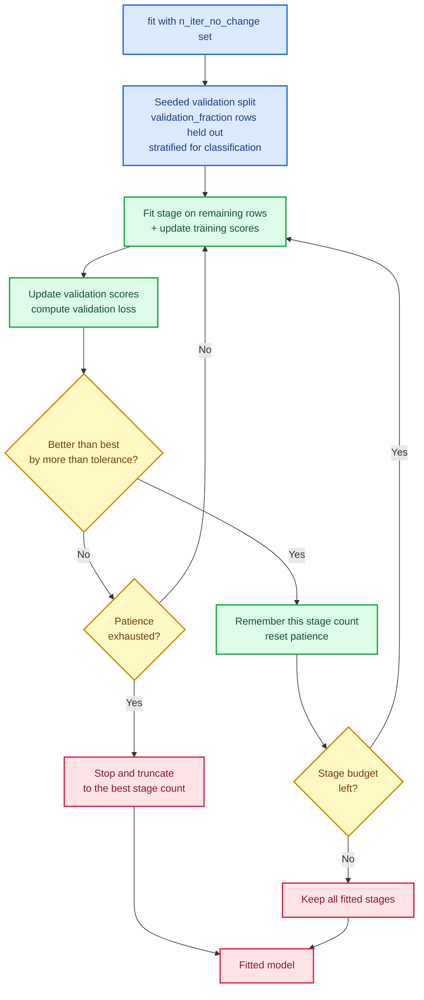

# Gradient boosting: fitting trees to residuals, one shrinking step at a time

Random forests ([Chapter 40](./ch40-random-forest.html)) and bagging
([Chapter 46](./ch46-bagging.html)) attack error by **averaging many independent learners**. They
reduce variance, but every member of the ensemble is trained against the same raw target and none
of them is told what the previous ones got wrong. With a fixed budget of shallow trees that is a
real limitation: if ten trees are not enough to bend the prediction along a curved boundary, adding
an eleventh identical-looking tree only smooths the average.

**Gradient boosting**, introduced by Jerome Friedman in 2001, takes the opposite road. It builds the
ensemble **sequentially**, and each new tree is fitted not to the target but to the *residual* — the
part of the target that the current ensemble still fails to explain. Every stage is a small, shallow
correction, and a shrinkage factor keeps each correction deliberately timid so that many stages can
accumulate into a precise model without overfitting.

This chapter introduces `SKGradientBoostingClassifier<F>` and `SKGradientBoostingRegressor<F>` in
`crates/sciencekit_ensemble/src/gradient_boosting/`, built on the reusable boosting substrate in
`crates/sciencekit_ensemble/src/boosting/`, implementing the `gradient-boosting` specification.

---

## 1. The problem, in plain words

Imagine you have to predict a continuous quantity — say a house price — with a family of very
simple trees. A single depth-1 tree (a "stump") can only split the world in two and predict one
constant on each side. It will be wrong almost everywhere. What do you do with the mistake?

The boosting answer is a loop:

1. **Predict with what you have.** Start with the single best constant prediction the loss allows —
   for squared error, the target mean.
2. **Measure the mistake.** For every training row, compute the *negative gradient* of the loss with
   respect to the current prediction. For squared error this is simply `target - prediction`, the
   residual. For log-loss it is `target - sigmoid(score)`. For absolute error it is the sign of the
   residual.
3. **Fit a small tree to the mistake.** Grow a shallow regression tree whose target is that negative
   gradient. In code, `crates/sciencekit_tree/src/structure/` exposes a structure-only build that
   grows the split geometry on the pseudo-residuals without computing criterion-driven leaf values.
4. **Overwrite the leaf values with a Newton step.** Each leaf receives $-\sum g / (\sum h + \lambda)$, built from
   the first derivative $g$ and second derivative $h$ of the *real* loss over the rows that fell in
   that leaf. This is what makes the update correct for losses other than squared error.
5. **Take a small step.** Multiply the tree's output by the learning rate $\nu$ (called shrinkage) and
   add it to the running raw score. Repeat.

After $T$ stages the regressor predicts

$$
\hat{y}(x) = f_0 + \nu \sum_{t=1}^{T} h_t(x),
$$

where $f_0$ is the initial constant and $h_t$ is the tree fitted at stage $t$. Classification reuses
the same loop in *raw-score space*: a binary model accumulates one score per row and turns it into a
probability with a sigmoid, while a multiclass model accumulates one score *per class* and grows one
tree per class per stage, turning the score vector into probabilities with a softmax.

```mermaid
flowchart LR
    accTitle: The sequential gradient-boosting loop, from an initial constant to a shrunk ensemble
    accDescr: A target table and the current raw scores produce per-row negative gradients and Hessians. A shallow structure is grown on the negative gradients, its leaves are replaced by Newton steps, and the tree is scaled by the learning rate before being added to the raw scores. The loop repeats for a fixed number of stages or until held-out validation loss stops improving.
    Data["Training table X<br/>dense or CSR, never densified"] --> Init["Initial constant f0<br/>mean, log-odds or log-priors"]
    Init --> Scores["Current raw scores f(x)<br/>one per row, or one per row and class"]
    Scores --> Grad["Loss derivatives<br/>-g = -dL/df and h = d2L/df2"]
    Grad --> Grow["Structure-only tree growth<br/>on the negative gradients"]
    Grow --> Newton["Leaf replacement<br/>value = sum(-g) / (sum(h) + lambda)"]
    Newton --> Shrink["Multiply by learning rate nu"]
    Shrink --> ScoreUpdate["Add nu * h_t(x) to the raw scores"]
    ScoreUpdate --> Check{"Enough stages,<br/>or validation<br/>stopped improving?"}
    Check -- "No, keep boosting" --> Scores
    Check -- "Yes" --> Model["Fitted model<br/>f0 + nu * sum of stage trees"]

    classDef data fill:#dbeafe,stroke:#2563eb,stroke-width:2px,color:#1e3a8a
    classDef math fill:#fef9c3,stroke:#ca8a04,stroke-width:2px,color:#713f12
    classDef tree fill:#dcfce7,stroke:#16a34a,stroke-width:2px,color:#14532d
    classDef score fill:#f3e8ff,stroke:#9333ea,stroke-width:2px,color:#581c87
    classDef done fill:#ffe4e6,stroke:#e11d48,stroke-width:2px,color:#881337

    class Data,Init data
    class Grad,Shrink math
    class Grow,Newton tree
    class Scores,ScoreUpdate score
    class Check,Model done
```

---

## 2. The decisions, and the roads not taken

| Decision | Why we chose it | Alternatives we discarded |
|---|---|---|
| **One loss-agnostic stage loop shared by regression, binary and multiclass** | Every loss only has to answer five questions: its initial prediction, its negative gradient, its Hessian, its link and its loss value (`SKGradientLoss<F>` in `boosting/loss/contract.rs`). The loop, the shrinkage and the early-stopping bookkeeping are written once, so a future histogram booster can reuse them untouched. | One bespoke loop per loss — triplicated subsampling, early stopping and multiclass handling, and three places to drift apart. |
| **Grow the split structure on the negative gradient, then replace the leaves** | The tree crate's split criterion is a fast variance-reduction search, which is exactly the right *shape* heuristic for pseudo-residuals. But the *value* each leaf should output is loss-specific. Splitting the two concerns lets one structure builder serve squared error, log-loss and Huber while `SKTreeStructure::replace_leaf_values` writes the Newton step afterwards. | Teaching the split criterion every loss, or re-implementing tree growth inside `sciencekit_ensemble`. |
| **Newton leaves $-\sum g / (\sum h + \lambda)$ instead of leaf means** | For squared error the two coincide exactly, but for log-loss a leaf mean of the residuals would ignore the curvature $p(1-p)$ and overshoot badly on confident rows. The second derivative also gives `l2_regularization` a mathematically honest home: it damps the step, it is not a penalty on the split search. | Plain residual means (Friedman's original "least squares" tree) — simpler, but wrong for every loss whose curvature varies. |
| **A documented positive Hessian surrogate for `AbsoluteError` and `Huber`** | $\lvert y - f \rvert$ is not twice differentiable: its second derivative is zero almost everywhere and undefined at zero. Using a constant Hessian of `1` makes the leaf step a damped median-like update that stays finite and behaves well in practice, and the choice is written down rather than hidden. | Dividing by a zero Hessian, or silently substituting the squared-error loss for the robust ones. |
| **Multiclass via one tree per class per stage with a diagonal Hessian** | This is the standard gradient-boosting compromise: the true softmax Hessian is a full $C \times C$ matrix, and fitting one tree to a full-matrix direction would require a matrix-valued tree. The diagonal $p_c(1 - p_c)$ keeps the update per-class and keeps the model surface simple. | Multivariate trees with vector leaves — far more machinery for a small accuracy gain. |
| **Shrinkage $\nu$ as an explicit builder parameter, default $0.1$** | A small step is the single most effective regularizer of boosting: it lets many weak stages combine and makes the model far less sensitive to the number of stages. Exposing it (instead of hard-coding `1.0`) makes the trade-off between stages and step size a documented contract. | Always taking the full Newton step and compensating with a tiny `number_of_estimators`. |
| **Seeded without-replacement row subsampling per stage** | Stochastic gradient boosting (`subsample < 1`) de-correlates consecutive stages and shortens each fit. Drawing without replacement avoids duplicate rows, and deriving the seed from `(global_seed, stage, class)` keeps every stage reproducible and thread-count invariant. | Sampling with replacement (duplicates distort the Hessian sums) or using one global RNG advanced in fit order (thread scheduling would change the draw). |
| **Early stopping by truncating back to the best validation stage** | The monitor keeps the *stage count* that achieved the lowest held-out loss and truncates the ensemble to it, so the returned model is the best one seen, not merely the last one before patience ran out. Classification splits are stratified so a rare class is not wiped out of the validation fold. | Returning the last stage, or a separate "early-stopped" model family. |
| **No histogram binning, categorical routing, missing-value handling, streaming, memmap or export in this change** | Each of those is a substantial subsystem with its own spec. Shipping a correct exact-split booster first gives the later histogram change a validated reference to measure against, instead of debugging binning and gradients at the same time. | Bundling everything — a change too large to review and too easy to get subtly wrong. |

The last decision is deliberate and recorded in `design.md`; the deferred items are listed again in
[Section 7](#7-what-this-unlocks) and in the change's task list.

---

## 3. The concepts, taught from zero

### Residuals, gradients and why boosting is called "gradient" boosting

If you have never seen calculus applied to machine learning, read the negative gradient as **"the
direction in which the prediction should move to make the loss smaller"**. For a single row with
target $y$ and prediction $f$:

- Squared error $L = \tfrac12 (y - f)^2$ has derivative $\partial L / \partial f = f - y$, so the
  negative gradient is $y - f$ — the ordinary residual.
- Log-loss for a positive row, $L = \log(1 + e^{-f})$, has negative gradient $1 - \sigma(f)$, which
  is large when the model is confidently wrong and nearly zero when it is confidently right.
- Absolute error $L = |y - f|$ has negative gradient $\operatorname{sign}(y - f)$: a constant push
  whose size does not grow with the mistake.

Boosting fits one tree per stage to that per-row direction. When the loss is squared error the tree
is literally fitting the residuals, which is why the technique is often explained as "fit trees to
the residuals". For other losses the "residual" is the negative gradient, hence the general name.

### Newton leaves, in pictures

A leaf may contain, say, ten rows. The split search decided they belong together, but what number
should the leaf output? A gradient step would move by $-g$ scaled by some rate; a **Newton** step uses
the curvature to jump straight to the minimum of a local quadratic model:

$$
\text{leaf value} = \frac{\sum_{i \in \text{leaf}} (-g_i)}{\sum_{i \in \text{leaf}} h_i + \lambda}.
$$

`boosting/init.rs` implements this twice: `sk_newton_leaf_value` from the raw gradients and
`sk_newton_leaf_value_from_negative_gradients` from the already-negated ones the stage loop produces.
Both guard the degenerate case: a leaf whose Hessian sum is zero or negative keeps the value `0.0` so
a pathological row can never produce an infinite update. $\lambda$ (`l2_regularization`) is added to the
denominator, which shrinks every leaf — a leaf backed by little curvature information moves less.

For the hand-computed binary fixture in `gb_classifier_tests.rs`, four balanced rows start at raw
score $0.0$. Each row has Hessian $p(1-p) = 0.25$ and negative gradients $-0.5$ (class 0) and $+0.5$
(class 1). A depth-1 split puts two class-0 rows on one side and two class-1 rows on the other:
$(-1.0) / 0.5 = -2.0$ and $(+1.0) / 0.5 = +2.0$. With `learning_rate(0.25)` the raw scores become
$\mp 0.5$, and the positive-class probabilities become $\sigma(\mp 0.5)$ — exactly what the test asserts.

### The learning rate is not a formality

With $\nu = 1.0$ each stage fully commits to the current Newton step; consecutive trees then chase
each other and the ensemble overfits within a handful of stages. With $\nu = 0.1$ the same correction
is spread over roughly ten stages, and each stage gets to see a slightly different residual field.
This is why the library defaults to $0.1$ and why the acceptance tests pair a small $\nu$ with a
larger `number_of_estimators` instead of a single big step.

### Initial predictions: where the additive model starts

A boosted model is $f_0 + \nu \sum h_t$. The constant matters because it is the loss-optimal prediction
before any tree exists:

| Estimator | `initial_prediction` | Source |
|---|---|---|
| `SquaredError`, `AbsoluteError`, `Huber` | arithmetic mean of the targets | `boosting/loss/{squared,absolute,huber}.rs` |
| Binary `LogLoss` | log-odds of the positive prior, `link(mean(0/1 targets))` | `boosting/loss/log_loss.rs` |
| Multiclass `LogLoss` | one log-prior per canonical class | `SKMulticlassLogLoss::initial_predictions` |

Binary targets are the canonical class indices mapped to `0.0`/`1.0`, so "positive" means
**canonical class 1**, not "the larger integer label". The fitted model stores the initial value(s)
and adds them before the stage trees during prediction.

### Canonical classes and the label-index contract

Targets are canonicalized through `sk_canonicalize_targets`: integers are stringified and nominal
strings are taken as-is, then each new label is assigned the next free index **in order of first
appearance** — not in sorted order. The `SKLabelTable` remembers the mapping, so
`model.classes().label_of(index)` recovers the original label. `SKClassifierPredictor::predict_labels`
returns those **canonical indices** (its trait documentation says so); callers that need the raw
label must map through `classes()`. This is precisely the nuance the 20 000-row acceptance test
exercises: it canonicalizes the truth labels with `sk_canonicalize_labels` before comparing, because
comparing canonical indices against raw integers would be wrong whenever the first class to appear is
not the smallest one.

### Stochastic subsampling and deterministic seeds

When `subsample < 1`, each stage draws
`clamp(floor(subsample · n), 1, n)` distinct training rows. The seed is derived in two steps
(`boosting/stage.rs::sk_stage_tree_seed`): from the global seed and the stage index, then from that
stage seed and the class index. The row draw adds a third derivation (`SK_RANDOM_DOMAIN_INITIALIZATION`)
and the tree split search uses the stage seed itself. Consequences worth stating out loud:

- Changing `subsample` changes the row draws, but changing `maximum_features` never does, because
  the feature draw lives in the tree's own constraint seed.
- Any stage's draw depends only on `(global_seed, stage_index, class_index)`, so it is identical on
  one thread or sixty-four.
- A sparse subset is *gathered* into a new CSR matrix (`sk_gather_sparse_rows`); the full matrix is
  never densified.

With `subsample >= 1` the full row range is used in order and no randomness is consumed at all.

### Early stopping that keeps the best stage

`n_iter_no_change(patience)` first holds out `validation_fraction` rows with a seeded draw — stratified
for classification so every class is represented — fits on the rest, and after every stage computes
the validation loss (mean scalar loss, or mean per-row multiclass cross-entropy). The monitor
(`boosting/early_stopping.rs`) declares an improvement only when the new loss beats the best by more
than `tolerance` (default `1e-4`). When patience non-improving stages have elapsed, the loop stops
and the stage vector is **truncated to the best stage count**. The returned model is therefore never
worse on the validation split than any shorter prefix of the run.

### Representation parity and concurrency

`SKDataView` already abstracts dense `ArrayView2` and borrowed CSR `CsMatView`
([Chapter 2](./ch02-common-core-contracts.html)). Boosting dispatches exactly once per operation:
fit validates dimensions and finiteness, then either hands the full view to the tree builder or
gathers a CSR row subset; prediction maps rows through `sk_map_prediction_rows`, which parallelizes
across rows with a deterministic grain while every single row accumulates its trees in strict stage
order. That fixed addition order is what makes predictions bit-identical on one thread and on many.
CSC input is rejected up front with a `to_csr` suggestion rather than silently transposed.

---

## 4. Each public object, explained

- **`SKGradientBoostingClassifier<F>` / `SKGradientBoostingClassifierBuilder<F>`** — builder-only
  binary/multiclass classifier, opened with `SKGradientBoostingClassifier::build()` and finalized by
  `SKBuilder::build`. Setters: `number_of_estimators` (default `100`), `learning_rate` (`0.1`),
  `loss` (`SKGradientBoostingClassificationLoss::LogLoss`, the only variant today), `maximum_depth`
  (`3`), `minimum_samples_leaf` (`1`), `maximum_features` (`SKMaximumFeatures::All`), `subsample`
  (`1.0`), `l2_regularization` (`0.0`), `random_seed` (`0`), `validation_fraction` (`0.1`),
  `n_iter_no_change` (off; `without_early_stopping` clears it), `tolerance` (`1e-4`), `backend`
  (`SKBackendKind::Faer`) and `execution_mode` (`SKExecutionMode::Automatic`). The estimator exposes
  matching getters plus `resolve_plan`.
- **`SKGradientBoostingClassifierModel<F>`** — immutable fitted classifier implementing
  `SKClassifierPredictor<F>` (`predict_labels`, `predict_probabilities`) plus `probabilities`,
  `number_of_stages`, `trees_per_stage` (`1` for binary, `C` for multiclass), `stage_trees`,
  `stage_tree`, `initial_predictions`, `initial_prediction` (`Some` only for binary), `learning_rate`,
  `classes`, `number_of_classes`, `feature_count`, `feature_importances`,
  `stage_feature_importances`, `loss`, `backend` and `execution_intent`. It is `Send + Sync`.
- **`SKGradientBoostingRegressor<F>` / `SKGradientBoostingRegressorBuilder<F>`** — the regression
  counterpart, adding `loss` (`SKGradientBoostingRegressionLoss`) and `huber_delta` (default `1.0`).
- **`SKGradientBoostingRegressorModel<F>`** — implements `SKRegressorPredictor<F>` (`predict`) and
  exposes `number_of_stages`, `stage_trees`, `stage_tree`, `initial_prediction`, `learning_rate`,
  `feature_count`, `feature_importances`, `stage_feature_importances`, `loss`, `huber_delta`,
  `backend` and `execution_intent`.
- **`SKGradientBoostingClassificationLoss` / `SKGradientBoostingRegressionLoss`** — the two public
  selectors. Classification has `LogLoss`; regression has `SquaredError` (default), `AbsoluteError`
  and `Huber`.
- **`crates/sciencekit_ensemble/src/boosting/`** — the public substrate:
  `SKGradientLoss<F>` (the loss contract), `SKSquaredErrorLoss`, `SKAbsoluteErrorLoss`,
  `SKHuberLoss` / `SKHuberLossBuilder`, `SKBinaryLogLoss` (with `sigmoid`) and
  `SKMulticlassLogLoss` / `SKMulticlassLogLossBuilder` (with `softmax`, `initial_predictions`,
  `stage_gradients_and_hessians`, `loss_for_row`).
- **`SKTreeStructure`'s advanced surface** in `crates/sciencekit_tree/src/structure/` —
  `build_structure` grows split geometry without criterion-driven leaves, and
  `replace_leaf_values` validates the leaf count and swaps in the Newton steps. The public
  `SKDecisionTreeRegressor` keeps using its own criterion and is unaffected.

The feature importances are *sample-weighted*: each stage tree's normalized importances are
multiplied by the number of rows it was fitted on, summed, and the total is renormalized to `1.0`
when any split occurred (`gradient_boosting/importances.rs`). A model whose trees never split returns
all zeros rather than dividing by zero.

---

## 5. A real walk-through, using the tests

Every claim above is pinned by a companion test. These are the ones worth reading, by name.

### `newton_leaf_value_matches_hand_computed_step_and_degeneracy_guard`

In `boosting/boosting_stage_tests.rs`. It feeds known gradients and Hessians to
`sk_newton_leaf_value`, checks the exact quotient $-\sum g / (\sum h + \lambda)$ including a non-zero $\lambda$, and
checks that a leaf with a zero Hessian sum yields `0.0` instead of an infinite value.

### `single_stage_stump_and_split_apply_newton_leaves_and_shrinkage` and `multiclass_single_stage_fits_one_tree_per_class`

Also in `boosting_stage_tests.rs`. The first grows one depth-0 stump and one depth-1 split, verifying
that leaf values are Newton steps and that the raw scores are updated by $\text{learning\_rate} \times \text{tree}$. The
second verifies the multiclass bookkeeping: one tree per canonical class, each column updated from
its own tree.

### `full_subsample_uses_every_training_row` and `stochastic_row_and_feature_subsampling_are_reproducible_and_diversify`

In `boosting/boosting_subsample_tests.rs`. The first proves that `subsample = 1.0` selects `0..n` in
order and consumes no randomness. The second proves that a stochastic run draws the same rows twice,
draws **different** rows for different stage indices, and that changing `maximum_features` does not
perturb the row draw.

### `seeded_validation_splits_are_deterministic_disjoint_and_stratified`, `monitor_stops_after_patience_and_reports_best_stage_count` and `scalar_binary_and_multiclass_loops_stop_early_and_restore_best_stages`

In `boosting/boosting_early_stop_tests.rs`. Together they cover the whole early-stopping contract:
the same seed yields the same disjoint split, the split keeps every class present, the monitor stops
exactly after `patience` non-improving stages and reports the best stage count, and both the scalar
and multiclass loops truncate the fitted stages back to that count.

### `hand_computed_binary_fit_and_zero_score_sigmoid` and `separable_binary_fixture_and_backend_span_propagation`

In `gradient_boosting/gb_classifier_tests.rs`. The first is the hand calculation described in
Section 3: a depth-0 stump leaves the score at `0.0` and the tie breaks toward canonical class `0`;
a depth-1 stage produces leaves `[-2.0, +2.0]`, shrinks them to `∓0.5`, and the probabilities match
`sigmoid(∓0.5)` to `1e-12`. The second fits separable nominal classes to 100 % accuracy and records
the configured backend on the prediction span.

### `multiclass_fits_one_tree_per_class_per_stage_and_softmax_sums_to_one` and `multiclass_equal_scores_break_ties_toward_smallest_canonical_index`

In `gradient_boosting/gb_classifier_multiclass_tests.rs`. The first fits three nominal classes
(`red`, `green`, `blue`), asserts `trees_per_stage() == 3`, that every stage holds three trees, that
`classes().label_of(..)` preserves first-appearance order, and that every softmax row sums to `1.0`.
The second proves the deterministic tie-break on a depth-0 uniform model.

### `hand_computed_single_stage_updates_for_all_three_regression_losses` and `smooth_response_recovered_under_every_regression_loss`

In `gradient_boosting/gb_regressor_tests.rs`. The first pins all three losses against paper
arithmetic: squared error gives `init = 2.0` and a `0.5` leaf shrunk to `2.05`; absolute error turns
sign gradients `[-1, +1]` into predictions `[4.5, 5.5]`; Huber with `delta = 1.0` clips residuals
`±10` to `±1` and predicts `[9.5, 10.5]`. The second recovers a smooth `sin(x) + 0.5x` response under
all three losses and checks that integer targets promote cleanly.

### `two_stages_with_different_importances_produce_sample_weighted_aggregate` and `classifier_importances_normalize_and_zero_split_boosters_return_zeros`

In `gradient_boosting/gb_importances_tests.rs`. They check the exact weighted aggregation formula and
the normalization and zero-split behaviour of `feature_importances`.

### `classifier_and_regressor_dense_and_sparse_fit_and_predict_are_equivalent` and `ultra_wide_sparse_never_densifies_and_csc_is_rejected`

In `gradient_boosting/gb_representation_tests.rs`. The first compares all four dense/CSR fit and
predict combinations, including feature importances and initial predictions, for multiclass and all
three regression losses under subsampling and early stopping. The second fits a
`128 × 100 000` CSR matrix to prove no densification ever happens, and asserts that a CSC view is
rejected with the `to_csr` suggestion.

### `gradient_boosting_types_are_send_and_sync` and `repeated_fits_and_rayon_thread_counts_produce_identical_models`

In `gradient_boosting/gb_determinism_tests/`. The first is a compile-time assertion over builders,
estimators, models and loss types. The second runs the same fit twice on a one-thread pool and once
on a four-thread pool, then compares stage counts, stage trees, feature importances and predictions
for exact equality.

### `concurrent_prediction_agrees_with_sequential_and_records_regressor_backend`

In `gradient_boosting/gb_determinism_tests/concurrency_tests.rs`. Eight OS threads share one fitted
model, predict concurrently, agree with the sequential result, and the span recorder confirms the
regressor's configured backend is on the prediction span.

### `empty_input_and_shape_mismatches_are_rejected`, `hyperparameter_bounds_and_early_stop_validation_are_enforced` and `single_class_non_finite_values_and_streaming_modes_are_rejected`

In `gradient_boosting/gb_validation_tests.rs`. They cover `EmptyInput` on fit and predict,
`ShapeMismatch` for column and row mismatches, every builder bound (`number_of_estimators >= 1`,
finite positive `learning_rate`, valid `maximum_features`, `subsample ∈ (0, 1]`, non-negative finite
`l2_regularization`, `validation_fraction ∈ (0, 1)`, `n_iter_no_change >= 1`, non-negative
`tolerance`), plus single-class targets, non-finite features and the rejection of
`OutOfCoreStreaming` fit with `ExecutionModeIncompatible`.

### `tiny_gradient_boosting_fits_and_scores_in_f32_and_f64` and the 20 000-row acceptance suites

In `gradient_boosting/acceptance_tests/` (the folder added for task 7.1). The tiny suite fits a sparse
binary classifier in `f64`, a dense multiclass classifier in `f32`, and all three regression losses
in `f32`, scoring accuracy $1.0$ and $R^2 > 0.85$ through `sciencekit_metrics`.
`large_binary_and_multiclass_gradient_boosting_with_metrics` builds a deterministic 20 000 × 5 design,
fits with subsampling, `Sqrt` feature sampling and early stopping, asserts dense and sparse
probabilities are identical, and requires accuracy and macro-$F_1$ above $0.85$ and log-loss below
$0.40$ for binary, plus accuracy and macro-$F_1$ above $0.82$ for multiclass.
`large_regression_gradient_boosting_all_losses_early_stop_and_metrics` runs the same design through
`SquaredError`, `AbsoluteError` and `Huber`, asserts dense/CSR prediction equality, and requires
$\mathrm{MSE} < 0.45$, $\mathrm{MAE} < 0.50$ and $R^2 > 0.85$, then explicitly checks that a `learning_rate(1.0)` run
with patience `3` returns fewer than its `30` allowed stages — early stopping measured on real data.

---

## 6. Look inside

| Path | Responsibility |
|---|---|
| `boosting/mod.rs` | Pure dispatcher and public re-exports of the substrate |
| `boosting/loss/contract.rs` | The `SKGradientLoss<F>` trait and the target-mean helper |
| `boosting/loss/{squared,absolute,huber}.rs` | The three regression losses, their gradients and Hessians |
| `boosting/loss/log_loss.rs` | Binary sigmoid log-loss and multiclass softmax log-loss, including per-class gradients/Hessians and `loss_for_row` |
| `boosting/init.rs` | Initial raw scores and the Newton leaf step with its degeneracy guard |
| `boosting/stage.rs` | Seed derivation, one scalar stage, one multiclass stage, leaf replacement |
| `boosting/subsample.rs` | Seeded without-replacement row draws and non-densifying dense/CSR gathering |
| `boosting/early_stopping.rs` | Validation splits (plain and stratified) and the patience monitor |
| `boosting/scores.rs` | `sk_update_raw_scores`, the additive shrunk update used by fit and validation |
| `boosting/scalar_loop.rs`, `boosting/multiclass_loop.rs` | The stage drivers with optional early stopping and truncation |
| `gradient_boosting/classifier.rs`, `regressor.rs` | Estimator configurations and getters |
| `gradient_boosting/{classifier,regressor}_builder.rs` | The sole construction surfaces and validation |
| `gradient_boosting/config.rs` | Shared defaults, hyperparameter validation and stage-parameter assembly |
| `gradient_boosting/classifier_fit.rs`, `regressor_fit.rs` | Fit orchestration, loss selection, model assembly |
| `gradient_boosting/{classifier,regressor}_model.rs` | Fitted models and their inspection surface |
| `gradient_boosting/classifier_predict.rs`, `regressor_predict.rs` | Sigmoid/softmax prediction over dense and CSR input |
| `gradient_boosting/importances.rs` | Sample-weighted aggregation and normalization |
| `gradient_boosting/validation.rs` | Dimensions, finiteness, streaming rejection, target canonicalization, row-parallel prediction |
| `gradient_boosting/*_tests.rs`, `gradient_boosting/gb_determinism_tests/` | Companion TDD suites |
| `gradient_boosting/acceptance_tests/gb_tiny_tests.rs`, `gb_large_tests.rs` | Tiny and 20 000-row acceptance suites |
| `crates/sciencekit_tree/src/structure/` | `build_structure` and `replace_leaf_values`, the advanced tree surface boosting consumes |

---

## 7. What this unlocks

`sciencekit` now has the second half of the ensemble story: bagging reduces variance by averaging
independent learners, and boosting reduces bias by fitting a sequence of small corrections. The
substrate is intentionally loss-agnostic and representation-agnostic, which is the foundation the
next steps build on:

- **Histogram gradient boosting** can reuse `SKGradientLoss`, the stage loop, subsampling and early
  stopping, replacing only the exact split search with binned feature histograms.
- **Categorical and missing-value routing** can extend the tree structure builder without touching
  the boosting drivers.
- **Streaming and out-of-core fitting**, `memmap` datasets and model export are explicitly deferred
  in this change: fit rejects `OutOfCoreStreaming`, and the fitted models do not yet implement
  `SKExportable`. Those land as their own specs.
- **Quantile and Poisson losses** only need new `SKGradientLoss` implementations plus a public
  selector variant; the loop does not change.

Until then, the exact-split booster is the reference against which faster approximations can be
measured — and every one of the guarantees above is protected by a named test.
