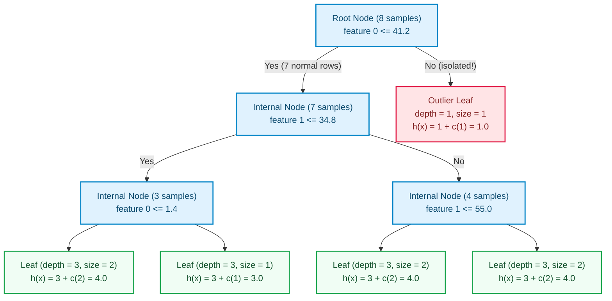

# Outlier detection: random isolation trees, path length and the contamination offset

Most unsupervised algorithms begin by modeling what *normal* looks like — fitting cluster centers,
estimating local point density, or projecting onto principal directions — and only afterward ask
whether a new point sits awkwardly far from that model. Distance and density work well in low
dimensions, yet both degrade rapidly as columns multiply or when anomalies hide in sparse,
mixed-scale tabular records.

**Isolation Forest** flips the question upside down. Instead of measuring how *dense* normal points
are, it measures how *easy* each point is to isolate with purely random axis-aligned cuts. A point
far from the crowd lands alone in a leaf after one or two cuts; a point buried inside a tight
cluster survives cut after cut before finally separating from its neighbors.

This chapter builds the model-side outlier contract (`SKOutlierLabel` and `SKOutlierPredictor<F>`)
in `crates/sciencekit_common/src/fit_traits/outlier.rs` (capability `outlier-prediction`) and
`SKIsolationForest<F>` in the new sub-crate `crates/sciencekit_outlier/` (capability
`isolation-forest`). No prior Rust or numerical-computing background is assumed.

---

## 1. The problem, in plain words

Given a table $X$ with $n$ rows and $p$ numeric features — and **no ground-truth labels** — we want
to assign every row both:

1. a continuous score ranking how anomalous or normal the row looks relative to the training
   population; and
2. a clear binary verdict: **inlier** (normal) or **outlier** (anomalous).

Four traps make naive anomaly detectors fragile in production:

1. **Distance concentration and feature scale.** Euclidean distance treats a column measured in
   millimeters ($0 \dots 1000$) as a thousand times more important than a column measured in meters
   ($0 \dots 1$). Random splits drawn uniformly between each feature's observed minimum and maximum
   are invariant to monotone linear rescaling of individual columns.
2. **Quadratic or density bottlenecks.** Pairwise distances over $n$ rows cost $O(n^2)$ work unless
   spatial trees apply, and spatial trees break down on wide sparse tables. Growing fixed-budget
   isolation trees on subsamples of size $\psi = \min(256, n)$ bounds tree depth at
   $\lceil \log_2 \psi \rceil \le 8$, giving linear $O(T \psi \log \psi)$ fit cost and
   $O(T \log \psi)$ per-row scoring cost.
3. **Magic integer sentinels (`-1` vs `1`).** Classic libraries return raw integers (`-1` for
   outliers, `1` for inliers), letting callers accidentally pass outlier flags into arithmetic or
   confuse `-1` with class index `0`. In Rust, a one-byte enum makes illegal values unrepresentable
   while keeping explicit `-1`/`1` conversion at external FFI or metric boundaries.
4. **Accidental densification.** Expanding a $64 \times 10{,}000$ sparse Compressed Sparse Row
   (CSR) subsample into $640{,}000$ dense floats just to scan column bounds wastes memory and cache
   bandwidth.

---

## 2. The decisions, and the roads not taken

| Decision | Why we chose it | Alternatives we discarded |
|---|---|---|
| **Dedicated `sciencekit_outlier` crate + shared `SKOutlierPredictor<F>` in `sciencekit_common`** | Anomaly detection is its own estimator family alongside classifiers, regressors and clusterers. Placing the trait and one-byte `SKOutlierLabel { Inlier, Outlier }` in `sciencekit_common` lets pipelines, scorers and future detectors (`SKLocalOutlierFactor`, `SKOneClassSVM`) speak one contract, while keeping isolation-tree internals isolated in `sciencekit_outlier`. | Returning raw `Array1<i64>` with `-1`/`1` sentinels (invites silent confusion with zero-based class indices) or stuffing `SKIsolationForest` into `sciencekit_ensemble` (couples unsupervised anomaly scoring to supervised target canonicalization). |
| **Reuse `sciencekit_tree::SKTree` node storage, write a dedicated random splitter** | `SKTree` and `SKTreeNode` already give a cache-friendly flat node vector (`split_feature`, `threshold`, `left_child`, `right_child`, `sample_count`) and zero-allocation traversal (`leaf_and_depth_for`). Isolation splits pick a random varying feature and a uniform threshold in $[\min, \max)$, which has nothing in common with CART impurity minimization. | Reusing CART's impurity splitter (wrong mathematical objective) or inventing a second pointer-chasing heap tree struct (hurts cache locality during ensemble scoring). |
| **Normalized Liu–Ting–Zhou score $s(x, \psi) = 2^{-E[h(x)] / c(\psi)}$ paired with `score_samples = -s` and `decision_function = score_samples - offset`** | Raw tree depth depends on the subsample size $\psi$. Dividing expected path length $E[h(x)]$ by the BST unsuccessful-search constant $c(\psi)$ maps every dataset onto a universal $[0, 1]$ anomaly scale ($s \to 1$ for shallow anomalies, $s < 0.5$ for deep inliers). Exposing `anomaly_scores` ($s \in [0, 1]$), `score_samples` ($-s \in [-1, 0]$, larger = more normal) and `decision_function` (`score_samples - offset`, negative = `Outlier`) satisfies both the original paper and external tool conventions. | Returning unnormalized average edge depth (changes threshold meaning whenever `maximum_samples` or row count changes). |
| **`SKContamination::Auto` (`-0.5` offset) or `SKContamination::Fraction(q)` ($q \in (0, 0.5]$)** | When the user has no prior on anomaly prevalence, `Auto` applies the paper's fixed threshold $s > 0.5 \iff -s - (-0.5) < 0$. When a domain contamination rate $q$ is known, `Fraction(q)` sets `offset` to the exact linear-interpolated $q$-quantile of the training `score_samples`. | Requiring an explicit fraction on every call (forces users to guess a rate even on clean training sets). |
| **CSR-to-CSC per-tree subsample gathering without densification** | Training inputs arrive row-major (CSR), whereas node splits scan one feature column at a time (`feature_bounds` and `partition_rows`). Gathering only the $\psi$ sampled CSR rows directly into a compact Compressed Sparse Column (CSC) matrix keeps storage proportional to stored non-zeros (`nnz`) while making column min/max and partitioning linear in stored entries plus implicit zeros. | Calling `to_dense()` on sparse subsamples (violates the workspace representation-parity rule and blows up on wide sparse tables). |

---

## 3. The concepts, taught from zero

### How a random isolation tree isolates an outlier early

Imagine eight points on a plane: seven clustered tightly near $(0, 0)$ and one lone anomaly out at
$(100, 800)$. To grow one isolation tree on a subsample of $\psi$ rows:

1. Stop immediately and emit a **leaf** recording `sample_count` if the node holds $\le 1$ row,
   reaches the height limit $L = \lceil \log_2 \psi \rceil$, or has no feature whose values vary
   across the node's rows.
2. Otherwise pick a candidate feature $j$ uniformly at random (retrying across a shuffled fallback
   list if feature $j$ is constant on this node), read its observed range $[v_{\min}, v_{\max}]$ on
   the node's rows, and draw a split threshold $t \sim \text{Uniform}[v_{\min}, v_{\max})$.
3. Send rows with $x_j \le t$ to the left child and rows with $x_j > t$ to the right child, then
   recurse with `depth + 1`.

Because $[v_{\min}, v_{\max}]$ spans $[0, 100]$ on the root node while all seven normal points sit
inside $[0, 6]$, roughly $94\%$ of the interval $[0, 100)$ falls *between* the normal cluster and
the outlier! Almost every random cut immediately strands $(100, 800)$ alone in a depth-$1$ leaf,
while the normal points remain grouped together and require many further cuts.



### Unsplit leaves and the harmonic correction $c(m)$

Because tree growth stops at the height limit $L = \lceil \log_2 \psi \rceil$ (for $\psi = 256$,
$L = 8$), normal points often land in a leaf that still holds $m > 1$ unseparated rows. We do not
need to keep splitting normal clusters to estimate how many *additional* random cuts those $m$ rows
would have taken: random binary partitioning has the same combinatorics as an unsuccessful search in
a random Binary Search Tree (BST) of $m$ keys!

The average path length $c(m)$ of an unsuccessful BST search is:

$$
c(m) = \begin{cases}
0 & \text{if } m \le 1, \\[4pt]
2 H(m - 1) - \dfrac{2(m - 1)}{m} & \text{if } m > 1,
\end{cases}
$$

where $H(k) = \sum_{i=1}^{k} \frac{1}{i}$ is the $k$-th harmonic number. In `score.rs`,
`harmonic_number` sums the exact reciprocals up to $k = 2048$ and switches seamlessly above $2048$
to the Euler–Maclaurin expansion

$$
H(k) \approx \ln k + \gamma + \frac{1}{2k} - \frac{1}{12k^2} + \frac{1}{120k^4},
$$

with Euler–Mascheroni constant $\gamma \approx 0.5772156649015329$, matching all $53$ IEEE-754
`f64` mantissa bits without looping millions of times on large explicit `Count` subsamples.

When query row $x$ reaches a leaf at edge depth $d_t(x)$ containing $m_t(x)$ training samples in
tree $t$, its adjusted path length is:

$$
h_t(x) = d_t(x) + c\!\bigl(m_t(x)\bigr).
$$

### From expected depth to anomaly score, `score_samples`, `offset` and `predict`

Averaging $h_t(x)$ across all $T$ trees gives the expected path length
$E[h(x)] = \frac{1}{T} \sum_{t=1}^{T} h_t(x)$. Normalizing by $c(\psi)$ — the average path length
of the whole $\psi$-row tree — yields the Liu–Ting–Zhou anomaly score:

$$
s(x, \psi) = 2^{-E[h(x)] / c(\psi)} \in [0, 1].
$$

Look at the three landmarks of $s(x, \psi)$:
- **Shallow isolation ($E[h(x)] \ll c(\psi)$):** the exponent approaches $0$, so $s(x, \psi) \to 1$
  (strong anomaly).
- **Average depth ($E[h(x)] = c(\psi)$):** $s(x, \psi) = 2^{-1} = 0.5$ (boundary).
- **Deep isolation ($E[h(x)] \gg c(\psi)$):** $s(x, \psi)$ shrinks toward $0$ (clear inlier).

To align with the shared `SKOutlierPredictor<F>` contract — where *higher* scores mean *more normal*
and *negative* decision values flag outliers — `SKIsolationForestModel<F>` derives three chained
quantities:

$$
\text{score\_samples}(x) = -s(x, \psi) \in [-1, 0], \qquad
\text{decision\_function}(x) = \text{score\_samples}(x) - \text{offset},
$$

$$
\text{predict}(x) = \begin{cases}
\texttt{SKOutlierLabel::Outlier} & \text{if } \text{decision\_function}(x) < 0, \\
\texttt{SKOutlierLabel::Inlier} & \text{if } \text{decision\_function}(x) \ge 0.
\end{cases}
$$

- Under `SKContamination::Auto` (default), $\text{offset} = -0.5$ (`SK_ISOLATION_AUTO_OFFSET`), so
  $\text{decision\_function}(x) = 0.5 - s(x, \psi)$, flagging rows with $s(x, \psi) > 0.5$.
- Under `SKContamination::Fraction(q)` with $q \in (0, 0.5]$, `fit` scores the training matrix once
  and sets `offset` to the exact linear-interpolated $q$-quantile of the sorted training
  `score_samples`.

```mermaid
flowchart LR
    accTitle: End-to-end Isolation Forest pipeline from dense or CSR input to typed SKOutlierLabel
    accDescr: Input features enter as Dense ArrayView2 or Sparse CsMatView without densification. During fit, independent SplitMix64 sub-seeds draw subsamples and candidate features for T trees, producing flat SKTree node arrays and a threshold offset. During inference, each row traverses the T trees to compute expected depth E[h(x)], anomaly score s in [0, 1], score_samples = -s, decision_function = score_samples - offset, and finally the 1-byte SKOutlierLabel enum.
    IN["SKDataView<br/>Dense or CSR"] --> SUB["Seeded Subsamples<br/>Dense Array2 or<br/>Sparse CSC (no densify)"]
    SUB --> TREES["T Isolation Trees<br/>SKTree flat nodes<br/>depth <= ceil(log2(psi))"]
    TREES --> DEPTH["Expected Path<br/>E[h(x)] = mean(d + c(size))"]
    DEPTH --> ANOM["anomaly_scores<br/>s = 2^(-E[h]/c(psi)) in [0, 1]"]
    ANOM --> NORM["score_samples = -s<br/>decision = -s - offset"]
    NORM --> LBL["SKOutlierLabel<br/>decision < 0 -> Outlier<br/>decision >= 0 -> Inlier"]
    classDef sky fill:#e0f2fe,stroke:#0284c7,stroke-width:2px,color:#0c4a6e
    classDef violet fill:#ede9fe,stroke:#7c3aed,stroke-width:2px,color:#3b0764
    classDef amber fill:#fef3c7,stroke:#d97706,stroke-width:2px,color:#78350f
    classDef emerald fill:#f0fdf4,stroke:#16a34a,stroke-width:2px,color:#14532d
    class IN,SUB sky
    class TREES,DEPTH violet
    class ANOM,NORM amber
    class LBL emerald
```



### Non-densifying sparse CSC subsamples and thread-count-invariant seeds

How do dense and sparse CSR fits produce **bit-for-bit identical** trees and scores across $1, 2, 4$
or $8$ Rayon worker threads?

1. **Three independent SplitMix64 sub-seeds per tree.** For each `tree_index` in
   `0..number_of_trees`, `sk_prepare_tree_draws` derives `tree_seed` from `(random_seed,
   SK_RANDOM_DOMAIN_TREE, tree_index)` and then derives three separate stage streams
   (`SK_RANDOM_DOMAIN_STAGE` indices `0`, `1`, `2`) for row subsampling, feature subsampling, and
   in-tree split thresholds. Tree $t$ never touches another tree's generator, so Rayon slot
   scheduling cannot alter a single bit.
2. **Order-preserving CSR-to-CSC gathering.** When the input is CSR, `SparseSubsample::from_csr_rows`
   counts stored entries per column across the $\psi$ sampled rows and packs them into a compact
   `CsMat::new_csc` whose row indices `0..psi` are strictly ascending in every column. Merging a
   sorted active-row slice against a CSC column (`for_each_column_value`) visits explicit non-zeros
   and implicit zeros in the exact same row order `0..psi` as `DenseSubsample`, yielding identical
   `(minimum, maximum)` bounds and identical `(left_rows, right_rows)` partitions without ever
   allocating a dense matrix.

---

## 4. Each public object, explained

- **`SKOutlierLabel`** (`sciencekit_common`, re-exported by `sciencekit_outlier`) — a `Copy`,
  one-byte (`size_of::<SKOutlierLabel>() == 1`) enum with variants `Inlier` and `Outlier`. Exposes
  `.is_inlier()`, `.is_outlier()`, `.to_i64()` (`Inlier -> 1`, `Outlier -> -1`), and
  `SKOutlierLabel::from_i64(code)` (rejecting anything other than `1` or `-1` with
  `SKError::Conversion`).
- **`SKOutlierPredictor<F>`** (`sciencekit_common`, re-exported by `sciencekit_outlier`) — the
  model-side trait exposing `.offset()`, `.score_samples(features)`, `.decision_function(features)`
  and `.predict(features)` over any dense or CSR input convertible into `SKDataView<'a, F>`.
- **`SKIsolationMaximumSamples<F>`** — per-tree subsample policy: `Auto` (default,
  `min(256, row_count)` via `SK_ISOLATION_DEFAULT_MAXIMUM_SAMPLES`), `Count(usize)` (validated in
  `1..=row_count`), or `Fraction(F)` in `(0, 1]`.
- **`SKContamination<F>`** — threshold offset policy: `Auto` (default, fixed offset
  `SK_ISOLATION_AUTO_OFFSET = -0.5`) or `Fraction(F)` in `(0, 0.5]`.
- **`SKIsolationForest<F>` and `SKIsolationForestBuilder<F>`** — builder-only estimator surface
  entered via `SKIsolationForest::<F>::build()`. Configures `.number_of_trees(100)`,
  `.maximum_samples(Auto)`, `.contamination(Auto)`, `.maximum_features(1.0)`, `.bootstrap(false)`,
  `.random_seed(0)`, `.backend(SKBackendKind::Faer)` and `.execution_mode(SKExecutionMode::Automatic)`.
  Implements `SKUnsupervisedFit<F>` plus inherent `.fit(features)` and `.fit_predict(features)`.
- **`SKIsolationForestModel<F>`** — the `Send + Sync`, `Clone`, `PartialEq` fitted detector.
  Implements `SKOutlierPredictor<F>` and exposes inherent `.anomaly_scores(features)`,
  `.score_samples(features)`, `.decision_function(features)`, `.predict(features)`, `.offset()`,
  `.subsample_size()`, `.feature_count()`, `.number_of_trees()`, `.tree(tree_index)`, `.backend()`
  and `.execution_mode()`.

<div class="sk-box sk-box--info">
  <strong>Explicit scope boundary (PRD §12, Wave 5.4).</strong> Local Outlier Factor, One-Class SVM,
  missing-value routing inside isolation trees, streaming/<code>partial_fit</code>, GPU kernels,
  <code>memmap2</code>-backed node arrays and model export (Wave 7) are documented non-goals of this
  change. Any <code>NaN</code> or infinite value is rejected up front with
  <code>SKError::NonFiniteValue</code> at its exact flat row-major position.
</div>

---

## 5. Walking through the real companion tests

Every requirement in `outlier-prediction` and `isolation-forest` is verified by companion
`*_tests.rs` suites beside the implementation and in `crates/sciencekit_outlier/src/acceptance_tests/`:

### `outlier_label_size_is_one_byte_and_variants_report_roles`, `outlier_label_i64_interop_round_trips_and_rejects_invalid_values` & `outlier_constant_detector_agrees_across_scalars_representations_and_threads`

In `crates/sciencekit_common/src/fit_traits/outlier_tests.rs`, the contract is proven before any
tree is grown: `size_of::<SKOutlierLabel>()` is asserted equal to `1`, `1` and `-1` round-trip
cleanly while `0`, `2`, `-2`, `i64::MIN` and `i64::MAX` fail with `SKError::Conversion`, and a
stand-in `ConstantRadiusDetector` verifies `f32`/`f64` label equality, CSR parity,
`decision == score - offset`, and concurrent `std::thread::scope` reads.

### `isolation_tree_single_sample_becomes_immediate_leaf`, `isolation_tree_splits_stay_within_observed_feature_bounds_and_cap_depth` & `isolation_tree_skips_constant_features_and_stops_on_identical_rows`

In `isolation_tree_tests.rs`, `sk_isolation_depth_limit` is checked at power-of-two boundaries
(`256 -> 8`, `257 -> 9`), a single-row matrix becomes an immediate depth-$0$ leaf, an $8$-row matrix
is walked node-by-node to confirm every split threshold satisfies
$\text{observed\_min} \le t < \text{observed\_max}$ with non-empty children and depth $\le 3$, and a
matrix whose first two columns are constant forces the splitter onto column `2`.

### `isolation_path_average_length_matches_hand_computed_harmonic_values` & `isolation_path_tree_and_forest_reduction_match_hand_built_trees`

In `isolation_path_tests.rs`, `sk_average_path_length` is checked against exact fractions
($c(2) = 1$, $c(3) = \frac{5}{3}$, $c(4) = \frac{13}{6}$, $c(5) = \frac{77}{30}$) and across the
$2049 \to 2050$ Euler–Maclaurin handoff to $10^{-14}$. Two hand-built `SKTree` instances then prove
that outlier $x = 10.0$ gets $E[h] = 1.5$ and score $2^{-1.5 / (77/30)}$, whereas inlier $x = 1.0$
lands in multi-sample leaves with $E[h] = \frac{31}{12}$ and a strictly smaller anomaly score.

```rust
let detector = SKIsolationForest::<f64>::build()
    .number_of_trees(100)
    .contamination(SKContamination::Fraction(0.05))
    .random_seed(42)
    .build()?;

let model = detector.fit(&data)?;
let anomalies = model.anomaly_scores(&data)?;
let scores = model.score_samples(&data)?;
let decisions = model.decision_function(&data)?;
let labels = model.predict(&data)?;
```

### `isolation_representation_sparse_and_dense_trees_and_scores_match_exactly` & `isolation_representation_wide_sparse_subsample_never_densifies`

In `isolation_representation_tests.rs`, $16$ seeded trees grown densely and from CSR over positive,
negative and implicit-zero entries assert `assert_eq!(dense_trees, sparse_trees)` and match across
all four tree/query combinations to $10^{-15}$. A $64 \times 10{,}000$ sparse matrix with $65$
non-zeros then verifies `subsample.stored_entry_count() == 65` — proving zero densification.

### `isolation_builder_defaults_match_specification`, `isolation_builder_rejects_invalid_hyperparameters` & `isolation_validation_rejects_*`

In `isolation_builder_tests.rs` and `isolation_validation_tests.rs`, every default (`100` trees,
`Auto` samples, `Auto` contamination, `1.0` features, `bootstrap == false`, seed `0`, `Faer`,
`Automatic`) and every invalid input is exercised: zero trees, zero or out-of-range sample sizes
(including `Count(10)` on a $4$-row matrix at fit time), contamination outside $(0, 0.5]$ (with
exact `0.5` accepted), empty dense/CSR matrices, feature-count mismatches, `NaN` and $\pm\infty$ in
standard, transposed and CSR layouts, CSC inputs (`UnsupportedRepresentation`), and
`OutOfCoreStreaming` (`ExecutionModeIncompatible`).

### `isolation_fit_builds_seeded_ensemble_and_transfers_model_state`, `isolation_score_*`, `isolation_concurrency_*` & `acceptance_large_20k_*`

In `isolation_fit_tests.rs`, a `tracing` layer confirms `fit` records `operation = "fit"`, dimensions
and `backend = "matrixmultiply"` on its span and transfers that backend onto `SKIsolationForestModel`.
`isolation_score_tests.rs` verifies `Auto` (`-0.5`) and `Fraction` quantile offsets, `f32`/`f64`
label invariance, `fit_predict` parity, and four-way dense/CSR scoring. `isolation_concurrency_tests.rs`
and `acceptance_tests/large_data_tests.rs` fit and score $20{,}000$ rows ($19{,}600$ sparse-friendly
inliers + $400$ anomalies), proving bit-identical models across `1, 2, 4, 8` Rayon threads, lock-free
concurrent `Arc` serving across $8$ OS threads, and `sk_roc_auc_score > 0.99`,
`sk_average_precision_score > 0.95`, `sk_accuracy_score > 0.99` and `sk_f1_score > 0.90` through
`sciencekit_metrics`.

---

## 6. Look inside

| File | Responsibility |
|---|---|
| `crates/sciencekit_common/src/fit_traits/outlier.rs` | One-byte `SKOutlierLabel`, `to_i64` / `from_i64` boundary conversions, and `SKOutlierPredictor<F>`. |
| `crates/sciencekit_outlier/src/lib.rs` | Crate root (`#![forbid(unsafe_code)]`, `#![warn(missing_docs)]`) and public re-exports. |
| `crates/sciencekit_outlier/src/isolation_forest/mod.rs` | Pure dispatcher declaring implementation modules and companion `*_tests.rs` suites. |
| `crates/sciencekit_outlier/src/isolation_forest/config.rs` | `SKIsolationMaximumSamples`, `SKContamination`, `SK_ISOLATION_DEFAULT_MAXIMUM_SAMPLES` (`256`) and `SK_ISOLATION_AUTO_OFFSET` (`-0.5`). |
| `crates/sciencekit_outlier/src/isolation_forest/builder.rs` | `SKIsolationForestBuilder<F>` defaults, setters, `SKBuilder` implementation and hyperparameter validation. |
| `crates/sciencekit_outlier/src/isolation_forest/core_implementation.rs` | Configured `SKIsolationForest<F>` estimator struct and configuration getters. |
| `crates/sciencekit_outlier/src/isolation_forest/subsample.rs` | `IsolationSampleSource<F>`, `DenseSubsample`, feature-count resolution and SplitMix64 per-tree draw preparation. |
| `crates/sciencekit_outlier/src/isolation_forest/sparse.rs` | Non-densifying `SparseSubsample` (CSR-to-CSC gather), sorted column merge and binary-searched CSR row lookup. |
| `crates/sciencekit_outlier/src/isolation_forest/tree.rs` | `sk_isolation_depth_limit`, uniform in-range split sampling, constant-feature fallback and flat `SKTree` assembly. |
| `crates/sciencekit_outlier/src/isolation_forest/score.rs` | Harmonic/Euler–Maclaurin `sk_average_path_length`, `sk_expected_path_length`, `sk_anomaly_score_from_expected_depth` and `sk_exact_quantile`. |
| `crates/sciencekit_outlier/src/isolation_forest/execution.rs` | Rayon and synchronous slot runners (`sk_execute_tree_slots`, `sk_map_rows`) and streaming guard. |
| `crates/sciencekit_outlier/src/isolation_forest/validation.rs` | Representation, empty-input, sample-bound, feature-width and flat-position finiteness checks. |
| `crates/sciencekit_outlier/src/isolation_forest/fit.rs` | `SKUnsupervisedFit<F>`, ensemble construction, contamination quantile offset and `Fit` observability span. |
| `crates/sciencekit_outlier/src/isolation_forest/model.rs` | `SKIsolationForestModel<F>` state and inspection accessors. |
| `crates/sciencekit_outlier/src/isolation_forest/predict.rs` | `anomaly_scores`, `score_samples`, `decision_function`, `predict`, `fit_predict` and `SKOutlierPredictor<F>`. |

---

## 7. Recap

- **Anomalies isolate shallowly under random cuts:** `SKIsolationForest` needs no distance metric,
  density estimate, or feature standardization.
- **Harmonic BST normalization makes scores comparable:** $s(x, \psi) = 2^{-E[h(x)] / c(\psi)}$ maps
  expected tree depth onto $[0, 1]$, `score_samples = -s` orders points from anomalous to normal,
  and `decision_function = score_samples - offset` separates outliers (`< 0`) from inliers (`>= 0`).
- **Contamination is explicit or hands-off:** `SKContamination::Auto` applies the fixed `-0.5`
  offset; `SKContamination::Fraction(q)` selects the exact $q$-quantile of training `score_samples`.
- **Typed one-byte labels replace magic integers:** `SKOutlierLabel::{Inlier, Outlier}` keeps domain
  code type-safe and confines `1`/`-1` to `to_i64` and `from_i64`.
- **Dense and sparse CSR stay bit-identical and thread-invariant:** per-tree CSC subsamples never
  densify sparse matrices, and independent SplitMix64 sub-seeds guarantee identical models across
  any Rayon thread count.
