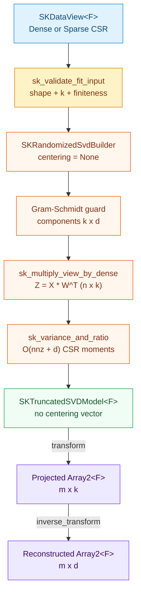
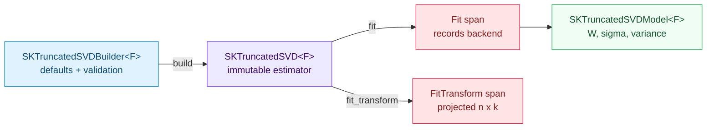

# Truncated SVD: uncentered low-rank factorization and the sparse path

Imagine a table of fifty thousand news articles across one hundred thousand vocabulary words. Each
row counts how often a word appears in an article, so more than $99.9\%$ of the cells are zero. In
compressed-sparse-row (CSR) format, only the non-zero word counts are stored — tens of megabytes
instead of forty gigabytes.

If you hand that table to [Principal Component Analysis (`SKPCA`)](./ch44-pca.html), the very first
step of textbook PCA subtracts the average frequency of every word from every column. Subtracting a
tiny positive number such as $0.002$ from a million zeros turns **every single zero into $-0.002$**:
sparsity vanishes instantaneously. Even though `SKPCA`'s `Randomized` solver avoids materializing
that dense matrix through implicit rank-one corrections, centering itself is often undesirable on
term-document counts or TF-IDF weights, where zero genuinely means *"absent"* and shifting the
origin mixes absence with negative signal.

**Truncated Singular Value Decomposition (`SKTruncatedSVD`)** solves the sister problem: find the
best $k$-dimensional linear subspace directly on the **uncentered** matrix $X$, keeping sparse CSR
inputs sparse from end to end — the classic foundation of **Latent Semantic Analysis (LSA)** and
sparse dimensionality reduction.

This chapter walks through `crates/sciencekit_decomposition/src/truncated_svd/` (capability
`truncated-svd`), teaching every concept from zero, explaining why each engineering decision was
taken (and which alternatives were discarded), touring the public Rust types, and tracing the real
companion tests that lock the specification down.

---

## 1. The problem, in plain words

Given an observation table $X \in \mathbb{R}^{n \times d}$ with $n$ rows (samples or documents) and
$d$ numeric features (columns or terms), and a target rank $k$ satisfying
$1 \le k \le \min(n, d)$, we want $k$ mutually perpendicular unit directions in feature space —
stored as the rows of $W \in \mathbb{R}^{k \times d}$ with $W W^{\top} = I_k$ — so that:

1. **Forward projection (`transform`)** compresses each row $x \in \mathbb{R}^d$ into $k$ numbers
   without subtracting any mean vector:
   $$
   Z = X W^{\top} \in \mathbb{R}^{n \times k}.
   $$
2. **Reconstruction (`inverse_transform`)** maps a $k$-vector back to $d$ features without adding
   any mean vector:
   $$
   \widehat{X} = Z W = X W^{\top} W \in \mathbb{R}^{n \times d}.
   $$
3. Among all rank-$k$ approximations, $\widehat{X}$ minimizes the total squared reconstruction
   error $\lVert X - \widehat{X} \rVert_F^2 = \sum_{i=1}^{n} \sum_{j=1}^{d} (X_{i,j} - \widehat{X}_{i,j})^2$.

By the Eckart–Young–Mirsky theorem, those optimal rows of $W$ are the first $k$ **right singular
vectors** of $X$ itself.

---

## 2. The decisions — and the roads not taken

| Decision | Why we chose it | Alternatives we discarded |
|---|---|---|
| **Separate `SKTruncatedSVD<F>` and `SKTruncatedSVDModel<F>` with zero centering state** | Keeps configuration immutable and distinct from fitted parameters, and omits a `mean` vector altogether so the type system reflects the uncentered contract directly. | Adding a `center: bool` flag onto `SKPCA` — blurs two estimators with different defaults, variance definitions and `mean()` invariants. |
| **Reuse `SKRandomizedSvdBuilder` with `centering = None`** | [Chapter 39](./ch39-randomized-svd.html) already provides a seeded, sign-deterministic randomized range finder whose matrix operator multiplies dense and CSR views directly without materializing $n \times d$ buffers. Passing `None` skips the rank-one mean terms cleanly. | Duplicating power-iteration loops inside `sciencekit_decomposition` — violates DRY and risks drifting in sign convention or seed stream. |
| **`SKTruncatedSVDAlgorithm` (`Randomized` default, `Arpack` reserved)** | Matches the user-facing solver vocabulary while failing fast with `InvalidHyperparameter` if `Arpack` is selected before an implicitly restarted Lanczos kernel lands. | Silently routing `Arpack` to `Randomized` — hides an approximate randomized run behind an exact iterative solver name. |
| **Population variance of `Z = X Wᵀ` divided by two-pass sparse column variance** | Because $X$ is uncentered, $\sigma_j^2 / n$ measures squared root-mean-square energy rather than statistical spread! Computing $\operatorname{Var}(Z_{:, c})$ over the projected rows and dividing by $\sum_{j=1}^{d} \operatorname{Var}(X_{:, j})$ measures true variance captured and satisfies $\sum_{c=1}^{k} \text{ratio}_c \le 1$. | Computing $\sigma_j^2 / (n - 1)$ as if $X$ were centered — a constant matrix of $4.0$s has $\sigma_1 > 0$ yet zero variance, which would yield ratios exceeding $1$ or division by zero. |
| **Modified Gram-Schmidt orthonormal completion (`sk_complete_zero_norm_components`)** | On rank-deficient or constant matrices ($r < k$), trailing singular directions from the small SVD can collapse numerically; completing them with canonical orthogonal unit vectors preserves $W W^{\top} = I_k$ without flipping active kernel signs. | Leaving zero rows in `components` — breaks orthonormality ($W W^{\top} \ne I_k$). |
| **Single-dispatch `SKTruncatedInput` plus 256-row chunked `sk_multiply_view_by_dense`** | Each public operation converts its `SKDataView` into a borrowed `SKTruncatedInput` exactly once (`Dense` or `SparseCsr`), rejecting CSC up front; validation, variance and multiplication then receive that prepared operand instead of re-dispatching per helper. The product uses `backend.gemm(..., 1)` on dense 256-row blocks and row-sliced CSR accumulation on sparse blocks, keeping 1-thread and multi-thread `rayon` runs bit-identical and never densifying CSR inputs. | Re-matching `SKDataView` inside every helper — repeated dispatch, duplicated CSC handling, and error-returning arithmetic helpers that can no longer fail once the view is accepted. Calling `sparse.to_dense()` before `gemm` — allocates $\mathcal{O}(n \cdot d)$ memory and defeats the estimator's reason to exist. |

<div class="sk-box sk-box--info">
  <strong>Explicit non-goals recorded in <code>docs/PRD.md</code>.</strong> Feature centering (use
  <code>SKPCA</code>), ARPACK/IRLBA solvers, missing-value routing, GPU kernels,
  <code>memmap2</code>-backed storage and model export (Wave 7) are intentionally deferred to their
  dedicated changes.
</div>

---

## 3. The concepts, taught from zero

### What Singular Value Decomposition means geometrically

Any rectangular table $X \in \mathbb{R}^{n \times d}$ can be written as a sum of rank-one layers:

$$
X = \sum_{j=1}^{r} \sigma_j u_j v_j^{\top}, \qquad \sigma_1 \ge \sigma_2 \ge \dots \ge \sigma_r > 0,
$$

where:
- each **right singular vector** $v_j \in \mathbb{R}^d$ ($\lVert v_j \rVert_2 = 1$) is a "concept"
  or "topic" — a weighted combination of the original features;
- each **left singular vector** $u_j \in \mathbb{R}^n$ ($\lVert u_j \rVert_2 = 1$) gives each row's
  relative affinity for that concept;
- each **singular value** $\sigma_j \ge 0$ scales the overall strength of layer $j$.

Keeping only the top $k$ layers sets rows $0 \dots k - 1$ of `components` to
$v_1^{\top}, \dots, v_k^{\top}$. Projecting $X$ onto those rows yields
$Z = X W^{\top} = U_k \Sigma_k$, and multiplying back by $W$ yields the rank-$k$ approximation
$\widehat{X} = U_k \Sigma_k V_k^{\top}$.

### Why uncentered variance is subtle — and why ratios never exceed $1$

In `SKPCA`, subtracting column means guarantees $\bar{Z}_{:, c} = 0$, so the variance of projected
column $c$ equals $\sigma_c^2 / (n - 1)$ automatically. Without centering, a matrix can have a huge
singular value along a constant offset that carries **zero** spread across rows! For instance, on a
$6 \times 3$ table filled with $4.0$, $\sigma_1 = \sqrt{6 \times 3 \times 16} = \sqrt{288}$, yet
every row projects to the exact same value, so its variance is $0$.

`SKTruncatedSVD` therefore measures **population variance** directly on the projected coordinates
$Z = X W^{\top}$:

$$
\mu_{Z, c} = \frac{1}{n} \sum_{i=1}^{n} Z_{i, c}, \qquad
\text{explained\_variance}_c = \frac{1}{n} \sum_{i=1}^{n} (Z_{i, c} - \mu_{Z, c})^2,
$$

and divides by the total input column variance $\sigma_{\text{total}}^2 = \sum_{j=1}^{d} \operatorname{Var}(X_{:, j})$.

Why can the sum of `explained_variance_ratio` never exceed $1$? Let
$C = \frac{1}{n}(X - \mathbf{1}\bar{x}^{\top})^{\top}(X - \mathbf{1}\bar{x}^{\top})$ be the
population covariance matrix of $X$. Notice shifting $Z = X W^{\top}$ by its column mean gives
$Z - \mathbf{1}\mu_Z^{\top} = (X - \mathbf{1}\bar{x}^{\top}) W^{\top}$, so:

$$
\sum_{c=1}^{k} \text{explained\_variance}_c
  = \operatorname{tr}(W C W^{\top})
  \le \operatorname{tr}(C)
  = \sigma_{\text{total}}^2,
$$

because $C$ is positive semidefinite and $W W^{\top} = I_k$ projects onto a $k$-dimensional
subspace! In `variance.rs`, `sk_total_input_variance` evaluates $\operatorname{tr}(C)$ on CSR
inputs in two non-negative passes over stored non-zeros plus $(n - \text{nnz}_j)\bar{x}_j^2$ for
the implicit zeros — $\mathcal{O}(\text{nnz} + d)$ work and zero dense allocation — and normalizes
any single-ULP floating-point rounding overshoot so the sum of ratios is strictly at most $1$.

### End-to-end sparse data flow without densification



At every stage on a sparse $n \times d$ input, the largest dense buffer ever allocated has $n \cdot (k + p)$
or $d \cdot (k + p)$ scalars (where $p = 10$ is the randomized oversampling), never $n \cdot d$.

---

## 4. Each public object, explained



### `SKTruncatedSVDAlgorithm` and `SK_TRUNCATED_SVD_PARITY_TOLERANCE`

*What they are* — `SKTruncatedSVDAlgorithm` (`truncated_svd/config.rs`) is a `#[non_exhaustive]`
solver enum with `Randomized` (the `Default` variant) and `Arpack` (reserved non-goal rejected at
validation time). `SK_TRUNCATED_SVD_PARITY_TOLERANCE` (`1e-6_f64`) is the public constant
documenting the dense/CSR equivalence and rank-$k$ reconstruction bound inherited from the
randomized SVD kernel.

### `SKTruncatedSVDBuilder<F>` and `SKTruncatedSVD<F>`

*What they are* — the mandatory builder (`truncated_svd/builder.rs`) and immutable estimator
(`truncated_svd/core_implementation.rs`), parameterized only by `F: SKFloat` (because `tolerance`
is a scalar; `backend` is a runtime `SKBackendKind` value).

*Documented defaults and builder setters*:
- `number_of_components(usize)` — default `2` (must satisfy $1 \le k \le \min(n, d)$);
- `algorithm(SKTruncatedSVDAlgorithm)` — default `SKTruncatedSVDAlgorithm::Randomized`;
- `number_of_iterations(usize)` — default `5` (must be $> 0$);
- `tolerance(F)` — default `0.0` (must be finite and $\ge 0$);
- `random_seed(u64)` — default `0`;
- `backend(SKBackendKind)` — default `SKBackendKind::Faer`;
- `execution_mode(...)` — default `SKExecutionMode::Automatic`.

Here is the real sparse CSR usage from `crates/sciencekit_decomposition/src/lib.rs`:

```rust
use sciencekit_common::{SKBuilder, SKUnsupervisedFit};
use sciencekit_decomposition::SKTruncatedSVD;
use sprs::TriMat;

let mut triplet = TriMat::new((4, 5));
triplet.add_triplet(0, 0, 2.0_f64);
triplet.add_triplet(1, 2, 4.0);
triplet.add_triplet(2, 0, 6.0);
triplet.add_triplet(3, 4, 3.0);
let sparse = triplet.to_csr();

let svd_model = SKTruncatedSVD::<f64>::build()
    .number_of_components(2)
    .random_seed(7)
    .build()
    .unwrap()
    .fit(sparse.view())
    .unwrap();
let projected = svd_model.transform(sparse.view()).unwrap();
assert_eq!(projected.dim(), (4, 2));
```

`SKTruncatedSVD<F>` implements `SKUnsupervisedFit<F, Model = SKTruncatedSVDModel<F>, Error = SKError>`
and provides inherent `fit_transform`, which returns the projected training matrix directly from the
fit pass under a single `FitTransform` span without projecting a second time.

### `SKTruncatedSVDModel<F>`

*What it is* — the fitted model (`truncated_svd/model.rs`), `Clone + Debug + PartialEq + Send + Sync`, storing
no centering vector. Structural equality compares components, singular values, both variance
vectors and the transferred builder state, so determinism checks can assert whole models directly.

*Accessors and operations*:
- `components()` — `ArrayView2<'_, F>` of shape $k \times d$ (rows are orthonormal right singular
  vectors);
- `singular_values()` — non-increasing `ArrayView1<'_, F>` of length $k$;
- `explained_variance()` and `explained_variance_ratio()` — `ArrayView1<'_, F>` of length $k$;
- `number_of_components()`, `number_of_features()`, `algorithm()`, `backend()`, `execution_mode()`;
- `transform` (inherent and via `SKFeatureTransformer<F>`) and `inverse_transform`, both accepting
  dense views and sparse CSR views with a single dispatch per call and recording the transferred
  `SKBackendKind` in `sciencekit.operation` spans.

Because `SKTruncatedSVD<F>` implements `SKUnsupervisedFit<F>` and `SKTruncatedSVDModel<F>`
implements `SKFeatureTransformer<F, Output = Array2<F>>`, `SKTruncatedSVD<F>` plugs straight into
`SKPipeline` and `SKFeatureUnion`.

---

## 5. Walking through the real companion tests

Every scenario in `openspec/changes/truncated-svd/specs/truncated-svd/spec.md` is verified by a
dedicated companion test module:

1. **Builder defaults and hyperparameter guards (`truncated_builder_tests.rs`, `truncated_model_tests.rs`).**
   `truncated_builder_defaults_match_the_documented_configuration` confirms `2` components,
   `Randomized`, `5` iterations, tolerance `0.0`, seed `0`, `Faer` and `Automatic`.
   `truncated_builder_overrides_are_exposed_on_the_estimator_and_via_trait` checks every setter and
   `SKBuilder` trait dispatch on `f32`.
   `truncated_builder_rejects_invalid_hyperparameters` verifies `InvalidHyperparameter` for zero
   components, `Arpack`, zero iterations, negative tolerance and non-finite tolerances.
   `truncated_model_exposes_uncentered_factorization_parts_and_default_algorithm` checks all fitted
   accessors.
2. **Uncentered reconstruction, variance ordering and backend spans (`truncated_fit_tests.rs`).**
   `truncated_fit_reconstructs_rank_one_matrix_without_centering` constructs the outer product
   $u v^{\top}$ with $u = [1, 2, 3, 4]^{\top}$ ($\lVert u \rVert_2 = \sqrt{30}$) and
   $v = [0.6, 0.8, 0]^{\top}$, verifying $\sigma_1 = \sqrt{30}$, `explained_variance[0] = 1.25`,
   `explained_variance_ratio[0] = 1.0`, `fit_transform == fit + transform`, and exact uncentered
   reconstruction of the non-zero feature means.
   `truncated_fit_reconstructs_rank_two_matrix_with_non_increasing_variance` checks row
   orthonormality ($W W^{\top} = I_2$), non-increasing singular values and explained variances, and
   $\sum \text{ratio} \le 1$.
   `truncated_fit_completes_orthonormal_components_on_constant_and_rank_deficient_data` fits $k = 2$
   on a constant $6 \times 3$ matrix of $4.0$s, confirming $W W^{\top} = I_2$, $\sigma_1 = \sqrt{288}$
   and zero variance ratios.
   `truncated_fit_transfers_configured_backend_and_records_fit_and_fit_transform_spans` captures
   `sciencekit.operation` spans to verify `NdArrayLinalg` and `InProcessSynchronous` propagate to
   both `fit` and `fit_transform`, then repeats the check on a default-built estimator to confirm
   the unconfigured `Faer` backend is recorded rather than a hardcoded kind.
3. **Dense/sparse CSR parity and the no-densification proof (`truncated_representation_tests.rs`).**
   `truncated_representation_sparse_csr_equals_dense_within_documented_tolerance` builds a CSR view
   including an explicit stored zero and verifies `components`, `singular_values`,
   `explained_variance`, `explained_variance_ratio` and projections match the dense fit within
   `SK_TRUNCATED_SVD_PARITY_TOLERANCE` ($10^{-6}$).
   `truncated_representation_wide_sparse_matrix_fits_without_densification` fits and transforms a
   $1\,500 \times 25\,000$ CSR matrix ($300\text{ MB}$ if densified, only $6\,000$ non-zeros) while
   asserting zero warnings and a peak materialized projection of only $1\,500 \times 3 = 4\,500$
   scalars.
   `truncated_representation_rejects_csc_up_front_before_scanning_elements` embeds a `NaN` inside a
   CSC matrix and confirms `UnsupportedRepresentation { representation: "csc", .. }` fires before
   any element scan.
4. **All four dense/sparse transform pairs (`truncated_transform_tests.rs`).**
   `truncated_transform_and_inverse_transform_shapes_and_rank_k_reconstruction` checks $m \times k$
   forward shape, $m \times d$ inverse shape, `SKFeatureTransformer` dispatch and rank-$k$
   reconstruction on unseen query rows.
   `truncated_transform_accepts_dense_and_sparse_views_across_all_combinations` verifies dense-fit
   and sparse-fit models on both dense and CSR queries, plus CSR input to `inverse_transform`.
   `truncated_transform_and_inverse_transform_record_transferred_backend_in_spans` verifies both
   model operations record `MatrixMultiply` in their spans.
5. **Input and shape validation (`truncated_validation_tests.rs`).**
   `truncated_validation_rejects_empty_inputs_and_propagates_conversion_failure`,
   `truncated_validation_rejects_zero_and_excessive_components_and_invalid_hyperparameters` and
   `truncated_validation_rejects_feature_count_mismatch_non_finite_and_csc_views` test
   `EmptyInput`, `InvalidHyperparameter` when $k > \min(n, d)$ on tall and wide matrices,
   `ShapeMismatch` on mismatched column counts (including $2 \times 0$ queries), and
   `NonFiniteValue` with flat row-major positions across dense and CSR inputs. They also pin the
   single-dispatch boundary: a failing `TryInto<SKDataView>` adapter must surface its own
   `SKError::Conversion` from `fit`, `inverse_transform` must reject non-finite projected
   coordinates, and CSC views must be refused by `transform` and `inverse_transform` alike.
6. **Thread-count invariance, concurrency and metrics (`truncated_concurrency_tests.rs`, `acceptance_tests/truncated_svd_acceptance_tests.rs`).**
   `truncated_concurrency_estimator_builder_and_model_are_send_and_sync` checks static `Send + Sync`
   bounds for `f32` and `f64`.
   `truncated_concurrency_repeated_fits_agree_across_runs_and_rayon_thread_counts` runs 1-thread and
   4-thread `rayon` pools on a $4\,096 \times 32$ dense table and a $2\,048 \times 64$ CSR table,
   asserting exact `assert_eq!` equality on whole models (components, singular values, variances and
   transferred configuration) and on projections.
   `truncated_concurrency_shared_model_transforms_match_sequential_output` shares an
   `Arc<SKTruncatedSVDModel<f64>>` across eight threads transforming dense and CSR batches.
   `acceptance_truncated_svd_tiny_matrices_f32_and_component_boundaries` and
   `acceptance_truncated_svd_large_dense_and_wide_sparse_concurrency_and_metrics` validate $1 \times 3$
   boundaries, `f32`, $2\,000 \times 10\,000$ wide CSR concurrency, and monotonically decreasing
   `sk_mean_squared_error` reaching $R^2 > 0.9999$ (`sk_r2_score`) on a planted low-rank table.

---

## 6. Recap

- `SKTruncatedSVD<F>` computes a seeded randomized low-rank SVD on the **uncentered** design,
  storing no mean vector and never densifying sparse CSR matrices during `fit`, `fit_transform`,
  `transform` or `inverse_transform`.
- Population `explained_variance` is measured over the projected training rows and divided by the
  two-pass $\mathcal{O}(\text{nnz} + d)$ total input variance so `explained_variance_ratio` sums to
  at most $1$ on every input.
- Fixed 256-row chunks, modified Gram-Schmidt completion and runtime `SKBackendKind` propagation
  keep every operation deterministic across thread counts, safe under `Arc` concurrency and
  observable in `sciencekit.operation` spans.
