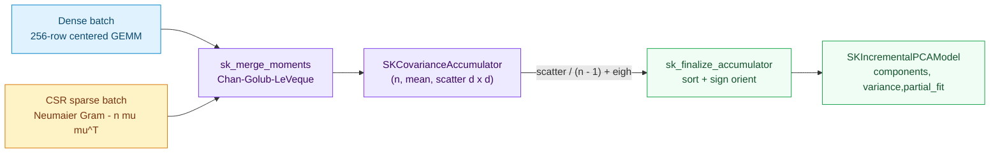
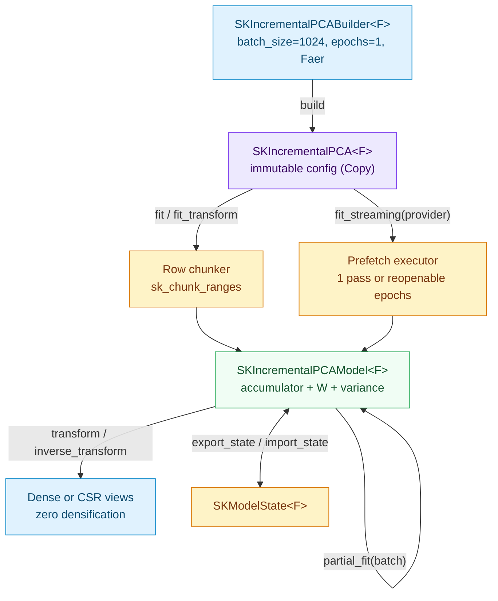

# Incremental PCA: merging covariance across batches and streams

In [Chapter 44](./ch44-pca.html), `SKPCA` found the directions of greatest spread in a feature
table by inspecting the whole dataset in memory. That works beautifully until the dataset has
fifty million rows on disk or arrives one network chunk at a time. You cannot subtract a global
mean before you have seen every row, and you cannot keep fifty million rows in RAM while you wait.

**Incremental Principal Component Analysis** (`SKIncrementalPCA`) breaks that deadlock. Instead
of holding onto rows, it keeps a tiny, fixed-size statistical summary of everything seen so far:
the sample count $n$, the running feature mean $\mu \in \mathbb{R}^d$, and the $d \times d$
centered scatter matrix $S$. Each new batch — whether from an in-memory chunk, a manual
`partial_fit` call, or an out-of-core `SKSourceProvider` stream — is folded into $(n, \mu, S)$ via
the **Chan-Golub-LeVeque merge** and then discarded immediately. When the model finalizes, a
single symmetric eigendecomposition on $S / (n - 1)$ recovers the exact same principal axes that
full batch PCA would have found on the concatenated dataset.

This chapter walks through `crates/sciencekit_decomposition/src/incremental_pca/` (capability
`incremental-pca`), teaching the algebra and floating-point mechanics from zero, explaining every
public type and method, and tracing the real companion tests that prove each guarantee.

---

## 1. The problem, in plain words

Imagine measuring $d$ numeric sensors across millions of events. A table with $n = 10^7$ rows and
$d = 64$ double-precision columns occupies roughly $5.1\text{ GB}$ of raw numbers, yet its sample
mean has only $64$ numbers and its sample covariance matrix has only $64 \times 64 = 4\,096$
numbers — barely $32\text{ KB}$!

The catch is **centering**. Sample covariance measures how features co-vary around the *global*
mean $\mu$:

$$
C = \frac{1}{n - 1} \sum_{i=1}^{n} (x_i - \mu)(x_i - \mu)^{\top}.
$$

If batch $A$ has mean $\mu_A$ and batch $B$ has a different mean $\mu_B$, you cannot just add
their separate scatter matrices together: both were centered around their *local* batch means
rather than the combined mean $\mu_{AB}$. Throwing batch $A$ away seems to make re-centering
impossible — until a clean algebraic identity comes to the rescue.

---

## 2. The decisions — and the roads not taken

| Decision | Why we chose it | Alternatives we discarded |
|---|---|---|
| **Exact Chan-Golub-LeVeque $(n, \mu, S)$ covariance state (`SKCovarianceAccumulator<F>`)** | Merging $(n_A, \mu_A, S_A)$ and $(n_B, \mu_B, S_B)$ is algebraically exact, associative across batch boundaries, independent of batch order, and requires $\mathcal{O}(d^2)$ memory with zero row retention. Finalizing via $C = S / (n - 1)$ and `backend.eigh` matches full PCA to machine precision. | Approximate rank-$k$ SVD sketches (Ross et al. / scikit-learn's truncated SVD update) — fast when $d$ is huge, but approximate and sensitive to batch order; kept open as a separate future rank-adaptive change. |
| **Separate dense and sparse CSR batch paths that meet at `sk_merge_moments`** | Dense batches center 256-row blocks and call `backend.gemm` for cache-friendly BLAS speed. Sparse CSR batches accumulate stored non-zeros into column sums and a $d \times d$ Gram matrix with **Neumaier compensated summation**, then form $S_B = G_B - n_B \mu_B \mu_B^{\top}$ without ever materializing a dense batch. | Densifying each sparse batch before centering — violates representation parity (`data-view-boundary`) and explodes memory on sparse wide streams; or using naive uncompensated $\sum x^2 - n\mu^2$ everywhere — loses precision when means are large. |
| **Shared `fit`, `partial_fit` and `fit_streaming` over one merge kernel** | `fit` slices an in-memory view into `batch_size` blocks (coalescing any trailing remainder smaller than `number_of_components`); `partial_fit` merges a new batch into `SKIncrementalPCAModel` and refreshes the eigendecomposition; `fit_streaming` drives `SKSourceProvider` through `sk_run_streaming_provider` with `SKStreamingPassPolicy::Iterative`. | Separate code paths for in-memory chunking and streaming — risks drift between `fit`, `partial_fit` and `fit_streaming`. |
| **Fixed 256-row reduction chunks folded in index order** | Both dense batch moments and dense `transform` / `inverse_transform` split rows into deterministic 256-row blocks (`DENSE_MOMENT_ROW_CHUNK`, `DENSE_TRANSFORM_ROW_CHUNK` and `DENSE_RECONSTRUCT_ROW_CHUNK`), evaluate chunks via `rayon` when `plan.parallelism > 1`, and sum chunk partials in strict sequence order. One thread and four threads produce **bit-identical** arrays (`assert_eq!`). | Letting `rayon` fold partials in work-stealing tree order — floating-point addition is non-associative, causing thread-count drift. |
| **Format-agnostic `SKExportable` / `SKImportable` state including the accumulator** | Exporting `components`, `mean`, `scatter`, variances, singular values and sample/epoch counters into `SKModelState<F>` lets an imported `SKIncrementalPCAModel<F>` both `transform` immediately and continue learning via `partial_fit`. | Exporting only `components` and `mean` — would silently break incremental continuation after model reload. |

  <strong>Explicit non-goals for this change.</strong> Missing-value imputation inside PCA,
  rank-adaptive component counts, GPU kernels and <code>memmap2</code>-backed storage are outside
  this change and recorded in <code>docs/PRD.md</code>. Binary file persistence is not
  reimplemented here either: the model exposes format-agnostic
  <code>SKExportable</code>/<code>SKImportable</code> state, and the shared
  <code>sciencekit_interop</code> adapters own the concrete on-disk encodings (JSON debug and the
  extended Safetensors format).

---

## 3. The concepts, taught from zero

### What a scatter matrix is

For a batch of $n$ rows with empirical mean $\mu = \frac{1}{n}\sum_{i=1}^n x_i$, the **scatter
matrix** $S \in \mathbb{R}^{d \times d}$ sums the outer products of each row's deviation from
$\mu$:

$$
S = \sum_{i=1}^{n} (x_i - \mu)(x_i - \mu)^{\top}.
$$

Entry $S_{p, q}$ measures how strongly feature $p$ and feature $q$ move together across the $n$
rows. Dividing by $n - 1$ turns total scatter into average unbiased sample covariance:
$C = \frac{1}{n - 1} S$.

### The Chan-Golub-LeVeque merge, worked by hand

Suppose we already summarized batch $A$ into $(n_A, \mu_A, S_A)$, and a fresh batch $B$ arrives
with $(n_B, \mu_B, S_B)$. Let $n = n_A + n_B$ and write the gap between the two batch means as
$\delta = \mu_B - \mu_A$. Algebra shows that the combined mean and combined scatter over
$A \cup B$ satisfy:

$$
\mu = \mu_A + \frac{n_B}{n}\,\delta, \qquad
S = S_A + S_B + \frac{n_A n_B}{n}\,\delta \delta^{\top}.
$$

Every term on the right-hand side depends *only* on the two summaries — none of the individual
rows of $A$ or $B$ are needed again!

Let us check this with four tiny 2D rows — the exact fixture locked by
`incremental_merge_hand_checked_two_batch_mean_and_scatter` in `incremental_merge_tests.rs`:

- **Batch 1:** $[1, 2]$ and $[3, 6]$ ($n_A = 2$). Its mean is $\mu_A = [2, 4]$. Deviations are
  $[-1, -2]$ and $[1, 2]$, so
  $$
  S_A = \begin{bmatrix} 1 + 1 & 2 + 2 \\ 2 + 2 & 4 + 4 \end{bmatrix}
      = \begin{bmatrix} 2 & 4 \\ 4 & 8 \end{bmatrix}.
  $$
- **Batch 2:** $[5, 10]$ and $[7, 14]$ ($n_B = 2$). Its mean is $\mu_B = [6, 12]$, and its local
  deviations are again $[-1, -2]$ and $[1, 2]$, so $S_B = \begin{bmatrix} 2 & 4 \\ 4 & 8 \end{bmatrix}$.
- **Merge:** $n = 4$, and $\delta = \mu_B - \mu_A = [4, 8]$. The merged mean is
  $\mu = [2, 4] + \frac{2}{4}[4, 8] = [4, 8]$, and the cross-mean rank-one correction carries
  weight $\frac{n_A n_B}{n} = \frac{2 \times 2}{4} = 1$:
  $$
  S = \begin{bmatrix} 2 & 4 \\ 4 & 8 \end{bmatrix}
    + \begin{bmatrix} 2 & 4 \\ 4 & 8 \end{bmatrix}
    + 1 \cdot \begin{bmatrix} 16 & 32 \\ 32 & 64 \end{bmatrix}
    = \begin{bmatrix} 20 & 40 \\ 40 & 80 \end{bmatrix}.
  $$

Check all four rows $[1, 2], [3, 6], [5, 10], [7, 14]$ directly around $[4, 8]$: deviations are
$[-3, -6], [-1, -2], [1, 2], [3, 6]$, whose squares sum to $9 + 1 + 1 + 9 = 20$ in column 0 and
$36 + 4 + 4 + 36 = 80$ in column 1. They match to the last bit.

### Sparse CSR batches without densification (and Neumaier compensation)

In a Compressed Sparse Row (`CsMatView`) batch, most entries are implicit zeros. Subtracting
$\mu_B$ from every entry would destroy sparsity. Instead, `sk_update_sparse` in `sparse.rs`
visits *only* stored non-zeros along each row: for every pair of stored entries $(j, v_j)$ and
$(l, v_l)$ in the same row, it accumulates column sums $\sum v_j$ and the uncentered Gram product
$G_B = X_B^{\top} X_B$, then applies the identity

$$
S_B = X_B^{\top} X_B - n_B\,\mu_B \mu_B^{\top}
$$

before handing $(n_B, \mu_B, S_B)$ to `sk_merge_moments`.

Because subtracting $n_B \mu_B \mu_B^{\top}$ from $X_B^{\top} X_B$ can amplify rounding error when
a feature has a large offset (for instance values near $100.0 \pm 0.5$), `sk_update_sparse` uses
**Neumaier compensated addition** (`sk_neumaier_add`): alongside every running sum $s$, a
companion error term $c$ captures the low-order bits lost when adding a small number to a large
one (or vice versa), folding $c$ back in before computing $\mu_B$ and $S_B$. After every merge,
`sk_symmetrized` averages $\frac{1}{2}(S + S^{\top})$ and clamps diagonal entries at $0$ so tiny
floating-point asymmetries never disturb the symmetric eigensolver.

### Finalization, sign orientation, and whitening

Given $(n, \mu, S)$, `sk_finalize_accumulator` in `finalize.rs`:

1. Forms $C = S / (n - 1)$ when $n \ge 2$ (or the zero matrix when $n = 1$), and sums
   $\sigma_{\text{total}}^2 = \sum_{j=1}^{d} \max(C_{j,j}, 0)$ along the diagonal;
2. Calls `backend.eigh(C)` on the configured `SKMathBackend<F>`, sorts eigenvalues
   $\lambda_1 \ge \lambda_2 \ge \dots \ge \lambda_k \ge 0$ (breaking ties by ascending feature
   index), and extracts the top $k$ eigenvectors as rows of $W \in \mathbb{R}^{k \times d}$;
3. Passes $W$ through `sk_orient_components` (shared with `SKPCA`), ensuring $W W^{\top} = I_k$
   and making each row's largest-magnitude coordinate non-negative so `SKIncrementalPCA` and
   `SKPCA` agree in sign as well as subspace;
4. Derives singular values $\sigma_c = \sqrt{\lambda_c (n - 1)}$, `explained_variance_ratio`, and
   whitening scales $s_c = \sqrt{\max(\lambda_c, \varepsilon)}$.

---

## 4. Each public object, explained

### `SKIncrementalPCABuilder<F>` and `SKIncrementalPCA<F>`

*What they are* — the mandatory builder (`incremental_pca/builder.rs`) and immutable, `Copy`
estimator (`incremental_pca/core_implementation.rs`). Direct struct construction is private;
`SKIncrementalPCA::<F>::build()` opens the builder.

*Documented defaults and setters*:
- `number_of_components(usize)` — `None` by default (resolving to $\min(n, d)$, i.e. all $d$
  features whenever $n \ge d$); must be $> 0$ when set;
- `batch_size(usize)` — `1024` by default; must be $> 0$ and at least `number_of_components`;
- `whiten(bool)` — `false` by default;
- `maximum_number_of_epochs(usize)` — `1` by default; must be $> 0$; controls how many passes
  `fit_streaming` requests from a reopenable `SKSourceProvider`;
- `backend(SKBackendKind)` — `SKBackendKind::Faer` by default;
- `execution_mode(...)` — `SKExecutionMode::Automatic` by default (inherent and via `SKBuilder`).

*Entry points on `SKIncrementalPCA<F>`* (for `F: SKBackendSelection`):
- `fit(features)` (`SKUnsupervisedFit<F>`) — validates shape, finiteness and
  `batch_size >= resolved_components`, partitions rows via `sk_chunk_ranges` (merging any short
  tail block into its predecessor so every chunk has at least $k$ rows), updates the accumulator
  and finalizes under a `Fit` span;
- `fit_transform(features)` — fits and projects under a single `FitTransform` span;
- `fit_streaming(provider)` — drives `SKSourceProvider<F>` through `sk_run_streaming_provider`
  with `SKStreamingPassPolicy::Iterative { maximum_number_of_passes: maximum_number_of_epochs }`.
  A one-shot provider (`&mut source`) consumes one pass (emitting a `tracing::warn!` if more
  epochs were requested); an `SKReopenableSource` reopens the stream once per epoch and records
  the count in `model.epochs_consumed()`.

### `SKIncrementalPCAModel<F>`

*What it is* — the fitted model (`incremental_pca/model.rs`), `Clone + Debug + Send + Sync`,
carrying both the finalized eigendecomposition and the live `SKCovarianceAccumulator<F>`.

*Accessors and operations*:
- `components()` ($k \times d$), `explained_variance()`, `explained_variance_ratio()`,
  `singular_values()`, `mean()`, `scatter_matrix()` ($d \times d$);
- `samples_seen()`, `epochs_consumed()`, `number_of_components()`, `number_of_features()`,
  `batch_size()`, `whiten()`, `backend()`, `execution_mode()`;
- `partial_fit(batch)` — validates non-empty input, matching feature count (`ShapeMismatch`),
  `rows >= number_of_components` (`InvalidHyperparameter`), CSR format and finiteness *before*
  mutating state, merges the batch under a `PartialFit` span, refreshes the finalized components,
  and returns `Result<&mut Self, SKError>` for chaining;
- `transform(features)` (inherent and `SKFeatureTransformer<F>`) and
  `inverse_transform(projected)` — operate on dense and CSR views without densifying sparse
  matrices, making `SKIncrementalPCA<F>` compose directly inside `SKPipeline` and
  `SKFeatureUnion`;
- `SKExportable<F>` and `SKImportable<F>` (`incremental_pca/export/`) — round-trip the full model
  and accumulator state through `SKModelState<F>`.

Also note workspace integration: adding `fit_streaming` and `partial_fit` registers
`SKIncrementalPCA` in `crates/sciencekit_pipeline/src/streaming_coverage/matrix.rs`, verified
automatically by `the_source_scan_matches_the_audited_streaming_surface`.

---

## 5. Walking through the real companion tests

Every requirement in `openspec/changes/incremental-pca/specs/incremental-pca/spec.md` is backed by
companion tests under `crates/sciencekit_decomposition/src/`:

1. **Defaults, builder validation and clean state (`incremental_accumulator_tests.rs`,
   `incremental_builder_tests.rs`).**
   `incremental_configuration_and_accumulator_start_clean` verifies zeroed accumulator arrays and
   default configuration constants. `incremental_builder_carries_documented_defaults`,
   `incremental_builder_overrides_every_option_and_trait_execution_mode`, and
   `incremental_builder_rejects_zero_components_batch_size_and_epochs` lock the builder surface.
2. **Chan-Golub-LeVeque merge and sparse CSR Gram parity (`incremental_merge_tests.rs`,
   `incremental_sparse_tests.rs`).**
   `incremental_merge_hand_checked_two_batch_mean_and_scatter` verifies the exact $[4, 8]$ mean
   and $[[20, 40], [40, 80]]$ scatter on the two-batch hand calculation above.
   `incremental_merge_two_batches_equal_one_batch_and_persist_state` proves two-batch and
   six-row-chunked updates match a single pass.
   `incremental_sparse_matches_dense_across_batches_without_densification` and
   `incremental_sparse_mixed_with_dense_batches_matches_single_dense_pass` verify CSR and
   alternating CSR/dense batches against shifted features ($100.0 + \dots$) where uncompensated
   sums would lose precision.
3. **Finalization and equality with `SKPCA` (`incremental_finalize_tests.rs`,
   `incremental_fit_tests.rs`).**
   `incremental_finalize_sorted_components_and_equals_full_pca` checks non-increasing
   `explained_variance`, orthonormal rows ($W W^{\top} = I_k$), and agreement with
   `SKPCASolver::Full` on components, singular values, variances and ratios.
   `incremental_fit_chunks_dense_and_sparse_and_matches_pca` exercises trailing-chunk coalescing
   ($50$ rows with `batch_size = 12` and $k = 3$), while
   `incremental_fit_partial_fit_chains_and_records_backend_spans` chains dense and CSR
   `partial_fit` calls and asserts `sciencekit.operation` spans record `"matrixmultiply"` on both
   `fit` and `partial_fit`.
4. **One-pass and multi-epoch streaming (`incremental_streaming_tests.rs`).**
   `incremental_streaming_one_shot_provider_consumes_one_pass_and_matches_fit` passes a one-shot
   source with `maximum_number_of_epochs(4)`, confirming `epochs_consumed() == 1`, a clamp
   warning event, and parity with `fit`.
   `incremental_streaming_reopenable_multi_epoch_reopens_and_preserves_subspace` wraps a factory
   in `SKReopenableSource` with `maximum_number_of_epochs(3)`, proving the factory opens $3$
   times (`epochs_consumed() == 3`, `samples_seen() == 108`) while preserving the exact subspace.
   `incremental_streaming_sparse_and_mixed_batches_match_dense_fit` streams alternating CSR and
   dense `SKDataBatch` blocks.
5. **Projection, whitening and validation (`incremental_transform_tests.rs`,
   `incremental_validation_tests.rs`, `incremental_validation_inputs_tests.rs`).**
   `incremental_transform_shape_roundtrip_and_sparse_dense_parity` verifies $(19, 3)$ shapes,
   `fit_transform` parity, and full-rank $k = d$ `inverse_transform` reconstruction within
   $10^{-9}$ on both dense and CSR coordinates. `incremental_transform_whitening_normalizes_unit_variance_and_inverts` checks
   unit sample variance across whitened columns and invertible reconstruction.
   `incremental_validation_rejects_empty_inputs_everywhere`,
   `incremental_validation_rejects_excessive_components_and_small_batches`, and
   `incremental_validation_rejects_feature_mismatch_non_finite_and_csc` verify every error variant
   and prove failed `partial_fit` calls leave `samples_seen()` and `mean()` untouched.
6. **Thread-count bit-identity, batch-size invariance, export and metrics
   (`incremental_concurrency_tests.rs`, `acceptance_tests/`).**
   `incremental_concurrency_repeated_fits_and_thread_counts_are_bit_identical` fits an
   $8\,192 \times 32$ matrix under 1-thread and 4-thread `rayon` pools and asserts exact
   `assert_eq!` equality on `mean`, `scatter_matrix`, `components`, `transform` and
   `inverse_transform`. `incremental_concurrency_batch_size_invariance_holds_for_dense_and_sparse`
   sweeps `batch_size` across $7, 19, 32, 64$ against $1\,024$.
   `incremental_concurrency_shared_model_transforms_match_sequential` shares an
   `Arc<SKIncrementalPCAModel<f64>>` across $6$ threads. Finally,
   `acceptance_incremental_pca_tiny_f32_large_dense_and_wide_sparse` and
   `acceptance_incremental_pca_streaming_epochs_export_concurrency_and_metrics` exercise `f32`,
   $3\,000 \times 24$ dense and $1\,200 \times 160$ wide CSR inputs, `export_state` /
   `import_state` round-tripping followed by continued `partial_fit`, and monotonic
   `sk_mean_squared_error` / $R^2 > 0.9999$ (`sk_r2_score`) via `sciencekit_metrics`.

---

## 6. Recap

- `SKIncrementalPCA<F>` learns exact sample covariance out-of-core in $\mathcal{O}(d^2)$ memory
  by merging per-batch $(n_B, \mu_B, S_B)$ summaries with the Chan-Golub-LeVeque formula and
  discarding every batch immediately.
- Dense batches reduce 256-row blocks via BLAS GEMM; sparse CSR batches accumulate
  Neumaier-compensated column sums and Gram products without ever densifying sparse storage.
- `fit`, chained `SKIncrementalPCAModel::partial_fit`, and `fit_streaming` over one-shot or
  reopenable `SKSourceProvider` streams all converge on the same sorted, sign-oriented principal
  components as `SKPCA`, with bit-identical results across thread counts.
