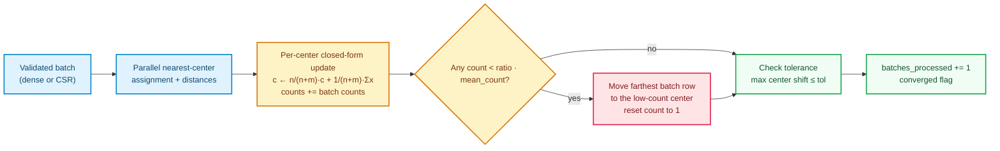
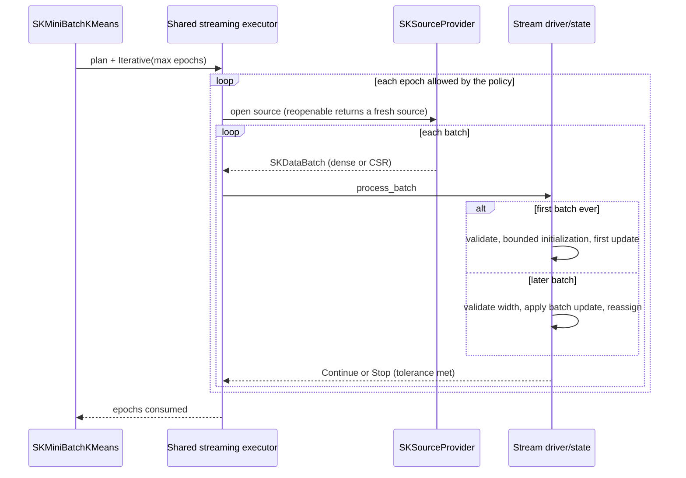

# Mini-batch k-means: learning rates, reassignment and honest streaming

Classic k-means — the Lloyd and Elkan algorithm from the
[k-means chapter](ch27-kmeans.html) — has a comfortable but expensive habit: it wants the
whole training table in memory and re-reads every row once per iteration. That is fine for a
100 000-row matrix that fits in RAM, and hopeless for a log file that arrives batch by batch
from disk, a network socket or a database cursor. **Mini-batch k-means** keeps the same center
matrix and the same nearest-center prediction contract, but improves each center from small
batches instead of a full pass, so it can learn from data it never holds at once.

This chapter builds `SKMiniBatchKMeans<F>` and `SKMiniBatchKMeansModel<F>` in
`crates/sciencekit_cluster/src/minibatch_kmeans/` (capability `mini-batch-k-means`). No prior
knowledge of Rust, linear algebra or streaming systems is assumed.

---

## 1. The problem, in plain words

Given a table $X$ with $n$ rows and $p$ numeric columns and a requested number of clusters
$k$, we want $k$ center vectors so that every row is close to at least one center. The
prediction surface is exactly the k-means one: a row belongs to the cluster of its nearest
center, and the model never invents a "noise" label. What changes is the *fitting* surface:

1. **Bounded memory.** Training data may be larger than RAM, so fitting must consume one batch
   at a time and keep only the centers and a few counters.
2. **Incremental continuation.** A user may have a first day of data today and a second day
   tomorrow; `partial_fit` must continue from the exact centers and per-center counts instead
   of restarting.
3. **Streaming, not just chunking.** The same algorithm must drive the shared
   `SKSourceProvider` executor, including reopenable providers that can be read for several
   epochs.
4. **Sparse data must stay sparse.** A wide one-hot table can have millions of columns and a
   handful of stored values per row. Materializing it densely would waste gigabytes and break
   the workspace's representation-parity rule (spec `data-view-boundary`).
5. **Determinism.** Parallel row assignment must not make repeated runs or different rayon
   thread counts disagree.

---

## 2. The decisions, and the roads not taken

| Decision | Why we chose it | Alternatives we discarded |
|---|---|---|
| **Per-center learning rate `1 / (count[c] + 1)`** | New centers should move a lot; mature centers should barely move. Dividing by the number of rows already assigned to that center gives exactly that decay. | A global fixed learning rate (destroys mature centers) or a schedule based on wall-clock batches (not reproducible). |
| **Exact closed-form batch update** | Applying the row rule sequentially over a batch reduces algebraically to $c \leftarrow \frac{n}{n+m}c + \frac{1}{n+m}\sum x$ with $n$ the prior count and $m$ the batch count. This lets a CSR batch touch only its stored entries — $O(kd + \operatorname{nnz})$ instead of densifying $m \times d$. | A row-by-row `for` loop over dense materialized rows: simpler, but densifies sparse input and is far slower. |
| **Deterministic bounded initialization sample** | Centers start from at most `initialization_batch_size` rows, drawn without replacement from a seeded generator and sorted, then `number_of_initializations` independent seeds compete on sample inertia. | Initializing from the first `batch_size` rows (positional bias), or random restarts without a seed (irreproducible). |
| **Deterministic low-count reassignment** | A center that receives almost no rows is a dead center. After each batch, centers below $\text{reassignment\_ratio} \times \text{mean\_count}$ steal the batch point currently farthest from its assigned center, with ties broken by the smallest row index, and reset the stolen center's count to `1`. | Re-running k-means++ on the whole dataset whenever a center is empty (expensive, not streaming-friendly). |
| **Reuse the shared streaming executor** | `fit_streaming` calls `sk_run_streaming_provider` with a mutable driver, so prefetching, parallelism and the reopenable-provider pass policy are the same code other estimators use. | A bespoke `while let Some(batch)` loop that would duplicate executor behavior and diverge from other streaming estimators. |
| **`tolerance = 0` means "use the full budget"** | Users often want a predictable number of passes. A positive tolerance enables early stopping when the largest center shift (and reassignment activity) is at or below it; zero explicitly disables the stop. | Treating zero as "stop immediately" (surprising) or as exact convergence (float equality is unattainable). |

---

## 3. The concepts, from zero

### Centers, counts and one update step

A center is just a vector — the current guess for the middle of a cluster. `counts[c]` records
how many rows have ever been assigned to center `c`. When a row $x$ is assigned to center $c$:

$$
c \leftarrow c + \frac{x - c}{\text{count}[c] + 1},
\qquad
\text{count}[c] \leftarrow \text{count}[c] + 1 .
$$

The first row moves the center halfway to itself; after a hundred rows the center moves only
$1/101$ of the gap. This is what makes mini-batch fitting stable: early batches shape the
centers, later batches refine them.

### Why the closed form is exact

Start from count $n$ and a batch of $m$ rows all assigned to the same center. Applying the
single-row rule $m$ times gives:

$$
c_{\text{new}}
= \left(\frac{n}{n+m}\right)c_{\text{old}}
+ \left(\frac{1}{n+m}\right)\sum_{i=1}^{m} x_i ,
\qquad
\text{count}_{\text{new}} = n + m .
$$

The code in `update.rs` implements exactly these two lines: it accumulates per-center batch
sums, scales the old center by `prior / total`, adds `sum / total`, and increments the count.
For dense input it uses `azip!` over rows; for CSR it scales the dense center row and then adds
only the stored `(column, value)` entries. No `to_dense()` call exists on the sparse path.

### Sparse distance without densification

For a CSR row, the squared distance to a center is computed by the norm expansion

$$
\lVert x - c \rVert^2 = \lVert x \rVert^2 + \lVert c \rVert^2 - 2\,x \cdot c ,
$$

where the dot product only iterates the stored entries of the row. Center norms are computed
once per assignment call. The result is clamped at zero to absorb floating-point round-off.

### Initialization on a bounded, seeded sample

`sk_sample_initialization_indices` draws `initialization_batch_size` row indices without
replacement from a seeded `SKRandomGenerator`, then sorts them for a stable traversal. If the
dataset is already smaller than the bound, every row is used. The sampled rows are gathered —
densely into a new matrix, or as a new small CSR matrix without densification — and the KMeans
initializer runs there. `sk_run_initializations` runs the requested number of trials and keeps
the one whose sample inertia (sum of squared distances to assigned centers) is smallest.

### Reassignment: keeping every center alive

After a batch has been folded into the centers, the estimator computes the mean count over all
clusters. A center with $\text{count} < \text{reassignment\_ratio} \times \text{mean\_count}$ is starving. The estimator
ranks every batch row once by squared distance to its *currently assigned* center, sorted by
distance descending and then row index ascending. It then pairs the starving centers, in
ascending cluster index, with the most distant rows in that ranking: the first starving center
receives the farthest row, the second the next farthest, and so on, so every starving center
gets a distinct row. The chosen row is copied into the center and that center's count is reset
to `1`. Because the ranking and the pairing order are both total, the same batches and seed
always choose the same rows.

### Streaming and epochs

`fit_streaming` does not read the provider directly. It builds a small driver holding an
`Option<SKMiniBatchState<F>>` and hands it to `sk_run_streaming_provider` with the
`Iterative` pass policy and `maximum_number_of_epochs`. The first batch initializes the state;
every later batch is validated against the fitted feature width and folded in. Returning
`SKStreamDecision::Stop` from the driver stops the pass. A non-reopenable `SKLazySource` can
only be consumed once, so it naturally yields one epoch; an `SKReopenableSource` is reopened
for each pass, and `epochs_consumed` reflects how many were actually read.

---

## 4. The public objects

### `SKMiniBatchKMeans<F>`

Built only through `SKMiniBatchKMeans::build()`, which returns
`SKMiniBatchKMeansBuilder<F>`. Every setter returns the builder, `build()` validates and returns
the configured estimator, and `Default` mirrors `new()`. The defaults are part of the spec:
eight clusters, k-means++, three initializations, batches of 1024, an initialization bound of
`3 × batch_size`, 100 in-memory iterations, one streaming epoch, tolerance `0`, reassignment
ratio `0.01`, seed `0`, `Faer` backend and `Automatic` execution mode.

Accessors expose the configured values (`number_of_clusters`, `initialization`,
`number_of_initializations`, `batch_size`, `initialization_batch_size`,
`maximum_number_of_iterations`, `maximum_number_of_epochs`, `tolerance`,
`reassignment_ratio`, `random_seed`, `backend`, `execution_mode`).

Fitting methods:

- `fit` implements `SKUnsupervisedFit<F>`: validates the input, initializes on the bounded
  sample, walks the data in `batch_size` chunks for up to `maximum_number_of_iterations`
  passes, and returns the model with typed training labels and exact full-data inertia.
- `fit_batch` initializes from one batch and performs one update, returning a model that can be
  continued with `partial_fit`. This is the streaming-equals-incremental bridge used by the
  tests.
- `fit_predict` fits and returns the typed training assignments.
- `fit_streaming` consumes an `SKSourceProvider<F>` and returns the model with
  `labels() == None`, because the training rows are no longer available.

Every public operation records the configured backend and execution mode in its
`SKOperationAttributes` span: `Fit` for `fit` and `fit_streaming`, `PartialFit` for
`fit_batch`, `partial_fit` and each streamed batch, `FitPredict` for `fit_predict`, `Predict`
for prediction and `Transform` for distances.

### `SKMiniBatchKMeansModel<F>`

The fitted model stores dense `centers`, per-center `counts`, optional typed `labels`,
`inertia`, `batches_processed`, `epochs_consumed`, `converged` and the original
configuration. Its accessors are `cluster_centers`, `counts`, `labels`, `inertia`,
`batches_processed`, `epochs_consumed`, `converged`, `number_of_clusters`,
`number_of_features`, `backend` and `execution_mode`.

It implements:

- `SKClustererPredictor<F>::predict_clusters` (and the inherent `predict`) — nearest-center
  typed assignments, dense or CSR, never `SKClusterLabel::Noise`;
- `transform` — an `(rows, clusters)` matrix of Euclidean distances;
- `partial_fit` — continues from the exact centers, counts, batch counter and convergence flag,
  clearing stale training labels because they no longer describe the updated centers;
- `SKExportable<F>` / `SKImportable<F>` — format-agnostic `SKModelState` emission with the
  `SKMiniBatchKMeans` estimator name and schema version `1`.

---

## 5. Walking through the companion tests

The tests live beside the implementation and are declared from the dispatcher `mod.rs`.

- `minibatch_update_tests.rs`
  - `minibatch_update_one_center_closed_form_moves_to_batch_mean_and_sets_count` checks the
    hand-computable case: with one center and a batch assigned entirely to it, the center
    becomes the batch mean and the count grows by the batch size.
  - `minibatch_update_learning_rate_decays_as_one_over_n_plus_one` starts with a nonzero count
    and verifies the exact `1/(n+1)` weight.
  - `minibatch_update_sequential_single_rows_equal_batch_update_and_sparse_batch` proves the
    closed form equals repeated single-row updates and that the CSR path matches the dense
    path.
- `minibatch_reassign_tests.rs`
  - `minibatch_reassign_moves_distant_outlier_to_low_count_center_and_resets_count` places a
    starving center far away and checks that the farthest batch row is copied and the count is
    reset to `1`.
  - `minibatch_reassign_breaks_ties_by_smallest_row_index_on_dense_and_sparse` builds an exact
    distance tie and asserts the smallest row index wins in both representations.
  - `minibatch_reassign_skips_centers_at_or_above_threshold_and_zero_ratio` pins the strict
    `<` comparison and the explicit zero-ratio opt-out.
- `minibatch_init_tests.rs`
  - `minibatch_init_respects_initialization_batch_size_bound_on_dense_and_sparse` verifies the
    bound and the non-densifying sparse gather.
  - `minibatch_init_selects_lowest_inertia_across_multiple_initializations` checks best-of-`n`
    selection.
- `minibatch_state_tests.rs`
  - `minibatch_state_initializes_zero_counts_and_builds_model_accessors` pins the default
    configuration, the zero-count fresh state and every model accessor.
- `minibatch_partial_tests.rs`
  - `minibatch_partial_persists_centers_counts_and_batches_across_chained_calls` proves that
    counts and batch counters accumulate across calls and labels are cleared.
  - `minibatch_partial_batched_updates_agree_with_full_fit_on_concatenated_data` compares
    repeated `partial_fit` with `fit` on the concatenated data within the documented tolerance,
    including cluster-permutation-insensitive assignments.
- `minibatch_representation_tests.rs`
  - `minibatch_representation_csr_fit_equals_dense_fit_centers_counts_and_labels`,
    `..._mixed_dense_and_csr_partial_fit_matches_uniform_paths`,
    `..._rejects_csc_sparse_view_up_front` and
    `..._wide_csr_fits_without_densifying_batch` cover four-way dense/CSR equivalence, the
    explicit CSC rejection with guidance, and a million-column sparse design.
- `minibatch_streaming_tests.rs`
  - `minibatch_streaming_one_shot_provider_consumes_single_pass_and_matches_partial_fit` shows
    a one-shot source is consumed once and equals `fit_batch` + `partial_fit`.
  - `minibatch_streaming_reopenable_provider_runs_multiple_epochs_and_sparse_batches` counts
    provider opens and checks `epochs_consumed` and cumulative counts over sparse batches.
  - `minibatch_streaming_positive_tolerance_stops_early_and_zero_tolerance_runs_full_budget`
    pins the convergence contract.
- `minibatch_model_tests.rs` covers accessors, nearest-center prediction and Euclidean
  `transform`, f32/f64 scalar independence, and export/import round-trips.
- `minibatch_builder_tests.rs` locks the documented defaults and every rejected
  hyperparameter, including zero clusters, an undersized initialization sample, non-finite
  tolerance and an out-of-range reassignment ratio.
- `minibatch_validation_tests.rs` checks empty inputs across every operation, small batches,
  non-finite values (dense and sparse positions), feature-width mismatches, and that a failed
  `partial_fit` leaves the existing model untouched.
- `minibatch_determinism_tests/` checks bit-identical repeated fits and streams, invariance
  between one and four rayon threads, and concurrent prediction equality, plus `Send + Sync`.
- `acceptance_tests/minibatch_*_tests.rs` compare against full `SKKMeans`, run a 50 000-row
  one-shot and two-epoch reopenable stream, check a wide sparse design never densifies, and
  feed the typed labels to `sciencekit_metrics` (`sk_adjusted_rand_score`,
  `sk_v_measure_score`, `sk_silhouette_score`, `SKSilhouetteScorer`).

---

## 6. What is deliberately out of scope

Elkan triangle-inequality pruning on streaming batches, missing values, GPU acceleration,
`memmap2`-backed sources and file/ONNX-style export are explicit non-goals of the
`minibatch-kmeans-streaming` change (recorded in `docs/PRD.md`). Format-agnostic
`SKModelState` export/import is still provided so pipelines can persist the fitted centers;
concrete file formats are delivered by their own changes.

The next natural step is automatic selection between full `SKKMeans` and
`SKMiniBatchKMeans` when a pipeline knows the dataset size, without changing the model
contract.
