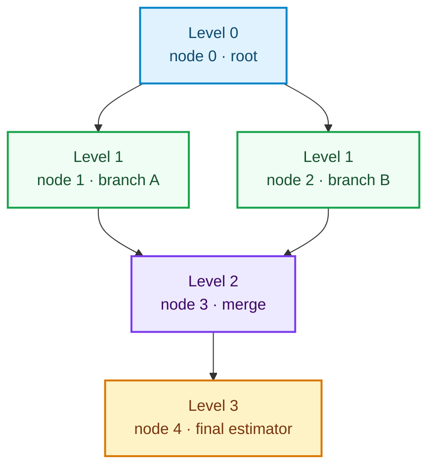
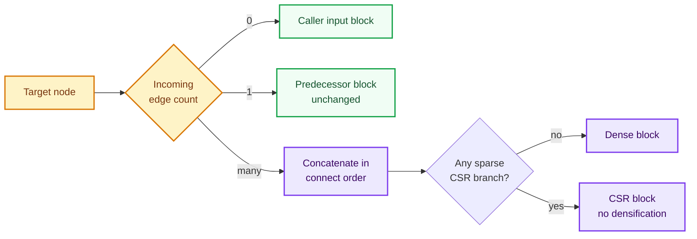

# Runtime DAG pipelines: topological fitting, deterministic levels and honest merges

Chapter 24 built `SKPipeline`, a **linear** conveyor belt checked by the compiler, and chapter 43
added `SKFeatureUnion`, a **fan-out** that stitches parallel branches side by side. Both are
composed before any data arrives: the Rust type of the builder records exactly which stages exist.
Real feature engineering, however, is rarely a straight line. One input may feed a numeric branch
and a categorical branch, a third branch may derive a missingness mask from the raw columns, two of
those branches may merge, and the merged result may feed yet another transformer before the
estimator. That shape is a **directed acyclic graph (DAG)** and its structure is often only known at
runtime — after reading a configuration file, a UI canvas or a remote experiment definition.

This chapter tells the story of `sciencekit_pipeline::graph` (capability `pipeline-graph`): the
validated runtime DAG, its mandatory builder, the deterministic topological scheduler, the
edge-order merge policy, the node-attributed error surface and the two typed prediction wrappers.
It is the first composition layer in `sciencekit` whose *shape* is a runtime value while every
stage keeps flowing through the same `SKFeatureBlock` medium built in chapter 19.

---

## 1. The problem, in plain words

Think of a factory floor. A linear pipeline is one conveyor belt: each station hands its output to
the next. A feature union is a single fan-out station that bolts several sub-assemblies onto the same
item at once. A DAG is the whole floor plan: stations can feed several successors, several stations
can feed one successor, and the only rule is that material never flows in a circle.

Written down, a DAG is a set of **nodes** $V$ and directed **edges** $E \subseteq V \times V$ with no
cycle. If an edge points from $u$ to $v$, then $u$ must finish before $v$ starts. A schedule that
respects every edge is a **topological order**. Any DAG has at least one, and when it has several,
we must pick one **deterministically** — otherwise fitting the same definition twice would produce
different floating-point results and the whole reproducibility story of the library would collapse.

Three more hazards are specific to this domain:

1. **A missing or duplicated sink.** If no node is a supervised estimator, there is nothing to fit.
   If two are, which one is *the* model? A validated DAG must end in exactly one final estimator.
2. **Orphan nodes.** A node that no input can reach, or that cannot reach the final estimator, is
   dead weight. It would silently never influence the model, or worse, never be fitted at all.
3. **Ambiguous merge order.** When two branches merge, the column order of the concatenated block
   decides which weight multiplies which feature. Rust's `petgraph` stores adjacency in a way that
   does not preserve insertion order, so "just iterate the neighbours" gives an order that is
   neither the user's nor stable across versions.

And one hazard that Rust can eliminate entirely: **scalar mixing**. Two stages fitted on `f32` and
`f64` cannot exchange a block without a lossy conversion, so the graph must be generic over exactly
one `SKFloat`.

---

## 2. The decisions, and the roads not taken

| Decision | Why we chose it | Alternatives we discarded |
|---|---|---|
| **Runtime DAG in a new `graph` folder module, separate from `SKPipeline`** | A runtime shape cannot be expressed by the compiler-checked types of chapter 24, and pretending otherwise would force type-level lists for arbitrary graphs. Keeping the two layers side by side lets users choose the stronger compile-time guarantee for linear work and the flexible runtime one for dynamic definitions. | Extending `SKPipeline` with a runtime stage list (mixes two very different error surfaces); generating Rust code from the graph (out of scope). |
| **`petgraph::DiGraph` as the storage** | Cycle detection, toposort and neighbour queries are already implemented and audited; `petgraph` is a small, widely used workspace dependency. | Hand-rolled adjacency lists (subtle bugs in cycle reporting); a per-node `Vec<Box<dyn ...>>` with linear scans. |
| **Mandatory builder; direct constructors private** | Follows the repository-wide builder rule. Only `build()` can return a `SKPipelineGraph`, and only after validation, so every value of the type is guaranteed acyclic, single-sink and fully connected. | A public struct with public fields (invalid graphs become representable). |
| **Validation returns `SKError::InvalidHyperparameter`** | The common error taxonomy already covers user-supplied invalid configuration, and callers can match it without learning a new variant for structural mistakes. | A dedicated `SKGraphError` enum (extra surface for no extra information). |
| **Deterministic level order: group by topological level, then ascending node id** | Levels are the natural parallelisable frontier and also give a stable reading order; the node id is a total order assigned by insertion. Two structurally identical graphs therefore schedule identically even when edges were inserted in a different order. | `petgraph`'s raw `toposort` order (depends on internal adjacency layout); node-id-only sorting (ignores dependencies). |
| **Merge order = exact `connect(source, target)` insertion order** | The user's `connect` calls are the only declaration of intent we have, so the concatenation must follow them literally. The insertion index is stored **as the edge weight**. | `petgraph` neighbour iteration (reverse-insertion and unstable); ascending node id (surprising when a branch is declared later). |
| **One `SKFloat` per graph, enforced at compile time** | A graph with mixed scalars is not merely invalid, it is unrepresentable: `add_transformer` and friends require `Stage: SKBlockTransformer<F>` where `F` is the builder's scalar. A `compile_fail` doctest on `add_transformer` pins this guarantee. | A runtime scalar check (the impossible state would remain representable and would need an error variant). |
| **Node-attributed errors via `SKPipelineGraphNodeError`, alongside plain `SKError` methods** | Every fallible operation exists twice: `fit`/`fit_checked`, `predict`/`predict_checked`, and so on. The checked variants name the failing node and keep structured variants (`ShapeMismatch`, `UnsupportedRepresentation`) intact for pattern matching. | Prefixing every message inside `SKError` (loses the structured variant); only returning `SKError` (no node context). |
| **Type-erased final model (`SKBoxedFinalModel`) with typed downcast** | The graph must store one of three supervision flavours behind one type, but callers still want the concrete model back. The box keeps an `Arc<dyn Any + Send + Sync>` plus an erased predictor façade; `downcast_reference::<Model>()` recovers the concrete type. | Making `SKPipelineGraph` generic over the final estimator type (leaks the estimator type into every accessor and defeats runtime graphs). |
| **Dense, CSR and mixed blocks throughout; no implicit densification** | The layer sits on top of `SKFeatureBlock`, so the merge simply reuses the CSR-preserving concatenation written for `SKFeatureUnion`. | Densifying before concatenation (memory blow-up on wide sparse branches). |

---

## 3. The concepts, taught from zero

### Nodes, edges and the feature-block medium

A graph node stores a **payload** — a boxed transformer, a boxed `SKFeatureUnion`, a `Merge` marker
or a boxed final estimator. The payload is generic over the scalar `F` that the whole graph shares.
Data never lives in the payload: during fitting, each node's output block is written into an
`SKNodeBlockStore<F>`, a `BTreeMap<SKNodeIdentifier, SKFeatureBlock<F>>` kept sorted so iteration
and equality checks are deterministic.

```mermaid
flowchart LR
    accTitle: Node payloads and the shared feature-block medium of a runtime DAG
    accDescr: A validated SKPipelineGraph holds four kinds of node payload. Transformers and feature unions fit on their incoming block and emit a new block. A merge node concatenates its incoming blocks. The single final estimator node fits a supervised model on the block it receives. Every edge carries a feature block at execution time, resolved from the node block store.
    IN["Input rows<br/>SKDataView"] --> R["Transformer root<br/>SKPipelineGraphNodeKind::Transformer"]
    R --> T1["Transformer<br/>branch A"]
    R --> T2["FeatureUnion<br/>branch B"]
    T1 --> M["Merge<br/>column concatenation"]
    T2 --> M
    M --> T3["Transformer<br/>post-merge"]
    T3 --> F["FinalEstimator<br/>SKBoxedFinalModel"]
    F --> OUT["Labels / probabilities / responses"]
    classDef sky fill:#e0f2fe,stroke:#0284c7,stroke-width:2px,color:#0c4a6e
    classDef emerald fill:#f0fdf4,stroke:#16a34a,stroke-width:2px,color:#14532d
    classDef violet fill:#ede9fe,stroke:#7c3aed,stroke-width:2px,color:#3b0764
    classDef amber fill:#fef3c7,stroke:#d97706,stroke-width:2px,color:#78350f
    class IN,OUT sky
    class R,T1,T2,T3 emerald
    class M violet
    class F amber
```

### Validation: three structural promises

`build()` calls `sk_validate_graph`, which performs the promises the spec names:

1. **Every edge endpoint exists.** `connect` refuses to insert an edge whose endpoints are not yet
   nodes; the offending pair is remembered and reported as `InvalidHyperparameter`.
2. **No cycles.** `petgraph::algo::toposort` detects them, and a depth-first search then reconstructs
   one concrete cycle path so the error reads `pipeline graph contains a cycle: node 1 -> node 2 ->
   node 1` instead of a bare "cycle".
3. **Exactly one final estimator, and it is a sink.** Zero or several final estimators, or a final
   estimator with outgoing edges, are rejected with `InvalidHyperparameter` naming the node(s).
4. **Full reachability.** Every node must be reachable from some input root *and* must reach the
   final estimator. Both directions are checked with a breadth-first search, so neither orphaned
   islands nor dead-end branches survive.

### Deterministic levels

`sk_topological_level_order` starts from `petgraph`'s toposort and then assigns each node a **level**:
an input root is level `0`, and every other node is `1 + max(level of its predecessors)`. Nodes are
finally sorted by `(level, node identifier)`. Two consequences matter:

- nodes at the same level are independent by construction, so their relative order is a policy
  choice — ours is ascending identifier;
- the resulting vector is a total, reproducible schedule, and `topological_order()` exposes it.

### Edge-order merges

Each `connect(source, target)` stores a monotonically increasing insertion counter **as the edge
weight**. When a node has several incoming edges, `sk_ordered_predecessors` sorts them by that
counter and `sk_resolve_incoming_block` applies a three-way policy:

- **zero incoming edges (a root):** the caller's input block is the node's input;
- **one incoming edge:** that predecessor's block is passed through unchanged — no copy, no
  densification;
- **several incoming edges:** the blocks are concatenated horizontally in exact `connect` order.

The concatenation itself is the CSR-preserving routine from chapter 43, promoted from `pub(super)`
to `pub(crate)` so both composition layers share one implementation. All-dense inputs stay dense; if
any input is sparse CSR the result is CSR, and no sparse block is ever densified.

### Widths are re-checked at prediction time

During `fit`, the width of every incoming branch is recorded in `incoming_widths`. During
`predict`, `sk_resolve_incoming_block` receives those recorded widths: a single-predecessor node
must still receive exactly the width it was fitted on, and a multi-predecessor merge must still
produce the same per-branch widths it concatenated during fitting. A drift is reported as a
node-attributed `ShapeMismatch`. Node outputs are also validated for representation (dense or CSR
only, never CSC) and for row count after every stage.

---

## 4. The public surface, object by object

### `SKPipelineGraphBuilder<F>` and `SKPipelineGraph<F>`

`SKPipelineGraph::start::<F>()` (and the equivalent `SKPipelineGraph::build()` on a scalar-annotated
path) opens the builder. It exposes four node constructors — `add_transformer`,
`add_feature_union`, `add_merge`, `add_classifier` / `add_regressor` / `add_final_estimator` — each
returning an opaque `SKNodeIdentifier` whose `index()` is its zero-based insertion position.
`connect(source, target)` returns `&mut Self` so chains read naturally. The builder also carries the
mandatory `backend` (default `SKBackendKind::Faer`) and `execution_mode` (default
`SKExecutionMode::Automatic`) parameters, and implements the shared `SKBuilder` trait. `build()`
validates and freezes the topology into an `SKPipelineGraph`, which exposes `node_count`,
`edge_count`, `topological_order`, `final_node`, `node_kind`, `incoming_nodes`, `backend` and
`execution_mode`.

### `SKPipelineGraph::fit` / `fit_checked` and `SKPipelineGraphModel<F>`

`fit` converts the input into an `SKFeatureBlock`, then walks the topological order once. For each
node it resolves the incoming block, opens a `pipeline_graph_node` tracing span carrying the node
identifier, kind and operation, and dispatches on the payload: transformers and unions fit and then
transform; merges validate and store; the final estimator fits and produces an
`SKBoxedFinalModel`. The fitted `SKPipelineGraphModel` keeps the fitted stages, the recorded
incoming widths, the per-node blocks and the final model, and exposes accessors for all of them
(`fitted_node_blocks`, `fitted_node_block`, `incoming_widths`, `number_of_input_features`,
`number_of_features`, `final_model`). `SKPipelineGraphClassifier` and `SKPipelineGraphRegressor`
wrap the model to implement the shared `SKClassifierPredictor` / `SKRegressorPredictor` contracts,
so a DAG can be dropped wherever a classifier or regressor is expected.

### `SKPipelineGraphNodeError` and `SKBoxedFinalModel<F>`

The checked methods return `SKPipelineGraphNodeError`, which pairs an `Option<SKNodeIdentifier>` with
the underlying `SKError`. `into_sk_error()` prefixes dynamic-message variants with
`pipeline graph node N: ` while leaving structured variants matchable; `to_string()` reads the same
way. `SKBoxedFinalModel` keeps the concrete fitted model inside an `Arc<dyn Any + Send + Sync>` and
stores a type-erased predictor façade for classifiers, regressors, or supervised-only models;
`is_classifier`, `is_regressor` and `downcast_reference::<Model>()` let callers inspect or recover it.

---

## 5. Walking the real companion tests

Every claim above is pinned by a named test. The suite lives beside the implementation, in
`crates/sciencekit_pipeline/src/graph/*_tests.rs`, plus three acceptance files under
`crates/sciencekit_pipeline/src/acceptance_tests/pipeline_graph_*.rs`.

**Construction and configuration — `graph_builder_tests.rs`.** 
`graph_builder_assigns_monotonic_node_identifiers_and_records_edges` checks that identifiers are
`0, 1, 2, 3` in insertion order, that `Display` renders `node 0`, that `node_kind` reports the right
`SKPipelineGraphNodeKind`, and that `node_count`/`edge_count` match. 
`graph_builder_carries_backend_and_execution_mode_overrides` proves the builder starts at `Faer` /
`Automatic` and records explicit overrides.

**Validation — `graph_validate_tests.rs`.** 
`cyclic_graphs_are_rejected_with_invalid_hyperparameter_naming_the_cycle` builds a two-node cycle and
a self-loop and asserts the reason names the nodes involved.
`zero_or_two_final_estimators_are_rejected_with_invalid_hyperparameter` covers both cardinality
failures. `disconnected_and_dead_end_nodes_are_rejected_with_invalid_hyperparameter` covers an
island that no input reaches and a branch that never reaches the sink.
`final_estimator_with_outgoing_edge_and_foreign_node_id_are_rejected` checks the sink rule and the
out-of-range edge endpoint. `valid_diamond_graph_passes_validation` is the happy path.

**Scheduling — `graph_order_tests.rs`.** 
`topological_order_respects_dependencies_when_nodes_are_inserted_reverse` inserts the sink first and
proves the schedule still respects dependencies and ascending identifiers.
`same_level_nodes_execute_in_ascending_node_identifier_order_independent_of_edge_insertion` builds
the same three-branch graph twice with opposite `connect` order and asserts identical orders
`[0, 1, 2, 3, 4]`. `per_node_block_store_keeps_blocks_sorted_by_node_identifier` checks the
`BTreeMap` ordering of `SKNodeBlockStore`.

**Fitting — `graph_fit_tests.rs`.** 
`diamond_graph_fits_both_branches_and_matches_equivalent_linear_chain` fits a diamond
(imputer → standard scaler / min-max scaler → classifier) and compares predictions node by node with
`SKPipeline` + `SKFeatureUnion`. `regressor_diamond_graph_learns_identical_weights_to_linear_feature_union_chain`
goes further and compares the fitted coefficients and intercept to `1e-12`.

**Merges — `graph_merge_tests.rs`.** 
`explicit_merge_node_concatenates_columns_in_exact_edge_insertion_order` connects branches three, ten
and twenty into the merge in the order `[node 2, node 0, node 1]` and asserts the first merged row is
`[30.0, 10.0, 20.0, 20.0]` — insertion order, not identifier order.
`merge_node_feeding_downstream_transformer_and_mismatch_attribution_work` places a transformer after
the merge and checks that a row-count mismatch is attributed to the right node.

**Prediction — `graph_predict_tests.rs`.** 
`classifier_wrapper_predictions_and_probabilities_match_linear_equivalent_on_unseen_rows` and
`regressor_wrapper_predictions_match_linear_equivalent_on_unseen_rows` exercise the typed wrappers on
held-out rows. `wrapper_role_mismatch_and_query_width_mismatch_surface_structured_errors` proves that
calling `predict_labels` on a regressor graph, or predicting with the wrong number of input columns,
returns structured errors rather than panics.

**Representation — `graph_representation_tests.rs`.** 
`sparse_csr_diamond_flows_without_implicit_densification_and_matches_dense_predictions` fits the
same diamond on CSR and on dense input, asserts sparse nodes stay sparse via `SKFeatureBlock::is_sparse`,
and compares predictions. `representation_rejection_surfaces_failing_node_identifier_and_representation_name`
feeds CSR to a dense-only scaler during fit and during predict, and a custom `CscEmittingStage`
produces a CSC output, asserting that each error names its node and the representation string.

**Determinism and concurrency — `graph_concurrency_tests.rs`.** 
`graph_definitions_and_fitted_models_are_send_and_sync` is a compile-time assertion.
`repeated_fits_produce_identical_node_blocks_and_predictions_and_accessors_cover_every_node` fits
twice and compares every node block, the topological order and the predictions, while checking that
the order covers each node exactly once. `concurrent_prediction_and_refitting_across_threads_match_sequential_results`
shares one fitted graph across eight scoped threads and compares every concurrent label,
probability and response with the sequential result, including a refit per thread.

**Acceptance — `acceptance_tests/pipeline_graph_*.rs`.** 
On small data, `tiny_diamond_graphs_match_linear_equivalents_across_f64_and_f32_and_produce_metrics`
covers both scalars and produces accuracy, MSE and $R^2$; 
`tiny_sparse_and_mixed_graphs_preserve_csr_without_densification_and_attribute_rejections` covers
mixed representations; `doomed_graph_fixtures_and_single_edge_width_drift_surface_structured_errors`
covers structural failures and a deliberate width drift. On large data,
`large_multi_level_dense_dags_fit_predict_and_produce_classifier_and_regressor_metrics` builds a
multi-level DAG and scores it, `large_sparse_csr_dag_fits_without_densification_and_produces_metrics`
keeps CSR end to end, and
`large_dag_concurrent_predictions_and_refits_match_sequential_results` repeats the concurrency
guarantee at scale.

---

## 6. What this layer deliberately does not do

- **No persistence of the graph definition itself.** The fitted model is a Rust value; exporting it
  belongs to the model-export changes, not to the scheduler.
- **No parallel execution of same-level nodes.** The level order is *ready* to drive a parallel
  scheduler, but this change executes deterministically and sequentially; threading is a later,
  separately measured optimisation.
- **No runtime scalar polymorphism.** One graph is one `SKFloat`; mixing scalars is a compile error,
  not a validation error.
- **No fit-time densification shortcuts.** A branch that cannot accept CSR fails with a
  node-attributed `UnsupportedRepresentation` instead of being silently converted.

The next chapter in this book keeps the story going with the composition layers that build on this
scheduler; when a new graph feature lands, amend this chapter rather than adding a parallel one.
