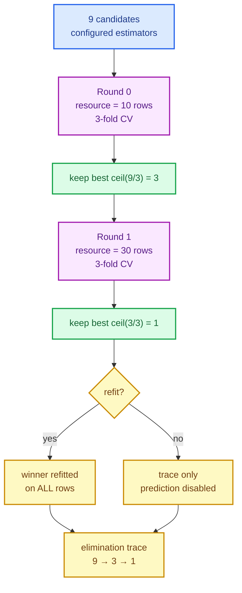

# Successive halving: spend the budget where it pays

Grid search is honest but greedy. It spends the *full* dataset on every candidate, including
the ones that are obviously bad after a handful of rows. Successive halving flips the budget
around: evaluate everybody cheaply first, keep the promising fraction, and only then pay for
more data.

This chapter builds `SKHalvingGridSearchClassifier` and `SKHalvingGridSearchRegressor`: the
round scheduler, the seeded resource subsample, the deterministic elimination trace, the
aggressive mode, the refit, and the result surface a caller inspects afterwards.

The capability is `halving-grid-search`; the code lives in
`crates/sciencekit_model_selection/src/halving/`.

## 1. The problem, in plain words

You have nine candidate configurations. Grid search fits all nine on every fold of the full
training set. But if a candidate is clearly worse after thirty rows, the remaining nine
hundred rows you spend on it are wasted. Successive halving:

1. evaluates all nine candidates on a **small resource** (say ten rows);
2. ranks them by their cross-validated mean score;
3. keeps the best `ceil(n / factor)` — with factor 3, the best three;
4. multiplies the resource by the factor (ten → thirty);
5. repeats until one candidate remains or the maximum resource is reached;
6. optionally **refits** the winner on all the rows.

Every step has a trap. If each round drew a different random subset with no seed, two runs
would rank differently. If ties broke arbitrarily, the trace would not be reproducible. If a
small round used a different fold partition than the next, the comparison would mix "better
candidate" with "luckier split". And if the final refit reused the tiny last subsample instead
of the whole dataset, the deployed model would be trained on almost nothing.



## 2. The decisions, and the roads not taken

1. **Rounds are driven by a resource schedule, not by a hard-coded count.** The schedule is
   the geometric sequence `minimum_resource * factor^round`, clipped to
   `maximum_resource`. With a minimum of 10 and a factor of 3 it is `10, 30, 90, …`; the loop
   stops early as soon as only one candidate survives. There is no "number of rounds" knob to
   get wrong.
2. **The resource is a row budget, and it is a closed enum.** `SKHalvingResource` currently
   has exactly one variant, `NumberOfSamples` (the default). Making it an enum rather than a
   boolean keeps the door open for future resource axes (trees, epochs) without a breaking
   API change.
3. **Every round draws its own subsample from one seed.** The round seed is derived from the
   configured `random_seed` and the round index, so round 0 and round 1 never share rows by
   accident, but rerunning the same search reproduces every draw exactly.
4. **Stratification follows the splitter, not the caller.** If the splitter answers
   `requires_stratification() == true` (as `SKStratifiedKFold` does), the subsample preserves
   class proportions. Group labels, when supplied, are preserved proportionally instead.
5. **The folds are the grid-search folds.** Each round reuses the shared
   `sk_evaluate_candidates` machinery, so candidates are compared on the same fold partition
   *within a round*. Only the rows change between rounds — which is the whole point.
6. **Elimination is deterministic.** Candidates are ranked by descending mean score; an exact
   tie goes to the smaller **original candidate index**, and `NaN` ranks below every finite
   score. The same seed and data therefore produce a byte-identical trace.
7. **Aggressive elimination is opt-in.** By default the survivor count is exactly
   `ceil(n / factor)`; a short resource schedule may therefore end with several survivors.
   `aggressive_elimination(true)` prunes down to what the remaining rounds can actually
   support, so the tournament ends with a single winner.
8. **Refit is explicit.** With `refit(true)` the winner is fitted on **all** rows and the
   result exposes prediction; with `refit(false)` the trace and the winning configuration are
   still available, but prediction and export return `UnsupportedOperation`.

*Roads not taken.* Random or Bayesian search (a different change), resource types such as
number of trees or epochs (not yet modelled), re-splitting the folds after subsampling with a
different random partition (would break the shared-fold comparison), and refitting at every
round (wasted work — only the final winner is deployed).

## 3. The concepts, taught from zero

### Resources and rounds

A **resource** is how much training data a round is allowed to use. A **round** is one full
cross-validation sweep of the still-alive candidates at one resource. The sequence of
resources is computed before the loop starts, by
`sk_halving_resource_schedule(minimum_resource, maximum_resource, factor)`. It uses
`checked_mul` and stops at the cap, so a huge factor or a nearly-`usize::MAX` resource cannot
overflow; an invalid schedule (`minimum_resource == 0`, `minimum_resource > maximum_resource`,
or `factor < 2`) simply returns an empty vector and the search fails cleanly.

The candidate trajectory is computed by the sibling function
`sk_halving_candidate_schedule(number_of_candidates, factor)`: it repeatedly applies ceiling
division until one survivor remains. Nine candidates with factor 3 give `9 → 3 → 1`; ten give
`10 → 4 → 2 → 1`, because `ceil(10/3) = 4`. The real loop does not call this function — it
stops when the alive list has one element — but the function is the executable statement of
the schedule the spec promises.

### Ceiling division, from zero

Integer division truncates: `10 / 3 = 3`. Successive halving must not *over*-eliminate, so it
rounds up: `ceil(10/3) = 4`. Rust spells this `10_usize.div_ceil(3)`. The one-survivor case
is special: `ceil(1/3) = 1`, but the loop must stop, so the schedule function only continues
while `current > 1`.

### Seeded subsampling

To evaluate on exactly `resource` rows, the search shuffles row indices with a deterministic
generator and truncates. The seed is *derived*, not reused:

```text
round_seed = sk_derive_seed(random_seed, SK_RANDOM_DOMAIN_STAGE, round_index)
```

`SK_RANDOM_DOMAIN_STAGE` keeps this draw in its own random stream, so adding a future consumer
of the same base seed cannot change the halving trace. When the resource is already the whole
dataset, the search returns `0..total_rows` in order — no shuffle, no allocation of a
different ordering.

Stratified and grouped subsampling share a proportional allocator. Class (or group) sizes are
allocated with `sk_allocate_class_counts`, then each class or group is shuffled with its own
derived seed (`SK_RANDOM_DOMAIN_FOLD` plus the group position) and truncated; the union is
shuffled once more. A 70/30 binary target subsampled to 30 rows therefore contains exactly 21
and 9 rows, as the tests assert for both integer and nominal labels.

### The score matrix, reused

`sk_evaluate_candidates` returns the same `SKGridSearchResults<F>` that grid search uses: a
`candidates × folds` matrix with per-candidate means and population standard deviations. A
halving round wraps that matrix together with its bookkeeping — round number, resource,
evaluated indices, survivors, eliminated indices, aggressively pruned indices — in
`SKHalvingRound<F>`.

### Ranking, ties and `NaN`

`sk_rank_candidate_indices` sorts positions by `sk_compare_scores(right, left)`, so a larger
mean comes first. When means compare equal, the **original candidate index** decides, not the
position in this round's evaluated list. That last detail matters: in round 1 the surviving
candidates are no longer stored in their original order, and the trace must still prefer
candidate 3 over candidate 8 if they tie. `NaN` compares below every finite score, so a
candidate that failed under `SKErrorScore::Value(NaN)` can never win.

### Aggressive elimination, precisely

A standard round keeps `ceil(alive / factor)` candidates regardless of how much budget is
left. If the resource schedule has only two rounds, a tournament that starts with 27
candidates will still have 3 survivors after the last round — no single winner. Aggressive
mode caps the survivor count at what the remaining rounds can reduce to one:

$$\begin{aligned}
\text{future\_rounds} &= \text{number\_of\_resources\_from\_here\_to\_the\_cap} - 1 \\
\text{capacity} &= \text{factor}^{\text{future\_rounds}} && (\text{checked, saturating}) \\
\text{survivors} &= \min(\lceil \text{alive} / \text{factor} \rceil, \text{capacity})
\end{aligned}$$

With 27 candidates, factor 3, and the schedule $[10, 30]$, $\text{future\_rounds} = 1$, so capacity is
3: round 0 keeps three candidates, prunes the other six early, and round 1 finishes with one.
The pruned six are still named in `aggressively_pruned_candidate_indices()` — pruning is
recorded, never hidden.

## 4. Each public object, explained

- **`SKHalvingGridSearchClassifier<F, E>` / `SKHalvingGridSearchRegressor<F, E>`** — the
  search estimators. Construction goes only through
  `SKHalvingGridSearchClassifierBuilder` / `SKHalvingGridSearchRegressorBuilder`, reached with
  `SKHalvingGridSearchClassifier::build()`. The builders expose `candidates`, `splitter`,
  `scoring`, `factor`, `minimum_resource`, `maximum_resource`, `resource`,
  `aggressive_elimination`, `random_seed`, `refit`, `error_score`, `groups`, `backend` and
  `execution_mode`. Defaults: factor `3`, minimum resource `1`, maximum resource = all rows,
  `NumberOfSamples`, no aggressive elimination, seed `0`, refit `true`,
  `SKErrorScore::Raise`, backend `Faer`, execution mode `Automatic`.
- **`SKHalvingGridSearchClassifierModel<F, E>` /
  `SKHalvingGridSearchRegressorModel<F, E>`** — the fitted result. It exposes
  `elimination_trace()`, `number_of_rounds()`, `candidate_count_trajectory()`,
  `resource_schedule()`, `best_candidate_index()`, `best_score()`, `best_parameters()` (the
  winning configured candidate), `best_model()`, `is_refitted()`, `scoring()`,
  `execution_mode()` and `backend()`. The classifier additionally delegates
  `predict_labels` / `predict_probabilities`; the regressor delegates `predict`.
- **`SKHalvingRound<F>`** — the immutable record of one round: `round()`, `resource()`,
  `evaluated_candidate_indices()`, `surviving_candidate_indices()`,
  `eliminated_candidate_indices()`, `aggressively_pruned_candidate_indices()`,
  `ranked_candidate_indices()`, `mean_scores()`, `standard_deviations()`, `fold_scores()` and
  the underlying `results()`.
- **`SKHalvingResource`** — the closed, `#[non_exhaustive]` resource axis; `NumberOfSamples`
  is the default and the only variant today.
- **`SKHalvingScoring`** — the family-safe scoring wrapper. The builders accept either a
  `SKClassifierScoring` or a `SKRegressorScoring` through `Into<SKHalvingScoring>`; the wrong
  family fails at construction with `InvalidHyperparameter` instead of mis-scoring at fit
  time.
- **`sk_halving_resource_schedule` / `sk_halving_candidate_schedule`** — the free functions
  that make the schedule visible and testable without fitting anything.
- **`SKExportable`** — implemented by both fitted models by delegating `export_state()` to the
  refitted winner; without refit it returns `UnsupportedOperation` naming the `refit(false)`
  configuration.

## 5. A real walk-through, using the tests

### `halving_scheduler_tests.rs` — the schedule, by hand

`halving_scheduler_nine_candidates_shrink_nine_three_one` pins the spec's headline sequence.
`halving_scheduler_non_multiple_candidate_counts_use_ceiling_division` proves `10 → 4 → 2 → 1`
and that a single candidate stays `[1]`. `halving_scheduler_resource_grows_geometrically_up_to_maximum`
checks `10, 30, 90` and `10, 30, 90, 270`. The boundary test — `halving_scheduler_handles_overflow_and_boundary_resources_cleanly`
— exercises a resource equal to the cap, a near-`usize::MAX` minimum, and every invalid
schedule (zero minimum, inverted bounds, factor 1), which must all return an empty vector
rather than panic or loop.

### `halving_trace_tests.rs` — deterministic elimination

`halving_trace_ranks_by_descending_mean_and_breaks_ties_by_original_index` ranks
`[7, 2, 5, 1, 4]` with means `[0.80, 0.80, NaN, 0.95, 0.80]` and expects `[1, 2, 4, 7, 5]`:
candidate 1 wins on score, 2 and 4 tie and beat 7 by original index, and candidate 5 (`NaN`)
sinks to last even though its index is smaller than 7. `halving_trace_splits_survivors_and_eliminated_candidates_cleanly`
builds a six-candidate, two-fold matrix and checks every accessor of `SKHalvingRound` at once.
`halving_trace_tie_in_later_round_still_prefers_smaller_original_index` is the subtle one: it
feeds the round a list `[8, 3]` and equal scores, and asserts candidate 3 survives — proving
the tie-break uses the *original* index, not the position in the current round.

### `halving_subsample_tests.rs` — seeded, stratified, sparse-aware

`halving_subsample_draws_exact_resource_count_and_is_reproducible_per_seed_and_round` draws
30 of 100 rows four ways: the same seed and round must be identical, a different round must
differ, and a different base seed must differ. `halving_subsample_stratified_preserves_class_proportions_for_integer_and_nominal_targets`
uses a 70/30 target and asserts exactly 21 and 9 rows, for integer labels and for string
labels. `halving_subsample_preserves_sparse_csr_representation_and_groups` subsamples a CSR
matrix and checks the result is still `SKDataView::Sparse` with the same nonzero payload as
`sk_gather_rows`, and that three equal groups each receive five of the fifteen rows.
`halving_subsample_full_budget_returns_all_rows_and_stratified_splitter_signals_requirement`
pins the no-op case — all rows, original order — and confirms that `SKStratifiedKFold`, unlike
`SKKFold`, reports `requires_stratification() == true`.

### `halving_evaluation_tests.rs` — the loop itself

`halving_evaluation_runs_nine_three_one_and_selects_true_target_constant` uses nine mock
regressors and ninety rows: round 0 at resource 10 evaluates all nine and keeps three; round 1
at resource 30 evaluates three and keeps one; the winner is the candidate whose constant equals
the target. `halving_evaluation_stops_at_maximum_resource_and_picks_highest_mean_with_tie_break`
stops at the cap with two survivors and resolves a tie to the smaller index. The error-policy
test, `halving_evaluation_respects_raise_and_value_error_score_policies`, shows `Raise`
propagating the mock's failure and `Value(NaN)` letting the healthy candidate win. Finally,
`halving_evaluation_single_candidate_still_evaluates_one_round` proves a one-candidate search
does not return an empty trace.

### `halving_aggressive_tests.rs` — pruning what the budget cannot support

`halving_aggressive_prunes_candidates_early_when_budget_cannot_support_survivors` runs 27
candidates against a two-round schedule with and without aggressive mode: the standard run
keeps nine survivors after round 0 and finishes with three, while the aggressive run keeps
three, records six aggressively pruned candidates, and finishes with one.
`halving_aggressive_is_a_no_op_when_budget_supports_all_rounds_and_breaks_ties_deterministically`
shows that a one-round schedule prunes extra candidates (9 → 1) while a full `[10, 30, 90]`
schedule prunes nothing extra and still resolves ties by index.

### `halving_refit_tests.rs` — the winner, refitted on everything

`halving_refit_classifier_trains_winner_on_all_rows_and_delegates_predictions` fits a
threshold classifier over nine candidates, checks `candidate_count_trajectory() == [9, 3, 1]`,
`resource_schedule() == [18, 54]`, the winning threshold, and — crucially —
`training_rows() == 90`, proving the final fit used the whole dataset rather than the last
54-row round. It also checks that `backend(MatrixMultiply)` and
`execution_mode(InProcessSynchronous)` survive into the model, and that labels and
probabilities are delegated to the winner. The regressor twin,
`halving_refit_regressor_trains_winner_on_all_rows_and_delegates_predict`, repeats the story
with 27 candidates, three rounds `[10, 30, 90]`, trajectory `[27, 9, 3, 1]`, and a refit on all
100 rows.

### `halving_concurrency_tests.rs` and `halving_representation_tests.rs`

`halving_concurrency_no_refit_blocks_regressor_and_classifier_predictions` proves that
`refit(false)` yields `best_model().is_none()` and that `predict`, `predict_labels` and
`predict_probabilities` all return `UnsupportedOperation` naming the operation.
`halving_concurrency_parallel_fits_and_thread_pools_produce_identical_traces` fits the same
search under a one-thread and a four-thread rayon pool and demands identical traces, then
shares one model across eight threads and compares predictions. Representation parity lives in
`halving_concurrency_representation_dense_sparse_and_mixed_match_without_densification`, which
fits dense and CSR designs and asserts identical traces, cross-representation prediction, and —
with a sparse-only mock — that neither subsampling nor the final refit densified the CSR.
`halving_concurrency_rejects_non_finite_rows_even_outside_sampled_budget` is the validation
guard: a `NaN` in row 39 of 40 is rejected even though the configured resource only samples
six rows.

### `builder/` and `validation_tests.rs`

`halving_builder_*` pins the defaults, rejects `factor < 2`, invalid resource bounds, empty
candidates, a missing splitter and a scorer from the wrong family — including an explicit
check that every optional setter and the `SKBuilder` trait dispatch are honoured.
`halving_acceptance_rejects_empty_mismatched_non_finite_and_oversized_resource_inputs` covers
the fit-time guards: empty data, target-length mismatch, dense and sparse non-finite values,
a `maximum_resource` larger than the dataset, and a `minimum_resource` above the effective
cap.

### The acceptance suite

`acceptance_tests/halving/` is the executable contract at the public surface.
`halving_acceptance_tiny_classifier_and_regressor_select_refitted_and_exportable_winners`
covers small data, export metadata and the no-refit export error; the `f32` companion,
`halving_acceptance_f32_scalar_pipeline_runs_without_f64_detour`, proves scalar genericity.
`halving_acceptance_large_classifier_runs_multi_round_schedule_and_refits_full_dataset` runs
1,080 rows, checks `[40, 120, 360]` and `[27, 9, 3, 1]`, and verifies every fold score is
finite. `halving_acceptance_large_regressor_supports_factor_two_three_and_four_schedules`
pins the schedules for factors 2, 3 and 4; and
`halving_acceptance_thirty_row_resource_evaluates_exact_thirty_rows_across_every_fold`
instruments the estimator to prove all nine fold evaluations saw exactly 30 rows.
`halving_acceptance_kfold_and_imbalanced_stratified_kfold_preserve_fold_contracts`,
`halving_acceptance_group_kfold_respects_groups_and_rejects_invalid_group_configurations` and
`halving_acceptance_aggressive_mode_prunes_early_on_public_estimator_surface` exercise the
splitters, groups and aggressive mode through the builders. The scoring-policy sweep
`halving_acceptance_every_classifier_and_regressor_scoring_policy_produces_finite_traces`
visits every `SKClassifierScoring` and `SKRegressorScoring` variant, while
`halving_acceptance_determinism_error_score_and_held_out_metrics_compose` ties the whole story
together: a seeded train/test split, a deterministic halving search, `ErrorScore::Value(NaN)`
recovery, and held-out accuracy, F1, MSE and $R^2$ produced by `sciencekit_metrics`.

## 6. Why this shape scales

The total work is dominated by the first round, not the last. Nine candidates at resource 10
cost 90 candidate-rows; three candidates at resource 30 cost another 90; one candidate at
resource 90 costs 90. A full grid search would have spent $9 \times 90 = 810$ candidate-rows. The
saving is roughly a factor of the elimination ratio per round, and it compounds on large
grids — exactly the regime where exhaustive search stops being practical.

The price is statistical: an early round sees fewer rows, so its ranking is noisier. That is
why the seed, the stratification and the deterministic tie-break all matter, and why the trace
is exposed rather than hidden. You can inspect every round, see which candidates were
eliminated and which were aggressively pruned, and decide whether the budget was too small.

## 7. Recap

- Successive halving evaluates all candidates cheaply, keeps `ceil(n / factor)`, grows the
  resource geometrically, and repeats until one survivor or the cap.
- The resource and candidate schedules are pure functions; the loop is a thin driver over the
  shared grid-search evaluator.
- Subsamples are seeded per round, stratified when the splitter requires it, group-aware when
  groups are supplied, and never densify a sparse design.
- Ranking is descending by mean, ties by original candidate index, `NaN` last.
- Aggressive elimination prunes to what the remaining rounds can support and records what it
  pruned.
- Refit trains the winner on all rows; without it, prediction and export are rejected, not
  silently wrong.
