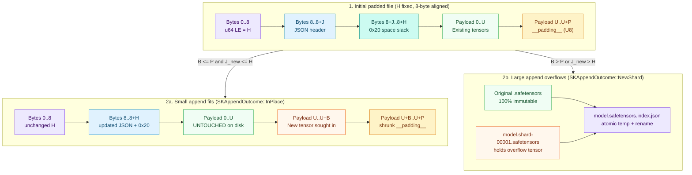

# Extended Safetensors format: safe binary checkpoints, sharding, in-place padding and compression

## 1. The problem we were solving

A fitted machine-learning model is more than code: it is the learned numbers (weights, split
thresholds, centroids, feature masks) plus the identity and configuration that give those
numbers meaning (which estimator wrote them, how many features it expects, what class labels
map to indices $0, 1, \dots, K-1$, and which hyperparameters were active).

Historically, Python libraries reached for `pickle` to save fitted models. `pickle` is a
stack-based virtual machine: loading an untrusted file can execute arbitrary code before a
single prediction runs. On the other end of the spectrum, the human-readable JSON debug
format ([Chapter 45](./ch45-json-debug-format.html)) is completely safe and great for `git
diff`, but converting millions of 64-bit floating-point numbers into UTF-8 decimal text
inflates file sizes and forces full-document parsing before you can inspect one tensor.

HuggingFace's **Safetensors** format solves the core binary problem cleanly: a file begins
with an 8-byte little-endian integer $H$, followed by $H$ bytes of UTF-8 JSON describing each
tensor's data type, shape and byte offsets, followed immediately by a flat contiguous buffer
of raw little-endian tensor bytes. No executable opcodes exist anywhere in the specification.

For `sciencekit`'s internal checkpoint format (PRD §8.2, spec `safetensors-format`), plain
single-file Safetensors needed four careful extensions — **without** breaking standard
Safetensors readers on the single-file path:

1. **Rich estimator metadata** in the standard `"__metadata__"` string map: container format
   version, estimator name and version, scalar data type, feature count, canonical class
   labels and typed hyperparameters.
2. **Sharding (`SKShardPlan`)** for large models: splitting tensors across immutable
   `.safetensors` shard files paired with an atomically updated `.safetensors.index.json`
   manifest that the reader merges transparently.
3. **Header and payload padding** for small incremental additions (such as attaching an
   out-of-bag score or a low-rank adapter): reserving slack in both the JSON header and a
   `__padding__` byte region so new tensors can be written **in place** by seeking, without
   rewriting existing tensor payloads — and automatically spilling into a new shard the
   moment reserved space runs out.
4. **Whole-file compression** (`.safetensors.gz`, `.safetensors.brotli`,
   `.snappy.safetensors`) behind optional Cargo features, detected automatically from magic
   bytes on read.

---

## 2. The architecture in one picture

```mermaid
flowchart LR
    accTitle: Extended Safetensors export, sharding, padding, compression and validated import pipeline
    accDescr: An SKExportable model produces an SKModelState, which SKSafetensorsWriter encodes into standard Safetensors bytes with optional header and payload padding, splits across immutable shards with an atomic index when SKShardPlan is exceeded, and optionally wraps in Gzip, Brotli or Snappy. SKSafetensorsReader auto-detects magic bytes to decompress, validates duplicate keys, version, shapes and contiguous offsets, merges any shards, excludes padding, and rebuilds SKModelState for SKImportable.

    M1["Fitted model<br/>SKExportable"]:::violet --> S1["SKModelState<br/>metadata + BTreeMap"]:::blue
    S1 --> W["SKSafetensorsWriter<br/>shard_plan · padding · codec"]:::green
    W -->|"single / padded"| F1[".safetensors<br/>8B len + JSON + LE bytes"]:::amber
    W -->|"exceeds threshold<br/>or padding overflows"| F2["Immutable shards +<br/>atomic .index.json"]:::amber
    W -->|"optional feature"| F3[".gz · .brotli · .snappy<br/>magic-byte wrapper"]:::orange
    F1 --> R["SKSafetensorsReader<br/>magic detect + wire check"]:::teal
    F2 --> R
    F3 --> R
    R -->|"valid v1"| S2["SKModelState<br/>exact round-trip"]:::blue
    R -->|"corrupt / missing feature"| E["Structured SKError<br/>no partial model"]:::rose
    S2 --> M2["Reconstructed model<br/>SKImportable"]:::violet

    classDef blue fill:#e0f2fe,stroke:#0284c7,color:#0c4a6e
    classDef green fill:#f0fdf4,stroke:#16a34a,color:#14532d
    classDef orange fill:#fff7ed,stroke:#ea580c,color:#7c2d12
    classDef violet fill:#ede9fe,stroke:#7c3aed,color:#3b0764
    classDef amber fill:#fef3c7,stroke:#d97706,color:#78350f
    classDef teal fill:#ccfbf1,stroke:#0d9488,color:#134e4a
    classDef rose fill:#ffe4e6,stroke:#e11d48,color:#7f1d1d
```



Just like the JSON debug adapter, everything lives in `crates/sciencekit_interop/src/safetensors/`.
Estimator crates never depend on `safetensors`, `flate2`, `brotli` or `snap`; they only speak
`SKModelState<F>` from `sciencekit_common`.

---

## 3. The decisions — and the roads not taken

| Decision | Why we chose it | Alternatives we discarded |
|---|---|---|
| **Standard Safetensors wire encoding on the single-shard path** | Any unsharded, uncompressed file written by `SKSafetensorsWriter` can be opened directly by `safetensors::SafeTensors::deserialize` in Rust or `safetensors.safe_open` in Python. | Inventing a custom binary header — forfeits ecosystem tooling and HuggingFace interoperability. |
| **Safe little-endian byte conversion (`to_le_bytes` / `chunks_exact` + `from_le_bytes`) under `#![deny(unsafe_code)]`** | `sciencekit_interop` forbids `unsafe`. Explicit little-endian byte conversion avoids unaligned pointer Undefined Behavior on arbitrary `Vec<u8>` slices, stays portable on big-endian targets, and compiles down to vectorized moves on little-endian CPUs. | `std::slice::from_raw_parts` pointer casts — requires `unsafe`, panics or triggers UB on unaligned buffers, and silently writes wrong endianness on big-endian hosts. |
| **Dual-region padding: ASCII space (`0x20`) header slack + reserved `__padding__` `U8` payload tensor** | The Safetensors specification allows trailing `0x20` bytes in the JSON header, and requires tensor `data_offsets` to cover the payload buffer contiguously with zero unreferenced trailing bytes. Declaring unused payload capacity as a `"__padding__"` `U8` tensor keeps the file 100% valid to external Safetensors readers while our reader strips `"__padding__"` automatically. | Leaving unreferenced zero bytes after the last tensor — rejected by `SafeTensors::deserialize` as an incomplete/mismatched metadata buffer. |
| **Sequential shard names (`<stem>.shard-00001.<ext>`) + atomic temp-and-rename `.index.json`** | Appending a new shard when padding overflows never renames or mutates existing shard files, and `fs::rename` ensures concurrent readers never observe a half-written JSON manifest. | `<stem>-00001-of-00002.safetensors` naming — adding a third shard would force renaming every previous shard, violating shard immutability and racing concurrent readers. |
| **Duplicate-preserving `serde` header visitor before `SafeTensors::deserialize`** | Standard `HashMap` JSON deserialization silently overwrites duplicate keys (`"w": ..., "w": ...`). A streaming `MapAccess` visitor catches duplicate tensor and metadata keys deterministically and checks `sciencekit.format_version` before typing version-1 fields. | Relying solely on `SafeTensors::read_metadata` — collapses shape mismatches and duplicate keys into opaque parse strings or silent overwrites. |
| **Deterministic magic-byte detection (`0x1F 0x8B`, `"βρ"`, `\xff\x06\x00\x00sNaPpY`) with explicit `UnsupportedOperation`** | `SKSafetensorsReader` recognizes compressed streams even from in-memory `&[u8]` slices with no filename, and tells the caller which Cargo feature (`compression-gzip`, `compression-brotli`, `compression-snappy`) to enable when compiled without it. | Silent fallback or opaque header-parse errors when reading a compressed file without its codec feature. |

---

## 4. The concepts, taught from zero

### 4.1 Numbers in memory vs bytes on disk

If you have never worked with binary file formats before, start with one question: *how does
a computer store a 64-bit floating-point number like `1.5_f64`?*

In text (JSON), `1.5` is three ASCII characters: `'1'` (`0x31`), `'.'` (`0x2E`), `'5'`
(`0x35`). A number like `-0.3333333333333333` takes 19 bytes of text and requires a decimal
parser to recover the IEEE-754 bits. In binary **IEEE-754 little-endian** form, *every*
`f64` is always exactly **8 bytes**, with the least-significant byte stored at the lowest
address. A tensor of $N$ `f64` values therefore occupies an exact, predictable $8N$ bytes on
disk — no delimiters, no escaping, and $O(1)$ random access to any tensor by slicing
`payload[begin..end]`.

`sciencekit` maps its four `SKTensorDataType` variants onto standard Safetensors element
types with fixed byte widths $w(\text{dtype})$:

| `SKTensorDataType` | Safetensors `dtype` | Byte width $w$ | Encoding rule |
|---|---|---|---|
| `F32` | `"F32"` | $4$ bytes | IEEE-754 binary32 little-endian (`f32::to_le_bytes`), finite values required |
| `F64` | `"F64"` | $8$ bytes | IEEE-754 binary64 little-endian (`f64::to_le_bytes`), finite values required |
| `I64` | `"I64"` | $8$ bytes | Two's-complement signed 64-bit little-endian (`i64::to_le_bytes`) |
| `Bool` | `"BOOL"` | $1$ byte | `0x00` for `false`, `0x01` for `true` (any byte $> 1$ is rejected as corrupt) |

For a tensor of shape $[s_1, s_2, \dots, s_r]$ (where a scalar tensor has empty shape $[]$
and empty product $\prod_{d=1}^{0} s_d = 1$), its `[begin, end]` slice in `data_offsets`
must satisfy:

$$\text{end} - \text{begin} = w(\text{dtype}) \times \prod_{d=1}^{r} s_d$$

Every multiplication in that check uses `usize::checked_mul`, so an adversarial header like
`"shape": [18446744073709551615, 2]` cannot wrap around `usize::MAX` to impersonate a tiny
buffer; it is immediately rejected with `SKError::ShapeMismatch`.

### 4.2 The metadata header contract

Safetensors reserves a top-level `"__metadata__"` key in the JSON header whose values must all
be strings (`Map<String, String>`). `sciencekit_interop::safetensors` stores seven well-known
keys inside `"__metadata__"`:

- `"sciencekit.format_version"`: container major version (`"1"`, exposed as
  `SK_SAFETENSORS_FORMAT_VERSION`). Checked **first** on read; a future major version such
  as `"2"` returns `SKError::UnsupportedRepresentation` with guidance to re-export.
- `"sciencekit.estimator_name"`: stable estimator identifier (for example,
  `"SKLinearRegression"` or `"SKLogisticRegression"`).
- `"sciencekit.estimator_format_version"`: the estimator's own `SKModelMetadata::format_version()`
  integer as a decimal string (defaulting to `1` when omitted by external writers).
- `"sciencekit.scalar_data_type"`: `"F32"` or `"F64"`, checked against the caller's target
  Rust scalar `F`.
- `"sciencekit.feature_count"`: decimal feature count fitted by the estimator.
- `"sciencekit.class_labels"` *(classifiers only)*: JSON array string of canonical class
  names in index order, e.g. `["setosa","versicolor","virginica"]`.
- `"sciencekit.parameters"`: deterministic JSON object string encoding the `BTreeMap` of
  `SKParameterValue` booleans, 64-bit integers, finite floats, strings and nested lists.

Any extra `"__metadata__"` keys written by third-party tools (such as `"format": "pt"` or
custom provenance tags) are ignored cleanly while preserving all known fields.

### 4.3 Header padding, in-place seek appends, and shard overflow

Why would you ever modify a checkpoint after writing it? Suppose a model finishes training
and writes 200 MiB of tree arrays, and a post-fit step computes a scalar out-of-bag score or
attaches a small `lora.adapter_a` matrix. Rewriting all 200 MiB just to add 32 bytes wastes
disk bandwidth.



When `SKSafetensorsWriter::builder().padding_bytes(P)` writes a file:

1. The JSON header (length $J$) is padded with trailing ASCII spaces (`0x20`) to an 8-byte
   aligned capacity:
   $$H = \left\lceil \frac{J + P_{\text{header}}}{8} \right\rceil \times 8$$
   Because $8 + H$ is fixed from the start, the byte offset where tensor payloads begin
   never shifts.
2. At the end of the real tensor payloads $[0, U)$, a reserved tensor named `"__padding__"`
   (`SK_SAFETENSORS_PADDING_TENSOR_NAME`) of dtype `"U8"` and shape $[P]$ covers $[U, U + P)$,
   accompanied by `"__padding_bytes__": "P"` in `"__metadata__"`.
3. When `append_tensor_to_path` adds a tensor of $B$ payload bytes, it checks both conditions
   ($B \le P$ and new JSON length $J_{\text{new}} \le H$). If both hold, it opens the file
   for read/write without truncation, seeks to byte `8` to overwrite the $H$-byte padded
   header, and seeks to byte $8 + H + U$ to write the $B$ new tensor bytes — leaving bytes
   $[8 + H, 8 + H + U)$ **completely untouched on disk** (`SKAppendOutcome::InPlace`).
4. The moment $B > P$ or $J_{\text{new}} > H$, the original file is left byte-for-byte
   untouched, the new tensor is written to `<stem>.shard-00001.safetensors`, and
   `<file>.index.json` is written via a temporary file + atomic `fs::rename`
   (`SKAppendOutcome::NewShard`). Subsequent reads of `<file>` automatically notice the
   companion `.index.json` and merge every shard!

### 4.4 Sharding large states from the start

When a single model state already exceeds a desired file-size budget at initial export time,
`SKShardPlan` (configured via `.maximum_shard_bytes(threshold)`) partitions tensors in
deterministic `BTreeMap` name order into greedy buckets bounded by `threshold`. Each bucket
becomes an immutable `<stem>.shard-NNNNN.<ext>` Safetensors file carrying the model
metadata, and `<path>.index.json` records `format_version`, `metadata` (including
`"total_size"`), the ordered `shards` array, and the `weight_map` dictionary mapping every
tensor name to its shard filename.

### 4.5 Whole-file compression and magic bytes

Behind optional Cargo features (`compression-gzip`, `compression-brotli`,
`compression-snappy`), `SKSafetensorsWriter` wraps encoded Safetensors files (and shards) in:

- **Gzip** (`SKSafetensorsCompression::Gzip`, `.safetensors.gz`, magic `0x1F 0x8B`),
- **Brotli** (`SKSafetensorsCompression::Brotli`, `.safetensors.brotli`, 4-byte `"βρ"` framing
  magic `0xCE 0xB2 0xCF 0x81`, plus `.brotli`/`.br` suffix fallback for raw RFC 7932 streams),
- **Snappy** (`SKSafetensorsCompression::Snappy`, `.snappy.safetensors`, standard 10-byte
  framing header `\xff\x06\x00\x00sNaPpY`).

`sk_detect_safetensors_compression(bytes)` inspects those leading magic bytes without needing
any compression feature compiled in. If a caller reads a compressed file without enabling its
matching feature, `SKSafetensorsReader` immediately returns `SKError::UnsupportedOperation`
naming the exact Cargo feature to enable.

---

## 5. Each public object, explained

Everything below is exported from `sciencekit_interop::safetensors`:

- **`SK_SAFETENSORS_FORMAT_VERSION` (`1`)** and **`SK_SAFETENSORS_PADDING_TENSOR_NAME`
  (`"__padding__"`)** — container major version and reserved padding tensor identifier.
- **`SK_GZIP_MAGIC`**, **`SK_BROTLI_MAGIC`**, **`SK_SNAPPY_MAGIC`** and
  **`sk_detect_safetensors_compression(&[u8])`** — leading magic-byte constants and pure
  byte-slice compression detector.
- **`SKSafetensorsCompression`** — `None` (default), `Gzip`, `Brotli`, `Snappy`, exposing
  `.file_extension()`, `.feature_flag()` and `SKSafetensorsCompression::from_path(&Path)`.
- **`SKShardPlan` & `SKShardPlanBuilder`** (plus `SK_DEFAULT_MAXIMUM_SHARD_BYTES = 512 MiB`)
  — builder-only sharding plan exposing `.maximum_shard_bytes(...)` (rejecting `0`),
  `.backend(SKBackendKind)` (default `Faer`), `.execution_mode(...)` (default `Automatic`)
  and `.build()`.
- **`SKShardIndex`**, **`sk_safetensors_index_path(&Path)`** and
  **`sk_read_safetensors_shard_index(&Path)`** — validated read-only view of a
  `.safetensors.index.json` manifest exposing `.format_version()`, `.metadata()`, `.shards()`
  and `.tensor_to_shard()`.
- **`SKAppendOutcome`** — `InPlace` vs `NewShard { shard_file }`, returned by append
  operations so callers can observe whether reserved padding absorbed the write.
- **`SKSafetensorsWriter` & `SKSafetensorsWriterBuilder`** — builder-only writer exposing
  `.shard_plan(...)`, `.maximum_shard_bytes(...)`, `.padding_bytes(...)`,
  `.header_padding_bytes(...)`, `.payload_padding_bytes(...)`, `.compression(...)`,
  `.backend(...)` and `.execution_mode(...)`. Provides `write_state_to_bytes`,
  `write_state_to_writer`, `write_state_to_path`, `append_tensor_to_path`,
  `append_tensors_to_path`, `export_to_bytes` and `export_to_path`, emitting structured
  `sciencekit.interop.safetensors.write` `tracing` spans.
- **`SKSafetensorsReader` & `SKSafetensorsReaderBuilder`** — builder-only reader exposing
  `.backend(...)` and `.execution_mode(...)`. Provides `read_state_from_bytes`,
  `read_state_from_reader`, `read_state_from_path`, `import_from_bytes` and
  `import_from_path`, transparently decompressing and merging shards while emitting
  `sciencekit.interop.safetensors.read` `tracing` spans.
- **Convenience functions** — `sk_write_model_state_safetensors`,
  `sk_write_model_state_safetensors_file`, `sk_read_model_state_safetensors`,
  `sk_read_model_state_safetensors_file`, `sk_export_model_safetensors`,
  `sk_export_model_safetensors_file`, `sk_import_model_safetensors`,
  `sk_import_model_safetensors_file` and `sk_append_safetensors_tensor`.

```rust,ignore
use sciencekit_interop::safetensors::{
    SKAppendOutcome, SKSafetensorsWriter, sk_read_model_state_safetensors_file,
};

let writer = SKSafetensorsWriter::builder()
    .padding_bytes(256)
    .build()?;
writer.export_to_path(&fitted_model, &checkpoint_path)?;

let outcome = writer.append_tensor_to_path(&checkpoint_path, &extra_tensor)?;
assert_eq!(outcome, SKAppendOutcome::InPlace);

let state = sk_read_model_state_safetensors_file::<f64>(&checkpoint_path)?;
```

---

## 6. Validation table: every rejection is structured

| Failure condition | Returned `SKError` |
|---|---|
| Truncated prefix ($< 8$ bytes), truncated JSON header, truncated tensor payload, inverted/gapped/overlapping `data_offsets`, or corrupt compressed payload | `SKError::Conversion` |
| Missing file or missing referenced shard file on disk | `SKError::Io` (`ErrorKind::NotFound`) |
| Shard manifest with an empty `shards: []` list | `SKError::EmptyInput` |
| Newer or incompatible major version (`sciencekit.format_version != 1` or index `format_version != 1`) | `SKError::UnsupportedRepresentation` |
| Reading or writing `.gz` / `.brotli` / `.snappy` when its Cargo feature is disabled | `SKError::UnsupportedOperation` (names the missing Cargo feature) |
| Tensor byte slice length $\neq w(\text{dtype}) \prod s_d$, or shape product overflow | `SKError::ShapeMismatch` |
| `NaN` or $\pm\infty$ in floating tensor payload or hyperparameter | `SKError::NonFiniteValue { position }` |
| Duplicate tensor names in JSON header, across shards, or on append | `SKError::InvalidHyperparameter { name: "tensor_names", .. }` |
| Unsupported wire `dtype` (`"F16"`), invalid `BOOL` byte ($> 1$), or scalar mismatch (`F32` read as `f64`) | `SKError::InvalidHyperparameter { name: "tensor_data_type" \| "scalar_data_type", .. }` |
| Duplicate shard entries, path-traversal shard names (`"../..."`), or cross-shard metadata disagreement | `SKError::InvalidHyperparameter { name: "shards", .. }` |

---

## 7. Walking through the companion tests

The module under `crates/sciencekit_interop/src/safetensors/` keeps `mod.rs` as a pure
dispatcher over focused single-responsibility files (`header.rs`, `parameter_codec.rs`,
`tensor_codec.rs`, `wire_header_deserialization.rs`, `wire_validation.rs`, `single_file.rs`,
`shard_plan.rs`, `shard_index.rs`, `shard_io.rs`, `padding_encode.rs`, `padding_append.rs`,
`compression_types.rs`, `compression.rs`, `writer_builder.rs`, `writer.rs`,
`writer_functions.rs`, `reader_builder.rs`, `reader.rs`), verified by nine companion test
suites:

- **Module & `SKBuilder` wiring (`safetensors_wiring_tests.rs`)**:
  - `safetensors_wiring_exposes_format_constants_and_safetensors_dependency` verifies
    `SK_SAFETENSORS_FORMAT_VERSION`, `SK_SAFETENSORS_PADDING_TENSOR_NAME` and the `SKBuilder`
    trait contract on `SKSafetensorsWriterBuilder`, `SKSafetensorsReaderBuilder` and
    `SKShardPlanBuilder`.
- **Single-file & metadata round-trips (`safetensors_round_trip_tests.rs`,
  `safetensors_round_trip_io_tests.rs`)**:
  - `safetensors_round_trip_preserves_classifier_metadata_and_all_tensor_dtypes` round-trips a
    multi-class `SKLogisticRegression` state carrying `F64` (2-D and 0-D scalar), `I64` and
    `Bool` tensors plus nested `SKParameterValue::List` hyperparameters, and proves
    `safetensors::SafeTensors::deserialize` opens the emitted bytes directly.
  - `safetensors_round_trip_preserves_single_precision_f32_dtype` verifies `F32` preservation
    and custom `backend`/`execution_mode` configuration.
  - `safetensors_round_trip_ignores_unknown_metadata_fields` injects third-party keys into
    `"__metadata__"` and confirms known `sciencekit.*` fields survive untouched.
  - `safetensors_round_trip_supports_files_streams_and_exportable_models` exercises
    `io::Write`/`io::Read` streams, file paths and `SKExportable`/`SKImportable` traits.
- **Wire corruption & offset validation (`safetensors_validation_tests.rs`)**:
  - `safetensors_validation_rejects_truncated_files`,
    `safetensors_validation_rejects_inconsistent_offsets`,
    `safetensors_validation_rejects_shape_and_offset_length_mismatch`,
    `safetensors_validation_rejects_duplicate_tensor_names_in_header` and
    `safetensors_validation_rejects_unsupported_and_mismatched_dtypes` forge malformed binary
    headers (inverted/gapped/overlapping offsets, `usize::MAX` shape overflow, duplicate
    `"w"` keys, `"F16"` tensors and `F32`-as-`f64` reads) and verify every structured error.
- **Sharding & shard validation (`safetensors_shards_tests.rs`,
  `safetensors_shards_validation_tests.rs`)**:
  - `safetensors_shards_plan_validates_threshold_and_preserves_builder_options`,
    `safetensors_shards_large_state_splits_into_immutable_shards_and_merges_identically`,
    `safetensors_shards_state_below_threshold_stays_single_file` and
    `safetensors_shards_overwriting_sharded_path_with_single_file_clears_stale_index` verify
    threshold splitting, standalone shard validity, lossless merging from both base and
    `.index.json` paths, and clean bidirectional transitions when overwriting between sharded
    and single-file checkpoints.
  - `safetensors_shards_rejects_missing_shard_and_empty_shard_manifest`,
    `safetensors_shards_rejects_duplicate_shards_duplicate_tensors_and_mismatched_metadata`
    and `safetensors_shards_and_single_files_reject_future_major_versions` verify missing
    shard `Io(NotFound)`, `EmptyInput`, path-traversal rejection, duplicate shard/tensor
    detection, cross-shard metadata checks and version-2 `UnsupportedRepresentation`.
- **Header padding & in-place append (`safetensors_padding_tests.rs`)**:
  - `safetensors_padding_reserves_space_excludes_padding_tensor_and_appends_in_place` proves
    two small adapter tensors append in place without changing file size, shifting the header
    boundary, or modifying existing payload bytes, while `"__padding__"` stays hidden from
    reconstructed states.
  - `safetensors_padding_overflow_creates_new_shard_and_updates_index` and
    `safetensors_padding_header_slack_overflow_spills_to_shard_cleanly` prove exhausting
    either payload padding or JSON header slack leaves the base file byte-for-byte immutable,
    spills into sequential shards, updates `.index.json` atomically, and rejects duplicate
    tensor names.
- **Compression & magic-byte detection (`safetensors_compression_tests.rs`,
  `safetensors_compression_detection_tests.rs`)**:
  - `safetensors_compression_variants_report_expected_extensions`,
    `safetensors_compression_gzip_round_trips_bytes_files_and_shards`,
    `safetensors_compression_brotli_round_trips_bytes_and_files` and
    `safetensors_compression_snappy_round_trips_bytes_and_files` verify compressed size
    reduction and transparent round-trips across all three codecs.
  - `safetensors_compression_detects_magic_bytes_and_path_extensions`,
    `safetensors_compression_missing_feature_returns_unsupported_operation_with_guidance` and
    `safetensors_compression_corrupt_streams_and_compressed_append_behave_cleanly` verify
    magic-byte identification, explicit feature guidance when disabled, corrupt-stream
    `SKError::Conversion` reporting, and shard spill when appending to compressed files.
- **End-to-end acceptance (`acceptance_tests/`)**:
  - `safetensors_acceptance_tiny_states_round_trip_for_both_scalars`,
    `safetensors_acceptance_large_state_sharded_padded_compressed_and_traced` and
    `safetensors_acceptance_exported_regressor_reproduces_dense_and_sparse_metrics` verify
    zero-tensor `f32`/`f64` states, 70,000-element ensembles with `sk_canonicalize_labels`,
    `tracing` span recording, and identical dense + CSR predictions with zero MSE drift.
  - `safetensors_acceptance_concurrent_reads_agree_for_single_and_sharded_files` and
    `safetensors_acceptance_corrupt_and_truncated_inputs_never_panic` run eight concurrent
    reader threads over padded and sharded files and sweep every truncated byte prefix plus
    `NaN` and invalid-boolean byte injections without panicking.
