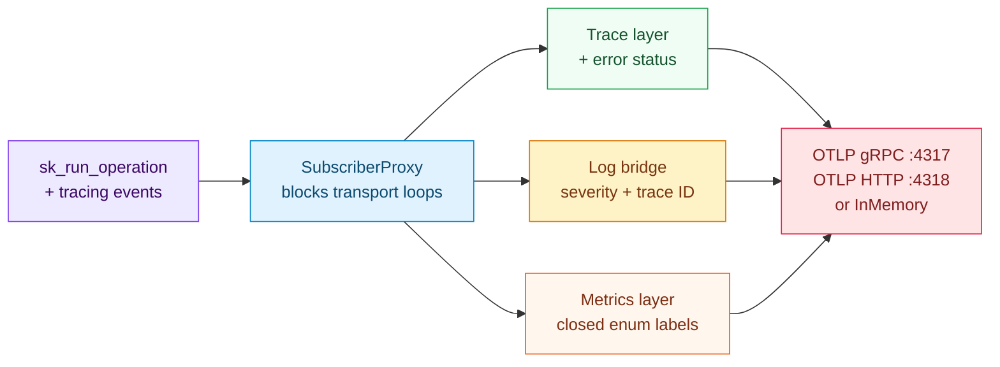
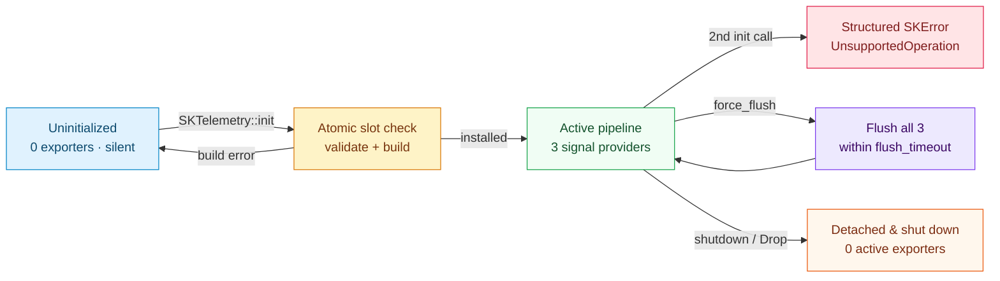

# OpenTelemetry export: three signals, bounded cardinality and an honest lifecycle

## 1. The problem we were solving

Back in [Chapter 4](./ch04-execution-and-observability.html), `sciencekit_common` taught every public estimator operation — `fit`, `partial_fit`, `fit_transform`, `transform`, `predict`, `fit_predict` and `score` — to open a structured `tracing` span (`sciencekit.operation`) through `sk_run_operation`. Each span records its `operation`, `rows`, `columns`, `mode`, `backend`, `fallback_reason`, `duration_ms` and, when something goes wrong, `error`.

Emitting spans in library code is only half of production observability. The moment a team deploys a training worker or an online scoring service, five practical questions appear immediately:

1. **Where do logs and metrics go?** Operators rarely debug latency spikes from distributed traces alone. They want aggregated p95 latency and error-rate **metrics** on dashboards, correlated **structured logs** when a numerical guard or GPU host fallback fires, and **traces** for slow requests — all tagged with the same `service.name`, `service.version` and `deployment.environment.name`.
2. **How do we keep algorithm crates lightweight?** `sciencekit_preprocessing` or `sciencekit_linear_model` must never compile `tonic`, `hyper`, `reqwest` or an OpenTelemetry SDK just to center a matrix.
3. **How do we guarantee silence by default?** A library that opens background threads or attempts network connections to `localhost:4317` when imported into a unit test or CLI script is broken by design.
4. **How do we prevent metric cardinality explosions?** In OpenTelemetry and Prometheus, every distinct combination of metric label values allocates a separate time series. Letting arbitrary strings leak into metric labels turns user identifiers into memory leaks.
5. **How does a short-lived batch training job exit without losing its last spans?** Batch processors buffer data in memory; without deterministic `force_flush` and `shutdown` (plus a `Drop` safety net), a process that finishes `fit` and exits `main` drops the very telemetry that explained the run.

`crates/sciencekit_telemetry` solves all five problems in a dedicated opt-in sub-crate. Algorithm crates keep calling `sk_run_operation` from `sciencekit_common` with zero SDK dependencies; applications that want OpenTelemetry build a validated `SKTelemetryConfiguration` and call `SKTelemetry::init` once at startup.

---

## 2. The idea in two pictures

### Three-signal pipeline architecture



### Process-wide lifecycle state machine



---

## 3. The decisions — and the roads not taken

| Decision | Why we chose it | Alternatives we discarded |
|---|---|---|
| **Isolate the OpenTelemetry SDK and OTLP exporters in `sciencekit_telemetry`** | Every estimator crate continues to depend only on `sciencekit_common` and `tracing`. Applications that never export OTLP pay zero compile-time or binary-size cost for `opentelemetry_sdk`, `tonic` or `reqwest`. | Putting OTLP exporters inside `sciencekit_common` — bloats the foundation crate at the root of the entire workspace dependency graph. |
| **Derive traces, logs and metrics from the existing `tracing` instrumentation** | Estimators already emit `sciencekit.operation` spans and structured `tracing` events without knowing which subscriber is listening. Bridging all three signals in subscriber layers preserves the span contract unchanged. | Sprinkling direct `opentelemetry::global::meter()` calls inside every algorithm — duplicates instrumentation and couples math kernels to telemetry APIs. |
| **Enrich span `Status::Error` inside a `SpanExporter` wrapper (`SKOperationSpanExporter`)** | `SKOperationObservation::record_error` records the `error` string field on a failed span without mutating `tracing_opentelemetry` internals. Inspecting finished `SpanData` right before export promotes any non-empty `error` attribute into `Status::Error { description }` cleanly. | Changing `sciencekit_common` span field names to `otel.status_code` — violates the non-goal of keeping the existing span field contract stable. |
| **Canonicalize metric labels to closed `&'static str` vocabularies** | Mapping `operation`, `backend` and `mode` onto the closed `SKOperationKind`, `SKBackendKind` and `SKExecutionMode` sets (with `"unknown"` fallback) caps total time-series cardinality by construction and avoids per-span `String` allocations on `on_close`. | Forwarding raw span string fields into `KeyValue` metric attributes — risks unbounded cardinality if caller code emits custom spans. |
| **Install a swappable `SubscriberProxy` behind `OnceLock<Arc<SKGlobalTelemetrySubscriber>>`** | `tracing::subscriber::set_global_default` can only succeed once per OS process. Delegating through an `RwLock<Option<Arc<dyn Subscriber + Send + Sync>>>` lets `shutdown()` and `Drop` detach the active pipeline cleanly and rebuild `tracing`'s callsite interest cache so post-shutdown operations become silent again. | Installing the concrete `Registry` directly as the global default — makes `shutdown` unable to detach the subscriber layers for the remainder of the process. |
| **Gate network transports behind off-by-default `otlp-grpc` and `otlp-http` Cargo features** | In-memory pipelines (`SKTelemetryPipeline::from_exporters` and `SKTelemetry::init_with_exporters`) work with default features for deterministic tests, while network clients compile only when `otlp-grpc`, `otlp-http` or the umbrella `telemetry` feature is requested. | Enabling gRPC/HTTP clients in `default` features — pulls TLS/HTTP/protobuf stacks into builds that only want local or custom exporters. |

---

## 4. The concepts, taught from zero

### 4.1 One instrumentation seam, three signals

When an estimator runs `scaler.fit(&matrix)`, `sk_run_operation` opens a `tracing` span named `"sciencekit.operation"` with structured fields (`operation = "fit"`, `rows = 4`, `columns = 2`, `mode = "InProcessSynchronous"`, `backend = "faer"`). Inside that span, code may emit structured events such as `tracing::warn!(fallback_reason = "no_enumerated_device", "falling back to host backend")`. When the closure finishes, `SKOperationObservation` records `error` (if `Err`) and `duration_ms`, then drops the span.

`SKTelemetryPipeline` attaches three independent `tracing_subscriber::Layer` implementations to a single `Registry`:

1. **Traces (`sk_build_trace_layer`)**: `tracing_opentelemetry` converts each span enter/exit into an OpenTelemetry `SpanData` exported through `BatchSpanProcessor` and `SKOperationSpanExporter`, preserving attributes and promoting recorded `error` messages into OpenTelemetry's `Status::Error`.
2. **Logs (`sk_build_log_layer`)**: `OpenTelemetryTracingBridge` converts each `tracing::Event` (`info!`, `warn!`, `error!`, ...) into an OpenTelemetry `LogRecord` with matching `Severity`, target, body message, structured key-value attributes, and — whenever emitted inside an active span — the enclosing span's `TraceId` and `SpanId`.
3. **Metrics (`SKTelemetryMetricsLayer`)**: a custom `Layer` stores an `OperationSpanState` in the span's extensions on `on_new_span`, updates recorded fields on `on_record` / `on_event`, and on `on_close` records five OpenTelemetry instruments:
   - `sciencekit.operation.duration` (`f64` histogram, unit `"ms"`)
   - `sciencekit.operation.count` (`u64` counter, unit `"{operation}"`)
   - `sciencekit.operation.rows` (`u64` histogram, unit `"{row}"`)
   - `sciencekit.operation.columns` (`u64` histogram, unit `"{column}"`)
   - `sciencekit.operation.errors` (`u64` counter, unit `"{error}"`, incremented only when the operation failed)

### 4.2 Bounding metric cardinality mathematically

Unlike traces and logs, metric backends maintain an in-memory aggregation slot per unique tuple of attribute values. `SKTelemetryMetricsLayer` restricts every observation's three labels to closed sets:

- `operation`: $7$ `SKOperationKind` names (`fit`, `partial_fit`, `fit_transform`, `transform`, `predict`, `fit_predict`, `score`) plus `"unknown"` $\Rightarrow 8$ values.
- `backend`: $6$ `SKBackendKind` names (`faer`, `matrixmultiply`, `ndarray-linalg`, `opencl`, `cuda`, `rocm`) plus `"unknown"` $\Rightarrow 7$ values.
- `mode`: $5$ `SKExecutionMode` names (`Automatic`, `InProcessSynchronous`, `InProcessAsynchronous`, `OutOfCoreStreaming`, `OutOfCoreMemoryMapped`) plus `"unknown"` $\Rightarrow 6$ values.

Even in the worst case where every combination is exercised in one process, the number of distinct attribute series per instrument is strictly bounded by:

$$N_{\text{series}} \le 8 \times 7 \times 6 = 336$$

Row counts, column counts and elapsed milliseconds are recorded as **histogram values**, never as attribute labels, and arbitrary caller strings outside those closed enums collapse deterministically to `"unknown"`.

### 4.3 Breaking recursive export feedback loops

An OTLP exporter sends batches over `tonic`/`hyper`/`h2` (gRPC) or `reqwest` (HTTP). Those networking crates themselves emit `tracing` spans and events! Without target filtering, exporting one `fit` span would emit HTTP spans, whose export would emit more HTTP spans in an infinite feedback loop.

`sciencekit_telemetry` blocks that loop at two levels:

- `SubscriberProxy` rejects callsites whose target starts with `"opentelemetry"`, `"tonic"`, `"hyper"`, `"h2"` or `"reqwest"` (`Interest::never()`).
- Both `sk_build_trace_layer` and `sk_build_log_layer` attach a `tracing_subscriber::filter::Targets` filter setting those internal transport targets to `LevelFilter::OFF` so standalone `SKTelemetryPipeline::layer()` compositions enjoy the exact same protection.

### 4.4 Deterministic flushing and `flush_timeout`

OpenTelemetry's `BatchSpanProcessor`, `BatchLogProcessor` and `PeriodicReader` run background worker channels whose built-in `force_flush` waits use fixed multi-second internal defaults and can reject overlapping control messages when called concurrently from several worker threads.

`sciencekit_telemetry` hardens both edges:

- `SKTelemetry::force_flush` serializes concurrent callers on an internal `Mutex<()>` (recovering cleanly from poisoning) and rejects calls after `shutdown`.
- `SKTelemetryPipeline::force_flush` executes the three provider flushes behind a bounded channel receive (`recv_timeout(configuration.flush_timeout())`), guaranteeing `force_flush` either hands pending signals to the exporters or returns a structured timeout error within `flush_timeout`.

---

## 5. Each public object, explained

All public items live in `sciencekit_telemetry` and follow PRD §3.4 (`SK` prefix on types, `sk_`/`SK_` on free functions and constants, full English words without abbreviations, pure-dispatcher `mod.rs` files, and every source file at or under 200 lines):

- **`SKTelemetryTransport`**: wire protocol enum with variants `Grpc` (default, standard endpoint `"http://localhost:4317"`) and `Http` (OTLP/HTTP binary protobuf over `/v1/traces`, `/v1/logs`, `/v1/metrics`, standard endpoint `"http://localhost:4318"`).
- **`SKTelemetrySampler`**: trace sampling policy enum with `AlwaysOn` (default), `AlwaysOff`, `TraceIdRatioBased(f64)` and `ParentBased(f64)`. Validates that ratios are finite and lie in $[0.0, 1.0]$.
- **`SKTelemetryResource`**: validated OpenTelemetry resource metadata holding required `service.name`, optional `service.version`, optional `deployment.environment.name`, and deterministic `BTreeMap<String, String>` custom attributes, convertible via `to_sdk_resource()`.
- **`SKTelemetryBatchConfiguration` & `SKTelemetryBatchConfigurationBuilder`**: builder-validated batching configuration (`maximum_queue_size`, `maximum_export_batch_size`, `scheduled_delay`, `export_timeout`, `periodic_metric_interval`, plus uniform `backend` and `execution_mode`). Enforces $1 \le \text{maximum\_export\_batch\_size} \le \text{maximum\_queue\_size}$ and strictly positive durations.
- **`SKTelemetryConfiguration` & `SKTelemetryConfigurationBuilder`**: main builder implementing `SKBuilder<SKTelemetryConfiguration>`, configuring service identity, resource attributes, `endpoint`, `transport`, `header` / `headers`, `timeout` (default `10s`), `flush_timeout` (default `5s`), `sampler`, `batch`, `backend` (default `Faer`) and `execution_mode` (default `Automatic`).
- **`SKTelemetryPipeline`**: owns `SdkTracerProvider`, `SdkLoggerProvider` and `SdkMeterProvider` built from one `SKTelemetryConfiguration`. Exposes `from_exporters`, `layer`, `subscriber`, `force_flush` and `shutdown`, alongside lower-level builders (`sk_build_tracer_provider`, `sk_build_trace_layer`, `sk_build_logger_provider`, `sk_build_log_layer`, `sk_build_meter_provider`, `sk_build_metrics_layer`, `SKTelemetryMetricsLayer`, and `sk_build_otlp_pipeline`) and metric name constants (`SK_METRIC_OPERATION_DURATION`, `SK_METRIC_OPERATION_COUNT`, `SK_METRIC_OPERATION_ROWS`, `SK_METRIC_OPERATION_COLUMNS`, `SK_METRIC_OPERATION_ERRORS`).
- **`SKTelemetry`**: process-wide lifecycle guard returned by `SKTelemetry::init(configuration)` or `SKTelemetry::init_with_exporters(...)`. Exposes `is_initialized()`, `active_exporter_count()`, `is_shut_down()`, `configuration()`, `force_flush(&self)` and `shutdown(self)`, plus a `Drop` implementation that detaches the global subscriber and shuts down all three providers if the caller drops the guard without calling `shutdown` explicitly.

<div class="sk-window">
  <div class="sk-window__bar">
    <span class="sk-window__dot sk-window__dot--r"></span>
    <span class="sk-window__dot sk-window__dot--y"></span>
    <span class="sk-window__dot sk-window__dot--g"></span>
    <span class="sk-window__title">startup_telemetry.rs</span>
  </div>

```rust,ignore
use std::time::Duration;
use sciencekit_common::SKBuilder;
use sciencekit_telemetry::{
    SKTelemetry, SKTelemetryConfiguration, SKTelemetrySampler, SKTelemetryTransport,
};

let configuration = SKTelemetryConfiguration::builder()
    .service_name("sciencekit-scoring-api")
    .service_version(env!("CARGO_PKG_VERSION"))
    .deployment_environment("production")
    .endpoint("http://localhost:4317")
    .transport(SKTelemetryTransport::Grpc)
    .header("x-api-key", "collector-token")
    .timeout(Duration::from_secs(5))
    .flush_timeout(Duration::from_secs(3))
    .sampler(SKTelemetrySampler::ParentBased(0.1))
    .build()?;

let telemetry = SKTelemetry::init(configuration)?;
// ... run estimators normally (fit, transform, predict, score) ...
telemetry.force_flush()?;
telemetry.shutdown()?;
```

</div>

---

## 6. Validation & error contract

Every invalid configuration or lifecycle misuse fails deterministically with a structured `SKError` — never a panic:

| Failure condition | Returned `SKError` |
|---|---|
| Missing or blank `service_name` | `SKError::InvalidHyperparameter { name: "service_name", .. }` |
| Blank `service_version`, `deployment_environment` or resource attribute key | `SKError::InvalidHyperparameter` |
| Endpoint missing `http://` / `https://`, containing whitespace/control bytes, missing host, unclosed IPv6 bracket, or port outside `1..=65535` | `SKError::InvalidHyperparameter { name: "endpoint", .. }` |
| Non-token ASCII header name or header value containing `\r`, `\n` or NUL | `SKError::InvalidHyperparameter { name: "headers", .. }` |
| Zero `timeout`, `flush_timeout`, `scheduled_delay`, `export_timeout` or `periodic_metric_interval` | `SKError::InvalidHyperparameter` |
| Non-finite sampler ratio or ratio outside $[0.0, 1.0]$ | `SKError::InvalidHyperparameter { name: "sampler", .. }` |
| `maximum_queue_size == 0` or `maximum_export_batch_size` outside `1..=maximum_queue_size` | `SKError::InvalidHyperparameter` |
| Calling `SKTelemetry::init` when the transport feature (`otlp-grpc` / `otlp-http`) is disabled, when a global subscriber is already installed externally, or a second time in the same process | `SKError::UnsupportedOperation { operation: "telemetry_init", .. }` |
| Calling `force_flush` after `shutdown`, or when an exporter exceeds `flush_timeout` | `SKError::UnsupportedOperation { operation: "telemetry_force_flush", .. }` |

---

## 7. Walking through the companion tests

The test suites sit right next to their implementation modules under `crates/sciencekit_telemetry/src/` and test every requirement using deterministic `InMemorySpanExporter`, `InMemoryLogExporter`, `InMemoryMetricExporter` and custom probe exporters:

- **Configuration & validation (`configuration/configuration_tests.rs`, `configuration/validation_tests.rs`)**:
  - `transport_defaults_to_grpc_and_exposes_standard_endpoints`, `resource_projects_service_identity_and_custom_attributes_into_sdk_resource`, `sampler_validates_ratios_and_builds_sdk_samplers` and `configuration_builder_constructs_complete_configuration_with_defaults_and_overrides` verify defaults, `Resource` key-value projection, sampling ratios and full builder overrides.
  - `configuration_builder_rejects_missing_or_blank_service_name`, `configuration_builder_rejects_malformed_endpoints` and `configuration_builder_rejects_invalid_headers_timeouts_samplers_and_batch_bounds` exercise missing names, malformed schemes/ports/whitespace/IPv6 brackets, CRLF header injection, zero timeouts, out-of-range ratios and inverted batch bounds.
- **Trace, log & metric bridges (`pipeline/traces_tests.rs`, `pipeline/logs_tests.rs`, `pipeline/metrics_tests.rs`, `pipeline/metrics_cardinality_tests.rs`, `pipeline/pipeline_tests.rs`)**:
  - `fit_operation_exports_span_with_rows_columns_backend_and_execution_mode` runs a real `SKStandardScaler::fit` and verifies the exported `sciencekit.operation` span carries `operation = "fit"`, `rows = "4"`, `columns = "2"`, `backend = "matrixmultiply"`, `mode = "InProcessSynchronous"` and `duration_ms`.
  - `failed_operation_exports_span_with_error_status_and_message` runs a failing `Transform` operation and confirms `Status::Error` carries the shape-mismatch description.
  - `structured_tracing_events_export_with_matching_severity_target_body_and_fields` and `structured_event_inside_operation_span_preserves_both_span_and_log_records` verify `Severity::Info` / `Warn` / `Error`, structured attributes and active span trace-context correlation.
  - `completed_operations_export_duration_count_rows_and_columns_metrics_with_labels`, `failed_operation_increments_error_counter_labelled_by_operation_and_backend` and `metrics_layer_bounds_label_cardinality_to_closed_vocabulary` verify all five instruments, error counting and `"unknown"` canonicalization for arbitrary caller strings.
  - `configured_resource_attributes_propagate_to_traces_logs_and_metrics` and `sampler_and_batch_settings_govern_exported_spans_and_batches` prove identical resource metadata reaches all three exporters and verify `AlwaysOff` vs `ParentBased(1.0)` batching.
- **Silent default, lifecycle & concurrency (`lifecycle/noop_tests.rs`, `lifecycle/lifecycle_tests.rs`, `lifecycle/flush_timeout_tests.rs`, `lifecycle/concurrency_tests.rs`, `acceptance_tests.rs`)**:
  - `uninitialized_default_creates_no_exporter_and_produces_no_network_traffic` binds a non-blocking loopback `TcpListener`, builds a configuration pointing at that port *without* calling `init`, runs `SKStandardScaler::fit` + `transform`, and proves `active_exporter_count() == 0` and `accept()` returns `ErrorKind::WouldBlock`. `default_feature_set_compiles_out_otlp_network_exporters` verifies OTLP transports are absent unless enabled.
  - `force_flush_exports_pending_signals_and_shutdown_stops_further_exports`, `double_initialization_returns_structured_error_without_replacing_pipeline`, `dropping_telemetry_guard_flushes_pending_signals_and_detaches_safely` and `force_flush_times_out_promptly_when_exporter_exceeds_configured_flush_timeout` verify every lifecycle transition, including a `StallingSpanExporter` timing out cleanly at `30ms`.
  - `concurrent_initialization_race_elects_single_winner_and_rejects_others` synchronizes 8 threads on a `Barrier` racing `init_with_exporters`, asserting 1 winner and 7 structured rejections. `concurrent_small_and_large_operations_export_consistent_spans_logs_and_metrics` runs 6 threads across small (`8 × 4`) and larger (`1024 × 4`) matrices, fitting `SKStandardScaler`, exporting `SKModelState`, computing `sk_mean_squared_error` and calling `force_flush` concurrently.
  - `dense_and_sparse_csr_operations_export_matching_telemetry_signals` and `otlp_grpc_and_http_pipelines_construct_and_shut_down_cleanly` verify dense/CSR parity without densification and exercise real OTLP gRPC and HTTP exporter construction under `--features telemetry`.
