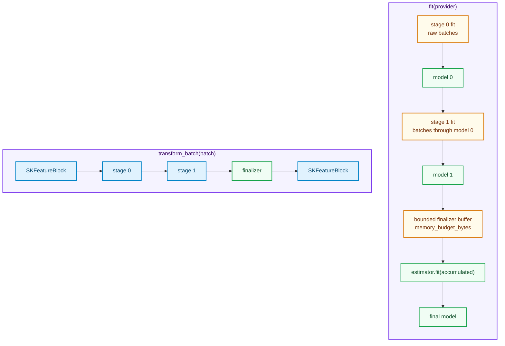

# Streaming pipelines: epochs, chained stages and a bounded finalizer

Every pipeline chapter so far assumed the data fits in memory. Chapter 24 built `SKPipeline`, a
conveyor belt whose stages receive an owned `SKFeatureBlock`; chapter 43 added a fan-out and
chapter 52 turned the belt into a runtime DAG. All of them still take the **whole** matrix as an
argument: `fit(&features, labels)` borrows one `Array2`. The PRD's out-of-core promise needs the
other shape: a transformer that learns from a **stream** of batches, never holding more than one
batch at a time, and a pipeline that applies the learned stages to one batch at a time.

This chapter tells the story of `sciencekit_pipeline::streaming` (capability
`streaming-pipeline`): the `SKStreamingTransformer` contract, the `SKStreamingPipeline` builder,
chained fitting through the shared prefetch executor, one-shot materialization, multi-epoch
replay, the bounded batch finalizer and the error surface. It is the first pipeline layer whose
input is a **provider** rather than a matrix.

---

## 1. The problem, in plain words

Imagine a warehouse too large to empty onto a single table. You can still describe a procedure —
"weigh each box, subtract the average weight, scale by two" — and run it box by box. Two things
are hard:

1. **Learning the numbers.** "The average weight" is not known until every box has passed. A
   streaming transformer must therefore make a pass over the source, accumulate just enough state
   (sums, counts), and only then freeze a model.
2. **Reusing the procedure.** Once the average is known, every new box is transformed in isolation.
   The pipeline must keep every stage's learned model and run them in order, without ever
   concatenating the stream.

The existing `sciencekit_common` machinery already supplies the hard I/O parts: an
`SKLazySource<F>` yields `SKDataBatch<F>` values, an `SKSourceProvider<F>` opens one source per
pass (or exactly one when it is a one-shot `&mut Source`), and `sk_run_streaming_provider` runs the
prefetch driver with a pass policy. The streaming pipeline is the composition layer on top.


---

## 2. The decisions, and the roads not taken

| Decision | Why we chose it | Alternatives we discarded |
|---|---|---|
| **A dedicated `SKStreamingTransformer<F>` contract** | The batch pipeline's `SKPipelineTransformer` fits on one block. A streaming stage must fit from a *source* and transform a *batch*; modelling that separately keeps both contracts honest instead of overloading one. | Making every `SKPipelineTransformer` accept a stream (breaks the batch contract); a single mega-trait with both fit forms. |
| **Fit returns a model that owns only learned state** | The driver hands owned batches to an update closure. If the model retained batches, memory would grow with the stream. Storing the running mean of a stage is legitimate; storing the data is not. | Keeping the source in the model (self-referential lifetimes, unbounded memory). |
| **Chained fit by wrapping the provider** | Stage `i` is fitted over a provider that opens the upstream source and pushes every batch through the already-fitted stages `0..i`. No second I/O loop and no intermediate materialization for reopenable providers. | Fitting each stage on a separately materialized copy of the whole dataset (defeats streaming); a bespoke multi-stage driver (duplicates the executor). |
| **Erase stages behind an object-safe adapter** | A `Vec` of heterogeneous transformers whose models differ cannot be spelled without boxing. A private `SKStreamingStage`/`SKFittedStage` pair erases the stage while the public contract stays generic and statically typed. | A giant generic tuple like `SKPipeline` (the streaming builder is runtime-sized, so the type would grow with the stage count); `dyn` on the public trait (its generic provider method is not object-safe). |
| **One-shot providers are materialized within a budget** | A `&mut Source` cannot be reopened for each stage. Reading it once into memory — bounded by `memory_budget_bytes` — gives the one-shot user the full chain, and a structured `BatchBufferOversize` error when it does not fit. | Refusing every one-shot chain (the spec allows materialization); silently densifying or truncating (dishonest). |
| **Multi-epoch replay only for reopenable providers** | Epochs mean *replaying the source*. A one-shot provider has nothing to replay, so `epochs > 1` is a structured `UnsupportedOperation` naming the reopenable requirement instead of a silent clamp. | Clamping to one epoch (hides a configuration error); caching the whole source for replay (unbounded, and not a stream). |
| **A batch finalizer with an explicit byte budget** | Existing estimators expose `fit(&features)`, not `partial_fit`, so the finalizer needs the transformed data resident. The buffer charges every block against the budget and concatenates once, preserving CSR when every block is sparse. | Pretending every estimator streams (unsupported); an unbounded `Vec` (OOM). |
| **Structured errors, stage index included** | A source failure stops the pipeline with the central taxonomy error. A stage failure is wrapped with its zero-based index so the caller knows *which* station rejected the batch. | Panicking (forbidden); losing the index (unactionable). |
| **`backend` and `execution_mode` on the builder** | Repository-wide rule: every public operation records the configured backend (default `Faer`) and execution intent (default `Automatic`) in its span. | Hardcoding `Faer`; inferring a backend per stage. |

The finalizer is deliberately the **first** version: a true out-of-core finalizer built on
`partial_fit`, `memmap2`-backed batches, streaming DAGs, GPU execution and model export are
explicit non-goals of this change and remain future work.

---

## 3. The concepts, taught from zero

### Batches, sources, providers

A **batch** (`SKDataBatch<F>`) is an owned feature block plus a position and a final marker. A
**source** (`SKLazySource<F>`) yields batches one at a time and can fail. A **provider**
(`SKSourceProvider<F>`) opens a source for one pass; a concrete `&mut Source` is a one-shot
provider, while `SKReopenableSource` wraps a factory and opens a fresh source per pass. The
pipeline's `fit` takes a provider, so the same code spans both worlds.

### The transformer contract

```rust
pub trait SKStreamingTransformer<F: SKFloat> {
    type Model;
    type Error: From<SKError>;

    fn fit_streaming<S: SKSourceProvider<F>>(
        &self,
        source: &mut S,
        epochs: usize,
    ) -> Result<Self::Model, Self::Error>;

    fn transform_batch(
        &self,
        model: &Self::Model,
        batch: &SKFeatureBlock<F>,
    ) -> Result<SKFeatureBlock<F>, Self::Error>;
}
```

`fit_streaming` drives `sk_run_streaming_provider` with an `SKStreamingPassPolicy::Iterative`
policy carrying the epoch budget; the executor enforces the pass count. `transform_batch` borrows
the model and one batch. A stage that accepts CSR must return CSR — the pipeline never densifies
on its behalf.

### The builder and the fitted pipeline

`SKStreamingPipeline::start::<F>()` opens `SKStreamingPipelineBuilder<F>`. `then(stage)` appends a
stage, `backend`, `execution_mode`, `epochs` and `memory_budget_bytes` configure the run, and
`finalize_estimator(estimator)` validates the accumulated configuration (at least one stage,
`epochs >= 1`, a non-zero budget) before returning `SKStreamingPipelineConfigured<F, Estimator>`.
Its `fit(provider)` returns `SKFittedStreamingPipeline<F, Estimator::Model>`, whose
`transform_batch(&batch)` runs the fitted stages and the finalizer, and whose `report()` exposes
the run's metrics.



### Epochs and passes

An epoch is a full pass over the source by one stage's `fit_streaming`. With `n` stages and `e`
epochs, a reopenable provider is opened `n × e` times for fitting plus once for the finalizer
accumulation. A one-shot provider can be read only once: the pipeline materializes it (within the
budget), then all stages and the finalizer read the materialized blocks. `epochs > 1` on a one-shot
provider is rejected because the data cannot be replayed.

### The bounded finalizer

`SKFinalizerBuffer` stores the transformed blocks, charging each block's `byte_size()` against
`memory_budget_bytes` **before** storing it. Exceeding the budget returns
`SKError::BatchBufferOversize` with the block size, the required total and the available budget.
At the end it concatenates the blocks: all dense uses `ndarray::concatenate`, all sparse rebuilds
one CSR matrix from the per-row entries, and a mixed set densifies only at this explicit
materialization point. The estimator then fits on the concatenated block, and the fitted model is
exposed through `final_model()`.

### Errors and concurrency

A read failure propagates from the executor as the central `SKError`. A stage that rejects a batch
is wrapped by `sk_stage_failure(index, error)` into `SKError::Conversion` whose message names the
stage index and preserves the cause. Fitted pipelines are `Send + Sync` because every stage model
and the finalizer model are, so concurrent `transform_batch` calls are safe and deterministic.

---

## 4. Walking through the real tests

The companion tests are the executable specification. They live beside the implementation as
`*_tests.rs` modules.

**Construction and validation** — `builder_tests.rs`: `an_empty_streaming_pipeline_is_rejected`,
`zero_epochs_are_rejected` and `a_zero_memory_budget_is_rejected` pin the
`InvalidHyperparameter` surface; `a_valid_pipeline_is_configured_with_the_default_backend` fits a
real one-stage pipeline and checks the default `Faer` backend and the fit report.

**The transformer contract** — `transformer_tests.rs` uses the test fixture
`SKTestMeanCentering`, which learns column means through `sk_run_streaming_provider`.
`a_streaming_fit_reads_the_source_and_centers_batches` checks the hand-computed means of the
3×2×2 fixture; `one_pass_and_two_epochs_learn_the_same_mean` shows that replaying the source
leaves the mean unchanged (the extra pass adds the same data twice, so the ratio is identical);
`a_transformed_batch_keeps_its_row_count` pins the row-count invariant.

**Chained fitting** — `fit_tests.rs::the_second_stage_is_fitted_on_the_first_stage_output` composes
`SKTestColumnScaling(2.0)` and `SKTestMeanCentering`. If the second stage saw raw data, its means
would be 6 and 7; it sees doubled data, learns 12 and 14, and the batch `[1,2;3,4]` becomes
`[-10,-10;-6,-6]`. `a_two_stage_fit_reads_one_pass_per_stage_plus_the_finalizer` checks the report
(stage count, batches, rows).

**One-shot providers** — `oneshot_tests.rs` covers the four cases: a single stage fits
(`a_one_shot_provider_fits_a_single_stage`), a chain materializes within the budget
(`a_one_shot_provider_materializes_within_the_budget_for_a_chain` asserts 96 resident bytes for
three 2×2 `f64` blocks), multiple epochs are rejected
(`a_one_shot_provider_rejects_multiple_epochs`), and an over-budget materialization returns
`BatchBufferOversize` (`a_one_shot_provider_over_budget_returns_a_structured_error`).

**Epochs** — `epochs_tests.rs::a_reopenable_provider_replays_every_configured_epoch` checks the
reported epoch count, and `the_epoch_count_does_not_multiply_the_finalizer_rows` proves the
finalizer takes exactly one accumulation pass even when stages replay four epochs.

**Transform parity** — `transform_tests.rs` compares the streaming pipeline against the equivalent
batch path built from the same transformers:
`streaming_transform_equals_the_equivalent_batch_transform` and
`streaming_transform_matches_on_unseen_rows` assert identical dense outputs.

**Representation parity** — `representation_tests.rs::a_sparse_batch_stays_csr_and_is_not_densified`
sends a two-entry CSR batch through `SKTestColumnScaling` and asserts the result is still CSR with
two stored entries, doubled; `a_dense_batch_stays_dense` covers the dense side.

**The finalizer budget** — `finalizer_tests.rs::the_finalizer_fits_within_a_sufficient_budget` uses
exactly 96 bytes and succeeds; `the_finalizer_rejects_an_accumulation_over_the_budget` uses 95 and
matches the `BatchBufferOversize { batch_bytes: 32, required_bytes: 96, available_bytes: 95 }`
fields.

**Error propagation** — `errors_tests.rs::a_mid_stream_source_failure_surfaces_the_central_error`
uses a source that fails at the second batch; `a_stage_failure_names_the_stage_index` transforms a
sparse batch through a chain whose second stage rejects it and asserts the message contains
`stage 1` and `sparse`.

**Determinism and concurrency** — `concurrency_tests.rs` asserts that two independent fits produce
identical output (`fitting_the_same_stream_twice_produces_identical_output`), that the fitted type
is `Send + Sync` (`the_fitted_pipeline_is_send_and_sync`), and that eight threads transforming the
same batch agree with the sequential result
(`concurrent_transform_agrees_with_the_sequential_result`).

**Acceptance** — `streaming/acceptance_streaming_tests.rs` covers a tiny stream and a produced
metric (`a_tiny_stream_produces_a_centered_metric_near_zero` checks every column mean is zero), a
large stream that never materializes (`a_large_stream_fits_without_materializing_the_source`,
1 000 blocks), sparse flow, and an enforced finalizer budget on a large stream. The crate-level
`acceptance_tests/streaming_pipeline_tests.rs` repeats the tiny, large and one-shot acceptance
paths from outside the module.

---

## 5. What this chapter leaves for later

The streaming pipeline is the composition seam, not the end of out-of-core. A `partial_fit`
finalizer that consumes transformed batches without materializing them, memory-mapped batches
(`memmap2`, Wave 7), streaming DAGs, GPU execution and model export are separate changes. What
exists now is deliberately small and honest: every stage learns from a stream, every batch is
transformed in isolation, every materialization is bounded and every failure is structured.

---

## 6. Where to read the code

| Object | File |
|---|---|
| `SKStreamingTransformer` | `crates/sciencekit_pipeline/src/streaming/transformer.rs` |
| `SKStreamingPipeline`, `SKStreamingPipelineBuilder` | `crates/sciencekit_pipeline/src/streaming/builder.rs` |
| `SKStreamingPipelineConfigured` (chained fit) | `crates/sciencekit_pipeline/src/streaming/pipeline/configured.rs` |
| `SKFittedStreamingPipeline` (transform) | `crates/sciencekit_pipeline/src/streaming/pipeline/fitted.rs` |
| `SKStreamingFitReport` | `crates/sciencekit_pipeline/src/streaming/pipeline/report.rs` |
| `SKFinalizerBuffer` | `crates/sciencekit_pipeline/src/streaming/finalizer.rs` |
| Materialization and stage application | `crates/sciencekit_pipeline/src/streaming/fitting.rs` |
| Object-safe stage and provider adapters | `crates/sciencekit_pipeline/src/streaming/stage.rs`, `provider.rs` |
| Error constructors | `crates/sciencekit_pipeline/src/streaming/errors.rs` |
